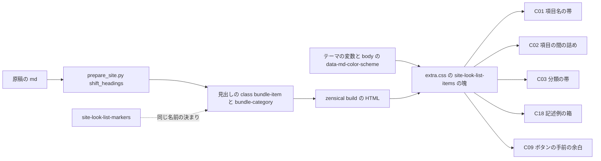
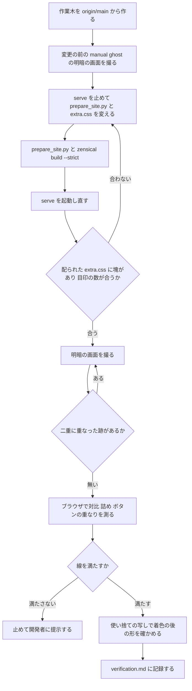

# Design Document: site-look-list-items

## Overview
**Purpose**: UKADOC のまとめ頁（`descript/`・`list/`・`spec/` の 20 頁）で仕様を引くゴースト制作者に、項目の始まり・分類の始まり・記述例をひと目で見分けられる見え方を届ける。`site-look-plan` で「採る」と決まった C01（項目名の帯）・C02（項目の間の詰め）・C03（分類の見出しの帯）・C09（コピーのボタンの手前で折り返す）・C18（記述例の箱）を、本番の書き方で ukadoc-spec に入れる。
**Users**: まとめ頁で仕様を引くゴースト制作者（明・暗の表示、幅 375 の狭い画面を含む）。読み物の頁（`manual/`・`dev/`・`memo/`・`spec/` の 1 ファイルの頁・トップ）の見え方は、コードブロックの右の余白（C09）と、`h4` の直後のコードブロック（C18）のほかは変えない。
**Impact**: ukadoc-spec の `scripts/prepare_site.py` の `shift_headings()` が、まとめた頁の分類と項目の頭の見出しに役の class（`bundle-category`・`bundle-item`）を付ける。`assets/extra.css` の末尾に、その class と、`h4` の直後のコードブロックと、すべてのコードブロックに当てる見た目の指定の塊を 6 つ足す。原稿・設定は変えない。

項目と分類は、見出しの段（`h2`・`h3`・`h4`）でなく、`prepare_site.py` が知っている組み立ての役で決める（要件の議論の決定。ギャップ分析の案 B）。役の印は見出しの class だけで、見出しの id・¶・右の欄の目次は変わらない（使い捨ての写しで確かめた。`research.md` の「設計の調査」）。

### Goals
- まとめ頁の項目 1875 個に項目名の帯、分類 116 個（分類の中の分類 5 個を含む）に分類の帯を付け、注意書きの節 16 個と読み物の頁には付けない
- `descript/ghost` の `#charset` から幅 1000・高さ 700 の画面に 4 項目を入れる
- 記述例の見出し 289 個（`h4` の直後にコードブロックが続くもの）と、続くコードブロック（2 つ目以降 36 個）を 1 つの箱に見せ、それ以外のコードブロックは今のままにする
- すべてのコードブロックで、見える字をコピーのボタンの下に重ねない（今は `list/sakura-script` の 288 個のうち 165 個が重なる）
- 帯・箱の字とリンクを明・暗とも線の上に置き、暗い表示だけの色は画面だけに当てる

### Non-Goals
- 注意書きの箱・対応の札・既定値の札（`site-look-list-markers`）、さくらスクリプトのタグの色（`site-look-sakura-script-highlight`）、`manual/` のファイル名の帯（`site-look-manual-files`）、C08
- テーマの色・暗い表示のリンクの色そのもの（`site-look-dark-link-color`）、`mkdocs.yml`・原稿・`.nav.yml`・`requirements.txt`・Zensical の版
- 測りの道具の新設（`shot.mjs` は読むだけで使う）
- 5 つ以上続くコードブロックの箱（今は最大 4 つ。「前提と OPEN QUESTION」の 5）

## Boundary Commitments

### This Spec Owns
- `scripts/prepare_site.py` の、まとめた頁の単位の頭の見出しに役の class を付ける処理（`shift_headings()` の 1 か所と、その呼び出しの引数）と、class の名前 `bundle-item`・`bundle-category`（目印の名前の決まり `bundle-<役>` を含む）
- `assets/extra.css` の、見出しのコメント `/* site-look-list-items: … */` で始まる 6 つの塊（項目名の帯・項目の間の詰め・分類の見出しの帯・記述例の箱・濃い帯の中の ¶ と検索の強調・コピーのボタンの手前で折り返す）
- この spec の記録（`.kiro/specs/completed/site-look-list-items/verification.md` と `screenshots/`）: 目印の数・対比・画面の見比べ・失わないものの確かめ

### Out of Boundary
- `extra.css` のほかの塊（紺のテーマ・目次の詰め・記述例の折り返し `pre > code { white-space; word-break }`、PR #10 の `site-look-dark-link-color:` の塊、後続 spec の塊）
- `prepare_site.py` のほかの処理（一覧の検査・id の振り方・見出しの数の検査 `old_ids()`・リンクの書き換え・`hr` の入れ方・生の原稿 `_raw/`）と、注意書きの節の包み（C04。`site-look-list-markers` が足す）
- テーマの色の変数の値、暗い表示のリンク・ホバーの色の変数（`--md-typeset-a-color`・`--md-accent-fg-color`）
- 箱の中のさくらスクリプトのタグの色と、その箱の地の上の対比（`site-look-sakura-script-highlight` が測る）
- 原稿（`.md`）・`.nav.yml`・`mkdocs.yml`・`requirements.txt`・Zensical の版、`site-look-plan` の成果物（目標の画面・試作・`tools/shot.mjs`）

### Allowed Dependencies
- テーマ（Zensical 0.0.67 の classic）の変数 `--md-primary-fg-color`・`--md-primary-fg-color--dark`・`--md-primary-bg-color`・`--md-primary-bg-color--light`・`--md-default-fg-color--lighter`・`--md-default-fg-color--lightest`、`<body>` に付く `data-md-color-scheme`、テーマが暗い表示の色を `@media screen` の中だけで定める作り
- Python-Markdown の `attr_list`（見出しの行の `{#id .cls}`）と `toc`（`mkdocs.yml` の今の設定のまま）
- CSS の `:has()`・`:is()` の中の組み立て（`h4 + .highlight` など）。今の主なブラウザはどれも対応する。対応しないブラウザでは C02 の詰めと C18 の箱が出ず、今の見え方に戻るだけで、読めなくはならない
- 確かめの道具: `zensical serve`、`.kiro/specs/completed/site-look-plan/tools/shot.mjs`（読むだけ）、Claude の内蔵ブラウザの枠の JavaScript

### Revalidation Triggers
- class の名前 `bundle-item`・`bundle-category` か、付ける見出し（単位の頭の見出し・`notes_` を除く）を変えたとき: `site-look-list-markers`（同じ決まりで目印を付ける）・`site-look-manual-files`（C01 の帯の見え方を写す）・`site-look-note-icon` が確かめ直す
- `shift_headings()` の見出しの行の書き方（`{#id}` の括弧）を変えたとき: id・¶・右の欄の目次・`old_ids()` を確かめ直す
- C01 の帯の値（線・地・余白・暗い表示のリンクの色）を変えたとき: `site-look-manual-files` の C22 が同じ値に合わせ直す
- コードブロックの HTML の形を変えたとき（`site-look-sakura-script-highlight` の `pre.highlight > code`）: C09・C18 が両方の形で同じに見えることを確かめ直す（この設計では写しで確かめ済み）。箱の地 `#eef2f8`・`#1d2433` の上のタグの色の対比は、その spec が測る
- 記述例の見出しの後に 5 つ以上のコードブロックが続く原稿が入ったとき、`h4` の項目名の直後にコードブロックが来たとき（今は 0 個）、帯・箱の中に `code` を含むリンクやリンクそのものが入ったとき（今は C01 の帯の 31 個のリンクだけで、どれも `code` を含まない）: 指定と対比を確かめ直す
- テーマの紺・`--md-primary-*`・`--md-default-fg-color--*`・`--md-typeset-mark-color` を上書きしたとき、Zensical の版を上げたとき: 対比と、`:has()` の当て先・コピーのボタン（`.md-code__nav`）の位置を測り直す

## Architecture

### Existing Architecture Analysis
- `prepare_site.py` の `register_bundle()` が単位ごとに id を振り、`shift_headings(text, rel, depth)` が見出しの行を `#### 題 {#id}` に書き直す。単位が分類（`index.md`）か項目か（`is_index`）、深さ（`depth`）、ファイル名（`notes_`）は、呼び出し元 `main()` の `for rel, depth, is_index, text in units` が知っている。単位はどれも 1 行目が原稿の H1 で、`shift_headings()` の最初の見出し（`n == 0`）が単位の頭の見出しになる（全 2027 単位で確かめた）
- 見出しの数の検査 `old_ids()` は、ずらす前の原稿で数えるので、書き直した後の行の class には響かない。リンクの書き換えは `](` の形だけを見るので、見出しの行の class には響かない
- テーマの見た目の指定は `main.*.css` → `palette.*.css` → `assets/extra.css` の順に読む。`extra.css` は最後なので、同じ詳細度でも後の指定が勝つ
- コピーのボタンは、テーマの JavaScript が `pre` の中に置く `nav.md-code__nav`（右上、幅 1.5em のボタン）。今の `pre > code` の右の内側の余白は 16px で、`list/sakura-script` の 288 個のうち 165 個で字がボタンの下に重なる
- `extra.css` の今の型: 塊ごとに見出しのコメントを前に置く。開発者の決まりで、注は塊ごとに `/* <spec名>: <何> */` の短い 1 行にし、説明はこの記録に書く

### Architecture Pattern & Boundary Map
選んだ形は「組み立ての処理が役の印を付け、見た目の指定はその印と HTML の形に当てる」（ギャップ分析の案 B）。



- C01・C02・C03 は役の class に当てる。C02 の詰めは、項目名の帯を 1 つでも持つ頁（`.md-typeset:has(.bundle-item)`）に絞る。読み物の頁には class が付かないので効かない
- C18・C09 は印を使わず、HTML の形（`h4 + .highlight`、`pre > code`）に当てる。`.highlight` と `pre > code` は、今の形（`div.highlight > pre > code`）にも着色の後の形（`pre.highlight > code`）にも当たる
- 暗い表示だけの色は `@media screen` の中に書き、印刷は明るい表示の色にする（PR #10 と同じ）

### Technology Stack

| Layer | Choice / Version | Role in Feature | Notes |
|-------|------------------|-----------------|-------|
| 組み立ての処理 | Python 3.12・`scripts/prepare_site.py` | 単位の頭の見出しに役の class を付ける | 依存は足さない |
| Markdown | Python-Markdown の `attr_list`・`toc`（`mkdocs.yml` のまま） | `{#id .cls}` を `<hN id class>` にする | 設定は変えない |
| 見た目の指定 | CSS（`assets/extra.css`）、`:has()`・`:is()` | 帯・詰め・箱・余白 | 新しい道具は足さない |
| サイト生成 | Zensical 0.0.67（`requirements.txt` のまま） | 頁と `extra.css` の配り | 版は変えない |
| 確かめ | `zensical serve`、`shot.mjs`（Edge ヘッドレス）、内蔵ブラウザの枠の JavaScript | 目印の数・対比・画面 | `shot.mjs` は読むだけ |

## File Structure Plan

### Directory Structure
```
ukadoc-spec（作業木 .worktrees/site-look-visibility/、ブランチ site-look-visibility）
├── scripts/
│   └── prepare_site.py          # shift_headings() で単位の頭の見出しに役の class を付ける（1 か所と呼び出しの引数）
└── assets/
    └── extra.css                # 末尾に site-look-list-items の塊を 6 つ足す

.kiro/specs/completed/site-look-list-items/（doc_edit）
├── verification.md              # 新規。目印の数・対比・画面の見比べ・失わないものの確かめの記録
└── screenshots/                 # 新規。下の「VerificationRecord」の画面
```

### Modified Files

#### `scripts/prepare_site.py`（ukadoc-spec の作業木）
変える所は 4 か所で、ほかの関数は変えない。

1. モジュールの頭の説明（docstring）の箇条書きに 1 行足す:
   `- まとめた頁の分類と項目の頭の見出しに、役の class（bundle-category・bundle-item）を付ける（見た目は assets/extra.css）`
2. `def shift_headings(text, rel, depth):` を `def shift_headings(text, rel, depth, is_index):` にし、`dst, key, olds = UNIT[rel]` の後に次を足す:
   ```python
       # 頁の頭（depth 1）と注意書き（notes_）を除き、単位の頭の見出しに役の class を付ける
       role = ''
       if depth > 1 and not posixpath.basename(rel).startswith('notes_'):
           role = ' .bundle-category' if is_index else ' .bundle-item'
   ```
3. 見出しの繰り返しを `for n, ((i, level, title), new) in enumerate(zip(heads, ids)):` にし、書き直しの行を次にする:
   ```python
           lines[i] = f'{"#" * new_level} {title} {{#{new}{role if n == 0 else ""}}}'
   ```
4. `main()` の呼び出しを `shift_headings(text, rel, depth, is_index)` にする（呼び出しはこの 1 か所だけ）

- class は見出しの行の `{#id}` と同じ括弧に足す。`{: .cls }` の段落の目印（`site-look-list-markers`）と違い、段落の末尾に足す決まり（`<br />` の漏れ）は当たらない
- 写しで確かめた結果: 20 頁の HTML の見出しの id の並び・`class="headerlink"` の数・`class="md-nav__link"` の数・`<hr />` の数が、変える前とすべて同じ。本文への `{: `・`{#` の漏れ 0。`_raw/` は変える前と同じ。`prepare_site.py` と `zensical build --strict` は exit 0

#### `assets/extra.css`（ukadoc-spec の作業木）
今の 27 行（PR #10 の `site-look-dark-link-color:` の塊を含む）の後ろ、ファイルの末尾に次の 6 つの塊を足す。ほかの塊は変えない。塊の順は、帯（C01）→ 詰め（C02。C01 の余白を上書きする）→ 分類の帯（C03）→ 記述例の箱（C18）→ 濃い帯の中の ¶ と強調（C03・C18 の共通）→ コピーのボタン（C09）。

```css
/* site-look-list-items: 項目名の帯 */
.md-typeset .bundle-item {
  padding: .3em .6em;
  border-left: .3rem solid var(--md-primary-fg-color);
  border-bottom: .05rem solid var(--md-default-fg-color--lighter);
  background: var(--md-default-fg-color--lightest);
}
.md-typeset :is(.bundle-item, .bundle-category) code {
  padding: 0;
  background: transparent;
}
@media screen {
  [data-md-color-scheme="slate"] .md-typeset .bundle-item a:not(.headerlink) {
    color: #ffffff;
    text-decoration: underline;
  }
}

/* site-look-list-items: 項目の間の詰め */
.md-typeset:has(.bundle-item) hr {
  margin: .5em 0;
}
.md-typeset:has(.bundle-item) p {
  margin: .4em 0;
}
.md-typeset .bundle-item {
  margin: .5em 0 .3em;
}

/* site-look-list-items: 分類の見出しの帯 */
.md-typeset .bundle-category {
  padding: .3em .6em;
  border-radius: .1rem;
  background: var(--md-primary-fg-color);
  color: var(--md-primary-bg-color);
  font-weight: 700;
}
.md-typeset .bundle-category code {
  color: inherit;
}

/* site-look-list-items: 記述例の箱 */
.md-typeset h4:has(+ .highlight) {
  margin: 1.4em 0 0;
  padding: .3em .8em;
  border-radius: .2rem .2rem 0 0;
  background: var(--md-primary-fg-color--dark);
  color: var(--md-primary-bg-color);
  font-size: .75rem;
}
.md-typeset :is(h4, h4 + .highlight, h4 + .highlight + .highlight, h4 + .highlight + .highlight + .highlight) + .highlight {
  margin: 0 0 1em;
  border-left: .35rem solid var(--md-primary-fg-color--dark);
  background: #eef2f8;
}
.md-typeset :is(h4, h4 + .highlight, h4 + .highlight + .highlight, h4 + .highlight + .highlight + .highlight) + .highlight :is(pre, code) {
  margin: 0;
  background: transparent;
}
.md-typeset :is(h4 + .highlight, h4 + .highlight + .highlight, h4 + .highlight + .highlight + .highlight) + .highlight {
  border-top: .05rem dashed var(--md-primary-fg-color--dark);
}
.md-typeset :is(h4, h4 + .highlight, h4 + .highlight + .highlight) + .highlight:has(+ .highlight) {
  margin-bottom: 0;
}
@media screen {
  [data-md-color-scheme="slate"] .md-typeset h4:has(+ .highlight) {
    background: var(--md-primary-fg-color);
  }
  [data-md-color-scheme="slate"] .md-typeset :is(h4, h4 + .highlight, h4 + .highlight + .highlight, h4 + .highlight + .highlight + .highlight) + .highlight {
    border-left-color: #7fa6dc;
    background: #1d2433;
  }
}

/* site-look-list-items: 濃い帯の中の ¶ と検索の強調 */
.md-typeset :is(.bundle-category, h4:has(+ .highlight)) .headerlink {
  color: var(--md-primary-bg-color--light);
}
.md-typeset :is(.bundle-category, h4:has(+ .highlight)) mark {
  background-color: var(--md-primary-bg-color);
  color: var(--md-primary-fg-color);
}

/* site-look-list-items: コピーのボタンの手前で折り返す */
.md-typeset pre > code {
  padding-right: 2.8em;
}
```

指定のわけ（注に書かず、ここに残す）:
- **C01**: 試作の C01 の値を、`h3` でなく `.bundle-item` に当てた。段（`h2`・`h3`・`h4`）の字の大きさは変えず、段の違いは残す。帯の中のコードの字は地を消し、字の色はテーマのコードの字のまま（目標の画面と同じ）
- **C01 の暗い表示のリンク**: 帯の地（暗 `rgb(54, 56, 64)`）の上では、PR #10 の `#8fb4e8` でも約 5.5:1、テーマのホバーの藍 `#526cfe` は約 2.75:1 で、6.1・6.2 の線に届かない。帯の中の項目名の字（`--md-default-fg-color`）も 6.76:1 で 7:1 に届かない。そこで暗い表示の帯の中のリンクだけ、白 `#ffffff`（11.66:1）にし、色の違いの代わりに下線でリンクと分かるようにした。見出しの横の ¶（`a.headerlink`）は本文のリンクでないので除き、テーマの見え方のままにする。状態の擬似クラスを付けない指定なので、ふだん・ホバー・フォーカスとも同じ白になり（詳細度 0,4,1 がテーマの `.md-typeset a:focus, .md-typeset a:hover`（0,2,1）に勝つ）、PR #10 の有無に依らない。明るい表示の紺 `#1f4e8c` は帯の地 `rgb(237, 237, 237)` に 7.11:1、フォーカスの藍は 3.64:1 で線を満たすので、変えない
- **C02**: 試作の値（`hr .6em`・`h3 .6em 0 .4em`・`p .5em`）に帯の内側の余白が足されると、`#charset` からの画面に 4 項目目の終わりが入らなかった（終わりが 720px）。`hr .5em`・項目名 `.5em 0 .3em`・段落 `.4em`・帯の内側の余白 `.3em` に詰めて、4 項目目の終わりが 680px（高さ 700 の中）になった。項目名の上の余白は、テーマの `.md-typeset h2 + h3 { margin-top: .8em }` にも勝つ（詳細度 0,2,0）
- **C02 の当て先**: `.md-typeset:has(.bundle-item)` は「項目名の帯を持つ頁」で、まとめ頁 20 頁だけに当たる（読み物の頁には class が無い）。頁の頭の説明と注意書きの節の段落も詰まるが、どれもまとめ頁の中である（「前提と OPEN QUESTION」の 7）
- **C03**: 試作の C03 の値。帯の中のコードの字は地を消して白（`inherit`）にした（試作の白の 20% の地は、今は帯の中のコードが 0 個なので要らない）。段が `h3` の分類の中の分類も同じ帯
- **C18**: 試作の C18 の値。続くコードブロックの連なりを、`h4` から始まるものだけに限るため、`:is(h4, h4 + .highlight, …) + .highlight` と最大 4 つまで並べた（今の最大は 4 つ）。`div.highlight` の形では箱の線と地が `div` に、`pre.highlight` の形では `pre` に付き、中の `pre`・`code` の地と余白を消す。箱の下の余白は、どちらの形でも箱の要素の `margin: 0 0 1em` で同じにした（写しで、両方の形の 288 個の位置と高さが同じだった）
- **C18 の箱の色**: 明るい表示の地 `#eef2f8`、暗い表示の線 `#7fa6dc` と地 `#1d2433` はテーマの変数で出せない色である（試作のまま）。対比は下の「測る所と線」に残す
- **濃い帯の中の ¶**: テーマの ¶ は、ふだん `--md-default-fg-color--lighter`、ホバー・フォーカス・`:target` のとき藍 `#526cfe`（紺の地に約 1.95:1）になる。帯の中だけ白の 70%（`--md-primary-bg-color--light`）にした。詳細度 0,3,0 で、読む順も後なので、テーマの 3 つの状態の指定にどれも勝ち、状態に依らず同じ色になる
- **濃い帯の中の検索の強調**: テーマの強調 `mark` は半透明の黄（明 `rgba(255, 255, 0, .5)`）で字は `inherit` なので、紺の帯の上では白い字が濁った黄緑の地 `rgb(143, 167, 70)` に 2.71:1 になる。帯の中だけ、白の地に紺の字（明・暗とも 8.31:1）にした（7.1。試作には無かった指定）
- **C09**: 試作の C09 の値。`pre > code` は両方の形に当たる。読み物の頁のコードブロックにも効く（4.1 の「サイトのすべてのコードブロック」）

### 部品とファイルの対応
| 部品 | ファイル | 扱い |
|---|---|---|
| RoleMarker | `scripts/prepare_site.py`（作業木） | 変える |
| ItemBand | `assets/extra.css`「項目名の帯」 | 足す |
| ItemSpacing | `assets/extra.css`「項目の間の詰め」 | 足す |
| CategoryBand | `assets/extra.css`「分類の見出しの帯」 | 足す |
| ExampleBox | `assets/extra.css`「記述例の箱」 | 足す |
| DarkBandInner | `assets/extra.css`「濃い帯の中の ¶ と検索の強調」 | 足す |
| CopyGap | `assets/extra.css`「コピーのボタンの手前で折り返す」 | 足す |
| MarkerCheck | なし（`serve` の HTML を数える使い捨ての手順。手順と結果は `verification.md`） | 作らない |
| ContrastProbe | なし（内蔵ブラウザの枠の JavaScript。式と結果は `verification.md`） | 作らない |
| ShapeCheck | なし（作業木の HEAD を書き出した使い捨ての写し。`mkdocs.yml` に `pymdownx.highlight` を足して build する） | 作らない |
| ShotTool | `.kiro/specs/completed/site-look-plan/tools/shot.mjs` | 読むだけで使う |
| VerificationRecord | `.kiro/specs/completed/site-look-list-items/verification.md`・`screenshots/` | 新規 |

## System Flows



- 「変更の前」は、作業木を作った直後（`origin/main` と同じ）の `serve` で撮る。`ukadoc-spec/` のメインのチェックアウトは使わない
- 線に届かないときは、色を勝手に選び直さず、測った数を添えて開発者に提示して判断を待つ（タスクにも止まる所として書く）
- 着色の後の形（L）は、作業木の `mkdocs.yml` を変えない。作業木の HEAD を `git archive` で使い捨ての置き場に書き出し、その写しの `mkdocs.yml` の `markdown_extensions` の `pymdownx.superfences` の前に `pymdownx.highlight`（`use_pygments: false`）を足して build し、別の口（8000 以外）で配って測る。終わったら止めて消す

## Requirements Traceability

| Requirement | Summary | Components | Interfaces | Flows |
|-------------|---------|------------|------------|-------|
| 1.1 | 項目名を線・下の線・薄い地の帯に | RoleMarker, ItemBand, ShotTool | `.bundle-item` | G |
| 1.2 | 帯の中のコードの地を消す | ItemBand | `.bundle-item code` | G |
| 1.3 | 段・区切りの線に依らずすべての項目に | RoleMarker, MarkerCheck | `shift_headings(…, is_index)` | F |
| 1.4 | 注意書きの節に付けない | RoleMarker, MarkerCheck | `notes_` を除く条件 | F |
| 1.5 | 分類・項目の中の節・記述例の見出しに付けない | RoleMarker, MarkerCheck | 単位の頭の見出しだけ（`n == 0`） | F |
| 1.6 | 読み物の頁は今のまま | RoleMarker（まとめ頁だけ）, ShotTool | `manual/ghost` の前後の画面 | B, G |
| 1.7 | 帯の中の字 4.5:1 以上 | ItemBand, ContrastProbe | 測る所と線 | I |
| 2.1 | 線・項目名・段落の余白を詰める | ItemSpacing | `.md-typeset:has(.bundle-item)` | G |
| 2.2 | `#charset` から 4 項目 | ItemSpacing, ContrastProbe, ShotTool | 項目の終わりの位置 | I |
| 2.3 | 区切りの線を残し帯と重ねる | ItemSpacing（`hr` を消さない）, ItemBand | `hr` の数が変わらない | F, G |
| 2.4 | 読み物の頁は詰めない | ItemSpacing（`:has()` の当て先） | `manual/ghost` の前後の画面 | B, G |
| 3.1 | 分類を紺の地に白い太い字の帯に | RoleMarker, CategoryBand | `.bundle-category` | G |
| 3.2 | 白い字 7:1 以上 | CategoryBand, ContrastProbe | 測る所と線 | I |
| 3.3 | 注意書きの節に付けない | RoleMarker, MarkerCheck | `notes_` を除く条件 | F |
| 3.4 | 項目名に付けない（`spec/` の `h2` を含む） | RoleMarker, MarkerCheck | 役で分ける | F |
| 3.5 | 分類の中の分類にも | RoleMarker, CategoryBand, MarkerCheck | 段が `h3` の 5 個 | F |
| 3.6 | 帯の中のコード 4.5:1、¶ 3:1（状態を問わず） | CategoryBand, DarkBandInner, ContrastProbe | `.bundle-category code`・`.headerlink` | I |
| 3.7 | 読み物の頁の `h2` は今のまま | RoleMarker, ShotTool | `manual/ghost` の前後の画面 | B, G |
| 4.1 | すべてのコードブロックでボタンの手前で折り返す | CopyGap, ContrastProbe | `pre > code` の右の余白 | I |
| 4.2 | 幅 375 で重ねず横幅に収める | CopyGap, ContrastProbe, ShotTool | 字とボタンの重なり、`scrollWidth` | I, G |
| 4.3 | 着色の前後で同じ | CopyGap, ShapeCheck | `pre > code` | L |
| 4.4 | ボタンとコピーされる字は今のまま | CopyGap（余白だけ） | 画面、原稿に触れない差分 | G |
| 5.1 | 記述例の見出しを濃い紺の帯の白い字（7:1 以上） | ExampleBox, ContrastProbe | `h4:has(+ .highlight)` | G, I |
| 5.2 | 続くコードブロックに線と地、1 つの箱 | ExampleBox | `:is(h4, …) + .highlight` | G |
| 5.3 | 2 つ以上続くときも同じ箱、間を細い線 | ExampleBox, ContrastProbe | 点線の数 36 | I |
| 5.4 | 記述例でないコードブロックは今のまま | ExampleBox（`h4` から始まる連なりだけ）, ContrastProbe | 箱の有無と連なりの頭の照合 | I |
| 5.5 | さくらスクリプトの頁の外の記述例にも | ExampleBox, ShotTool | `list/propertysystem` の画面 | G |
| 5.6 | 箱の中のコードの字 4.5:1 以上 | ExampleBox, ContrastProbe | 測る所と線 | I |
| 5.7 | 着色の前後で同じ箱 | ExampleBox, ShapeCheck | `.highlight` の両方の形 | L |
| 5.8 | 記述例の帯の ¶ 3:1 以上 | DarkBandInner, ContrastProbe | `.headerlink` | I |
| 6.1 | 帯の上のリンク 7:1 以上（暗は PR #10 の色で判定） | ItemBand（暗い表示は白）, ContrastProbe | 測る所と線 | I |
| 6.2 | ホバー・フォーカス 3:1 以上 | ItemBand, ContrastProbe | 測る所と線 | I |
| 6.3 | 届かないときは帯の上だけ字の色を替える | ItemBand（暗い表示の帯の中のリンクを白・下線） | `@media screen` の中の 1 つの指定 | I, J |
| 6.4 | 箱・分類の帯の中のリンクを数える | MarkerCheck, VerificationRecord | 今はどちらも 0 個 | F |
| 6.5 | 切り替えで読み込み直さずに変わる | ItemBand, CategoryBand, ExampleBox, ContrastProbe | `body` の属性の条件 | I |
| 6.6 | 暗い表示のまま印刷しても明るい色 | ItemBand, ExampleBox（暗い表示だけの色は `@media screen`）, ContrastProbe | 見た目の指定の木（CSSOM） | I |
| 7.1 | 検索の欄と強調を帯・箱の中でも見せる | DarkBandInner, ContrastProbe | `?h=` の頁の `mark` | I |
| 7.2 | 見出しの id・¶・右の欄の目次 | RoleMarker, MarkerCheck | id の並び・`headerlink`・`md-nav__link` の数 | F |
| 7.3 | 幅 375 で横にはみ出さない | ShotTool | `scrollWidth`・`innerWidth` | G |
| 7.4 | 記述例の `\` のまま | ShotTool | 画面 | G |
| 8.1 | 配られた `extra.css` に指定があるか | MarkerCheck | `/ukadoc-spec/assets/extra.css` | F |
| 8.2 | 目印の数と漏れ | MarkerCheck | 数え方（下の MarkerCheck） | F |
| 8.3 | 目標の画面と同じ位置・大きさで明・暗を見比べる | ShotTool, VerificationRecord | 画面の一覧 | G |
| 8.4 | 読み物の頁の前後の見比べ | ShotTool, VerificationRecord | `manual/ghost` の `h1#ゴースト` | B, G |
| 8.5 | 対比を明・暗で測り記録する | ContrastProbe, VerificationRecord | 測る所と線 | I, M |
| 8.6 | 二重に重なった画面の撮り直し | ShotTool | 画面の目視 | H |
| 8.7 | 見せる前に Ctrl+F5 を頼む | VerificationRecord | — | — |
| 9.1 | 変えるのは `extra.css` と `prepare_site.py` だけ | RoleMarker, 6 つの塊 | `git diff --stat origin/main` | — |
| 9.2 | 末尾に塊、注は 1 行 | 6 つの塊 | `/* site-look-list-items: <何> */` | — |
| 9.3 | `origin/main`（PR #10 を含む）から作った作業木で書く | RoleMarker, 6 つの塊 | `.worktrees/site-look-visibility/` | A |
| 9.4 | id・数の検査・リンクの書き換え・生の原稿を保つ | RoleMarker, MarkerCheck | `old_ids()` に触れない、`_raw/` | D, F |
| 9.5 | Build Gate と規約 Gate | RoleMarker, 6 つの塊 | `prepare_site.py`・`build --strict` | D |
| 9.6 | この spec の完了では PR を作らない | （`workflow.md` の PR の単位） | — | — |
| 9.7 | `origin/main` とぶつかったら追いつき両方残す | 6 つの塊（独立した塊）, RoleMarker | 見出しのコメントの区切り | — |
| 9.8 | 試作を写さず書き直す | 6 つの塊, RoleMarker | `html[data-slp~=…]`・`slp-` を使わない | — |

## Components and Interfaces

| Component | Domain/Layer | Intent | Req Coverage | Key Dependencies | Contracts |
|-----------|--------------|--------|--------------|------------------|-----------|
| RoleMarker | 組み立ての処理（`prepare_site.py`） | 単位の頭の見出しに役の class を付ける | 1.3, 1.4, 1.5, 1.6, 3.3, 3.4, 3.5, 3.7, 7.2, 9.1, 9.4 | `attr_list`・`toc`（P0） | Batch |
| ItemBand | 見た目の指定 | 項目名の帯と、暗い表示の帯の中のリンク | 1.1, 1.2, 1.7, 6.1〜6.3, 6.5, 6.6 | RoleMarker（P0）、テーマの変数（P0） | State |
| ItemSpacing | 見た目の指定 | まとめ頁の線・項目名・段落の余白を詰める | 2.1〜2.4 | RoleMarker（P0）、`:has()`（P1） | State |
| CategoryBand | 見た目の指定 | 分類の濃い帯 | 3.1, 3.2, 3.5, 3.6 | RoleMarker（P0） | State |
| ExampleBox | 見た目の指定 | 記述例の見出しの帯と、続くコードブロックの箱 | 5.1〜5.8, 6.5, 6.6 | `.highlight` の両方の形（P0）、`:has()`（P1） | State |
| DarkBandInner | 見た目の指定 | 濃い帯（C03・C18）の中の ¶ と検索の強調 | 3.6, 5.8, 7.1 | CategoryBand・ExampleBox の当て先（P0） | State |
| CopyGap | 見た目の指定 | コードの右の内側の余白をボタンの分広げる | 4.1〜4.4 | `.md-code__nav` の幅（P1） | State |
| MarkerCheck | 確かめ（使い捨て） | 目印の数・漏れ・id・配り | 1.3〜1.5, 3.3〜3.5, 6.4, 7.2, 8.1, 8.2, 9.4 | `serve`（P0） | Service |
| ContrastProbe | 確かめ（使い捨て） | 対比・詰め・ボタンの重なり・箱の有無 | 1.7, 2.2, 3.2, 3.6, 4.1, 4.2, 5.1, 5.3, 5.4, 5.6, 5.8, 6.1〜6.3, 6.5, 6.6, 7.1, 8.5 | 内蔵ブラウザの枠（P0） | Service |
| ShapeCheck | 確かめ（使い捨て） | 着色の後の形で C09・C18 が同じか | 4.3, 5.7 | 使い捨ての写し（P0） | Service |
| ShotTool | 確かめ（`shot.mjs`。読むだけ） | 明・暗・幅 375 の画面と横幅 | 1.1, 1.6, 2.4, 3.7, 4.2, 5.5, 7.3, 7.4, 8.3, 8.4, 8.6 | Edge（P0） | 既存のまま |
| VerificationRecord | 記録 | 数と見比べの結果を残す | 6.4, 8.3〜8.5, 8.7 | 上の確かめの結果（P0） | State |

### 組み立ての処理

#### RoleMarker

| Field | Detail |
|-------|--------|
| Intent | まとめた頁の各単位の頭の見出しに、分類なら `bundle-category`、項目なら `bundle-item` の class を付ける |
| Requirements | 1.3, 1.4, 1.5, 1.6, 3.3, 3.4, 3.5, 3.7, 7.2, 9.1, 9.4 |

**Responsibilities & Constraints**
- 付けるのは単位の頭の見出し（`shift_headings()` の最初の見出し）だけ。項目の中の節の見出し・記述例の見出しには付けない
- 付けない単位: 頁の頭（`depth == 1`）、ファイル名が `notes_` で始まる単位
- 役の決め方: `is_index`（`index.md` の単位）なら分類、それ以外なら項目。`introduction_*` は項目
- 見出しの id・段・題は変えない。class を `{#id}` の括弧に足すだけ
- 目印の名前の決まり: `bundle-<役>`（`bundle` は `prepare_site.py` の `BUNDLE_DIRS`・`register_bundle()` の「まとめる」）。後続の `site-look-list-markers` が付ける目印も、この決まりにそろえることを申し送る（例: 注意書きの包み `bundle-notes`。名前はその spec が決める）

**Contracts**: Batch [x]

##### Batch / Job Contract
- Trigger: `python scripts/prepare_site.py`（Build Gate と GitHub Actions の build）
- Input / validation: `register_bundle()` が返す単位 `(rel, depth, is_index, text)`。単位の 1 行目が H1 であること（全 2027 単位で成り立つ。成り立たない原稿が入っても、最初の見出しに付くだけで build は止まらない）
- Output / destination: `_site_src/<群>/<名前>/index.md` の見出しの行が `## 題 {#id .bundle-item}` の形になる。HTML は `<h2 class="bundle-item" id="id">`
- 数（`afb2152` の写しで数えた。実装で数え直す）: 項目 1875（`h2` 44・`h3` 1694・`h4` 137）、分類 116（`h2` 111・`h3` 5）、付けない注意書き 16、頁の頭 20。合わせて 2027 単位
- Idempotency & recovery: 毎回 `_site_src/` を作り直すので、何度流しても同じ。原稿は書き換えない

**Implementation Notes**
- Integration: `old_ids()` はずらす前の原稿を見るので、見出しの数の検査は変わらない。`rewrite_links()` は `](` だけを見るので、見出しの行の class に響かない
- Validation: MarkerCheck（下）
- Risks: 原稿の H1 の題が `}` で終わる・`{` を含むときの `attr_list` の読み違い。今の原稿では id・数がすべて変わる前と同じで、漏れも 0 だった

### 見た目の指定

ItemBand・ItemSpacing・CategoryBand・ExampleBox・DarkBandInner・CopyGap は、どれも新しい境目を持たない見た目の指定で、中身は上の「Modified Files」の塊そのものである。共通の決まり:

**Contracts**: State [x]

##### State Management
- 状態は HTML の class・形と、`<body>` の `data-md-color-scheme` だけで決まる。テーマが明・暗の切り替えで属性を書き換えると、読み込み直さずに効き・外れが切り替わる（6.5。写しで、切り替えのたびに測った色が変わることを見た）
- 暗い表示だけの指定（帯の中のリンクの白・C18 の帯と箱の色）は `@media screen` の中にあり、印刷では効かない。テーマの暗い表示の変数も画面だけなので、暗い表示のまま印刷すると明るい表示の色で出る（6.6）
- 色はテーマの変数から取る。変数で出せない色は `#eef2f8`・`#1d2433`・`#7fa6dc`・`#ffffff` の 4 つで、対比を下に残す

### 確かめ

#### MarkerCheck

| Field | Detail |
|-------|--------|
| Intent | `serve` の HTML で、目印の数・漏れ・id・配りを数える |
| Requirements | 1.3〜1.5, 3.3〜3.5, 6.4, 7.2, 8.1, 8.2, 9.4 |

**Responsibilities & Constraints**
- 配り（8.1）: `serve` の `/ukadoc-spec/assets/extra.css` が 200 で、`site-look-list-items:` の見出しのコメントが 6 つある
- 目印の数（8.2）: 20 頁の HTML で `class="bundle-item"` と `class="bundle-category"` を段ごとに数え、`collect()` の単位の数（項目・分類）と合わせる。`notes_` の id を持つ見出しに class が無い。読み物の頁に class が 0
- 漏れ（8.2）: `pre`・`code` の外の本文に `{: ` と `{#` が 0
- 変わらないこと（7.2・9.4）: 変更の前の build と、20 頁の見出しの id の並び・`class="headerlink"` の数・`class="md-nav__link"` の数・`<hr />` の数が同じ。`_raw/` が同じ
- 帯・箱の中のリンク（6.4）: 項目名の中のリンク（今 31 個: `descript/balloon` 26・`list/sakura-script` 5。`code` を含むもの 0）、分類の帯の中のリンク（今 0）、記述例の箱の中のリンク（今 0）

##### Service Interface
```typescript
interface MarkerCount {
  page: string;                                   // 例: "list/sakura-script/"
  item: Record<"h2" | "h3" | "h4", number>;       // class="bundle-item" の段ごとの数
  category: Record<"h2" | "h3", number>;          // class="bundle-category" の段ごとの数
  notesWithClass: number;                         // id^="notes_" の見出しで class のあるもの（0 であること）
  leaks: number;                                  // pre・code の外の "{: " と "{#"（0 であること）
  idsSameAsBefore: boolean;                       // 見出しの id の並びが変更の前と同じ
}
interface MarkerCheck {
  served(): boolean;                              // 配られた extra.css に 6 つの塊がある（8.1）
  count(page: string): MarkerCount;               // 8.2・7.2
}
```

#### ContrastProbe

| Field | Detail |
|-------|--------|
| Intent | `serve` の頁で、色と対比・詰め・ボタンの重なり・箱の有無を測る |
| Requirements | 1.7, 2.2, 3.2, 3.6, 4.1, 4.2, 5.1, 5.3, 5.4, 5.6, 5.8, 6.1〜6.3, 6.5, 6.6, 7.1, 8.5 |

**Responsibilities & Constraints**
- 頁: 作業木の `serve`（`http://127.0.0.1:8000/ukadoc-spec/…`）。幅 1000 で測り、ボタンの重なりは幅 375 でも測る
- 色は `getComputedStyle` の `color` と、要素から `body` までの `backgroundColor` を重ねた地（半透明の地と字を重ねて計算する）から、WCAG 2.x の相対輝度の式で対比を出す（小数 2 桁。`site-look-dark-link-color` の `verification.md` の式に、重ねの計算を足したもの）
- 内蔵ブラウザの枠が隠れているとテーマの色の移り変わり（`transition`）が進まず、フォーカスの色が測れない。測る間だけ、頁に `transition: none` の使い捨ての指定を足す（写しで分かった）
- ホバーの色は、まず本当にポインタを載せて測る（内蔵ブラウザの枠を見える状態にするか、Claude in Chrome で）。測れないときだけ、テーマが `:focus` と `:hover` を同じ指定にしていることを根拠にフォーカスで測った色で代え、代えたことを記録する
- 詰め（2.2）: `shot.mjs` と同じく `#charset` の上を「ヘッダの高さ + 8px」に置いたとき、`craftman` の項目の終わり（次の `hr` の上）が 700px の中にあること
- ボタンの重なり（4.1・4.2）: 各 `pre > code` の、空白でない字の 1 字ごとの矩形が、`.md-code__nav` の矩形と重ならないこと（行の終わりにぶら下がる空白は見えないので除く。写しでは幅 375 で 2 個の空白が 1px 重なった）
- 箱の有無（5.3・5.4）: 各 `.highlight` の連なりの頭（`.highlight` でない前の要素）が `h4` のときだけ左の線があり、連なりの 2 つ目以降だけ点線があること

##### Service Interface
```typescript
type Scheme = "default" | "slate";
type Shape = "div.highlight" | "pre.highlight";
interface ContrastSample {
  target: string;                       // 測る所（例: "C01 帯の中のリンク"）
  selector: string;
  scheme: Scheme;
  state: "normal" | "hover" | "focus";
  fg: string;                           // getComputedStyle の color
  bg: string;                           // 重ねた地（rgb(...)）
  ratio: number;                        // WCAG 2.x の対比（小数 2 桁）
}
interface ContrastProbe {
  sample(target: string, scheme: Scheme, state: ContrastSample["state"]): ContrastSample;
  itemsInView(page: "descript/ghost", from: "#charset", height: 700): number;   // 2.2（4 以上）
  copyOverlaps(page: string, width: 1000 | 375): number;                         // 4.1・4.2（0）
  wronglyBoxed(page: string): number;                                             // 5.4（0）
  screenOnly(): boolean;                // 暗い表示だけの指定が CSSMediaRule（screen）の中にある（6.6）
}
```

測る所と線（「写し」は `afb2152` の使い捨ての写しで測った数。実装で作業木の `serve` で測り直し、それを正とする）:

| 測る所 | セレクタ（最初に当たる要素） | 表示 | 状態 | 写しの fg / bg | 写しの対比 | 線 |
|---|---|---|---|---|---|---|
| C01 項目名の字 | `#bang-lock-repaint` | 明 | ふだん | `rgba(0,0,0,.87)` / `rgb(237,237,237)` | 14.13 | 4.5（1.7） |
| C01 項目名の字 | 同上 | 暗 | ふだん | `rgba(226,228,233,.82)` / `rgb(54,56,64)` | 6.76 | 4.5（1.7） |
| C01 項目名のコードの字 | `#bang-lock-repaint code` | 明 / 暗 | ふだん | `rgb(54,70,78)` / `rgba(213,216,226,.82)` | 8.38 / 6.09 | 4.5（1.7） |
| C01 帯の中のリンク | `#_b-x-y-2 a:not(.headerlink)` | 明 | ふだん | `rgb(31,78,140)` / `rgb(237,237,237)` | 7.11 | 7（6.1） |
| 同上 | 同上 | 明 | フォーカス（＝ホバー） | `rgb(82,108,254)` / 同上 | 3.64 | 3（6.2） |
| 同上 | 同上 | 暗 | ふだん・フォーカス・ホバー | `rgb(255,255,255)` / `rgb(54,56,64)` | 11.66 | 7・3（6.1〜6.3） |
| 参考: PR #10 の色をそのまま帯に置いた場合 | — | 暗 | ふだん / ホバー | `#8fb4e8` / `#526cfe` | 約 5.5 / 約 2.75（手元の計算） | 6.3 の判断の根拠 |
| 参考: 作業木の紺をそのまま帯に置いた場合 | — | 暗 | ふだん | `#1f4e8c` | 約 1.6（手元の計算） | 同上 |
| C03 分類の帯の字 | `.bundle-category` | 明・暗 | ふだん | `rgb(255,255,255)` / `rgb(31,78,140)` | 8.31 | 7（3.2） |
| C03 帯の中のコードの字 | `.bundle-category code` | 明・暗 | — | 今は 0 個。字は `inherit` で白 | （8.31） | 4.5（3.6） |
| C03 ¶ | `.bundle-category .headerlink` | 明・暗 | ふだん・フォーカス | `rgba(255,255,255,.7)` / `rgb(31,78,140)` | 4.99 | 3（3.6） |
| C18 見出しの帯の字 | `#bang-lock-repaint-記述例` | 明 / 暗 | ふだん | `rgb(255,255,255)` / `rgb(22,58,105)`・`rgb(31,78,140)` | 11.39 / 8.31 | 7（5.1） |
| C18 ¶ | `#bang-lock-repaint-記述例 .headerlink` | 明 / 暗 | ふだん・フォーカス | `rgba(255,255,255,.7)` | 6.45 / 4.99 | 3（5.8） |
| C18 箱の中のコードの字 | `#bang-lock-repaint-記述例 + .highlight code` | 明 | ふだん | `rgb(54,70,78)` / `rgb(238,242,248)`（`#eef2f8`） | 8.72 | 4.5（5.6） |
| 同上 | 同上 | 暗 | ふだん | `rgba(213,216,226,.82)` / `rgb(29,36,51)`（`#1d2433`） | 7.80 | 4.5（5.6） |
| C18 暗い表示の箱の線 | `#7fa6dc` と暗い地 `#1e2129` | 暗 | — | — | 約 6.4（手元の計算。字でないので線は無い） | 記録だけ（8.5） |
| C03 の中の検索の強調 | `?h=スコープ` の `.bundle-category mark` | 明 / 暗 | — | `rgb(31,78,140)` / `rgb(255,255,255)` | 8.31 / 8.31（指定の前は明 2.71） | 見えて読める（7.1） |
| C01・C18 の中の検索の強調 | `.bundle-item mark`・箱の中の `mark` | 明 / 暗 | — | テーマのまま | C01 明 8.58・暗 4.41、C18 明 8.73・暗 5.31 | 見える（7.1。テーマの強調のまま） |

- 6.5: 頁を読み込み直さずにヘッダの明・暗の切り替え（`form[data-md-component=palette]` の見えている `label`）を押し、上の色が明・暗の値に変わることを見る
- 6.6: `screenOnly()` で、暗い表示だけの 3 つの指定が `media` が `screen` の `CSSMediaRule` の中にあることを見る。印刷の画面そのものは撮らない（`site-look-dark-link-color` の決め方に合わせる）
- 7.1: `?h=スコープ` と `?h=記述例` の頁を明・暗で開き、帯・箱の中の強調と頭の帯の検索の欄が見えることを目で見て、上の数を測る

#### ShapeCheck

| Field | Detail |
|-------|--------|
| Intent | 着色の後の形（`pre.highlight > code`）でも、C09・C18 が今の形と同じに見えることを確かめる |
| Requirements | 4.3, 5.7 |

**Responsibilities & Constraints**
- 作業木の `mkdocs.yml` は変えない。作業木の HEAD を `git -C .worktrees/site-look-visibility archive HEAD` で使い捨ての置き場（Claude のスクラッチの下の新しいフォルダ）に書き出し、その写しの `mkdocs.yml` に `pymdownx.highlight`（`use_pygments: false`）を足して `prepare_site.py` と `zensical build --strict` を流す
- 写しを 8000 以外の口で配り、`list/sakura-script` で次を作業木の `serve` と比べる: コードブロックが `PRE` であること、箱の数・点線の数・箱の上端と高さ、箱の中のコードの字の対比、ボタンの重なり（0）。画面を明・暗で 1 組撮り、目で比べる
- 終わったら配りを止め、写しを消す
- 設計の写しでの結果（`list/sakura-script` の中の数。点線の全サイトの数は 36）: `pre.highlight` が 288 個、箱 288・点線 33、箱の位置と高さが今の形と同じ、対比も同じ（明 8.72・暗 7.80）、見える字の重なり 0。画面は目で見て違いが無かった（バイト単位では同じでない）

### 記録

#### VerificationRecord

| Field | Detail |
|-------|--------|
| Intent | 数と見比べの結果を、単位の PR と後続 spec の手がかりとして残す |
| Requirements | 6.4, 8.3〜8.5, 8.7 |

**Contracts**: State [x]

##### State Management
- `verification.md` の中身（日本語、`site-look-dark-link-color` の `verification.md` の型）:
  - 測った版（作業木のコミット、`origin/main` の版）と日付、測りに流した式（重ねの計算を含む）
  - MarkerCheck の数（頁ごとの表）と、変わらないことの確かめ
  - 上の「測る所と線」の表に、作業木で測った値を埋めたもの。変数で出せない 4 つの色とその対比
  - 詰め（2.2）の 4 項目目の終わりの位置、ボタンの重なり（幅 1000・375）、箱の有無の照合（5.4）、ShapeCheck の結果
  - 画面の見比べ（8.3・8.4）と、撮り直した画面の枚数とわけ（8.6）
  - 失わないもの（7.1〜7.4）、Build Gate と規約 Gate（9.5）、`git diff --stat origin/main`（9.1）
- 画面（`screenshots/`。`shot.mjs` の既定の 1000×700）:

| 画面 | 頁 | 位置 | 見比べる目標の画面 |
|---|---|---|---|
| `after-sakura-script-{light,dark}.png` | `list/sakura-script/` | `#bang-lock-repaint` | `mock-sakura-script-C01-*`・`C09-*`・`C18-*` |
| `after-sakura-script-notes-{light,dark}.png` | `list/sakura-script/` | `#notes_escape` | `mock-sakura-script-C03-*` |
| `after-descript-ghost-{light,dark}.png` | `descript/ghost/` | `#charset` | `mock-descript-ghost-C02-*` |
| `after-propertysystem-{light,dark}.png` | `list/propertysystem/` | `[id="currentghost.seriko.cursor.scope-ID-.mouse-q-q-q-q-list-.path"]` | `mock-propertysystem-C25-*`（箱の部分） |
| `before-manual-ghost-{light,dark}.png`・`after-manual-ghost-{light,dark}.png` | `manual/ghost/` | `h1#ゴースト` | 前と後（8.4） |

- 幅 375 の画面は残さない。目標の画面にはほかの候補（C06・C10・C20 など）も入っているので、比べるのはこの spec の 5 つの候補の部分だけ
- 開発者に画面や `serve` を見せるときは、Ctrl+F5 を頼む（8.7）

## Error Handling

| 起きること | 見分け方 | 対し方 |
|---|---|---|
| `serve` が書きかけの `_site_src/` を拾い、`extra.css` が 404 か古い | MarkerCheck の `served()` が偽 | `serve` を止め、`prepare_site.py` → `build --strict` → 起動し直す |
| 目印の数が単位の数と合わない、本文に `{: `・`{#` が漏れる、id の並びが変わる | MarkerCheck | `prepare_site.py` の変更を見直す。直せないときは止めて開発者に提示する |
| 撮る途中の描き直しで画面が二重に重なる | 上の端以外の左右の端にヘッダの紺の行がある | 撮り直す（8.6）。`#notes_escape` のヘッダの題の重なりは本文に響かないので撮り直さない |
| 内蔵ブラウザの枠でフォーカスの色が変わらない | `:focus` が付いても `color` がふだんのまま | 頁に `transition: none` の使い捨ての指定を足して測り直す |
| 対比・詰め・重なりが線に届かない | ContrastProbe | 色や値を勝手に選び直さず、そこで作業を止め、測った数を添えて開発者に提示して判断を待つ |
| `origin/main` が `extra.css` か `prepare_site.py` を変えて進み、ぶつかる | merge のぶつかり | `extra.css` は両方の塊を並べて残す。`prepare_site.py` は両方の変更を残し、Build Gate と MarkerCheck をやり直す（`workflow.md` の「開いている PR に追いつく」） |
| 開発者のブラウザに古い `extra.css` が残る | 開発者の画面だけ帯が出ない | Ctrl+F5 を頼む（8.7） |

## Testing Strategy

自動のテストは無い（ukadoc-spec に CSS と `prepare_site.py` のテストの仕組みは無く、足さない）。`prepare_site.py` の変更の確かめは、MarkerCheck の数え方がそれに当たる。次の確かめを `verification.md` に記録する。

- **Build Gate**: 作業木で `python scripts/prepare_site.py` と `zensical build --strict` がどちらも exit 0（9.5）。`git diff --stat origin/main` が `assets/extra.css` と `scripts/prepare_site.py` だけ（9.1）
- **目印**: 項目 1875・分類 116（段ごとの内訳が上の数と合う）、`notes_` に class 0、読み物の頁に class 0、漏れ 0、見出しの id の並び・`headerlink`・`md-nav__link`・`hr` の数・`_raw/` が変更の前と同じ（1.3〜1.5・3.3〜3.5・7.2・8.2・9.4）
- **帯・箱の対比**: 「測る所と線」のすべての行が線を満たす（1.7・3.2・3.6・5.1・5.6・5.8・6.1・6.2）。切り替えで読み込み直さずに変わる（6.5）。暗い表示だけの指定が `@media screen` の中（6.6）
- **詰め**: `descript/ghost` の `#charset` から 4 項目目（`craftman`）の終わりが 700px の中（2.2）。区切りの線の数が変わらない（2.3）
- **ボタン**: `list/sakura-script` の全コードブロックで、見える字とボタンの重なりが幅 1000・375 とも 0（変更の前は幅 1000 で 165 個）（4.1・4.2）
- **箱の当て先**: `list/sakura-script`・`spec/plugin`・`spec/sstp`・`descript/shell-surfaces`・`spec/dll`・`spec/saori-ex`・`list/propertysystem`・`descript/install`・`manual/ghost` で、箱の有無が連なりの頭の `h4` と食い違うものが 0、点線が全サイトで 36（5.2〜5.5）
- **着色の後の形**: ShapeCheck の結果（4.3・5.7）
- **失わないもの**: 検索の強調（7.1）、幅 375 で `scrollWidth` = `innerWidth` = 375（`list/sakura-script`・`spec/sstp`・`descript/shell-surfaces`・`manual/ghost`。明・暗）（4.2・7.3）、画面の中のコピーのボタンと `\`（4.4・7.4）
- **目標の画面との見比べ**: VerificationRecord の画面（8.3・8.4）

## 前提と OPEN QUESTION
設計で、確かめた事実か要件の決定に基づいて決めた。開発者の判断で変わりうるものを挙げる（詳しいわけは `research.md` の「設計の調査」）。

**決定（2026-10-25、開発者の「承認」）**: 7 件とも下のとおり確定した。同じ日に PR #10 がスクワッシュマージされ（`a341420`）、作業木は暗い表示のリンク `#8fb4e8` を含む `origin/main` から作る。写しの数は `afb2152`（PR #10 の前）で測ったので、実装で作業木で測り直す。6 は、まず本当にポインタを載せて測り、測れないときだけフォーカスで代える（ContrastProbe）。

1. **目印の名前**: `bundle-item`・`bundle-category`（決まり `bundle-<役>`）とした。`prepare_site.py` の「まとめる」（`BUNDLE_DIRS`）に合わせ、テーマの `md-` とぶつからない。`site-look-list-markers` も同じ決まりにそろえることを申し送る
2. **暗い表示の帯の中のリンクの色**: 白 `#ffffff` と下線にした（11.66:1）。帯の中の項目名の字（6.76:1）では 7:1 に届かず、PR #10 の `#8fb4e8` では約 5.5:1 のため。明るい表示は紺のまま（7.11:1）。ふだん・ホバー・フォーカスで色は変わらない
3. **濃い帯の中の検索の強調**: 白の地に紺の字にした（試作に無かった指定。明るい表示で白い字が黄緑の地に 2.71:1 になるため）
4. **C02 の詰めの量**: 試作より詰めた（`hr .5em`・項目名 `.5em 0 .3em`・段落 `.4em`・帯の内側 `.3em`）。高さ 700 に 4 項目は入るが、目標の画面のように 5 つ目の項目名までは入らない
5. **記述例の箱の連なりの長さ**: 4 つまで書いた（今の最大）。5 つ以上続く原稿が入ると、5 つ目から箱の外に見える
6. **ホバーの測り方**: テーマが `:focus` と `:hover` を同じ指定にしているので、フォーカスで測った色をホバーの色とする。写しでは、隠れた枠のポインタの位置が合わず、ホバーを直に測れなかった
7. **C02 の当て先の広さ**: まとめ頁の全体（頁の頭の説明・注意書きの節の段落を含む）を詰める。「項目の中だけ」に厳しく絞るには単位を `div` で包む要があり、C04 の包みと入れ子になるので取らなかった
