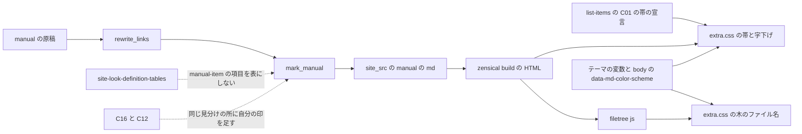
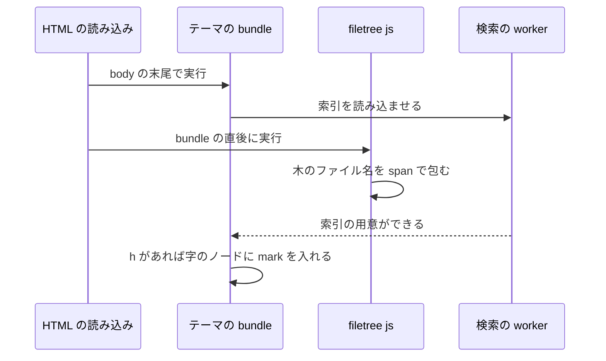
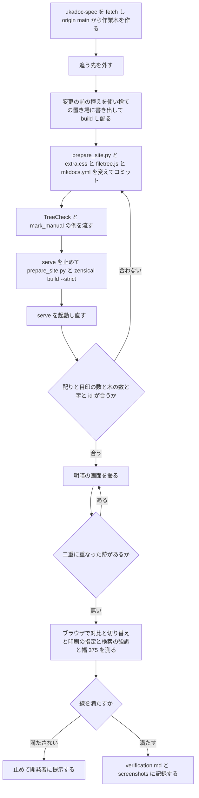

# Design Document: site-look-manual-files

## Overview
**Purpose**: UKADOC の `manual/` の頁（8 頁）でゴーストなどの作り方を読むゴースト制作者に、ファイルごとの説明の切れ目とファイル名をひと目で見分けられる見え方と、ファイル構成の木でファイルとフォルダを見分けられる見え方を届ける。`site-look-plan` で「採る」と決まった C14（ファイルごとの説明の切れ目）・C15（木のファイル名の色）・C22（ファイル名を項目名と同じ帯に）を、本番の書き方で ukadoc-spec に入れる。
**Users**: manual の頁を読むゴースト制作者（明・暗の表示、幅 375 の狭い画面、印刷、検索から開く頁を含む）。木の色は `dev/nar`・`dev/update` の木にも付く（要件 4.9）。ほかの頁の頭が太字の箇条書きの見え方は変えない。
**Impact**: ukadoc-spec の `scripts/prepare_site.py` に、manual の頁のファイルの箇条書きの頭の名前に目印を付けて「`: `」を外す関数 `mark_manual()` を足し、`main()` の読み物の頁の写しの 1 か所から呼ぶ。`assets/extra.css` は、C01 の項目名の帯の 2 つのセレクタに manual の名前の目印を足し、末尾に 2 つの塊を足す。`assets/filetree.js`（新規）が木のファイル名を `span` で包み、`mkdocs.yml` の `extra_javascript` に 1 行足す。原稿・`.nav.yml`・`overrides/` は変えない。

目印は、まとめ頁の目印（`site-look-list-items`・`site-look-list-markers`）と同じく組み立ての処理で付け、名前を `<種類>-<役>`（その種類の頁の中の役。まとめ頁の `bundle-<役>` と並ぶ）の決まりにした。この spec の見た目の指定が使わない、頁の種類だけを示す印は足さない（設計の話し合いの議題 1）。使い捨ての写し（ukadoc-spec `0eb3fb9`。Claude のスクラッチ）で、この設計の差分そのものを build し、目印の数・木の数・字・見出し・対比・幅 375 を確かめた（`research.md` の「9. 設計の調査」）。

### Goals
- manual の頁かどうかを `prepare_site.py` の 1 か所で見分け、目印を manual の頁にだけ付ける。頁の種類だけを示す印は足さない
- ファイルの箇条書き 73 個の頭の名前を、C01 の項目名の帯と同じ見え方の帯にして 1 行に置き、説明のすべてを同じ字下げで帯の下に並べる。名前の後ろの「`: `」（「`:`」だけのものを含む 72 個）を見せない
- 木 21 個（manual 17・`dev/` 4）の木の行で、ファイル名（manual 204 個・`dev/` 17 個）だけに色を付け、木の字を 1 字も変えない
- 木のファイル名を、明るい表示で白地とコードの地に 7:1 以上、暗い表示で暗い地とコードの地に 4.5:1 以上にする。帯の中のリンクを C01 と同じ扱い（明は紺、暗は白と下線）にする

### Non-Goals
- `updates2.dau` と `updates.txt` が 1 つの説明を共有している見え方（D12。原稿の書き方による）
- C16（`spec/shiori3` のヘッダの値の列）・C12（キャラクター）。頁を絞る印が要れば、その spec が `prepare_site.py` の同じ見分けの所に足す
- manual の頁の外の頭が太字の箇条書き、「名前: 説明」の表（`site-look-definition-tables`）
- 木でない言語指定の無いコードブロックの着色、さくらスクリプトの記述例の着色（`site-look-sakura-script-highlight`）
- 原稿（`.md`）・`.nav.yml`・`requirements.txt`・Zensical の版、木の書き方（名前と注の間の空白など）を原稿で直すこと
- テーマの色・リンクの色の変数の値、テンプレートの上書き（`overrides/`・`theme.custom_dir`）

## Boundary Commitments

### This Spec Owns
- `scripts/prepare_site.py` の、manual の頁に目印を付ける処理: 定数 `MANUAL_ITEM`、関数 `mark_manual()`、`main()` の読み物の頁の写しの呼び出し 1 か所、モジュールの docstring の 1 項目
- 目印の名前と形: ファイルの箇条書きの頭の名前の目印 `manual-item`（`strong` の class）と、その決まり `<種類>-<役>`
- 「ファイルの箇条書きの頭の名前」を見分ける規則（コードブロックの外で、行の頭が `- **名前**` で、後ろが「`: `」・行の終わりの「`:`」・行の終わりのどれか。名前の中の `\*`・`\\` は名前の字）と、「`: `」の外し方
- `assets/filetree.js`（新規）: 木を見分ける規則、木の行の名前の切り出しとファイル名・フォルダ名の見分けの規則、ファイル名を `span.filetree-file` で包む処理
- `mkdocs.yml` の `extra_javascript` の `assets/filetree.js` の 1 行
- `assets/extra.css` の、見出しのコメント `/* site-look-manual-files: … */` で始まる 2 つの塊（ファイル名の帯と説明の字下げ・木のファイル名）と、`site-look-list-items: 項目名の帯` の塊の 2 つのセレクタに足す `.manual-item`（値は変えない）
- この spec の記録（`.kiro/specs/site-look-manual-files/verification.md` と `screenshots/`。完了で `completed/` へ移る）

### Out of Boundary
- `extra.css` のほかの塊の値と、上の 2 つのセレクタの外のセレクタ（C02 の詰め `.md-typeset:has(.bundle-item) …`・`.md-typeset .bundle-item { margin }`、`.md-typeset :is(.bundle-item, .bundle-category) code`、list-markers・sakura-script-highlight の塊）
- `prepare_site.py` のほかの処理（一覧の検査・まとめ頁の流れ・`add_markers()`・id の振り方・見出しの数の検査・リンクの書き換え・`_raw/`・`.nav.yml` の書き換え）
- テーマの色の変数とリンクの色の変数（`--md-typeset-a-color` は読むだけ）、ヘッダの地の色
- 言語の印の付いたコードブロックと、その字の着色（`assets/sakurascript.js`）
- 原稿・`.nav.yml`・`requirements.txt`・Zensical の版・`overrides/`・`INDEX.md`、`site-look-plan` の成果物（目標の画面・試作・`tools/shot.mjs`）

### Allowed Dependencies
- `prepare_site.py` の既にある部品: `FENCE`・`main()` の読み物の頁の流れ（`rewrite_links()` の後に書き出す）
- Python-Markdown の `attr_list`（行の中の `**…**{: .cls }` と見出しの `{: .cls }`）。`mkdocs.yml` と `EXTENSIONS` の今の設定のまま
- `site-look-list-items` の C01 の帯の宣言（`padding`・左の線・下の線・地）と、暗い表示の帯の中のリンクの指定（白・下線）。C02 の詰めは `.bundle-item` のある頁だけに効き、manual の頁には効かないこと
- テーマ（Zensical 0.0.67 の classic）の変数 `--md-typeset-a-color`（明は `--md-primary-fg-color` の紺、暗は `site-look-dark-link-color` の `#8fb4e8`）、`<body>` の `data-md-color-scheme`、暗い表示の変数を `@media screen` の中だけで定める作り、`extra_javascript` を `bundle.*.min.js` の直後に読む作り、検索の強調（`?h=`）が索引を待ってから字のノードに `mark` を入れる順
- 確かめの道具: `zensical serve`、`python -m http.server`（変更の前の控えを配る）、Edge ヘッドレス + CDP の使い捨てのスクリプト、Node（偽の `document` で `filetree.js` を流す）、`.kiro/specs/completed/site-look-plan/tools/shot.mjs`（読むだけ）

### Revalidation Triggers
- manual の頁の見分け（`main()` の `d == 'manual'`）を変えたとき: 目印の数を数え直す。C16・C12 を入れる後の spec は、同じ所に自分の印を足す
- 名前の目印 `manual-item` の名前か、「`: `」の外し方を変えたとき: `site-look-definition-tables` が、manual の頁のファイルの箇条書きを表にしないことを確かめ直す（その spec の「名前: 説明」の形の見分けから、目印の付いた項目は外れる）
- 原稿に、manual の頁の一番外の箇条書きで規則に合わない書き方（`- **名前** 説明`・`- **名前**:説明` など）が入ったとき、manual の頁が増えたとき: 目印の数を数え直す（今は 73・「`: `」72）
- 原稿に、木の行の新しい書き方（名前と注の間に空白も全角の括弧も無い注、「または」「`/`」の外の並べ方、空白を含む名前）が入ったとき: 木の数と字を数え直す
- `site-look-sakura-script-highlight` など、言語の印の付け方（`code` の class）を変える spec が入ったとき: 木の当て先が言語の印の無いブロックだけで、両方のスクリプトの当て先が重ならないことを確かめ直す
- `theme.features` に `navigation.instant` を入れたとき: `filetree.js` を頁を移るたびに動かす書き方に替える（今は頁を開いたときに 1 回動く）
- C01 の帯の宣言、C02 の詰めの当て先、リンクの色の変数（PR #10 の `#8fb4e8`・テーマの紺）、`--md-code-bg-color`・`--md-code-fg-color` を変えたとき、Zensical の版を上げたとき: 帯・木の対比と字下げを測り直す

## Architecture

### Existing Architecture Analysis
- `main()` は、まとめ頁の単位を `shift_headings()` → `rewrite_links()` → `add_markers()` に通してつなぐ。読み物の頁（`manual/`・`dev/`・`memo/` とまとめ頁に入らない `spec/` の頁）は、`for d in DIRS` の中で `write(rel, rewrite_links(read(rel), rel, rel))` で写すだけで、頁ごとの目印を付ける所は無い
- manual の頁の 8 つの原稿は、どれも 1 行目が `# 題`（`translator.md` だけ改行が CRLF だが、`read()` が LF にそろえる）。ファイルの箇条書き 73 個は、どれも行の頭（字下げ無し）の `- **…**` で、原稿の空行のため 1 項目ずつ別の `<ul>` になる
- まとめ頁の見出しは、`shift_headings()` が `# 題 {#id .bundle-item}` の形で `attr_list` を付け、頁の題・目次・id が保たれている。読み物の頁の見出しに `{: .cls }` を足しても同じ（写しで確かめた）
- C01 の帯は `.md-typeset .bundle-item`（`h3` などの見出し）に当たる。C02 の詰め（`.md-typeset:has(.bundle-item) p`・`hr`）は `.bundle-item` のある頁だけに効く。manual の頁に `bundle-item` の class を付けると manual の頁の段落の間まで詰まるので、名前の目印は別の名前にする
- コードブロックは今 `<div class="highlight"><pre><span></span><code>…`（`code` に class 無し）。`site-look-sakura-script-highlight` の後は `<pre class="highlight"><code>…`（言語の名前の無いブロック）。どちらも `pre > code:not([class*="language-"])` に合う
- `extra_javascript` は `bundle.*.min.js` の直後に読まれ、DOM はできている。検索の強調はその後に動き、字のノードに `mark` を入れる

### Architecture Pattern & Boundary Map
選んだ形は、ギャップ分析の推す組み合わせ A（組み立ての処理が目印を付け、見た目の指定はその目印だけに当て、木は中身でスクリプトが包む）。頁の種類だけを示す印（ギャップ分析の T・P1・P2）は足さず、manual の頁の見分けは `main()` の `d == 'manual'` が持つ（設計の話し合いの議題 1）。



- **目印の役**: `manual-item` は「manual の頁のファイルの箇条書きの頭の名前」という役の印。見え方の名前（帯・字下げ）にしないので、見た目を替えるときは `extra.css` だけを替えればよい
- **見た目の当て先**: 帯と字下げは `manual-item` に当てる（`:has()` で項目と箇条書きを選ぶ）。`manual-item` は manual の頁にしか付かないので、頁を絞る印は要らない（「設計の話し合いで決めたこと」の 1）
- **木**: 頁を問わず、中身（`+-` の行）で見分ける（要件 4.9）。頁は見ない
- **色**: 帯は C01 の宣言を共有し（`:is(.bundle-item, .manual-item)`）、木のファイル名はリンクの色の変数 `--md-typeset-a-color` を使う。直書きの色は足さない。暗い表示の色は変数の側で `@media screen` の中だけにあるので、この spec に `@media screen` の指定は無い

### Technology Stack

| Layer | Choice / Version | Role in Feature | Notes |
|-------|------------------|-----------------|-------|
| 組み立ての処理 | Python 3.12・`scripts/prepare_site.py` | 名前の目印を足し「`: `」を外す | 依存は足さない（`re`） |
| Markdown | Python-Markdown の `attr_list`（`mkdocs.yml` のまま） | `**…**{: .manual-item }` を `<strong class="manual-item">` にする | 設定は変えない |
| ブラウザの仕掛け | 素の JavaScript（ES2020）の 1 ファイル `assets/filetree.js` | 木のファイル名を `span` で包む | ライブラリ・外部の資源を読まない |
| 見た目の指定 | CSS（`assets/extra.css`） | 帯・字下げ・木のファイル名の色 | `:has()`・`:is()` は既にある塊も使っている |
| サイト生成 | Zensical 0.0.67（`requirements.txt` のまま） | `extra_javascript` の配り | 版は変えない |
| 確かめ | `zensical serve`、`python -m http.server`、Edge ヘッドレス + CDP、Node、`shot.mjs` | 数・字・対比・画面・幅 | `shot.mjs` は読むだけ |

## File Structure Plan

### Directory Structure
```
ukadoc-spec（作業木 .worktrees/site-look-manual-files/、ブランチ site-look-manual-files、origin/main から）
├── mkdocs.yml                   # extra_javascript に assets/filetree.js を足す
├── scripts/
│   └── prepare_site.py          # MANUAL_ITEM・mark_manual() を足し、読み物の頁の写しの 1 か所から呼ぶ
└── assets/
    ├── filetree.js              # 新規。木のファイル名を span.filetree-file で包む
    └── extra.css                # C01 の帯の 2 つのセレクタに .manual-item を足し、末尾に 2 つの塊を足す

.kiro/specs/site-look-manual-files/（doc_edit。完了で completed/ へ移る）
├── verification.md              # 新規。数・字・対比・画面の見比べ・失わないものの確かめの記録
└── screenshots/                 # 設計の写しの画面（design-*.png、済み）と、実装の後の画面（after-*.png）
```

ukadoc-spec で変えるのは上の 4 ファイルだけである（8.1）。原稿・`.nav.yml`・`requirements.txt`・`overrides/`・`INDEX.md` には触れない。

### Modified Files

#### `scripts/prepare_site.py`（ukadoc-spec の作業木）
変える所は 4 か所で、ほかの関数は変えない。差分（`0eb3fb9` に対して。写しで build を通したものから、設計の話し合いの議題 1 で頁の種類の印を外した）:

```diff
@@ -10,6 +10,7 @@
 - まとめた頁の分類と項目の頭の見出しに、役の class（bundle-category・bundle-item）を付ける（見た目は assets/extra.css）
 - まとめた頁の対応・既定値の段落と注意書きの節に目印（bundle-support・bundle-default・bundle-notes）を付け、
   対応のベースウェアの名前を札（bundle-baseware）で包む（見た目は assets/extra.css）
+- manual/ の頁のファイルの箇条書きの頭の名前に目印（manual-item）を付け、名前の後ろの「: 」を外す（見た目は assets/extra.css）
 原稿そのものは書き換えない。
 """
 import os
@@ -39,6 +40,7 @@
 BASEWARE = ['Materia', 'SSP', 'CROW', 'Ninix']   # 札にする名前。足すときは assets/extra.css に明・暗の札の色も足す
 BASEWARE_PART = re.compile(rf'^({"|".join(BASEWARE)})(?=\s|$)(.*)$')
 NEGATION = re.compile(r'非対応|未対応|廃止')
+MANUAL_ITEM = re.compile(r'^(- \*\*(?:\\.|[^\\*])+\*\*)(: |:$|$)')   # 一番外の箇条書きの頭の太字の名前（\* と \\ は名前の字）
 
 ERRORS = []
 UNIT = {}      # 元ページ（ROOT からの相対パス）→ (まとめたページ, ページ内の id, {元の見出しの id: まとめたページでの id})
@@ -274,6 +276,20 @@
     return text
 
 
+def mark_manual(text):
+    """manual/ の頁のファイルの箇条書きの頭の名前に {: .manual-item } を足し、名前の後ろの「: 」を外す"""
+    lines = text.split('\n')
+    in_fence = False
+    for i, line in enumerate(lines):
+        if FENCE.match(line):
+            in_fence = not in_fence
+            continue
+        m = None if in_fence else MANUAL_ITEM.match(line)
+        if m:
+            lines[i] = m.group(1) + '{: .manual-item }' + (' ' if m.group(2) == ': ' else '') + line[m.end():]
+    return '\n'.join(lines)
+
+
 # ---------------------------------------------------------------- 本体
 
 def page_dirs():
@@ -340,7 +356,8 @@
             for name in sorted(files):
                 rel = os.path.relpath(os.path.join(dirpath, name), ROOT).replace(os.sep, '/')
                 if name.endswith('.md') and rel not in bundled:
-                    write(rel, rewrite_links(read(rel), rel, rel))
+                    text = rewrite_links(read(rel), rel, rel)
+                    write(rel, mark_manual(text) if d == 'manual' else text)
     write('index.md', rewrite_links(read('INDEX.md'), 'INDEX.md', 'index.md'))
```

- **manual の頁を見分ける所**: `main()` の `for d in DIRS` の `d == 'manual'`（頁が `manual/` の下にあること。1.1・1.5）。原稿の題や見出しの id では見分けない。頁の種類だけを示す印は HTML に足さない（1.4。「設計の話し合いで決めたこと」の 1）。C16 などで頁を絞る印が要るときは、その spec が同じ所に自分の印を足す
- **名前の目印**: 行の頭の `- **名前**` の後ろが「`: `」なら `**名前**{: .manual-item } 説明`（「`:`」を外し、空白 1 つを残す）、行の終わりの「`:`」なら `**名前**{: .manual-item }`、行の終わりなら `**名前**{: .manual-item }` にする。残した空白は、名前が `display: block` の帯になるので行の頭の空白として消え、見えない。検索の字では名前と説明の語の切れ目になる（「設計の話し合いで決めたこと」の 4）
- **名前の字**: `(?:\\.|[^\\*])+` で、`\*`・`\\` を 1 字の組として読み、`**` の切れ目を取り違えない（`surfaces\*\*.txt`・`(myghost)\\ghost\\`・名前の一部だけのリンク `(myghost)\\[delete.txt](…)` を含む）
- **当てない所**: 字下げした行（注記の箱 `!!! tip` の中の `shell` の「`※1,※2`」など。2.7）、コードブロックの中、形に合わない行（`- **名前** 説明`・`- **名前**:説明`。今は 0 個。Revalidation Triggers）
- 写しで確かめた結果: 下の MarkerCheck の数。`prepare_site.py` と `zensical build --strict` は exit 0、`_raw/` と `llms.txt` は変わらない

#### `assets/filetree.js`（ukadoc-spec の作業木、新規）
中身（写しの 21 個の木で、数と字が合ったもの）:

```js
// site-look-manual-files: ファイル構成の木（+- の行のある言語の印の無いコードブロック）のファイル名を span で包む（字は変えない）
(() => {
  const ROW = /^[\s　]*\+-/;
  const NAME = /[^\s（]+/y;
  const OR = / または /y;
  const FILE = /\.[^.()]+$/;

  // 木の行 line の中のファイル名の [始め, 終わり] の並び。名前は +- の後ろの空白と全角の（ までで、/ と「 または 」で 2 つ目が続く
  const files = (line) => {
    const row = ROW.exec(line);
    if (!row) return [];
    const out = [];
    let i = row[0].length;
    for (;;) {
      NAME.lastIndex = i;
      const m = NAME.exec(line);
      if (!m) return out;
      let s = i;
      for (const part of m[0].split('/')) {
        if (FILE.test(part)) out.push([s, s + part.length]);
        s += part.length + 1;
      }
      i = NAME.lastIndex;
      OR.lastIndex = i;
      if (!OR.test(line)) return out;
      i = OR.lastIndex;
    }
  };

  for (const code of document.querySelectorAll('pre > code:not([class*="language-"])')) {
    const t = code.textContent;
    if (!/^[\s　]*\+-/m.test(t)) continue;
    if (code.children.length) { console.warn('filetree: 要素の入った木には色を付けない', location.pathname); continue; }
    const nodes = [];
    let last = 0, at = 0;
    for (const line of t.split('\n')) {
      for (const [s, e] of files(line)) {
        const span = document.createElement('span');
        span.className = 'filetree-file';
        span.textContent = line.slice(s, e);
        nodes.push(t.slice(last, at + s), span);
        last = at + e;
      }
      at += line.length + 1;
    }
    code.replaceChildren(...nodes, t.slice(last));
    if (code.textContent !== t) { code.textContent = t; console.warn('filetree: 字が変わるので包まずに戻した', location.pathname); }
  }
})();
```

書き方のわけ（注に書かず、ここに残す）:
- **木の見分け**（4.7・4.8・4.9）: `pre > code:not([class*="language-"])` のうち、行の頭（空白・全角の空白の後）が `+-` の行を 1 つ以上持つもの。今の HTML（`div.highlight > pre > code`）と、`site-look-sakura-script-highlight` の後の HTML（`pre.highlight > code`）のどちらにも合う（写しで両方を build して確かめた）。言語の印の付いたブロック（`language-sakurascript`・`language-ss` など）には当たらない。頁は問わない
- **名前の切り出し**（4.1・4.4・4.5）: `+-` の直後から、空白か全角の `（` の前までを名前の並びとする。並びを `/` で分け、どれも 1 つの名前として見る。並びの後ろが「` または `」なら、その後ろの並びも名前として見る。半角の `(` は名前の字とする（`(saori).dll`・`(myghost)`・`master(またはadditional_shell)`）。注（`（旧仕様）`・`(SSPのみ)` など）は、空白か全角の `（` で名前から外れる
- **ファイル名とフォルダ名**（4.1・4.2）: 名前が「`.` と、`.`・`(`・`)` を含まない字」で終わればファイル名（`descript.txt`・`*.ico`・`(saori).dll`・`surfaces**.txt`・`.narignore`）、そうでなければフォルダ名（`(myghost)`・`ghost`・`master(またはadditional_shell)`）。包むのはファイル名だけで、フォルダ名・`+-`・注・「`/`」・「または」・`+-` で始まらない行は字のノードのまま残す（今の字の色のまま）
- **包み方**（4.3・6.5）: `innerHTML` を組み立てず、`span` を作って `textContent` を入れる（`site-look-sakura-script-highlight` と同じ）。字のエスケープが要らず、包んだ後の字は前と同じ。違えば包む前の字に戻して `console.warn` で知らせる。本番に `console.assert` は残さない。字の太さ・大きさ・並び・折り返しには触れない
- **要素の入った木**（6.2）: 先にほかの仕掛け（検索の強調など）が `code` の中に要素を入れたときは包まず、`console.warn` で知らせる。字を作り直すとその要素（`mark`）が消えるため。今の順では、検索の強調はこのスクリプトの後に動き、`mark` がファイル名の `span` の中に入る（写しの `?h=readme` で、木の中の `mark` 5 個がすべて `span` の中）
- **仕掛けが動かないとき**（4.6）: スクリプトを読めない・止めているときは、木は今の字と見え方のまま。CSS は `span.filetree-file` にだけ当たる
- **名前**: ファイル `filetree.js`、class `filetree-file`（`sakurascript.js`・`sakurascript-tag` と同じ「スクリプトの名前-役」の形）。試作の `slp-` を使わない（8.7）。フォルダ名は包まない（色を変えないので要らない。数は確かめの側で数える）

#### `mkdocs.yml`（ukadoc-spec の作業木）
```diff
@@ extra_css:
   - assets/extra.css
 
+extra_javascript:
+  - assets/filetree.js
+
 plugins:
```
- 作業木を作るときに `site-look-sakura-script-highlight` の PR が `origin/main` に入っていれば、`extra_javascript:` の鍵は既にあるので、その並びの後ろに `  - assets/filetree.js` の 1 行だけを足す。後から追いつくときにぶつかったら、並びに両方のスクリプトを残す（8.6）。2 つのスクリプトの当て先は重ならない（言語の印の有る・無し）ので、並びの順は問わない
- `build --strict` は無いファイルを指定しても気づかないので、`serve` で `/ukadoc-spec/assets/filetree.js` が 200 になることを確かめる（7.1）

#### `assets/extra.css`（ukadoc-spec の作業木）
`site-look-list-items: 項目名の帯` の塊の 2 つのセレクタに `.manual-item` を足し（宣言の値は変えない）、今の末尾の後ろに 2 つの塊を足す。ほかの塊は変えない。

```diff
 /* site-look-list-items: 項目名の帯 */
-.md-typeset .bundle-item {
+.md-typeset :is(.bundle-item, .manual-item) {
   padding: .3em .6em;
   border-left: .3rem solid var(--md-primary-fg-color);
   border-bottom: .05rem solid var(--md-default-fg-color--lighter);
   background: var(--md-default-fg-color--lightest);
 }
@@
 @media screen {
-  [data-md-color-scheme="slate"] .md-typeset .bundle-item a:not(.headerlink) {
+  [data-md-color-scheme="slate"] .md-typeset :is(.bundle-item, .manual-item) a:not(.headerlink) {
     color: #ffffff;
     text-decoration: underline;
   }
 }
```

```css
/* site-look-manual-files: ファイル名の帯と説明の字下げ */
.md-typeset > ul:has(> li > .manual-item, > li > p:first-child > .manual-item) {
  margin-left: 0;
}
.md-typeset > ul > li:has(> .manual-item, > p:first-child > .manual-item) {
  margin-left: 1.2rem;
  list-style: none;
}
.md-typeset li > p:first-child:has(> .manual-item) {
  margin-top: 0;
}
.md-typeset .manual-item {
  display: block;
  margin: .5em 0 .3em -1.2rem;
  font-size: 1.25em;
  font-weight: 400;
  line-height: 1.5;
}

/* site-look-manual-files: 木のファイル名 */
.md-typeset .filetree-file {
  color: var(--md-typeset-a-color);
}
```

指定のわけ（注に書かず、ここに残す）:
- **帯の共有**（3.1・3.6）: C01 の帯の見た目（`padding`・左の太い線・下の細い線・薄い地）と、暗い表示の帯の中のリンク（白・下線）を、セレクタを広げて共有した。同じ宣言を 2 か所に書かないので、C01 の帯が変われば manual の帯もそろって変わる。C02 の詰め（`.md-typeset:has(.bundle-item) p` など）と `.md-typeset .bundle-item { margin }` は広げない（manual の頁に `.bundle-item` は無く、詰めは効かない）。帯の中の `code` の指定も広げない（73 個の名前に `code` は無い）。この 2 行は `site-look-list-items` の塊の中の変更で、要件 8.2 の例外として決めた（「設計の話し合いで決めたこと」の 2）
- **帯の形**（2.1・3.1・3.2・3.3）: 名前の `strong` を `display: block` にして 1 行に置き、説明はその次の行から始まる（`<p>` の有る形も無い形も同じ。2.5）。字の大きさは `h3` と同じ `1.25em`、太さは C01 の帯（`h3`）と同じ `400`、行の高さ `1.5`。上下の余白は C01 の帯（`.5em 0 .3em`）にそろえた（「設計の話し合いで決めたこと」の 5）
- **字下げ**（2.2・2.3）: 箇条書きの左の余白を 0 にし、項目を `1.2rem`（本文の字の 1.5 字）字下げして点を消す。帯は `-1.2rem` で本文の左の端に戻す。説明の段落・入れ子の箇条書き・表・コードブロック・木・注記の箱は、どれも項目の中にあるので同じ左の端にそろう。入れ子の箇条書きの点は残る（テーマの `ul` の指定のまま。写しの `balloon` で `disc`）
- **2 つの形をそろえる**（3.2・3.3）: 名前は `li > p:first-child > strong`（61 個）か `li > strong`（12 個）のどちらかにあり、どちらも項目の中身の左の端から始まる。`p` の上の余白を 0 にして、帯の上の端もそろえた。写しで 73 個の帯の左の端（16px）と幅（711px）が 1 通りだった（試作は `updates2.dau` が 6px ずれた）。目標の画面の帯は、試作の負の字下げが帯の字の大きさで 6px 大きく効いて、本文の左の端より 6px 左にあった。この設計は C01 の帯と同じく本文の左の端に置く
- **`:has()` で選ぶわけ**: 項目と箇条書きは、名前の目印を持つものだけを選ぶ。manual の頁に名前の無い箇条書きが後で入っても、その点と字下げは今のまま残る（「設計の話し合いで決めたこと」の 1）
- **幅 375**（6.4）: 帯の名前は、`\`・`(`・空白などの折り返せる所で折り返す。`overflow-wrap` などの指定は要らなかった（写しで manual の 8 頁と `dev/` の 2 頁が明・暗とも `scrollWidth` = `innerWidth` = 375。`(myghost)\shell\(additional_shell)\` は `\` の後ろで 2 行になった）
- **木のファイル名の色**（4.1・5.1・5.2・5.3）: テーマのリンクの色の変数 `--md-typeset-a-color` を使う。明るい表示は `--md-primary-fg-color` の紺 `#1f4e8c`（白地 8.31・コードの地 7.62）、暗い表示は `site-look-dark-link-color` の `#8fb4e8`（暗い地 7.56・コードの地 6.71）。変数で出せない色は足さない。暗い表示の値は変数の側で `@media screen` の中にあるので、暗い表示のまま印刷すると紺で出る（5.6）。紺のテーマに合い、テーマの色が変われば付いてくる（「設計の話し合いで決めたこと」の 3）
- **ファイル名とフォルダ名の差**（4.3）: 明るさの比は明 1.18・暗 1.50 と小さく、色合い（明は紺と灰色、暗は明るい青と明るい灰色）で分かれる。設計の写しの明・暗の画面（`screenshots/design-ghost-C15-*.png`・`design-directory-tree-dark.png`）で、どちらの表示でもファイル名の青がフォルダ名の灰色から見分けられることを見た。開発者が設計の話し合いで画面を見て決める（「設計の話し合いで決めたこと」の 3）
- **注**: 塊ごとの注は `/* site-look-manual-files: <何の指定か> */` の 1 行だけにした（8.2）。測りの数・わけはこの文書と `verification.md` に書く

### 部品とファイルの対応
| 部品 | ファイル | 扱い |
|---|---|---|
| ManualMarker | `scripts/prepare_site.py`（作業木） | 変える |
| TreeColorer | `assets/filetree.js`（作業木） | 新規 |
| ScriptEntry | `mkdocs.yml` の `extra_javascript`（作業木） | 足す |
| BandStyle | `assets/extra.css`「項目名の帯」の 2 つのセレクタと「ファイル名の帯と説明の字下げ」 | 変える・足す |
| TreeStyle | `assets/extra.css`「木のファイル名」 | 足す |
| MarkerCheck | なし（配られた HTML を数える使い捨てのスクリプト。置き場は Claude のスクラッチ。手順と結果は `verification.md`） | 作らない |
| TreeCheck | なし（Node の偽の `document` で `filetree.js` を流す例の表と、ブラウザで開いた後の木を数える使い捨てのスクリプト） | 作らない |
| ContrastProbe | なし（Edge ヘッドレス + CDP の使い捨てのスクリプト。式と結果は `verification.md`） | 作らない |
| ShotTool | `.kiro/specs/completed/site-look-plan/tools/shot.mjs` | 読むだけで使う |
| VerificationRecord | `.kiro/specs/site-look-manual-files/verification.md`・`screenshots/` | 新規 |

## System Flows

### 頁の中の順

- 帯と字下げは HTML の class と CSS だけで決まり、スクリプトに依らない。スクリプトは木の色だけを受け持つ
- 検索の強調は索引の読み込みを待ってから動くので、包みの後に動く。写しの `?h=descript`・`?h=readme` で、帯の中と木のファイル名の `span` の中に `mark` が入った（明・暗。6.2）
- 逆の順になっても、`mark` の入った木は包まないので強調は消えない。その木は色が付かないだけになる

### 作業の流れ

- A・B（`workflow.md` の「ukadoc-spec の作業木」）: `git -C ukadoc-spec fetch origin` → `git -C ukadoc-spec worktree add ../.worktrees/site-look-manual-files -b site-look-manual-files origin/main` → `git -C .worktrees/site-look-manual-files branch --unset-upstream`。起点は `site-look-list-items` の PR #11 を含む `origin/main`（今は `0eb3fb9`。`site-look-sakura-script-highlight` の PR が先に入っていれば、それも含む。8.3）
- D のコミットは 1 つにする（目印・見た目・スクリプトは互いに依り、どれか 1 つだけでは見え方が崩れる）。`git -C .worktrees/site-look-manual-files -c user.name=ekicyou -c user.email=dot.station@gmail.com commit …` で名前を渡す（設定は書き換えない）。push と PR は `/kiro-complete` で行う
- C: 変更の前の控えは、作業木の HEAD（作った直後は `origin/main` と同じ）を `git -C .worktrees/site-look-manual-files archive HEAD` で Claude のスクラッチの下の新しいフォルダに書き出し、`prepare_site.py` と `zensical build --strict` を流して、`_site/` を `python -m http.server` で 8000 以外の口（例: 8010）に配る。`ukadoc-spec/` のメインのチェックアウトは使わない。終わったら止めて消す
- F: `serve` は `_site_src/` を見るので、動かしたまま `prepare_site.py` を流さない（書きかけを拾って `extra.css` が 404 になる）
- M: 線に届かないとき・色合いの差が足りないと見たときは、色や値を勝手に選び直さず、測った数と画面を添えて開発者に提示して判断を待つ（タスクにも止まる所として書く）

## Requirements Traceability

| Requirement | Summary | Components | Interfaces | Flows |
|-------------|---------|------------|------------|-------|
| 1.1 | 1 か所で頁の置き場から見分け、目印を manual の頁の中だけに | ManualMarker（`for d in DIRS` の `d == 'manual'`）, MarkerCheck | 頁ごとの `manual-item` の数 | H |
| 1.2 | ほかの頁に目印を付けない | ManualMarker（`d == 'manual'` だけ）, MarkerCheck | 全 40 頁の数 | H |
| 1.3 | 題・id・¶・目次・検索の字を変えない | ManualMarker（`attr_list` の class だけ）, MarkerCheck | `<title>`・id の並び・`headerlink`・`md-nav__link`・本文の字 | C, H |
| 1.4 | 使わない頁の種類の印を足さない | ManualMarker（見分けは 1 か所、HTML の印は `manual-item` だけ） | `git diff` | — |
| 1.5 | 見た目の指定で題や id で頁を見分けない | BandStyle（`h1#…` を使わない） | — | — |
| 2.1 | 名前を 1 行に置き、説明を次の行から | BandStyle（`display: block`）, ShotTool | `strong.manual-item` | I |
| 2.2 | 説明のすべてを同じ字下げの左の端に | BandStyle（項目の `margin-left`）, ShotTool, ContrastProbe | 説明の左の端（写しで 40px） | I, K |
| 2.3 | 頭の点を見せない | BandStyle（`list-style: none`） | 項目の `list-style-type` | K |
| 2.4 | 「`: `」を見せず、ほかの字を変えない | ManualMarker（「`:`」だけを外す）, MarkerCheck | 本文の字の違いが「`:`」72 字だけ | H |
| 2.5 | 段落に分かれない 12 個も同じ字下げ | BandStyle（`li > strong` の形も同じ）, ShotTool | `balloon` の画面 | I |
| 2.6 | manual の外は今のまま | ManualMarker（manual だけ）, BandStyle（目印だけに当てる）, MarkerCheck | 目印 0・本文の字が同じ | H |
| 2.7 | 一番外でない項目は今のまま | ManualMarker（字下げした行に当てない）, MarkerCheck | `shell` の目印 12（`※1,※2` を含まない） | H |
| 2.8 | ファイルの間を次の帯で分ける | BandStyle（線を引かない） | 画面 | I |
| 2.9 | 場合分けの 8 個も同じに | ManualMarker（名前の中身を問わない）, MarkerCheck | `install` 7・`update` 7 | H, I |
| 3.1 | C01 と同じ見え方の帯 | BandStyle（C01 の宣言を共有、`1.25em`・`400`） | `:is(.bundle-item, .manual-item)` | I |
| 3.2 | 名前だけの帯も同じ左の端と幅 | BandStyle（2 つの形が同じ左の端）, ContrastProbe | 左の端・幅が 1 通り | K |
| 3.3 | 73 個すべてに同じ帯 | ManualMarker, BandStyle, MarkerCheck | 目印 73 | H |
| 3.4 | 名前の字を今のまま（`\`・`*`） | ManualMarker（名前の字に触れない）, MarkerCheck | 本文の字が同じ | H |
| 3.5 | 帯の中のリンク 7:1、ホバー・フォーカス 3:1 | BandStyle（C01 のリンクの指定を共有）, ContrastProbe | 測る所と線 | K |
| 3.6 | 帯の中のリンクを C01 と同じ扱い | BandStyle（暗い表示の白と下線の指定を広げた） | `:is(.bundle-item, .manual-item) a:not(.headerlink)` | K |
| 3.7 | 帯を見出しにせず、目次・id・¶ を増やさない | ManualMarker（`strong` に class を付けるだけ）, MarkerCheck | id・`headerlink`・`md-nav__link` の数 | H |
| 4.1 | 木のファイル名を違う色に | TreeColorer, TreeStyle, TreeCheck, ShotTool | `span.filetree-file` | E, H, I |
| 4.2 | フォルダ名・`+-`・注・ほかの行は今の色 | TreeColorer（ファイル名だけ包む） | 字のノードのまま | E |
| 4.3 | 字・太さ・並び・折り返しを保ち、色だけ。色合いの差を画面で確かめる | TreeColorer（`textContent` だけ）, TreeStyle（`color` だけ）, TreeCheck, ShotTool | 字の違い 0、`design-*.png` | E, H, I |
| 4.4 | 空白の無い注を外す | TreeColorer（全角の `（` で切る）, TreeCheck | `alias.txt（旧仕様）` → `alias.txt` | E |
| 4.5 | 「`/`」「または」の 2 つの名前に色 | TreeColorer（`/` で分け、「 または 」で続ける）, TreeCheck | 10 行で 20 個 | E |
| 4.6 | 仕掛けが動かないとき今のまま | TreeColorer（字を包むだけ）, TreeStyle（`span` にだけ当たる） | — | — |
| 4.7 | 木でないブロックを変えない | TreeColorer（`+-` の行と言語の印の無さで見分ける）, TreeCheck | 木の外で包んだブロック 0 | H |
| 4.8 | 今の形と着色の後の形の両方に効く | TreeColorer（`pre > code:not([class*="language-"])`）, TreeCheck | 写しの 2 つの build で同じ数 | H |
| 4.9 | `dev/nar`・`dev/update` の木にも付ける | TreeColorer（頁を問わない）, TreeCheck | `dev/` の 4 個の木 | H |
| 5.1 | 明るい表示 7:1（白地・コードの地） | TreeStyle（`--md-typeset-a-color` の紺）, ContrastProbe | 8.31・7.62 | K |
| 5.2 | 暗い表示 4.5:1（暗い地・コードの地）、紺のテーマに合う | TreeStyle（`#8fb4e8`）, ContrastProbe | 7.56・6.71 | K |
| 5.3 | なるべく変数から、出せない色は対比を記録 | TreeStyle（変数だけ。直書きの色 0） | — | N |
| 5.4 | 帯の中の名前の字 4.5:1 | BandStyle（C01 と同じ字の色）, ContrastProbe | 明 14.13・暗 6.76 | K |
| 5.5 | 切り替えで読み込み直さずに変わる | BandStyle, TreeStyle（属性と変数）, ContrastProbe | `body` の属性 | K |
| 5.6 | 暗い表示のまま印刷しても明るい色 | BandStyle, TreeStyle（暗い表示だけの値は `@media screen` の中）, ContrastProbe | 見た目の指定の木（CSSOM） | K |
| 5.7 | リンク・テーマ・ヘッダ・ほかの spec の字の色を変えない | TreeStyle（変数を読むだけ）, BandStyle（セレクタを足すだけ） | 差分 | — |
| 6.1 | 同じ字で検索で引ける（外すのは「`: `」だけ） | ManualMarker, TreeColorer, MarkerCheck | 本文の字の違い・`search.json` | H |
| 6.2 | 帯と木の中で検索の強調が見える | TreeColorer（順と `children` の確かめ）, ContrastProbe | `?h=` の `mark` | K |
| 6.3 | 見出しの id・¶・目次を保つ | ManualMarker, MarkerCheck | id の並び・数 | H |
| 6.4 | 幅 375 に収まる | BandStyle（折り返せる所で折り返す）, ShotTool | `scrollWidth` = `innerWidth` = 375 | K |
| 6.5 | コピーのボタンとコピーされる字 | TreeColorer（字を変えない）, TreeCheck, ShotTool | 字の違い 0・画面のボタン | H, I |
| 6.6 | 帯の中の `\` を今のまま | ManualMarker, MarkerCheck, ShotTool | `directory` の画面 | H, I |
| 6.7 | `_raw/`・`llms.txt`・一覧の検査・見出しの数の検査・リンクの書き換え | ManualMarker（`rewrite_links()` の後に足すだけ）, MarkerCheck | 控えと同じ、Build Gate | F, H |
| 7.1 | 配られた `extra.css` と `filetree.js` が 200 で中身がある | MarkerCheck | `/ukadoc-spec/assets/…` | H |
| 7.2 | 目印の数・「`: `」の目印の数・漏れ・スクリプトの読み込み | MarkerCheck | 下の表 | H |
| 7.3 | 木ごとのファイル名・フォルダ名の数と字 | TreeCheck | 下の表 | H |
| 7.4 | 前後で id・¶・目次の数が同じ | MarkerCheck | 控えとの比べ | C, H |
| 7.5 | 目標の画面と同じ位置・大きさで明・暗を見比べる | ShotTool, VerificationRecord | 画面の一覧 | I |
| 7.6 | 目標の画面に無いものを明・暗で撮る | ShotTool, VerificationRecord | 画面の一覧 | I |
| 7.7 | 帯の字・リンク・木の対比を明・暗で測る | ContrastProbe, VerificationRecord | 測る所と線 | K, N |
| 7.8 | 幅 375 を 10 頁で測る | ShotTool, VerificationRecord | `scrollWidth`・`innerWidth` | K |
| 7.9 | 二重に重なった画面の撮り直し | ShotTool | 画面の目視 | J |
| 7.10 | 見せる前に Ctrl+F5 を頼む | VerificationRecord | — | — |
| 8.1 | 変えるのは `assets/`・`prepare_site.py`・`mkdocs.yml` だけ | ManualMarker, TreeColorer, ScriptEntry, BandStyle, TreeStyle | `git diff --stat origin/main` の 4 ファイル | — |
| 8.2 | 末尾に塊、注は 1 行 | BandStyle, TreeStyle | `/* site-look-manual-files: <何> */` | — |
| 8.3 | 自分の作業木で、PR #11 の後の `origin/main` の上に書く | （作業木） | `.worktrees/site-look-manual-files/` | A, B |
| 8.4 | Build Gate と規約 Gate | ManualMarker ほか全部 | `prepare_site.py`・`build --strict` | F |
| 8.5 | 完了でこの spec だけの PR を作りスクワッシュマージ | （`/kiro-complete`） | PR の説明の決まり | — |
| 8.6 | `origin/main` とぶつかったら追いつき両方残す | ScriptEntry（並びに両方）, BandStyle・TreeStyle（独立した塊） | 見出しのコメントの区切り | — |
| 8.7 | 旧サイト・試作を写さず書き直す | ManualMarker, TreeColorer, BandStyle, TreeStyle | `html[data-slp~=…]`・`slp-`・`:has(h1#ゴースト)` を使わない | — |

## Components and Interfaces

| Component | Domain/Layer | Intent | Req Coverage | Key Dependencies | Contracts |
|-----------|--------------|--------|--------------|------------------|-----------|
| ManualMarker | 組み立ての処理（`prepare_site.py`） | manual の頁のファイルの箇条書きの名前に目印を付け「`: `」を外す | 1.1〜1.4, 2.4, 2.6, 2.7, 2.9, 3.3, 3.4, 3.7, 6.1, 6.3, 6.6, 6.7, 8.1, 8.4, 8.7 | `attr_list`（P0）、`FENCE`・`main()` の流れ（P0） | Batch |
| TreeColorer | ブラウザの仕掛け（`assets/filetree.js`） | 木のファイル名を `span` で包む | 4.1〜4.9, 6.1, 6.2, 6.5, 8.1, 8.7 | テーマの bundle の順（P1） | Service, State |
| ScriptEntry | 設定（`mkdocs.yml`） | 全頁で `filetree.js` を 1 回読む | 4.6, 7.1, 7.2, 8.1, 8.6 | Zensical の `extra_javascript`（P0） | State |
| BandStyle | 見た目の指定 | ファイル名の帯と説明の字下げ | 1.5, 2.1〜2.3, 2.5, 2.6, 2.8, 3.1, 3.2, 3.5, 3.6, 5.4〜5.7, 6.4, 8.2, 8.6, 8.7 | ManualMarker（P0）、C01 の帯の宣言（P0）、テーマの変数（P0） | State |
| TreeStyle | 見た目の指定 | 木のファイル名の色 | 4.1, 4.3, 4.6, 5.1〜5.3, 5.5〜5.7, 8.2 | TreeColorer（P0）、`--md-typeset-a-color`（P0） | State |
| MarkerCheck | 確かめ（使い捨て） | 目印の数・漏れ・変わらないこと・配り | 1.1〜1.3, 2.4, 2.6, 2.7, 2.9, 3.3, 3.4, 3.7, 6.1, 6.3, 6.6, 6.7, 7.1, 7.2, 7.4 | `serve` と控えの配り（P0） | Service |
| TreeCheck | 確かめ（使い捨て） | 名前の切り出しの例と、開いた後の木の数と字 | 4.1〜4.5, 4.7〜4.9, 6.5, 7.3 | Node・Edge ヘッドレス + CDP（P0） | Service |
| ContrastProbe | 確かめ（使い捨て） | 対比・字下げの位置・切り替え・印刷の指定・検索の強調・幅 375 | 2.2, 2.3, 3.2, 3.5, 3.6, 5.1, 5.2, 5.4〜5.6, 6.2, 6.4, 7.7, 7.8 | Edge ヘッドレス + CDP（P0） | Service |
| ShotTool | 確かめ（`shot.mjs`。読むだけ） | 明・暗・幅 375 の画面と横幅 | 2.1, 2.5, 2.8, 2.9, 3.1, 4.1, 4.3, 6.4〜6.6, 7.5, 7.6, 7.8, 7.9 | Edge（P0） | 既存のまま |
| VerificationRecord | 記録 | 数と見比べの結果を残す | 5.3, 7.5〜7.7, 7.10 | 上の確かめの結果（P0） | State |

### 組み立ての処理

#### ManualMarker

| Field | Detail |
|-------|--------|
| Intent | manual の頁の写しの字に、ファイルの箇条書きの頭の名前の目印を足し、名前の後ろの「`: `」を外す |
| Requirements | 1.1〜1.4, 2.4, 2.6, 2.7, 2.9, 3.3, 3.4, 3.7, 6.1, 6.3, 6.6, 6.7, 8.1, 8.4, 8.7 |

**Responsibilities & Constraints**
- 頁の見分け: `main()` の読み物の頁の流れで、`d == 'manual'` の頁だけを `mark_manual()` に通す。まとめ頁・`dev/`・`memo/`・トップの頁は通さない
- 名前の目印: コードブロックの外で `MANUAL_ITEM` に合う行（行の頭の `- **名前**`、後ろが「`: `」・行の終わりの「`:`」・行の終わり）の `**名前**` の直後に `{: .manual-item }` を足し、「`: `」は空白 1 つに、行の終わりの「`:`」は無しにする
- 名前の字・説明の字・リンク・見出しの行・コードブロックの中・原稿は変えない

**Contracts**: Batch [x]

##### Batch / Job Contract
- Trigger: `python scripts/prepare_site.py`（Build Gate と GitHub Actions の build）
- Interface:
  ```python
  MANUAL_ITEM: re.Pattern[str]                  # group(1) は "- **名前**"、group(2) は ": " か ":" か ""
  def mark_manual(text: str) -> str: ...  # text は rewrite_links() の後の頁の字
  ```
- Input / validation: manual の頁の、`rewrite_links()` を通した字。形に合わない行はそのまま通す（エラーにしない。「設計の話し合いで決めたこと」の 6）
- Output / destination: `_site_src/manual/<名前>.md` の名前の直後に `{: .manual-item }`。HTML は `<strong class="manual-item">…</strong>`（後ろに空白 1 つと説明の字）
- Idempotency & recovery: 毎回 `_site_src/` を作り直すので、何度流しても同じ。原稿は書き換えない

**Implementation Notes**
- Integration: `mark_manual()` は `rewrite_links()` の後に通す（名前の中のリンクの書き換えは先に済む）。`site-look-definition-tables` が読み物の頁の同じ行に後処理を足すときは、両方を入れ子にして残し、目印の数と表にならないことを確かめ直す
- Validation: MarkerCheck（下）と、`mark_manual()` に字を直に渡す例（Testing Strategy）
- Risks: 名前の後ろが規則に無い書き方の行は目印が付かず、点の付いた今の見え方のまま残る（今は 0 個。数の確かめで見つける。「設計の話し合いで決めたこと」の 6）

### ブラウザの仕掛け

#### TreeColorer

| Field | Detail |
|-------|--------|
| Intent | 言語の印の無い木のファイル名を `span.filetree-file` で包む。字は 1 字も変えない |
| Requirements | 4.1〜4.9, 6.1, 6.2, 6.5, 8.1, 8.7 |

**Responsibilities & Constraints**
- 当て先: `pre > code:not([class*="language-"])` で、行の頭（空白・全角の空白の後）が `+-` の行を持つもの。頁は問わない
- 名前の切り出しと、ファイル名・フォルダ名の見分けは、上の「書き方のわけ」のとおり
- 要素の入った木は包まない（`console.warn`）。包んだ後の字が違えば元に戻す（`console.warn`）
- 色は持たない（class を付けるだけ）

**Contracts**: Service [x] / State [x]

##### Service Interface
```typescript
type Range = [start: number, end: number];   // 木の行の中のファイル名の位置（end は含まない）
// filetree.js の中の関数（外には出さない）
declare function files(line: string): Range[];   // +- の行でなければ []
```
- 事前条件: `line` は `code.textContent` を `\n` で分けた 1 行
- 事後条件: 返す位置は重ならず、左から右の順。`line.slice(s, e)` は `/\.[^.()]+$/` に合う

##### State Management
- 前: `code` の中は字のノードだけ（HTML の実体参照を戻した後の字）
- 後: 中は字のノードと `<span class="filetree-file">` の並び。`textContent` と `innerText` は前と同じ。2 回流しても、2 回目は `children` があるので包まない（`console.warn` が出る。`navigation.instant` を入れないかぎり 2 回は流れない）

**Implementation Notes**
- Integration: `extra_javascript` で `bundle` の直後に読む。検索の強調はその後に動く（「頁の中の順」）
- Validation: TreeCheck（下）
- Risks: 木の行の新しい書き方（Revalidation Triggers）。名前に空白を含むファイル（今は 0 個）は、空白の前までしか色が付かない

### 設定と見た目の指定

ScriptEntry・BandStyle・TreeStyle は、どれも新しい境目を持たない設定と見た目の指定で、中身は上の「Modified Files」そのものである。共通の決まり:

**Contracts**: State [x]

##### State Management
- 状態は HTML の class と、`<body>` の `data-md-color-scheme` と、テーマの変数だけで決まる。テーマが明・暗の切り替えで属性と変数を書き換えると、読み込み直さずに変わる（5.5）
- 暗い表示だけの指定は、C01 から共有した帯の中のリンク（`@media screen` の中）と、変数 `--md-typeset-a-color` の暗い表示の値（`site-look-dark-link-color` の `@media screen` の中）だけで、どちらも印刷では効かない（5.6）
- 直書きの色を足さない（5.3）。共有した C01 の暗い表示のリンクの白 `#ffffff` は `site-look-list-items` の色で、対比は下に残す
- ScriptEntry の約束: すべての頁で `bundle.*.min.js` の直後に `assets/filetree.js` が 1 回読まれる（写しで 40 頁すべてに 1 つ）

### 確かめ

#### MarkerCheck

| Field | Detail |
|-------|--------|
| Intent | 配られた HTML で、目印の数・漏れ・変わらないこと・配りを数える |
| Requirements | 1.1〜1.3, 2.4, 2.6, 2.7, 2.9, 3.3, 3.4, 3.7, 6.1, 6.3, 6.6, 6.7, 7.1, 7.2, 7.4 |

**Responsibilities & Constraints**
- 配り（7.1）: 作業木の `serve` の `/ukadoc-spec/assets/extra.css` が 200 で、`site-look-manual-files:` の見出しのコメントが 2 つと `:is(.bundle-item, .manual-item)` が 2 つある。`/ukadoc-spec/assets/filetree.js` が 200 で、`filetree-file` を含む
- 数（1.1・1.2・2.9・3.3・7.2）: 全頁の HTML を `serve` から取り、`class="manual-item"` を頁ごとに数える。全頁の HTML で `assets/filetree.js` の読み込みが 1 つずつ
- 漏れ（7.2）: 全頁の `article` の中の、`pre`・`code` の外の字に `{:`・`{#`・`{.` が 0
- 変わらないこと（1.3・2.4・2.6・3.4・3.7・6.1・6.3・6.6・7.4）: 変更の前の控え（8010 などで配る）と全頁で、`<title>`・`article` の中の見出しの id の並び・`class="headerlink"` の数・`md-nav__link` の数が同じ。`article` の中の字（タグを外し空白を詰めたもの）が、manual の外の頁で同じ、manual の頁で「`:`」の数（頁ごとの「`: `」の目印の数）だけ少ない
- `_raw/` と `llms.txt` が控えと同じ（6.7）。`prepare_site.py` が exit 0（一覧の検査・見出しの数の検査）

##### Service Interface
```typescript
interface MarkerCount {
  page: string;            // 例: "manual/ghost/"
  items: number;           // class="manual-item"
  colonsRemoved: number;   // 控えとの本文の字の数の差（「:」の数）
  scripts: number;         // assets/filetree.js の読み込み（1 であること）
  leaks: number;           // pre・code の外の "{:" "{#" "{."（0 であること）
}
interface Unchanged {
  page: string;
  title: boolean; ids: boolean; headerlink: boolean; navLink: boolean; textOutsideManual: boolean;   // どれも true であること
}
interface MarkerCheck {
  served(): boolean;                  // 7.1
  count(page: string): MarkerCount;   // 1.1・1.2・7.2
  unchanged(page: string): Unchanged; // 1.3・7.4
  rawSame(): boolean;                 // 6.7
}
```

期待の数（`0eb3fb9` の写しで数えた。実装で数え直し、それを正とする）:

| 頁 | 名前の目印 | 外した「`:`」 | うち場合分け | うち名前だけ |
|---|---|---|---|---|
| `manual/balloon` | 22 | 22 | 0 | 0 |
| `manual/directory` | 12 | 12 | 0 | 0 |
| `manual/ghost` | 10 | 9 | 0 | 1（`updates2.dau`） |
| `manual/install` | 7 | 7 | 5 | 0 |
| `manual/owner-draw-menu` | 3 | 3 | 0 | 0 |
| `manual/shell` | 12 | 12 | 0 | 0 |
| `manual/translator` | 0 | 0 | 0 | 0 |
| `manual/update` | 7 | 7 | 3 | 0 |
| 計 | 73 | 72 | 8 | 1 |

- ほかの 32 頁は 2 つとも 0 で、本文の字は控えと同じ。全 40 頁で `<title>`・id の並び・¶・`md-nav__link` の数が同じ（manual の頁の ¶ は `directory` 3・ほか 1、`md-nav__link` は `directory` 62・ほか 56）
- 名前の目印 73 のうち、`<li><strong class="manual-item">`（段落に分かれない形）は 12
- 漏れ 0、`filetree.js` の読み込みは 40 頁すべてに 1 つ

#### TreeCheck

| Field | Detail |
|-------|--------|
| Intent | 名前の切り出しを例で確かめ、ブラウザで開いた後の木の数と字を数える |
| Requirements | 4.1〜4.5, 4.7〜4.9, 6.5, 7.3 |

**Responsibilities & Constraints**
- 例（4.1・4.2・4.4・4.5）: 作業木の `assets/filetree.js` そのものを、偽の `document`（`querySelectorAll`・`createElement` を持ち、偽の `code` は `textContent`・`children`・`replaceChildren` を持つ）の上で Node の `vm` で流し、次の表の行を 1 つずつ木にして、包まれた字を比べる
- 開いた後の木（4.7〜4.9・6.5・7.3）: `serve` の manual の 8 頁と `dev/nar`・`dev/update` を Edge ヘッドレス + CDP で開き、`pre > code:not([class*="language-"])` ごとに、`+-` の行の数・`span.filetree-file` の数と字・包んだ後の `textContent` が `fetch` で取り直した同じ頁の HTML（スクリプトが動く前）の字と同じことを数える。木でないブロックに `span` が 0
- 両方の形（4.8）: 作業木に `pymdownx.highlight` が無いときは、使い捨ての写しに `site-look-sakura-script-highlight` の `mkdocs.yml` の 2 か所を足して build し、同じ数になることを確かめる（その PR が先に入っていれば、作業木そのものが着色の後の形）

##### Service Interface
```typescript
interface TreeExample { line: string; files: string[] }   // 期待のファイル名（左から）
interface TreeCount {
  page: string;
  trees: number;          // 木の数
  rows: number;           // +- の行の数
  files: number;          // span.filetree-file の数
  folders: number;        // ファイル名の無い +- の行の数
  textSame: boolean;      // 包む前後の字が同じ（true であること）
  nonTreeWrapped: number; // 木でないブロックの span（0 であること）
}
interface TreeCheck {
  examples(cases: TreeExample[]): { line: string; got: string[]; ok: boolean }[];
  count(page: string): TreeCount;
}
```

例の表（設計の写しの関数で合ったもの）:

| 木の行 | ファイル名 |
|---|---|
| `+-descript.txt` | `descript.txt` |
| `+-(myghost)`・`+-ghost`・`+-master(またはadditional_shell)` | なし |
| `+-(saori).dll`・`+-surfaces**.txt (SSPのみ）`・`+-.narignore (必要な時のみ)(SSPのみ)` | `(saori).dll`・`surfaces**.txt`・`.narignore` |
| `+-alias.txt（旧仕様）` | `alias.txt` |
| `+-updates2.dau （旧仕様）` | `updates2.dau` |
| `+-ok_down.png/ok_up.png （SSPのみ）` | `ok_down.png`・`ok_up.png` |
| `+-readme.txt または readme.md (必要な時のみ)` | `readme.txt`・`readme.md` |
| `+-delete1.txt (delete[数字].txtも追加で認識できる)` | `delete1.txt` |
| `　　+-thumbnail.png`（全角の空白の字下げ） | `thumbnail.png` |
| `:`・`(myghost)`（`+-` の無い行） | なし |

期待の数（`0eb3fb9` の写しで、明・暗・幅 1000・375 のどれでも同じ。`pymdownx.highlight` を入れた写しでも同じ）:

| 頁 | 木 | 木の行 | ファイル名（包んだ数） | うち「`/`」「または」の 2 つ目 | フォルダの行 |
|---|---|---|---|---|---|
| `manual/balloon` | 1 | 40 | 42 | 3 | 1 |
| `manual/directory` | 2 | 59 | 59 | 7 | 7 |
| `manual/ghost` | 1 | 14 | 11 | 0 | 3 |
| `manual/install` | 6 | 48 | 29 | 0 | 19 |
| `manual/owner-draw-menu` | 1 | 18 | 15 | 0 | 3 |
| `manual/shell` | 1 | 18 | 15 | 0 | 3 |
| `manual/translator` | 2 | 14 | 8 | 0 | 6 |
| `manual/update` | 3 | 32 | 25 | 0 | 7 |
| manual の計 | 17 | 243 | 204 | 10 | 49 |
| `dev/nar` | 3 | 26 | 12 | 0 | 14 |
| `dev/update` | 1 | 10 | 5 | 0 | 5 |

- ファイル名の行 194（manual）・17（`dev/`）は要件の「言葉の決まり」の数と同じ。包んだ数は、2 つの名前が並ぶ 10 行の分だけ多い
- `manual/ghost` の 11 個は `descript.txt`・`shiori.dll`・`(saori).dll`・`makoto.dll`・`updates2.dau`・`updates.txt`・`*.ico`・`*.cur`・`thumbnail.png`・`ai0.png`・`ai0_dark.png`
- 全 40 頁で木は 21 個（ほかの頁に `+-` の行を持つ言語の印の無いブロックは無い）。字の違い 0、木でないブロックの `span` 0

#### ContrastProbe

| Field | Detail |
|-------|--------|
| Intent | 作業木の `serve` の頁で、色と対比・字下げの位置・切り替え・印刷の指定・検索の強調・幅 375 を測る |
| Requirements | 2.2, 2.3, 3.2, 3.5, 3.6, 5.1, 5.2, 5.4〜5.6, 6.2, 6.4, 7.7, 7.8 |

**Responsibilities & Constraints**
- 測り方は `site-look-list-items` の `verification.md` の「流した式」と「対比」の節に従う: Edge ヘッドレス + CDP の使い捨てのスクリプトで `getComputedStyle` の `color` と、要素から `html` までの `backgroundColor` を重ねた地から WCAG 2.x の対比（小数 2 桁）を出す。半透明の字は地に重ねてから測る。ホバーは `Input.dispatchMouseEvent` でポインタを本当に載せ、フォーカスは `Emulation.setFocusEmulationEnabled` を入れて `focus()` する
- 明（`default`）で開き、暗はヘッダの切り替えを押して移る（読み込み直さない。5.5）
- 位置（2.2・2.3・3.2）: 73 個の帯の左の端と幅が 1 通り、説明の左の端が 1 通り、一番外の項目の `list-style-type` が `none`、入れ子の箇条書きの点が残る
- 印刷（5.6）: 頁の `document.styleSheets` の `assets/extra.css` で、`data-md-color-scheme` を含む規則がすべて `media` が `screen` の `CSSMediaRule` の中にあること。`--md-typeset-a-color` の暗い表示の値も同じ（PR #10 の塊）
- 検索の強調（6.2）: `manual/ghost/?h=descript`（帯の中と木の中）・`manual/directory/?h=readme`（帯の中と、木の「または」の 2 つ目）を明・暗で開き、帯・木のファイル名の `span` の中の `mark` の数を数え、画面で見えることを確かめる
- 幅 375（6.4・7.8）: manual の 8 頁と `dev/nar`・`dev/update` を明・暗で `scrollWidth` と `innerWidth` を測る

##### Service Interface
```typescript
type Scheme = "default" | "slate";
interface ContrastSample {
  target: string;      // 測る所（例: "木のファイル名 / コードの地"）
  selector: string;
  scheme: Scheme;
  state: "normal" | "hover" | "focus";
  fg: string;          // getComputedStyle の color
  bg: string;          // 重ねた地（rgb(...)）
  ratio: number;       // WCAG 2.x の対比（小数 2 桁）
}
interface Layout { bandLefts: number[]; bandWidths: number[]; descLefts: number[]; outerListStyle: string[]; nestedListStyle: string[] }
interface ContrastProbe {
  sample(target: string, scheme: Scheme, state: ContrastSample["state"]): ContrastSample;
  layout(page: string): Layout;                    // 2.2・2.3・3.2
  toggled(): boolean;                              // 5.5
  screenOnly(): boolean;                           // 5.6
  marks(url: string): { inBand: number; inTreeFile: number; all: number };   // 6.2
  width(page: string, scheme: Scheme): { scrollWidth: number; innerWidth: number };   // 6.4・7.8
}
```

測る所と線（「写し」は設計の写しを Edge ヘッドレスで測った値。実装で作業木の `serve` で測り、それを正とする）:

| 測る所 | セレクタ（最初に当たる要素） | 表示 | 状態 | 写しの fg / bg | 写しの対比 | 線 |
|---|---|---|---|---|---|---|
| 木のファイル名 / コードの地 | `.filetree-file` | 明 | — | `#1f4e8c` / `#f5f5f5` | 7.62 | 7（5.1） |
| 木のファイル名 / 白地 | 同上 | 明 | — | `#1f4e8c` / `#ffffff` | 8.31 | 7（5.1） |
| 木のファイル名 / コードの地 | 同上 | 暗 | — | `#8fb4e8` / `rgb(39, 42, 53)` | 6.71 | 4.5（5.2） |
| 木のファイル名 / 暗い地 | 同上 | 暗 | — | `#8fb4e8` / `#1e2129` | 7.56 | 4.5（5.2） |
| 参考: ファイル名とフォルダ名の明るさの比 | `.filetree-file` と親の `code` | 明 / 暗 | — | `#1f4e8c` と `#36464e` / `#8fb4e8` と `rgba(213, 216, 226, .82)` | 1.18 / 1.50 | 色合いで見分ける（4.3。画面で見る） |
| 帯の中の名前の字 | `.manual-item`（リンクの無いもの） | 明 / 暗 | — | 本文の色 / 帯の地 `rgb(237, 237, 237)`・`rgb(54, 56, 64)` | 14.13 / 6.76 | 4.5（5.4） |
| 帯の中のリンク | `.manual-item a` | 明 | ふだん | `#1f4e8c` / `rgb(237, 237, 237)` | 7.11 | 7（3.5） |
| 同上 | 同上 | 明 | ホバー・フォーカス | `#526cfe` / 同上 | 実装で測る（C01 の同じ色で 3.64） | 3（3.5） |
| 同上 | 同上 | 暗 | ふだん（下線） | `#ffffff` / `rgb(54, 56, 64)` | 11.66 | 7（3.5） |
| 同上 | 同上 | 暗 | ホバー・フォーカス | `#ffffff` / 同上 | 実装で測る（C01 の同じ色で 11.66） | 3（3.5） |
| 帯・木の中の検索の強調 | `.manual-item mark`・`.filetree-file mark` | 明 / 暗 | — | 字の色 / 強調を重ねた地 | 実装で測る | 見える（6.2） |

- 写しの位置: 73 個の帯の左の端 16px・幅 711px（幅 1000）、説明の左の端 40px、一番外の項目の点 `none`、`balloon` の入れ子の箇条書きの点 `disc`
- 写しの検索の強調: `?h=descript` で `mark` 2（帯の中 1・木のファイル名の中 1）、`?h=readme` で 12（帯の中 2・木のファイル名の中 5）。明・暗とも同じ
- 写しの幅 375: 10 頁の明・暗で `scrollWidth` = `innerWidth` = 375

### 記録

#### VerificationRecord

| Field | Detail |
|-------|--------|
| Intent | 数と見比べの結果を、PR と後続 spec（`site-look-definition-tables`、C16・C12）の手がかりとして残す |
| Requirements | 5.3, 7.5〜7.7, 7.10 |

**Contracts**: State [x]

##### State Management
- `verification.md` の中身（日本語、`site-look-list-items` の `verification.md` の型）:
  - 測った版（作業木のコミット、`origin/main` の版）と日付、流した式（Build Gate・測りのスクリプト・重ねの計算）
  - MarkerCheck・TreeCheck の数（頁ごとの表）と、変わらないことの確かめ、例の表の結果
  - 上の「測る所と線」の表に、作業木で測った値を埋めたもの。直書きの色を足していないこと（5.3）
  - 切り替え（5.5）と画面だけの指定（5.6）、検索の強調（6.2）、幅 375（6.4・7.8）、コピーのボタンと `\`（6.5・6.6）
  - 画面の見比べ（7.5・7.6）と、撮り直した画面の枚数とわけ（7.9）
  - Build Gate と規約 Gate（8.4）、`git diff --stat origin/main`（8.1）
- 画面（`screenshots/`。`shot.mjs`）:

| 画面 | 頁 | 位置・大きさ | 見比べる目標の画面・見るもの |
|---|---|---|---|
| `after-ghost-{light,dark}.png` | `manual/ghost/` | `h1#ゴースト`、1000×700 | `mock-manual-ghost-C14-*`（ファイル名の行・字下げした説明）と `mock-manual-ghost-C15-*`（木のファイル名の色。暗い表示は緑から明るい紺に変わる）。同じ位置なので 1 枚で両方と見比べる |
| `after-ghost-C22-{light,dark}.png` | `manual/ghost/` | `.md-typeset > ul`、1000×900 | `mock-manual-ghost-C22-*`（ファイル名の帯と説明の字下げ。帯の中のリンクは紺・白と下線に変わる） |
| `after-balloon-{light,dark}.png` | `manual/balloon/` | 段落に分かれない項目（`balloonk*.pna` の箇条書き）、1000×700 | 目標の画面なし（2.5） |
| `after-install-{light,dark}.png` | `manual/install/` | `.md-typeset > ul`、1000×900 | 目標の画面なし（場合分けの項目・箇条書きの中の木・注記の箱の中の木。2.9） |
| `after-directory-{light,dark}.png` | `manual/directory/` | パスの名前と名前の一部だけのリンク（`(myghost)\delete.txt`）の箇条書き、1000×700 | 目標の画面なし（3.4・6.6） |
| `after-directory-tree-{light,dark}.png` | `manual/directory/` | 最初の木、1000×900 | 目標の画面なし（「または」と「`/`」。4.5） |
| `after-shell-tree-{light,dark}.png` | `manual/shell/` | 木、1000×700 | 目標の画面なし（`alias.txt（旧仕様）`。4.4） |

- 目標の画面の帯は本文の左の端より 6px 左にあり、帯の中のリンクは字の色だった。この spec の画面は、帯を C01 と同じく本文の左の端に置き、帯の中のリンクを要件 3.6 の扱いにする。暗い表示の木のファイル名は、目標の画面の緑から明るい紺に変わる。見比べで、この 3 つの違いは決めたとおりとして記録する
- 幅 375 の画面は残さない
- 開発者に画面や `serve` を見せるときは、Ctrl+F5 を頼む（7.10）
- 設計の写しで撮った画面（`screenshots/design-*.png`。ukadoc-spec `0eb3fb9` の写しにこの設計の差分を当てたもの）は、設計の話し合いで色合いを見るためのもので、実装の確かめには使わない

## Error Handling

| 起きること | 見分け方 | 対し方 |
|---|---|---|
| `serve` が書きかけの `_site_src/` を拾い、`extra.css` か `filetree.js` が 404 か古い | MarkerCheck の `served()` が偽 | `serve` を止め、`prepare_site.py` → `build --strict` → 起動し直す |
| 名前の目印の数が合わない、本文に `{:` が漏れる、id・¶・目次・題・本文の字が変わる | MarkerCheck | `mark_manual()` を見直す。原稿の新しい書き方が理由なら、原稿は直さず数と行を記録して開発者に提示する |
| 木の数・ファイル名の数が合わない、字が変わる、木でないブロックが包まれる | TreeCheck | `filetree.js` を直す。要件の規則と違う読み方が要るときは止めて開発者に提示する |
| 検索の強調がスクリプトより先に動いた（`mark` の入った木は包まれない） | ContrastProbe の `marks()` で木に `span` が無く `mark` だけがある、`console.warn` | 頁の読み込みの順を記録し、開発者に提示する（今の順では起きない。起きるなら字のノードごとに包む書き方に替える） |
| 撮る途中の描き直しで画面が二重に重なる | 上の端以外の左右の端にヘッダの紺の行がある | 撮り直す（7.9） |
| 対比が線に届かない、色合いの差が足りないと開発者が見た | ContrastProbe、画面 | 色を勝手に選び直さず、そこで作業を止め、測った数と代わりの案（「設計の話し合いで決めたこと」の 3）を添えて開発者に提示して判断を待つ |
| `origin/main` が `extra.css`・`prepare_site.py`・`mkdocs.yml` を変えて進み、ぶつかる | merge のぶつかり | `extra.css` は両方の塊を並べて残し、C01 の 2 つのセレクタの `.manual-item` を保つ。`mkdocs.yml` は `extra_javascript` の並びに両方を残す。`prepare_site.py` は両方の変更を残し、Build Gate・MarkerCheck・TreeCheck をやり直す（`workflow.md` の「開いている PR に追いつく」） |
| 開発者のブラウザに古い `extra.css`・`filetree.js` が残る | 開発者の画面だけ帯・色が出ない | Ctrl+F5 を頼む（7.10） |

## Testing Strategy

自動のテストは無い（ukadoc-spec に CSS・スクリプト・`prepare_site.py` のテストの仕組みは無く、足さない）。次の確かめを `verification.md` に記録する。

- **Build Gate**: 作業木で `python scripts/prepare_site.py`（一覧の検査・見出しの数の検査を含む）と `zensical build --strict` がどちらも exit 0（6.7・8.4）。`git diff --stat origin/main` が `mkdocs.yml`・`scripts/prepare_site.py`・`assets/extra.css`・`assets/filetree.js` だけ（8.1）
- **名前の目印の例**: `mark_manual()` に次の字を直に渡し、結果を記録する: `# ゴースト`（変わらない）、`- **[descript.txt](…)**: 説明`（目印、「`:`」を外す）、`- **[updates2.dau](update.md)**`（目印だけ）、`- **sstp.png**:`（目印、「`:`」を外す）、`- **[surfaces\*\*.txt](…)**: SSP専用。`・`- **(myghost)\\[delete.txt](…)**: …`・`- **foo\***: …`（名前の字を取り違えない）、`    - **※1,※2**: …`（字下げ。付かない）、`- **名前** 説明`・`- **名前**:説明`（付かない）、コードブロックの中の `- **x**: y`（付かない）（1.1・2.4・2.7・3.4）
- **目印の数**: 頁ごとの数が MarkerCheck の表と合う（73・72、場合分け 8、名前だけ 1）、ほかの頁 0、漏れ 0、スクリプトの読み込みが全頁に 1（1.1・1.2・2.9・3.3・7.2）
- **変わらないこと**: 変更の前の控えと、全 40 頁の題・id の並び・¶・目次の数が同じ、manual の外の本文の字が同じ、manual の頁の本文の字の違いが外した「`:`」だけ、`_raw/`・`llms.txt` が同じ（1.3・2.4・2.6・3.7・6.1・6.3・6.7・7.4）
- **木**: TreeCheck の例の表がすべて合う。頁ごとの数が TreeCheck の表と合い、字の違い 0、木でないブロックの `span` 0。着色の後の形でも同じ数（4.1〜4.5・4.7〜4.9・6.5・7.3）
- **位置と対比**: 帯の左の端・幅・説明の左の端が 1 通り、点が消え入れ子の点が残る（2.2・2.3・3.2）。「測る所と線」のすべての行が線を満たす（3.5・5.1・5.2・5.4）。切り替えで読み込み直さずに変わる（5.5）。暗い表示だけの指定が `@media screen` の中（5.6）
- **失わないもの**: 検索の強調が帯と木の中で明・暗とも見える（6.2）、幅 375 で 10 頁の `scrollWidth` = `innerWidth` = 375（6.4・7.8）、木の画面にコピーのボタンがあり、ボタンでコピーされる字（`code` の `innerText`）が控えと同じ（6.5）、`directory` の帯の `\`（6.6）
- **目標の画面との見比べ**: VerificationRecord の画面（7.5・7.6）。色合いの差（4.3）は、設計の話し合いの決定に従う

## Integration & Migration Notes
- 作業木: `.worktrees/site-look-manual-files/`（ブランチ `site-look-manual-files`）を `origin/main`（PR #11 の後。今は `0eb3fb9`）から作り、作った直後に追う先を外す。コミットは `-c user.name=ekicyou -c user.email=dot.station@gmail.com` で名前を渡す（System Flows の A・B・D）
- `site-look-sakura-script-highlight`: 作業木 `.worktrees/site-look-sakura-script-highlight/` に `mkdocs.yml`（`extra_javascript` と `pymdownx.highlight`）・`assets/extra.css`（末尾の塊）・`assets/sakurascript.js` の変更があり、PR はまだ無い（2026-10-25）。どちらが先に入っても、`extra_javascript` の並びに両方を残し、`extra.css` は末尾の塊を並べる（8.6）。後から入る方が `origin/main` に追いつき、木の数（TreeCheck）とさくらスクリプトの包みの数を確かめ直す
- PR（8.5）: `/kiro-complete` で、この spec だけの PR を作ってスクワッシュマージする。説明は brief の「続きの PR の説明」に従い、PR を出すときの roadmap の並び（出し済みの PR の番号・この PR・この後の PR）を短く並べ、この PR だけで完結してマージしてよいこと、中身で依る先が `site-look-list-items` の PR #11（C01 の帯の宣言と、その塊の 2 つのセレクタを広げたこと）であることを書く。この PR だけでサイトは壊れない（目印・見た目の指定・スクリプトがそろって入る）
- 後続: `site-look-definition-tables` は、manual の頁の `strong.manual-item` の項目（「`: `」が外れている）を表にしないことを確かめる。C16・C12 が頁を絞る印は、その spec が `main()` の同じ見分けの所に足す

## 設計の話し合いで決めたこと
2026-10-25、開発者の「承認」で全議題を推奨案のとおりに決めた（詳しいわけは `research.md` の「9. 設計の調査」と「10. 設計の話し合い」）。

1. **頁の種類の印は足さない**（1.1・1.4・1.5）: 設計の初めの案は manual の頁の `h1` に `page-manual` を付けたが、この spec の見た目の指定は使わず、使われない class が公開の PR に入る。manual の頁の見分けは `prepare_site.py` の 1 か所（`d == 'manual'`）が持ち、結果は `manual-item` が運ぶ。C16・C12 が頁を絞る印を要るときは、その spec が同じ所に自分の印を足す（roadmap の「印は、それを使う見た目と同じ spec に入れる」）。要件 1 をこの形に改めた
2. **C01 の帯は、`site-look-list-items` の塊の 2 つのセレクタを `:is(.bundle-item, .manual-item)` に広げて分け合う**（3.1・3.6・8.2）: 帯の宣言を 1 か所に保ち、C01 の帯が変われば manual の帯もそろって変わる。要件 8.2 にこの 2 行の例外を書き足した
3. **木のファイル名の色はリンクの色の変数 `--md-typeset-a-color`**（4.3・5.2・5.3）: 明は紺 `#1f4e8c`、暗は `#8fb4e8`。直書きの色 0、印刷は自然に紺。設計の写しの画面（`screenshots/design-ghost-C15-*.png`・`design-directory-tree-dark.png`）で、明・暗ともファイル名の青がフォルダ名の灰色から見分けられることを開発者と見た
4. **「`:`」を外した後の空白 1 つは残す**（2.4・6.1）: 帯の後ろの行の頭の空白として見えず、検索の字で名前と説明の語の切れ目になる
5. **帯の上下の余白は C01 の帯と同じ `.5em 0 .3em`**（2.1・3.1）: サイトの中で項目の間合いがそろう。目標の画面より、説明の終わりから次の帯までがやや詰まる（写しで約 37px、目標の画面で約 45px）
6. **形に合わない名前の行は目印を付けずに残し、build は止めない**（Revalidation Triggers）: `- **名前** 説明`・`- **名前**:説明` など（今は 0 個）は今の見え方のまま。数の確かめで見つける
