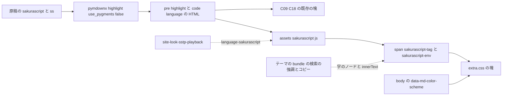
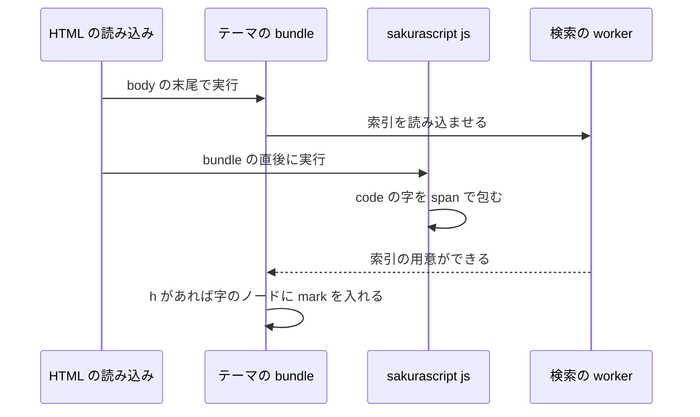
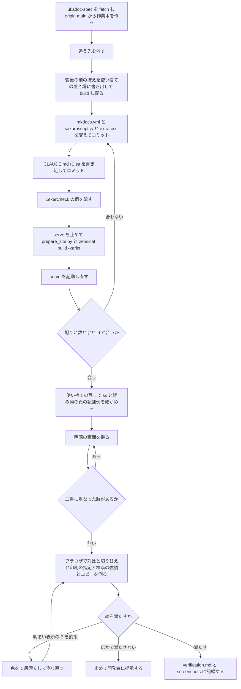

# Design Document: site-look-sakura-script-highlight

## Overview
**Purpose**: UKADOC のさくらスクリプトの記述例を読むゴースト制作者に、タグと環境変数を地の文からひと目で見分けられる見え方を届ける。`site-look-plan` で「採る」と決まった C10（タグと環境変数に色）・C19（太字）・C20（タグを赤紫に）・C21（薄い地）と、明るい表示のタグ・環境変数の濃さ（C17 から移した分）を、本番の書き方で ukadoc-spec に入れる。省略形の ```` ```ss ```` も `sakurascript` と同じに扱う。
**Users**: 記述例を読む・コピーするゴースト制作者（明・暗の表示、別のモニタ、幅 375 の狭い画面、印刷を含む）。言語の指定の無いコードブロック（162 個）の見え方は変えない。
**Impact**: ukadoc-spec の `mkdocs.yml` に `pymdownx.highlight`（`use_pygments: false`）と `extra_javascript` の 2 か所を足し、`assets/sakurascript.js`（新規）がタグと環境変数を `span` で包み、`assets/extra.css` の末尾の塊 1 つがその見た目を決める。`CLAUDE.md` の書式に `ss` を 1 行で書き足す。原稿・`scripts/prepare_site.py`・`requirements.txt` は変えない。

使い捨ての写し（`0eb3fb9`）にこの設計の変更をそのまま入れて build し、言語の印・字句の規則の数・見出しの id・本文の字・検索の強調・対比を確かめた（`research.md` の「設計の調査」）。

### Goals
- 原稿の ```` ```sakurascript ```` の 287 個（と ```` ```ss ````）に言語の印 `language-sakurascript` を付け、言語の指定の無い 162 個には付けない
- 記述例の中のタグを赤紫の太字に薄い地、環境変数を茶の太字に薄い地で見せる。地の文の色・太さ・折り返しは変えない
- タグと環境変数を Requirement 2 の規則（開発者の規則）どおりに切る（`\p23` は `\p2` と `3`、`\n1行削除` は `\n` と `1行削除`、引用符の中の `]` で切らない、`\_?…\_?` の中は地の文）
- 明るい表示は白地・コードの地・薄い地に 7:1 以上、暗い表示はコードの地・薄い地に 4.5:1 以上。暗い表示だけの色は画面だけに当てる
- 字・コピー・検索・見出しの id・コピーのボタン・C09・C18 を今のまま保つ。スクリプトが動かなければ今の見え方に戻る

### Non-Goals
- 言語の指定の無いブロックの着色（C25 の 6 個・SSTP の要求の例・`\![vanishbymyself]` の 1 例・`manual/` の木）、記述例の再生のボタン（`site-look-sstp-playback`）
- さくらスクリプトの外の言語の着色（Pygments の色付けは有効にしない）、等幅の字の指定
- 原稿（`.md`）・`.nav.yml`・`requirements.txt`・Zensical の版・`scripts/prepare_site.py`（`EXTENSIONS` を含む）
- 記述例の中身（タグの誤りなど）の直し、測りの道具の新設（`shot.mjs` は読むだけで使う）

## Boundary Commitments

### This Spec Owns
- `mkdocs.yml` の 2 か所: `markdown_extensions` の `pymdownx.highlight`（`use_pygments: false`）と、`extra_javascript` の `assets/sakurascript.js`
- `assets/sakurascript.js`（新規）: 字句の規則（Requirement 2）と、`code.language-sakurascript`・`code.language-ss` の字を包む処理。`ss` の `code` に `language-sakurascript` を足す処理（［仮定 A4］）
- 目印の名前: 言語の印 `language-sakurascript`（後続の `site-look-sstp-playback` が使う約束）、包みの class `sakurascript-tag`・`sakurascript-env`
- `assets/extra.css` の、見出しのコメント `/* site-look-sakura-script-highlight: 記述例のタグと環境変数 */` で始まる 1 つの塊と、その中の明・暗の 4 色
- `ukadoc-spec/CLAUDE.md` の書式の 7 番目の 1 行への `ss` の書き足し
- この spec の記録（`.kiro/specs/site-look-sakura-script-highlight/verification.md` と `screenshots/`。完了で `completed/` へ移る）

### Out of Boundary
- `scripts/prepare_site.py` のすべて（`EXTENSIONS` は `pymdownx.highlight` を足しても見出しの id が変わらないので、そろえない。`ss` のためにも変えない）
- `extra.css` のほかの塊（紺のテーマ・PR #10・記述例の折り返し・`site-look-list-items:` の 6 つ・`site-look-list-markers:` の 3 つ・後続 spec の塊）。C09・C18 の値と、記述例の箱の地 `#eef2f8`・`#1d2433`
- テーマの色の変数、リンクの色、コードの地の文の色、対応の札の色（3.7）
- 言語の指定の無いコードブロックの字と見え方（`site-look-manual-files` が当てる）、記述例の再生
- 原稿（`.md`）・`.nav.yml`・`requirements.txt`・Zensical の版、`site-look-plan` の成果物（目標の画面・試作・`tools/shot.mjs`）、`pasta/`・`areka/`・`shiori4/`

### Allowed Dependencies
- pymdown-extensions 12.1（`requirements.txt` に既にある）の `pymdownx.highlight`。`use_pygments: false` のとき、```` ```X ```` を `<pre class="highlight"><code class="language-X">` にし、言語の名前の無いものは `<pre class="highlight"><code>` にする。`pymdownx.superfences` はこの設定を使う
- Zensical 0.0.67 の `base.html`: `extra_javascript` を `bundle.*.min.js` の直後、`<body>` の末尾に普通の `<script src>` で読む。`bundle` の検索の強調（`?h=`）は検索の索引の読み込みを待ってから本文の字のノードを回す。コピーのボタンは `pre` の中の `code` の外に置き、字を `code` の `innerText` から取る
- `<body>` の `data-md-color-scheme`（`default`・`slate`）、テーマが暗い表示の色を `@media screen` の中だけで定める作り
- ブラウザの機能: `Element.replaceChildren`・`String.prototype.codePointAt`・正規表現の `y`、CSS の `:is()`・`color-mix()`。`color-mix()` の無いブラウザでは薄い地だけが出ず、色と太字は残る
- `site-look-list-items` の C09（`pre > code`）・C18（`h4 + .highlight` の並び）が、`pre.highlight > code` の形でも同じに効く書き方であること
- 確かめの道具: `zensical serve`、`python -m http.server`（変更の前の控えと使い捨ての写しを配る）、Node（字句の規則の確かめ）、Edge ヘッドレス + CDP か内蔵ブラウザの枠の JavaScript、`.kiro/specs/completed/site-look-plan/tools/shot.mjs`（読むだけ）

### Revalidation Triggers
- 言語の印（`language-sakurascript`）・`ss` のそろえ方・包みの class の名前を変えたとき: `site-look-sstp-playback` が記述例の見分け方を確かめ直す
- `mkdocs.yml` で `navigation.instant` を有効にしたとき: 頁を移ってもスクリプトが動き直さないので、`document$` に合わせる直しが要る
- Pygments の色付け（`use_pygments: true`）・`content.code.annotate`・行番号など、`code` の中に要素を足す設定を入れたとき: スクリプトは要素を持つ `code` を包まないので、着色が消える
- Zensical の版を上げたとき: スクリプトの読み込みの順・検索の強調の順・コピーの字の取り方・`pre.highlight` の形を確かめ直す
- 記述例に、今は無い形（`\\`・`\%`・`\q*[…]`・`%` と数字で始まる字）が入ったとき: タグ・環境変数の数と見え方を数え直す（9.3）
- 記述例に誤り（閉じない `[`・`"`・囲み、名前の字の無い `\`）が入ったとき: 頁に波線と警告が出る。原稿の直しを起票し、直るまで救済しない（2.11・9.13）
- 記述例の箱の地（C18）・コードの地・テーマの紺を変えたとき: 明・暗の対比を測り直す
- `site-look-manual-files` が言語の指定の無いブロックに仕掛けを当てるとき: 当て先が `code:not([class*="language-"])` で、このスクリプトの当て先と重ならないことを確かめる

## Architecture

### Existing Architecture Analysis
- `mkdocs.yml` は `markdown_extensions` を明示しているので、Zensical の既定の拡張は入らない。今は `pymdownx.superfences` だけがあり、コードブロックは `<div class="highlight"><pre><span></span><code>` で、言語の名前が HTML に残らない（Pygments に `sakurascript` は無い）
- `prepare_site.py` は `assets/` を丸ごと `_site_src/assets/` に写すので、`assets/` に足したファイルは設定を変えずに配られる。`EXTENSIONS` は `old_ids()`（原稿の見出しの id の計算）だけに使う
- `extra.css` の末尾は `site-look-list-markers: 既定値の札と字下げ` の塊。暗い表示だけの色は `@media screen` の中の `[data-md-color-scheme="slate"] …` で書く型
- C18 の箱は `pre`・`code` の地を透明にし、箱の地（明 `#eef2f8`・暗 `#1d2433`）を見せる。今の記述例のブロック 287 個はどれも箱の中にある
- `navigation.instant` は無い。頁を移るたびに頁を読み込み直すので、スクリプトは頁ごとに 1 回動けばよい

### Architecture Pattern & Boundary Map
選んだ形は「Markdown 拡張が言語の印を残し、ブラウザのスクリプトが印の付いた `code` の字を包み、見た目の指定は包みの class に当てる」（ギャップ分析の Option A）。



- 字句の規則は `sakurascript.js` の 1 か所に置く。見た目（色・太字・地）は `extra.css` の 1 つの塊に置き、スクリプトは class を付けるだけで色を持たない
- `ss` はスクリプトの中で `language-sakurascript` を足してそろえる。配る HTML には `language-ss` が残る（［仮定 A4］）
- 暗い表示だけの色は `@media screen` の中に書き、印刷は明るい表示の色にする（PR #10・`site-look-list-items`・`site-look-list-markers` と同じ）

### Technology Stack

| Layer | Choice / Version | Role in Feature | Notes |
|-------|------------------|-----------------|-------|
| Markdown | pymdown-extensions 12.1 の `pymdownx.highlight`（`use_pygments: false`） | 言語の印 `language-*` を残す | `requirements.txt` のまま。新しい依存は無い |
| ブラウザの仕掛け | 素の JavaScript（ES2020）の 1 ファイル `assets/sakurascript.js` | 字句の規則と `span` の包み | ライブラリ・外部の資源を読まない（5.5） |
| 見た目の指定 | CSS（`assets/extra.css`）、`:is()`・`color-mix()` | 色・太字・薄い地 | 塊 1 つ |
| サイト生成 | Zensical 0.0.67（`requirements.txt` のまま） | 頁・`extra.css`・スクリプトの配り | 版は変えない |
| 確かめ | `zensical serve`・`python -m http.server`・Node・Edge ヘッドレス + CDP・`shot.mjs` | 数・字・対比・画面 | 使い捨ての道具は Claude のスクラッチに置く |

## File Structure Plan

### Directory Structure
```
ukadoc-spec（作業木 .worktrees/site-look-sakura-script-highlight/、ブランチ site-look-sakura-script-highlight、origin/main 0eb3fb9 から）
├── mkdocs.yml                   # pymdownx.highlight と extra_javascript の 2 か所を足す
├── CLAUDE.md                    # 書式の 7 番目に ss を書き足す（1 行）
└── assets/
    ├── sakurascript.js          # 新規。字句の規則と、記述例の字を span で包む処理
    └── extra.css                # 末尾に site-look-sakura-script-highlight の塊を 1 つ足す

.kiro/specs/site-look-sakura-script-highlight/（doc_edit。完了で completed/ へ移る）
├── verification.md              # 新規。数・字・対比・画面の見比べ・失わないものの確かめの記録
└── screenshots/                 # 新規。下の「VerificationRecord」の画面
```

ukadoc-spec で変えるのは上の 4 ファイルだけである（10.1）。原稿・`.nav.yml`・`requirements.txt`・`scripts/prepare_site.py` には触れない。

### Modified Files

#### `mkdocs.yml`（ukadoc-spec の作業木）
```diff
@@ extra_css:
   - assets/extra.css
 
+extra_javascript:
+  - assets/sakurascript.js
+
 plugins:
@@ markdown_extensions:
   - mdx_truly_sane_lists
+  # コードブロックに言語の印（language-sakurascript など）を残す。色は付けない
+  - pymdownx.highlight:
+      use_pygments: false
   - pymdownx.superfences
```
- `use_pygments: false` なので Pygments の色付けは入らず、さくらスクリプトの外の言語にも色は付かない（Non-Goals）
- 写しで確かめた結果: 449 個のコードブロックが `<div class="highlight">` から `<pre class="highlight">` の形になり、`language-sakurascript` 287・言語の印の無い `<pre class="highlight"><code>` 162。41 の HTML（`404.html` を含む）のどれにもスクリプトの読み込みが 1 つ。`prepare_site.py` と `zensical build --strict` は exit 0
- `ss` の扱い: `extend_pygments_lang` は `use_pygments: false` では class の名前を替えない（ギャップ分析）ので、設定では寄せない。写しの ```` ```ss ```` は `<code class="language-ss">` になった

#### `assets/sakurascript.js`（ukadoc-spec の作業木、新規）
中身（下の LexerCheck の 30 例と、287 ブロックの数が合ったもの。設計のディスカッションで誤りを救済しない形に改め、Node で確かめ直した）:

```js
// site-look-sakura-script-highlight: さくらスクリプトの記述例のタグと環境変数を span で包み、誤りを示す（字は変えない）
(() => {
  const NUMBERED = { s: /[0-9]/, p: /[0-9]/, b: /[0-9]/, w: /[1-9]/ };
  const ENV = /%(?:\*|m\?|[A-Za-z_][A-Za-z0-9_]*)/y;
  const WHY = {
    args: '閉じる ] が無い（引数の " が閉じていないときも）',
    enclosure: '閉じる囲みの印が無い',
    backslash: '\\ の後にタグの名前が無い（\\ を字として見せるなら \\\\ と書く）',
  };

  // t[i] の [ に対になる ] の次の位置（閉じなければ -1）。\] と、引数の頭からの "…"（"" は " 1 字）の中の ] では終えない
  const argsEnd = (t, i) => {
    for (let j = i + 1, head = true; j < t.length; ) {
      if (head && t[j] === '"') {
        for (j++; j < t.length && !(t[j] === '"' && t[j + 1] !== '"'); j += t[j] === '"' ? 2 : 1);
        if (j >= t.length) return -1;
        j++;
        head = false;
        continue;
      }
      if (t[j] === ']') return j + 1;
      head = t[j] === ',';
      j += t[j] === '\\' && t[j + 1] === ']' ? 2 : 1;
    }
    return -1;
  };

  // [種類, 始め, 終わり, わけ] の並び。誤りはブロックの終わりまでとし、そこで読むのをやめる（救済しない）
  const tokens = (t) => {
    const out = [];
    const fail = (i, why) => (out.push(['error', i, t.length, why]), out);
    for (let i = 0; i < t.length; ) {
      if (t[i] === '\\') {
        if (t[i + 1] === '\\' || t[i + 1] === '%') { i += 2; continue; }
        let k = i + 1;
        while (t[k] === '_') k++;
        if (k >= t.length || t[k] === '\n' || t[k] === '\r') return fail(i, WHY.backslash);
        let e = k + (t.codePointAt(k) > 0xffff ? 2 : 1);
        const name = t.slice(i + 1, e);
        if (name === '_?' || name === '_!') {
          const close = t.indexOf('\\' + name, e);
          if (close < 0) return fail(i, WHY.enclosure);
          out.push(['tag', i, e], ['tag', close, close + 3]);
          i = close + 3;
          continue;
        }
        if (NUMBERED[name]?.test(t[e] ?? '')) e++;
        else if (t[e] === '[' && (e = argsEnd(t, e)) < 0) return fail(i, WHY.args);
        out.push(['tag', i, e]);
        i = e;
      } else if (t[i] === '%') {
        let e = -1;
        if (t.startsWith('%property[', i)) {
          if ((e = argsEnd(t, i + 9)) < 0) return fail(i, WHY.args);
        } else {
          ENV.lastIndex = i;
          if (ENV.exec(t)) e = ENV.lastIndex;
        }
        if (e < 0) { i++; continue; }
        out.push(['env', i, e]);
        i = e;
      } else i++;
    }
    return out;
  };

  // 警告に添える場所（記述例の前の見出しの id）
  const where = (code) => {
    for (let el = code.closest('pre'); el; el = el.previousElementSibling) {
      if (/^H[1-6]$/.test(el.tagName) && el.id) return `${location.pathname}#${el.id}`;
    }
    return location.pathname;
  };

  for (const code of document.querySelectorAll('code.language-sakurascript, code.language-ss')) {
    code.classList.add('language-sakurascript');
    if (code.children.length) { console.warn('sakurascript: 要素の入ったブロックには色を付けない', where(code)); continue; }
    const t = code.textContent;
    const nodes = [];
    let last = 0;
    for (const [kind, s, e, why] of tokens(t)) {
      const span = document.createElement('span');
      span.className = `sakurascript-${kind}`;
      span.textContent = t.slice(s, e);
      if (why) {
        span.title = why;
        console.warn(`sakurascript: ${why}`, where(code), t.slice(s, s + 40));
      }
      nodes.push(t.slice(last, s), span);
      last = e;
    }
    code.replaceChildren(...nodes, t.slice(last));
    if (code.textContent !== t) { code.textContent = t; console.warn('sakurascript: 字が変わるので包まずに戻した', where(code)); }
  }
})();
```

書き方のわけ（注に書かず、ここに残す）:
- **字句の規則の形**: 正規表現 1 本でなく、小さな手書きの走査にした。引数の頭だけで `"…"` を見る・`\_?` の対を探す・番号を 4 つのタグにだけ付ける、の 3 点を 1 本の正規表現で書くと読めなくなるため。ギャップ分析の突き合わせの正規表現（`DEVQ`）とは、番号の 4 つの限りと囲みの中の 2 点だけが違う
- **包み方**: `innerHTML` を組み立てず、`span` を作って `textContent` を入れる。字をエスケープする要がなく、`<`・`&` を含む記述例でも字が変わらない（5.1）
- **誤りを救済しない**（2.5・2.6・2.10・2.11）: UKADOC は正典なので、閉じない `[`・`"`・囲み、名前の字の無い `\` を見つけたら、その所からブロックの終わりまでを `span.sakurascript-error` にし、そこで読むのをやめる。名前までをタグにして読み進めるような救済はしない。`title` にわけを入れ、`console.warn` に頁・見出しの id・誤りの頭の 40 字を出す。字は変えない
- **字が同じことの確かめ**: 本番に `console.assert` は残さない。包んだ後の字が違えば、その場で包む前の字に戻し、`console.warn` で知らせる（黙って戻さない）。規則の確かめは LexerCheck（使い捨て）で行い、結果を `verification.md` に残す
- **`code.children.length` の確かめ**: 先にほかの仕掛け（検索の強調など）が `code` の中に要素を入れたときは、そのブロックを包まず、`console.warn` で知らせる。字を作り直すとその要素（`mark`）が消えるため。今の順では検索の強調はこのスクリプトの後に動く（下の「検索の強調の順」）。2 回流しても二重に包まない
- **`ss`**: `language-ss` の `code` に `language-sakurascript` を足してから同じに包む（1.2・［仮定 A4］）。見た目の指定は包みの class に当てるので、`language-ss` を CSS で名指ししない
- **当て先**: `document.querySelectorAll` で頁のすべての記述例のブロックを見る。まとめ頁の外（読み物の頁）でも同じに効く（1.4）。言語の指定の無い `code` には当たらない（1.3）

#### `assets/extra.css`（ukadoc-spec の作業木）
今の末尾（`site-look-list-markers: 既定値の札と字下げ` の塊）の後ろに、次の塊を足す。ほかの塊は変えない。

```css
/* site-look-sakura-script-highlight: 記述例のタグと環境変数 */
.md-typeset :is(.sakurascript-tag, .sakurascript-env) {
  border-radius: .15em;
  background: color-mix(in srgb, currentColor 9%, transparent);
  font-weight: 700;
}
.md-typeset .sakurascript-tag { color: #8a0d4f; }
.md-typeset .sakurascript-env { color: #7a2e0a; }
.md-typeset .sakurascript-error { text-decoration: underline wavy #c62828; text-decoration-skip-ink: none; }
@media screen {
  [data-md-color-scheme="slate"] .md-typeset .sakurascript-tag { color: #f48fb1; }
  [data-md-color-scheme="slate"] .md-typeset .sakurascript-env { color: #f6ad7b; }
  [data-md-color-scheme="slate"] .md-typeset .sakurascript-error { text-decoration-color: #ff8a80; }
}
```

指定のわけ:
- **C10・C20・C17 の色**: 明るい表示の色（タグ `#8a0d4f`・環境変数 `#7a2e0a`）を表示の条件なしに置き、暗い表示の色（`#f48fb1`・`#f6ad7b`）を `@media screen` の中の `[data-md-color-scheme="slate"]` に置いた。試作の 3 段（C10 の青を C17・C20 で上書き）を 1 段にした。暗い表示の指定の詳細度（0,3,0）が明るい表示（0,2,0）に勝つ。暗い表示のまま印刷すると明るい表示の色で出る（4.2）
- **C19 の太字**: `font-weight: 700` だけ。等幅の字の太さを変えても字の幅は変わらず、折り返しの位置は変わらない（試作の C19。実装で 287 ブロックの高さを前後で比べる。3.4）
- **C21 の薄い地**: 字の色の 9% を `currentColor` から作るので、明・暗・タグ・環境変数の 4 色に 1 つの指定で効く。`padding` を付けず、字の幅と折り返しを変えない（3.4）。角の丸み `.15em` は試作のまま
- **誤りの見え方**（2.11・3.8）: 字の色・太さ・地を変えず、赤い波線の下線だけを引く。字の幅と折り返しは変わらない。下線の色は明 `#c62828`・暗 `#ff8a80`（タグの赤紫と色相で分ける）。見込みの対比は箱の地の上で明 5.1:1・暗 7.0:1（線は 3:1。実装で測る）。`text-decoration-skip-ink: none` で、字の下がりの所でも線を切らない
- **class の名前**: `sakurascript-tag`・`sakurascript-env`・`sakurascript-error`。試作の `slp-` を使わない（10.8）。テーマの Pygments の短い class（`.k`・`.s`・`.ss`・`.nt` など）とは字の並びが違い、重ならない。まとめ頁だけの目印でない（1.4）ので `bundle-<役>` の決まりにはそろえない
- **地の文**: 包みの外の字の色・太さには触れない（3.3）

#### `CLAUDE.md`（ukadoc-spec の作業木）
書式の決まりの 7 番目を次にする（8.1）。ほかの行は変えない（8.2）。
```diff
-  7. `## 記述例`（さくらスクリプトは ```` ```sakurascript ```` のコードブロック）
+  7. `## 記述例`（さくらスクリプトは ```` ```sakurascript ```` のコードブロック。省略形の ```` ```ss ```` も同じ言語として使える）
```

### 部品とファイルの対応
| 部品 | ファイル | 扱い |
|---|---|---|
| LanguageMark | `mkdocs.yml` の `pymdownx.highlight` | 足す |
| ScriptEntry | `mkdocs.yml` の `extra_javascript` | 足す |
| Highlighter | `assets/sakurascript.js` | 新規 |
| TokenStyle | `assets/extra.css`「記述例のタグと環境変数」 | 足す |
| FormatRule | `CLAUDE.md` の書式の 7 番目 | 1 行を変える |
| LexerCheck | なし（Node の使い捨てのスクリプトと例の表。置き場は Claude のスクラッチ。例と結果は `verification.md`） | 作らない |
| PageCheck | なし（配られた HTML とブラウザの頁を数える使い捨てのスクリプト。手順と結果は `verification.md`） | 作らない |
| ContrastProbe | なし（Edge ヘッドレス + CDP か内蔵ブラウザの枠の JavaScript。式と結果は `verification.md`） | 作らない |
| ShotTool | `.kiro/specs/completed/site-look-plan/tools/shot.mjs` | 読むだけで使う |
| VerificationRecord | `.kiro/specs/site-look-sakura-script-highlight/verification.md`・`screenshots/` | 新規 |

## System Flows

### 頁の中の順

- 検索の強調は、索引の読み込みを待ってから動くので、スクリプトの包みの後に動く。写しの `?h=raise` で、記述例の中の `mark` 16 個のうち 12 個がタグの `span` の中に入った（7.1）
- 逆の順（スクリプトの読み込みが索引より遅い）になっても、`mark` の入った `code` は包まないので強調は消えない。そのブロックは色が付かないだけになる

### 作業の流れ

- A・B（`workflow.md` の「ukadoc-spec の作業木」）: `git -C ukadoc-spec fetch origin` → `git -C ukadoc-spec worktree add ../.worktrees/site-look-sakura-script-highlight -b site-look-sakura-script-highlight origin/main` → `git -C .worktrees/site-look-sakura-script-highlight branch --unset-upstream`（10.4）
- C: 作業木の HEAD を `git archive` で Claude のスクラッチの新しいフォルダに書き出し、`prepare_site.py` と `zensical build --strict` を流して、`_site/` を `python -m http.server` で 8000 以外の口（例: 8030）に配る。`ukadoc-spec/` のメインのチェックアウトは使わない
- D・E のコミットは `-c user.name=ekicyou -c user.email=dot.station@gmail.com` で名前を渡す。push と PR は `/kiro-complete` で行う
- G: `serve` は `_site_src/` を見るので、動かしたまま `prepare_site.py` を流さない（書きかけを拾って 404 になる）
- J（9.5・1.4・［仮定 A5］）: 作業木の HEAD をもう 1 つ書き出し、`list/sakura-script/environment-variable/environmentvariable.md` の末尾に ```` ```ss ```` のブロック 1 つ、`memo/memo.md` の末尾に見出しと ```` ```ss ```` 1 つ・```` ```sakurascript ```` 1 つ、誤りのある ```` ```sakurascript ```` 1 つ（閉じない `[`。9.13）を足して build し、別の口で配って確かめる（誤りのブロックは明・暗で波線・`title`・`console.warn` を見て、画面を `after-error-{light,dark}.png` に撮る）。終わったら写しごと消す。作業木と原稿には残さない
- O: 明るい表示のタグ・環境変数が 7:1 を割ったときは、［仮定 A2］の決定どおり、赤紫（茶）の色相のまま HSL の明るさを 2% ずつ下げる（タグの 1 段目は `#810c4a`。見込みで箱の薄い地に 7.58:1）。薄い地の 9% は変えない
- P: 暗い表示の 4.5:1・C09・C18 の形・字・id などが合わないときは、値を勝手に選び直さず、測った数を添えて開発者に提示して判断を待つ

## Requirements Traceability

| Requirement | Summary | Components | Interfaces | Flows |
|-------------|---------|------------|------------|-------|
| 1.1 | `sakurascript` の 287 個に言語の印 | LanguageMark, PageCheck | `code.language-sakurascript` | I |
| 1.2 | `ss` に同じ印と見え方 | Highlighter（`language-sakurascript` を足す）, PageCheck | `code.language-ss` → 同じ class | J |
| 1.3 | 言語の名前の無いもの・ほかの言語に印を付けない | LanguageMark, Highlighter（当て先を 2 つの class に限る）, PageCheck | `<pre class="highlight"><code>` 162 | I |
| 1.4 | まとめ頁の外でも同じ | LanguageMark（サイト全体）, Highlighter（頁を問わない）, PageCheck | 写しの `memo/memo` | J |
| 2.1 | `\` + `_`* + 1 字の名前と、番号か引数まで | Highlighter（`tokens()`）, LexerCheck | 例の表 | F |
| 2.2 | 番号は `\s`・`\p`・`\b`（0〜9）・`\w`（1〜9）だけ、1 桁 | Highlighter（`NUMBERED`）, LexerCheck | `\p23`・`\w9`・`\w0`・`\n1行削除`・`\s3[x]` | F |
| 2.3 | `[` から最初の `]` まで。`\]` と頭の `"…"` で終えない | Highlighter（`argsEnd()`）, LexerCheck | `\q[…"…]"]`・`""` | F |
| 2.4 | 引数の外の `\\`・`\%` は地の文 | Highlighter, LexerCheck | `a\\b\%c` | F |
| 2.5 | 閉じない `[`・`"`・`%property[` は終わりまで誤り | Highlighter（`argsEnd()` が -1 で `fail()`）, LexerCheck | `\![raise,OnTest\e`・`\![raise,"abc]` | F |
| 2.6 | `\_?…\_?`・`\_!…\_!` の両端だけタグ、中は地の文。閉じなければ誤り | Highlighter, LexerCheck | `\_?\1\n%username\_?`・`\_?\1終わらない` | F |
| 2.7 | 環境変数の 4 つの形 | Highlighter（`ENV`・`%property[`）, LexerCheck | `%username`・`%*`・`%m?`・`%property[…]` | F |
| 2.8 | 名前の形でない `%` は地の文 | Highlighter, LexerCheck | `50%で` | F |
| 2.9 | 引数の中の `%…` はタグの一部 | Highlighter（引数ごと取る）, LexerCheck | `\![raise,%username]` | F |
| 2.10 | 名前の字の無い `\` は終わりまで誤り | Highlighter（`fail()`）, LexerCheck | `末尾\`・`\`＋改行 | F |
| 2.11 | 誤りを波線とわけで見せ、警告を出す。救済しない | Highlighter（`sakurascript-error`・`title`・`console.warn`）, TokenStyle, PageCheck | 写しの誤りのブロック | F, J |
| 3.1 | タグを赤紫の太字に薄い地 | TokenStyle, ShotTool | `.sakurascript-tag` | K |
| 3.2 | 環境変数を違う色の太字に薄い地 | TokenStyle, ShotTool | `.sakurascript-env` | K |
| 3.3 | 色を変えるのは 2 つだけ、地の文は今のまま | TokenStyle（包みの class だけ）, PageCheck | 塊の中のセレクタ | I |
| 3.4 | 字の大きさ・形・折り返しを変えない | TokenStyle（`padding` なし・大きさの指定なし）, PageCheck | 287 ブロックの高さを前後で比べる | M |
| 3.5 | 明るい表示 7:1 | TokenStyle, ContrastProbe | 測る所と線 | M, O |
| 3.6 | 暗い表示 4.5:1 | TokenStyle, ContrastProbe | 測る所と線 | M |
| 3.7 | リンク・箱の地・地の文・札の色を変えない | TokenStyle（自分の class だけ） | 差分 | — |
| 3.8 | 誤りの下線は赤紫と分け、コードの地に 3:1 以上 | TokenStyle（`.sakurascript-error`）, ContrastProbe | 下線の色と地 | J, M |
| 4.1 | 切り替えで読み込み直さずに変わる | TokenStyle（`body` の属性と `currentColor`）, ContrastProbe | 切り替えの前後の `color` | M |
| 4.2 | 暗い表示のまま印刷しても明るい色 | TokenStyle（暗い表示は `@media screen`）, ContrastProbe | 見た目の指定の木（CSSOM） | M |
| 5.1 | 字を変えず包むだけ | Highlighter（`textContent` を入れ、違えば戻す）, PageCheck, LexerCheck | 包む前後の字の違い 0 | F, I |
| 5.2 | コピーの字が今と同じ | Highlighter（`code` の中だけ）, PageCheck | `innerText.trimEnd()` の前後とボタンのコピー | M |
| 5.3 | `\` を `\` のまま | TokenStyle（字の形の指定なし）, ShotTool | 画面 | K |
| 5.4 | 仕掛けが動かなければ今と同じ | Highlighter（包むのはスクリプトだけ）, PageCheck | スクリプトを切った頁 | M |
| 5.5 | 外部を読まない | Highlighter（読み込みなし）, PageCheck | 頁の通信の一覧 | M |
| 6.1 | 449 個の地・C18・C09・ボタンを今と同じに | LanguageMark, PageCheck, ShotTool | 箱・点線・重なりの数 | I, K |
| 6.2 | 言語の指定の無いブロックの字と見え方 | Highlighter（当て先外）, PageCheck | 本文の字・画面 | I |
| 7.1 | 検索で引け、強調が記述例の中で見える | Highlighter（順と `children` の確かめ）, PageCheck（`search.json` の字）, ContrastProbe | `?h=` の `mark` | I, M |
| 7.2 | 見出しの id・¶・目次 | LanguageMark（見出しに触れない）, PageCheck | id の並び・`headerlink`・`md-nav__link` | I |
| 7.3 | 幅 375 | TokenStyle, ShotTool | `scrollWidth`・`innerWidth` | K |
| 8.1 | `CLAUDE.md` に `ss` を書き足す | FormatRule | 7 番目の行 | E |
| 8.2 | ほかの決まりと原稿の `sakurascript` を変えない | FormatRule | `git diff --stat` | E |
| 9.1 | 配りの確かめ（指定・スクリプト 200・頁ごとに 1 回） | PageCheck | `/ukadoc-spec/assets/…` | H, I |
| 9.2 | 287・449・162 を記録 | PageCheck, VerificationRecord | 下の PageCheck の表 | I |
| 9.3 | タグ・環境変数の数と試作との違いを記録 | LexerCheck, PageCheck, VerificationRecord | 500・6・13 か所 | F, I |
| 9.4 | 包む前後の字の違い 0、コピーの字 | PageCheck, VerificationRecord | 287 ブロック | I, M |
| 9.5 | `ss` を使い捨ての写しで確かめる | PageCheck, VerificationRecord | 写しの数 | J |
| 9.6 | 目標の画面と同じ位置・大きさで明・暗 | ShotTool, VerificationRecord | `#bang-lock-repaint`・1000×700 | K |
| 9.7 | 写っていないものを明・暗で撮る | ShotTool, VerificationRecord | `#environmentvariable`・`#pID`・`#q-script` | K |
| 9.8 | 対比を明・暗で測り、変数で出せない色を記録 | ContrastProbe, VerificationRecord | 4 色と地 | M, Q |
| 9.9 | C18・C09・ボタンの前後の見比べ | PageCheck, ShotTool, VerificationRecord | 箱・点線・重なりの数 | I, K |
| 9.10 | 全頁の id・¶・目次の数が前後で同じ | PageCheck, VerificationRecord | 控えとの比べ | C, I |
| 9.11 | 二重に重なった画面を撮り直す | ShotTool | 画面の目視 | L |
| 9.12 | 見せる前に Ctrl+F5 を頼む | VerificationRecord | — | — |
| 9.13 | 全頁の誤り 0、誤りの見え方と警告を写しで確かめる。1 個でもあれば完了にしない | LexerCheck, PageCheck, ShotTool, VerificationRecord | 誤りの数・`after-error-*` | F, I, J |
| 10.1 | 変えるのは 4 ファイルだけ | LanguageMark, ScriptEntry, Highlighter, TokenStyle, FormatRule | `git diff --stat origin/main` | — |
| 10.2 | `requirements.txt` を変えない | LanguageMark（入っている包み） | 差分 | — |
| 10.3 | 末尾に塊、注は 1 行、スクリプトの注も短く | TokenStyle, Highlighter | 見出しのコメント | — |
| 10.4 | 自分の作業木で `origin/main` の上に書く | （作業木） | `.worktrees/site-look-sakura-script-highlight/` | A, B |
| 10.5 | Build Gate と規約 Gate | すべての変更 | `prepare_site.py`・`build --strict` | G |
| 10.6 | 完了でこの spec だけの PR を作りスクワッシュマージ | （`/kiro-complete`） | PR の説明の決まり | — |
| 10.7 | `origin/main` とぶつかったら追いつき両方残す | TokenStyle（独立した塊）, LanguageMark・ScriptEntry（行の足し） | 見出しのコメントの区切り | — |
| 10.8 | 旧サイト・試作を写さず書き直す、`slp-` を使わない | Highlighter, TokenStyle | class の名前 | — |

## Components and Interfaces

| Component | Domain/Layer | Intent | Req Coverage | Key Dependencies | Contracts |
|-----------|--------------|--------|--------------|------------------|-----------|
| LanguageMark | 設定（`mkdocs.yml`） | 記述例のブロックに言語の印を残す | 1.1, 1.3, 1.4, 6.1, 7.2, 10.1, 10.2, 10.7 | pymdownx.highlight（P0） | State |
| ScriptEntry | 設定（`mkdocs.yml`） | スクリプトをどの頁でも 1 回読む | 9.1, 10.1, 10.7 | Zensical の `base.html`（P0） | State |
| Highlighter | ブラウザの仕掛け（`assets/sakurascript.js`） | 字句の規則でタグと環境変数を `span` で包む | 1.2〜1.4, 2.1〜2.11, 5.1, 5.2, 5.4, 5.5, 6.2, 7.1, 10.3, 10.8 | LanguageMark（P0）、bundle の順（P1） | Service, State |
| TokenStyle | 見た目の指定（`extra.css`） | 色・太字・薄い地（明・暗・印刷） | 3.1〜3.8, 2.11, 4.1, 4.2, 5.3, 7.3, 10.3, 10.7, 10.8 | Highlighter（P0）、C18 の地（P1） | State |
| FormatRule | 書式の決まり（`CLAUDE.md`） | `ss` が使えることを書く | 8.1, 8.2 | — | — |
| LexerCheck | 確かめ（使い捨て） | 字句の規則を例と全ブロックで確かめる | 2.1〜2.11, 5.1, 9.3, 9.13 | Node（P0） | Service |
| PageCheck | 確かめ（使い捨て） | 配り・数・字・id・形・コピー・`ss` | 1.1〜1.4, 3.3, 3.4, 5.1, 5.2, 5.4, 5.5, 6.1, 6.2, 7.1, 7.2, 9.1〜9.5, 9.9, 9.10, 9.13 | `serve` と控えの配り（P0） | Service |
| ContrastProbe | 確かめ（使い捨て） | 対比・切り替え・印刷の指定・検索の強調 | 3.5, 3.6, 4.1, 4.2, 7.1, 9.8 | Edge ヘッドレス + CDP（P0） | Service |
| ShotTool | 確かめ（`shot.mjs`。読むだけ） | 明・暗・幅 375 の画面 | 3.1, 3.2, 5.3, 6.1, 7.3, 9.6, 9.7, 9.9, 9.11 | Edge（P0） | 既存のまま |
| VerificationRecord | 記録 | 数と見比べの結果を残す | 9.2〜9.12 | 上の確かめの結果（P0） | State |

### 設定

LanguageMark・ScriptEntry・FormatRule は新しい境目を持たない設定と書式の行で、中身は上の「Modified Files」のとおりである。
- LanguageMark の約束: 言語の名前 `X` のブロックは `<pre class="highlight"><code class="language-X">`、名前の無いブロックは `<pre class="highlight"><code>` になる。`code` の中は字だけ（要素を持たない）。末尾の改行は HTML から消える（コピーは `trimEnd()` するので字は変わらない）
- ScriptEntry の約束: すべての頁で `bundle.*.min.js` の直後に `assets/sakurascript.js` が 1 回読まれる。`build --strict` はファイルが無くても気づかないので、`serve` で 200 を確かめる（9.1）

### ブラウザの仕掛け

#### Highlighter

| Field | Detail |
|-------|--------|
| Intent | 記述例のブロックの字を、Requirement 2 の規則でタグと環境変数に切り、`span` で包む |
| Requirements | 1.2〜1.4, 2.1〜2.11, 5.1, 5.2, 5.4, 5.5, 6.2, 7.1, 10.3, 10.8 |

**Responsibilities & Constraints**
- 当て先は `code.language-sakurascript` と `code.language-ss` だけ。`ss` には `language-sakurascript` を足す
- 字句の規則（下の表）でタグと環境変数の範囲を出し、範囲を `span.sakurascript-tag`・`span.sakurascript-env` にし、間の字は字のノードのまま残す
- 字を 1 字も変えない。包んだ後の `textContent` が違えば、包む前の字に戻す。要素を持つ `code` は触らない
- 外部の資源を読まず、頁の外に何も送らない。色・大きさの指定を持たない（見た目は TokenStyle）

**字句の規則**（Requirement 2。走査は左から 1 字ずつ。位置は UTF-16 の位置）

| 見る所 | 形 | 結果 | 要件 |
|---|---|---|---|
| `\` の後が `\` か `%` | `\\`・`\%` | 2 字を地の文にして先へ | 2.4 |
| `\` の後に `_` が 0 個以上と 1 字（改行でない） | 名前 `\X`・`\_X`・`\__X` | 名前までをタグの頭とする。1 字はサロゲートの対を 1 字に数える | 2.1 |
| `\` の後（`_` の後）がブロックの終わりか改行 | 名前の字の無い `\` | `\` からブロックの終わりまでを誤り（わけ: 名前が無い） | 2.10, 2.11 |
| 名前が `\_?`・`\_!` | 囲み | 名前をタグにし、次の同じ名前までを地の文、その名前をタグにする。無ければ開く印からブロックの終わりまでを誤り（わけ: 閉じる印が無い） | 2.6, 2.11 |
| 名前が `\s`・`\p`・`\b` で次が 0〜9、`\w` で次が 1〜9 | 番号 | 1 桁までをタグ。後ろの `[` は引数にしない | 2.2 |
| ほかで名前の次が `[` | 引数 | `argsEnd()` の位置までをタグ。閉じなければ `\` からブロックの終わりまでを誤り（わけ: `]` が無い） | 2.3, 2.5, 2.9, 2.11 |
| `argsEnd()` の中 | `\]`、頭の `"…"` | `\]` は 2 字で読み飛ばす。`[` か `,` の直後の `"` から、`""` を 1 字に数えて閉じの `"` までを読み飛ばす（閉じなければ閉じない `[` と同じ）。それ以外の最初の `]` で終わる | 2.3, 2.5 |
| `%property[` | 環境変数の引数 | `argsEnd()` の位置まで。閉じなければ `%` からブロックの終わりまでを誤り | 2.5, 2.7 |
| `%` の後が `*`・`m?`・英字か `_` で始まる英字と数字と `_` | 環境変数 | その字までを環境変数 | 2.7 |
| 誤りを見つけた後 | ― | そこで読むのをやめる（後ろのタグを見分けて救済しない） | 2.11 |
| ほかの `%`・字 | 地の文 | 1 字進む | 2.8 |

**Contracts**: Service [x] / State [x]

##### Service Interface
```typescript
type TokenKind = "tag" | "env" | "error";
type Token = readonly [kind: TokenKind, start: number, end: number, why?: string]; // [start, end) は UTF-16 の位置。why は error だけ（end は字の長さ）

/** t[open] が "[" のとき、対になる "]" の次の位置。閉じなければ -1 */
declare function argsEnd(t: string, open: number): number;

/** 記述例の字の、タグと環境変数の範囲。昇順で重ならない */
declare function tokens(t: string): Token[];
```
- 事前条件: `t` はブロックの `textContent`（HTML の実体参照を戻した後の字）
- 事後条件: 範囲は昇順で重ならず、どれも長さ 1 以上。`error` は最後の 1 つだけで、ブロックの終わりまで。範囲の外の字と中の字をつなぐと `t` に戻る。`tokens()` は例外を投げない（どの字の並びでも終わる）
- どちらも即時関数の中に閉じ、頁のグローバルに名前を出さない

##### State Management
- 前: `<code class="language-sakurascript">` か `<code class="language-ss">` の中は字のノード 1 つ
- 後: `class` に `language-sakurascript` があり、中は字のノードと `<span class="sakurascript-tag">`・`<span class="sakurascript-env">` の並び（誤りがあれば最後に `<span class="sakurascript-error" title="わけ">`）。`textContent` と `innerText` は前と同じ
- 頁ごとに 1 回、読み込みの時に動く。後から足された `code` は見ない（`navigation.instant` は無い）

**Implementation Notes**
- Integration: `extra_javascript` で `bundle` の直後に読む。検索の強調はその後に動く（「頁の中の順」）
- Validation: LexerCheck・PageCheck（下）
- Risks: スクリプトが例外で止まると、それより後のブロックは包まれず今の見え方になる（どのブロックも 1 回の `replaceChildren` で入れ替えるので、半分だけ包まれたブロックはできない）

### 見た目の指定

TokenStyle は新しい境目を持たない見た目の指定で、中身は上の「Modified Files」の塊そのものである。

**Contracts**: State [x]

##### State Management
- 状態は `span` の class と `<body>` の `data-md-color-scheme` だけで決まる。切り替えで属性が変わると、読み込み直さずに色が替わり、薄い地も `currentColor` から作り直される（4.1）
- 暗い表示だけの 2 色は `@media screen` の中にあり、印刷では明るい表示の色になる（4.2）
- 変数で出せない色はタグ・環境変数の 4 色（明 `#8a0d4f`・`#7a2e0a`、暗 `#f48fb1`・`#f6ad7b`）と誤りの下線の 2 色（明 `#c62828`・暗 `#ff8a80`）で、対比を下に残す（9.8・3.8）

### 確かめ

#### LexerCheck

| Field | Detail |
|-------|--------|
| Intent | 作業木の `assets/sakurascript.js` そのものを、偽の `document` の上で Node で流し、例の表と原稿の全ブロックで確かめる |
| Requirements | 2.1〜2.11, 5.1, 9.3, 9.13 |

**Responsibilities & Constraints**
- 置き場は Claude のスクラッチ。ukadoc-spec にテストのファイルは足さない（10.1）。設計のときの見本は `…\scratchpad\design\check.mjs`・`cases.json`・`diff-proto.mjs`
- 偽の `document` は `querySelectorAll`・`createElement` だけを持ち、偽の `code` は `textContent`・`children`・`classList.add`・`replaceChildren` を持つ。スクリプトの字は変えずに `vm` で流す
- 例の表（下）のすべてが期待どおりで、字が変わらない。`ss` の `code` に `language-sakurascript` が付く。2 回流しても二重に包まない
- 原稿の記述例のブロック 287 個で、字が変わらないブロック 287、タグ 500、環境変数 6（`%username`・`%ms`・`%mp`・`%mh`・`%me`・`%mt`）、誤り 0・警告 0（9.13）。試作の正規表現（`mockups/mockup.js` の C10）と見分け方が違う所 13 か所

##### Service Interface
```typescript
interface LexerCase { input: string; expected: string }  // expected は "[tag:\\p2]·3" の形（[種類:字] と ·地の文）
interface LexerResult {
  cases: { input: string; got: string; ok: boolean }[];   // ok がすべて true
  ssMarked: boolean; idempotent: boolean;                  // どちらも true
  corpus: { blocks: number; sameText: number; tags: number; envs: number; envNames: string[]; errors: number; warns: number }; // errors・warns は 0
  protoDiffs: { page: string; proto: string; ours: string }[]; // 13 か所
}
```

例の表（設計のディスカッションの後に 30 例すべてが合った。見本は `…\scratchpad\strict\check.mjs`）:

| 入力 | 期待（`[種類:字]` と `·地の文`） | 要件 |
|---|---|---|
| `\p23` | `[tag:\p2]·3` | 2.2 |
| `\n1行削除` | `[tag:\n]·1行削除` | 2.2 |
| `\w9` | `[tag:\w9]` | 2.2 |
| `\w0` | `[tag:\w]·0` | 2.2 |
| `\b2` | `[tag:\b2]` | 2.2 |
| `\s3[x]` | `[tag:\s3]·[x]` | 2.2 |
| `\s[10]` | `[tag:\s[10]]` | 2.1, 2.3 |
| `\_w[100]` | `[tag:\_w[100]]` | 2.1 |
| `\__q[a,b]x` | `[tag:\__q[a,b]]·x` | 2.1 |
| `\q[その１,"script:\q[その２,script:その３はない]"]` | 全体が 1 つのタグ | 2.3 |
| `\![call,ghost,"the ""MobileMaster"""]\e` | `[tag:\![call,ghost,"the ""MobileMaster"""]][tag:\e]` | 2.3 |
| `\q[a\]b,c]` | 全体が 1 つのタグ | 2.3 |
| `\_?\1\n%username\_?\e` | `[tag:\_?]·\1\n%username[tag:\_?][tag:\e]` | 2.6 |
| `\_!\0\_!` | `[tag:\_!]·\0[tag:\_!]` | 2.6 |
| `\0\_?\1終わらない` | `[tag:\0][error:\_?\1終わらない]`、警告 1 | 2.6, 2.11 |
| `a\\b\%c` | すべて地の文 | 2.4 |
| `50%で` | すべて地の文（誤りにしない） | 2.8 |
| `%20です` | すべて地の文（名前は英字か `_` で始まる） | 2.7 |
| `%username` | `[env:%username]` | 2.7 |
| `%selfname2さん` | `[env:%selfname2]·さん` | 2.7 |
| `%m?と%*と%ms` | `[env:%m?]·と[env:%*]·と[env:%ms]` | 2.7 |
| `%property[currentghost.name]です` | `[env:%property[currentghost.name]]·です` | 2.7 |
| `\![raise,%username]` | `[tag:\![raise,%username]]` | 2.9 |
| `\0\![raise,OnTest\e` | `[tag:\0][error:\![raise,OnTest\e]`、警告 1 | 2.5, 2.11 |
| `\![raise,"abc]\e` | `[error:\![raise,"abc]\e]`、警告 1（`"` が閉じない） | 2.5, 2.11 |
| `%property[abc\e` | `[error:%property[abc\e]`、警告 1 | 2.5, 2.11 |
| `末尾\` | `·末尾[error:\]`、警告 1 | 2.10, 2.11 |
| `\`＋改行＋`\0` | `[error:\`＋改行＋`\0]`、警告 1 | 2.10, 2.11 |
| `\__`＋改行 | `[error:\__`＋改行`]`、警告 1 | 2.10, 2.11 |
| `\😀x` | `[tag:\😀]·x` | 2.1（サロゲートの対を 1 字） |
| ```` ```ss ```` の `\0\s[0]` | `language-sakurascript` が付き `[tag:\0][tag:\s[0]]` | 1.2 |
| 同じ `code` に 2 回流す | `[tag:\0]` のまま（2 回目は警告 1 で包まない） | 5.1 |

誤りの無い例で警告が出ないことも、各例で確かめた（警告の数は表のとおり）。

試作と見分け方が違う 13 か所（`0eb3fb9`。要件 9.3 の見込みの 12 か所に、`surface/sID.md` の `\s1` を足し、`\w9` 6 を `\w9` 5・`\w2` 1 に直した）:

| 頁の原稿 | 試作 | この設計 |
|---|---|---|
| `wait/w.md` | `\w` 4 か所（後ろの `9`・`9`・`9`・`2` が地の文） | `\w9` 3・`\w2` 1 |
| `font/f-align.md` | `\w` 2 か所 | `\w9` 2 |
| `scope/pID.md` | `\p` 2 か所 | `\p2`・`\p3`（後ろの `3`・`4` は地の文） |
| `balloon-text/bID.md` | `\b` | `\b2` |
| `surface/sID.md` | `\s` | `\s1` |
| `choice/q-script.md` | `\q[その１,"script:\q[その２,script:その３はない]`（`"]` が地の文） | 全体が 1 つのタグ |
| `balloon-text/_-q.md` | 囲みの中の `\1`・`\n` もタグ | 囲みの中は地の文 |

#### PageCheck

| Field | Detail |
|-------|--------|
| Intent | 作業木の `serve` と変更の前の控えの HTML とブラウザの頁で、配り・数・字・id・形・コピーを比べる |
| Requirements | 1.1〜1.4, 3.3, 3.4, 5.1, 5.2, 5.4, 5.5, 6.1, 6.2, 7.1, 7.2, 9.1〜9.5, 9.9, 9.10, 9.13 |

**Responsibilities & Constraints**
- 配り（9.1）: `serve` の `/ukadoc-spec/assets/extra.css` に `site-look-sakura-script-highlight:` の見出しのコメントがあり、`/ukadoc-spec/assets/sakurascript.js` が 200。全頁の HTML に `assets/sakurascript.js` の読み込みが 1 つずつ
- 数（1.1・1.3・9.2）: 全頁の `article` の中で `<pre class="highlight">` 449、`<code class="language-sakurascript">` 287、`<pre class="highlight"><code>` 162、`language-ss` 0、`<div class="highlight">` 0
- 字（5.1・9.4）: `list/sakura-script` をブラウザで開き、`fetch` で取り直した同じ頁の HTML（スクリプトが動く前）の記述例の字と、包んだ後の `textContent` を 287 個比べて違い 0。包みの数はタグ 500・環境変数 6
- コピー（5.2・9.4）: 控えと作業木で 287 個の `code.innerText.trimEnd()` が同じ。3 つのブロック（`#bang-lock-repaint`・`#q-script`・`#environmentvariable` の記述例）で、CDP でクリップボードの許しを与えてボタンを押し、コピーされた字が控えと同じ
- 折り返し（3.4）: 幅 1000 と 375 で、控えと作業木の 287 個の `code` の高さ（`getBoundingClientRect().height`）が同じ
- 検索で引ける字（7.1）: 控えと作業木の `search.json` の各項目の字（タグを除いて空白を詰めたもの）と題が同じ。違うのはコードの末尾の改行と `class` だけ（設計の写しでは 2579 項目のうち、字の違う項目は使い捨ての書き足しの 1 つだけ）
- 変わらないこと（6.2・7.2・9.10）: 全 41 の HTML で、`article` の中の見出しの id の並び・`class="headerlink"` の数・`class="md-nav__link` の数・`hr` の数・本文の字（タグを除いて空白を詰めて比べる）が控えと同じ
- 形（6.1・9.9）: `list/sakura-script`・`spec/sstp`・`manual/install` で、控えと作業木の箱（`h4:has(+ .highlight)`）の数・点線（`border-top-style: dashed` の `.highlight`）の数・コピーのボタン（`.md-code__nav`）と字の重なりの数・`.highlight` の地の色が同じ
- 動かないとき（5.4）と外部（5.5）: CDP の `Emulation.setScriptExecutionDisabled` で切った頁で、記述例が字のノードだけで色が付かない。ふつうの頁の通信の一覧に、`127.0.0.1` の外への読み込みが増えていない
- `ss` と読み物の頁（1.2・1.4・9.5）: Flow の J の写しで、`language-ss` 2（`environmentvariable` の末尾・`memo/memo`）・言語の印 290、ブラウザで `language-ss` の `code` 2 つに `language-sakurascript` が付き、`span` が入る（設計の写しでは `list/sakura-script` でタグ 503・環境変数 7、`memo/memo` でタグ 6・環境変数 1）

##### Service Interface
```typescript
interface Served { css: boolean; script200: boolean; pagesWithOneScript: number; pages: number } // pagesWithOneScript === pages
interface BlockCount { preHighlight: number; sakurascript: number; ss: number; plain: number; divHighlight: number }
interface Unchanged { page: string; ids: boolean; headerlink: boolean; navLink: boolean; hr: boolean; text: boolean } // すべて true
interface Shape { page: string; boxes: number; dashed: number; overlaps: number }                                   // 控えと同じ
interface PageCheck {
  served(): Served;                       // 9.1
  count(): BlockCount;                    // 1.1・1.3・9.2
  sameText(page: string): { blocks: number; diffs: number; tags: number; envs: number }; // 5.1・9.4（diffs === 0）
  sameCopy(page: string): { blocks: number; diffs: number; clicked: number };          // 5.2・9.4
  sameHeights(width: 1000 | 375): { blocks: number; diffs: number };                   // 3.4
  unchanged(): Unchanged[];               // 6.2・7.2・9.10
  shape(page: string): Shape;             // 6.1・9.9
}
```

期待の数（`0eb3fb9` の写しで数えた。実装で数え直し、それを正とする）:

| もの | 数 |
|---|---|
| 頁（HTML） | 41（`404.html` を含む）。どれもスクリプトの読み込み 1 |
| `<pre class="highlight">` | 449（変更の前は `<div class="highlight">` 449） |
| `<code class="language-sakurascript">` | 287（どれも `list/sakura-script`） |
| 言語の印の無い `<pre class="highlight"><code>` | 162 |
| タグ・環境変数（`list/sakura-script`） | 500・6 |
| 包む前後で字の違うブロック | 0 |
| 見出しの id・¶・目次・`hr`・本文の字が控えと違う頁 | 0（`list/sakura-script` の見出しの id は 649） |
| 原稿 2049 ファイルの `old_ids()`（`EXTENSIONS` に `pymdownx.highlight` を足したときと足さないとき） | 違うファイル 0（見出し 2724）。だから `EXTENSIONS` はそろえない |

#### ContrastProbe

| Field | Detail |
|-------|--------|
| Intent | 作業木の `serve` の頁で、色と対比・切り替え・印刷の指定・検索の強調を測る |
| Requirements | 3.5, 3.6, 4.1, 4.2, 7.1, 9.8 |

**Responsibilities & Constraints**
- 測り方は `site-look-list-items` の `verification.md` の「流した式」と「対比」に従う: `getComputedStyle` の `color` と、要素から `html` までの `backgroundColor` を重ねた地から WCAG 2.x の対比（小数 2 桁）を出す。薄い地（字の色の 9%）は地に重ねてから測る
- 明（`default`）で開き、暗はヘッダの切り替えを押して移る（読み込み直さない。4.1）
- 白地とコードの地（箱の外）の上の値は、記述例が今は箱の中だけにあるので、測った字の色と地の色から計算して記録する
- 印刷（4.2）: 頁の `document.styleSheets` の `assets/extra.css` で、`data-md-color-scheme` を含む規則がすべて `media` が `screen` の `CSSMediaRule` の中にあることを見る
- 検索の強調（7.1）: `?h=raise`（タグの中）・`?h=username`（環境変数の中）・`?h=喋る`（地の文）を明・暗で開き、記述例の中の `mark` の数と、タグ・環境変数の `span` の中の `mark` の数を記録し、画面で見えることを確かめる

##### Service Interface
```typescript
type Scheme = "default" | "slate";
interface ContrastSample {
  target: string;          // 例: "タグ / 記述例の箱の薄い地"
  selector: string;        // 例: "#bang-lock-repaint-記述例 + .highlight .sakurascript-tag"
  scheme: Scheme;
  fg: string; bg: string;  // getComputedStyle の color と重ねた地
  ratio: number;           // WCAG 2.x の対比（小数 2 桁）
}
interface ContrastProbe {
  sample(target: string, scheme: Scheme): ContrastSample;
  toggled(): boolean;      // 切り替えで読み込み直さずに色が替わる（4.1）
  screenOnly(): boolean;   // data-md-color-scheme の規則がすべて @media screen の中（4.2）
  marks(query: string, scheme: Scheme): { inCode: number; inTag: number; inEnv: number }; // 7.1
}
```

測る所と線（「設計の測り」は使い捨ての写しをブラウザで開いて `getComputedStyle` から計算した値、「見込み」は手元の計算。実装で作業木の `serve` で測り、それを正とする）:

| 測る所 | 表示 | fg | 地 | 設計の測り / 見込み | 線 |
|---|---|---|---|---|---|
| タグ / 箱の地 | 明 | `#8a0d4f` | `#eef2f8` | 8.30 | 7（3.5） |
| タグ / 箱の薄い地 | 明 | 同上 | 箱の地に字の 9% | **7.06**（いちばん弱い） | 7（3.5） |
| タグ / 白地・その薄い地 | 明 | 同上 | `#ffffff` | 見込み 9.33・7.88 | 7（3.5） |
| タグ / コードの地・その薄い地 | 明 | 同上 | `#f5f5f5` | 見込み 8.56・7.26 | 7（3.5） |
| 環境変数 / 箱の地・その薄い地 | 明 | `#7a2e0a` | `#eef2f8` | 8.41・7.24 | 7（3.5） |
| 環境変数 / 白地・その薄い地 | 明 | 同上 | `#ffffff` | 見込み 9.45・8.09 | 7（3.5） |
| 環境変数 / コードの地・その薄い地 | 明 | 同上 | `#f5f5f5` | 見込み 8.67・7.45 | 7（3.5） |
| タグ / 箱の地・その薄い地 | 暗 | `#f48fb1` | `#1d2433` | 6.96・5.95 | 4.5（3.6） |
| タグ / コードの地・その薄い地 | 暗 | 同上 | `#272a35` | 見込み 6.41・5.47 | 4.5（3.6） |
| 環境変数 / 箱の地・その薄い地 | 暗 | `#f6ad7b` | `#1d2433` | 8.27・6.92 | 4.5（3.6） |
| 環境変数 / コードの地・その薄い地 | 暗 | 同上 | `#272a35` | 見込み 7.61・6.31 | 4.5（3.6） |
| 参考: 地の文 / 箱の地 | 明 / 暗 | `--md-code-fg-color` | 箱の地 | 8.72 / 7.80（`site-look-list-items`） | 変えない（3.3） |
| 検索の強調の中のタグ | 明 / 暗 | タグの色 | 強調を重ねた地 | 実装で測る | 見える（7.1） |
| 誤りの下線 / 箱の地・コードの地 | 明 | `#c62828` | `#eef2f8`・`#f5f5f5` | 見込み 5.1・4.9（写しの誤りのブロックで測る） | 3（3.8） |
| 誤りの下線 / 箱の地・コードの地 | 暗 | `#ff8a80` | `#1d2433`・`#272a35` | 見込み 7.0・6.4 | 3（3.8） |

- 明るい表示で 7:1 を割ったら、Flow の O のとおり色を 1 段ずつ濃くする（タグ `#810c4a`: 白 10.07・7.84 以上、箱の薄い地 7.58 の見込み）。濃くした色と測った値を `verification.md` と PR の説明に書く
- 暗い表示のタグ・環境変数の色が互いに違うこと、明るい表示のタグが地の文（`#36464e`）と色相で分かれることを、測った `color` の値で記録する

### 記録

#### VerificationRecord

| Field | Detail |
|-------|--------|
| Intent | 数と見比べの結果を、PR と後続 spec（`site-look-sstp-playback`）の手がかりとして残す |
| Requirements | 9.2〜9.12 |

**Contracts**: State [x]

##### State Management
- `verification.md` の中身（日本語、`site-look-list-markers` の `verification.md` の型）:
  - 測った版（作業木のコミット、`origin/main` の版）と日付、流した式（Build Gate・LexerCheck・PageCheck・測りのスクリプト）
  - LexerCheck の例の表の結果と、全ブロックの数（287・500・6）、試作との違いの 13 か所
  - PageCheck の数（449・287・162・41 頁）、字・コピー・高さ・id・形の比べ、`ss` と読み物の頁の写しの数（9.5）
  - 「測る所と線」の表に作業木で測った値を埋めたもの。タグ・環境変数の 4 色と明・暗の地との対比（9.8）。色を濃くしたならその色とわけ
  - 切り替え（4.1）・画面だけの指定（4.2）・検索の強調（7.1）・幅 375（7.3）・スクリプトを切った頁（5.4）・外部の読み込み（5.5）
  - 画面の見比べ（9.6・9.7・9.9）と、撮り直した画面の枚数とわけ（9.11）
  - Build Gate と規約 Gate（10.5）、`git diff --stat origin/main`（10.1）
- 画面（`screenshots/`。`shot.mjs` の既定の 1000×700）:

| 画面 | 頁 | 位置 | 見比べる目標の画面 |
|---|---|---|---|
| `after-sakura-script-{light,dark}.png` | `list/sakura-script/` | `#bang-lock-repaint` | `mock-sakura-script-C21-*`（最後の見え方）。`C10-*`・`C19-*`・`C20-*` は途中の段 |
| `after-environmentvariable-{light,dark}.png` | `list/sakura-script/` | `#environmentvariable` | 目標の画面なし（環境変数の色は `mock-sakura-script-C17-light` の濃さ）（9.7） |
| `after-pID-{light,dark}.png` | `list/sakura-script/` | `#pID` | 目標の画面なし（`\p2` と地の文の `3`）（9.7） |
| `after-q-script-{light,dark}.png` | `list/sakura-script/` | `#q-script` | 目標の画面なし（引用符の中の `]`）（9.7） |
| `before-sstp-light.png`・`after-sstp-light.png` | `spec/sstp/` | 最初の言語の指定の無いブロック | 控えとの見比べ（9.9） |

- 幅 375 は `list/sakura-script` で明・暗の `scrollWidth` = `innerWidth` = 375 を記録し、画面は残さない（7.3）
- 目標の画面にはほかの候補（C01・C06・C09・C18 など）も入っているので、比べるのは記述例のタグと環境変数の見え方だけ。今の画面との違い（`\p2`・`\w9` などの番号の色、囲みの中の地の文）は、要件の規則による違いとして書く
- 開発者に画面や `serve` を見せるときは、Ctrl+F5 を頼む（9.12）

## Error Handling

| 起きること | 見分け方 | 対し方 |
|---|---|---|
| `serve` が書きかけの `_site_src/` を拾い、`extra.css` かスクリプトが 404 か古い | PageCheck の `served()` が偽 | `serve` を止め、`prepare_site.py` → `build --strict` → 起動し直す |
| 字句の規則の例が合わない、全ブロックの数が違う | LexerCheck | `sakurascript.js` を直す。要件の規則と違う読み方が要るときは止めて開発者に提示する |
| 記述例に誤りがある（閉じない `[`・`"`・囲み、名前の字の無い `\`） | 頁の波線と `console.warn`、LexerCheck・PageCheck の誤りの数が 0 でない | 救済せず、この spec を完了にしない。所を添えて開発者に報告し、原稿の直しを別の spec として起票する（9.13） |
| 包んだ後の字が違う（スクリプトは包まずに戻す） | PageCheck の `sameText()` の `diffs`、ブロックに `span` が無い | 規則の誤りとして直す。戻す処理は字を守るための最後の守りで、確かめの代わりにしない |
| 検索の強調がスクリプトより先に動いた（`mark` の入ったブロックは包まれない） | ContrastProbe の `marks()` でブロックに `span` が無く `mark` だけがある | 頁の読み込みの順を記録し、開発者に提示する（今の順では起きない。起きるなら字のノードごとに包む書き方に替える） |
| 明るい表示で 7:1 を割る | ContrastProbe | Flow の O（色を 1 段濃くする。［仮定 A2］の決定） |
| 暗い表示で 4.5:1 を割る、C09・C18・コピーのボタンの形が変わる、高さが変わる | ContrastProbe・PageCheck | 値を勝手に選び直さず、止めて測った数と代わりの案を添えて開発者に提示する |
| 撮る途中の描き直しで画面が二重に重なる | 上の端以外の左右の端にヘッダの紺の行がある | 撮り直す（9.11） |
| `origin/main` が `mkdocs.yml`・`extra.css` を変えて進み、ぶつかる | merge のぶつかり | `mkdocs.yml` は両方の行を、`extra.css` は両方の塊を残し、Build Gate と PageCheck をやり直す（10.7。`workflow.md` の「開いている PR に追いつく」） |
| 開発者のブラウザに古い `extra.css`・スクリプトが残る | 開発者の画面だけ色が出ない | Ctrl+F5 を頼む（9.12） |

## Testing Strategy

ukadoc-spec に JavaScript と CSS のテストの仕組みは無く、足さない。新しい字句の規則の確かめは LexerCheck（作業木のスクリプトそのものを Node で流す使い捨ての確かめ）が受け持ち、結果を `verification.md` に残す。

- **Build Gate**: 作業木で `python scripts/prepare_site.py` と `zensical build --strict` がどちらも exit 0（10.5）。`git diff --stat origin/main` が `mkdocs.yml`・`CLAUDE.md`・`assets/extra.css`・`assets/sakurascript.js` だけ（10.1・10.2）
- **規約 Gate**: `CLAUDE.md` の変更が 7 番目の 1 行だけで、原稿の ```` ```sakurascript ```` は 287 のまま（8.1・8.2）
- **字句の規則**: LexerCheck の 30 例がすべて合い、全ブロックで 287・500・6・誤り 0、試作との違い 13 か所（2.1〜2.11・9.3・9.13）
- **誤りの見え方**: 写しの誤りのブロックで、波線・`title`・`console.warn` が明・暗で出て、字とコピーが変わらない（2.11・3.8・9.13）
- **配りと数**: PageCheck の `served()`・`count()` が期待の数と合う（1.1・1.3・9.1・9.2）
- **字とコピー**: 包む前後の字の違い 0、コピーの字の違い 0、ボタンを押した 3 つが同じ（5.1・5.2・9.4）
- **形と折り返し**: 高さの違い 0（幅 1000・375）、箱・点線・重なりの数が控えと同じ、言語の指定の無いブロックの字が同じ（3.4・6.1・6.2・9.9）
- **見出し**: 全頁の id・¶・目次・`hr`・本文の字が控えと同じ（7.2・9.10）
- **`ss` と読み物の頁**: 写しで `language-ss` のブロックに印と包みが付く（1.2・1.4・9.5）
- **対比と表示**: 「測る所と線」のすべての行が線を満たす（3.5・3.6）、切り替え（4.1）、画面だけの指定（4.2）、検索の強調が記述例の中で明・暗とも見える（7.1）、幅 375（7.3）、スクリプトを切った頁（5.4）、外部の読み込みなし（5.5）
- **目標の画面との見比べ**: VerificationRecord の画面（3.1・3.2・5.3・9.6・9.7）

## Integration & Migration Notes
- 作業木: `.worktrees/site-look-sakura-script-highlight/`（ブランチ `site-look-sakura-script-highlight`）を `origin/main`（今は `0eb3fb9`）から作り、作った直後に追う先を外す（Flow の A・B）
- コミットは 2 つにする: (1) 言語の印と着色（`mkdocs.yml`・`assets/sakurascript.js`・`assets/extra.css`）、(2) 書式の決まり（`CLAUDE.md`）
- PR（10.6）: `/kiro-complete` で、この spec だけの PR を作ってスクワッシュマージする。説明は brief の「続きの PR の説明」に従い、PR を出すときの roadmap の並び（出し済みの PR の番号・この PR・この後の PR）を短く並べ、この PR だけで完結してマージしてよいこと、中身で依る先が無いこと（C09・C18 は両方の形に効く書き方で既に入っている）、全 449 のコードブロックの HTML の形が変わるが見え方は同じことを書く。明るい表示のタグの色を濃くしたときは、その色とわけも書く。この PR だけでサイトは壊れない（印・スクリプト・見た目の指定がそろって入り、スクリプトが動かなくても今の見え方）
- 後続: `site-look-sstp-playback` は、`code.language-sakurascript`（ブラウザの中。`ss` を含む）で記述例を見分ける。配る HTML だけを読む仕掛けなら `language-ss` も見る

## 前提と OPEN QUESTION の確定
設計のディスカッション（2026-10-25）で、開発者の大原則「UKADOC は正典であり、さくらスクリプトに誤りは許されない。救済があってはならない。文末まで行って閉じなければ何らかの警告が出るべき」に合わせて推奨を組み直し、開発者が「承認」した。詳しいわけは `research.md` の「設計のディスカッションの決定」。

1. **閉じない形は誤り**（2.5・2.6・2.10・2.11。確定）: 閉じない `[`・`"`・`%property[`・囲みと、名前の字の無い `\` は、その所からブロックの終わりまでを `sakurascript-error`（赤い波線・`title` のわけ）にし、`console.warn` を出して読むのをやめる。名前までをタグにして読み進める救済はしない。実装の確かめで全ブロックの誤り 0 を関門にする（9.13）。`prepare_site.py` でビルドを止める道は、規則が JavaScript と Python の 2 か所に分かれるので採らなかった
2. **字句の細部**（2.1・2.7・2.8。確定）: (a) `\` の直後の改行は 1 のとおり誤り。(b) 環境変数の名前は英字か `_` で始まる（`%20` は地の文）。(c) 旧仕様の `\q*[…]` は `\q` だけがタグ。(d) 地の文の裸の `%`（今の記述例に 7 か所）は誤りにしない（`\%` は環境変数の書き出しになる `%` を字として見せる書き方で、`%で` は SSP でもそのまま出る）
3. **試作との違いの数**（9.3。確定）: 13 か所（`surface/sID.md` の `\s1` が抜けていた。`\w9` 6 は `\w9` 5・`\w2` 1）。要件 9.3 の見込みを直した
4. **明るい表示のタグの色の余裕**（［仮定 A2］の続き。確定）: 目標の画面の色 `#8a0d4f`（設計の測り 7.06:1）のまま。実装で割ったら `#810c4a`（7.58:1 の見込み）にする
5. **検索の強調との順の守り**（7.1。確定）: `code` に要素があれば包まない 1 行の守りのまま。起きたときは `console.warn` で知らせ、実装でキャッシュの無い状態の順を記録する
6. **class の名前**（確定）: `sakurascript-tag`・`sakurascript-env`・`sakurascript-error`。`bundle-<役>` にはそろえない。後続の `site-look-sstp-playback` も `sakurascript-` で始まる名前にそろえる
