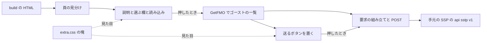
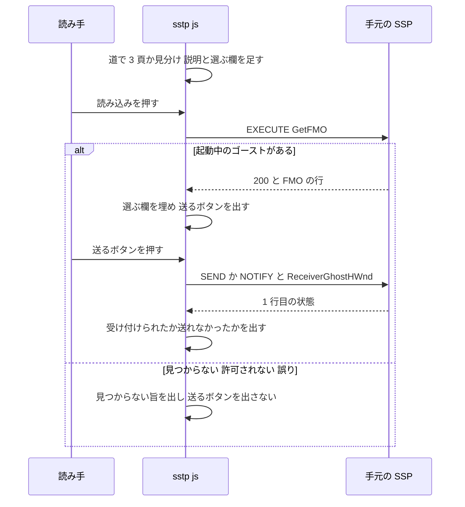
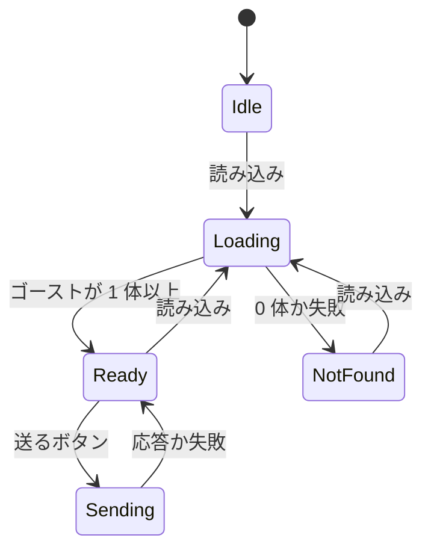
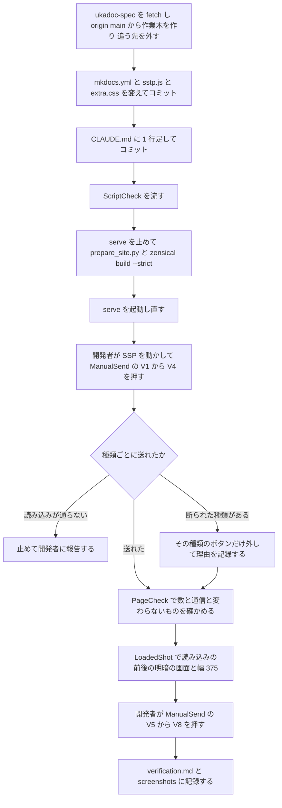

# Design Document: site-look-sstp-playback

## Overview
**Purpose**: UKADOC の 3 つの頁（`list/sakura-script`・`list/propertysystem`・`list/shiori-event`）を読むゴースト制作者が、記述例・プロパティ・イベントを、その場で手元の SSP の起動中のゴーストに送って試せるようにする。`site-look-plan` で「採る」と決まった C13（広げる案を含む）を、旧サイトの `sakura_player.js` を写さずに書き直して入れる。
**Users**: 手元の SSP で試したいゴースト制作者（Windows の Chrome・Edge・Firefox）。SSP の無い環境・狭い画面の読み手には、頁の頭の説明の欄 1 つだけが見え、送るボタンは出ない。
**Impact**: ukadoc-spec に自前のスクリプト `assets/sstp.js`（新規）を足し、`mkdocs.yml` の `extra_javascript` で読み、`assets/extra.css` の末尾に塊を 1 つ足し、`CLAUDE.md` の「GitHub Pages」の節に 1 行書き足す。原稿（`.md`）・`.nav.yml`・`INDEX.md`・`index.md` の「## 一覧」・`scripts/prepare_site.py`・`site_ext/`・`requirements.txt`・Zensical の版は変えない。第三者のコード（jsstp）は使わない。

ukadoc-spec の `CLAUDE.md` は、見た目のための構造に「JavaScript は使わない」と書いている。手元のゴーストへ送るには利用者のブラウザで動く仕掛けがどうしても要るので、この spec は前もって了承を取らずに PR を出し、PR の説明で違いを示してメンテナの判断に委ね、マージはしない（9.1・9.8）。

設計のときに、`8a7d8da` の使い捨ての写しを build し、下の見本のスクリプトと CSS を頁に読み込ませ、`fetch` を作り物に差し替えて（手元のベースウェアには何も送らずに）「読み込み」を押し、ボタンの数・送る中身・コピーの字・幅 375 を確かめた（`research.md` の「設計の調べ」）。送信そのもの（SSP の振る舞い）は確かめていない。実装で開発者が押して確かめる（10.6）。

### Goals
- 3 頁に、説明・ゴーストを選ぶ欄・「読み込み」を 1 組だけ出し、頁を開いただけでは頁の外へ何も読まず、何も送らない
- 「読み込み」の後にだけ、記述例 287・プロパティ 44 と 34 キー・イベント 272（見込み）の送るボタンを出す
- 押したボタン 1 つにつき、選んだゴースト 1 体へ 1 回だけ SSTP over HTTP で送り、受け付けたか失敗したかをボタンの近くに短く出す
- 第三者のコードを読まず、自前のスクリプト 1 本（約 140 行）でメンテナが読める形にする
- 記述例の字・コピー・検索・見出しの id と ¶ と目次・明暗・幅 375 を今のまま保つ

### Non-Goals
- 頁を開いたときの自動の読み込み・送信、選んだゴーストを頁をまたいで覚えること
- 書き込み（`\![set,property,…]`・`EXECUTE SetProperty`）を送ること、`(ID)` などを埋める入力欄、イベントの `Reference`
- 送る先の頁の外のボタン（`list/shiori-event-ex`・`list/plugin-event`・`spec/plugin` など）、C25 の言語の印
- 印刷のときにボタンを隠す指定、ゴーストの側の対応（`OnUkadocScriptExample` を受けるゴースト）
- jsstp の読み込み（`assets/` に置くことも CDN から読むことも）

## Boundary Commitments

### This Spec Owns
- `assets/sstp.js`（新規）: 3 頁の見分け、説明と選ぶ欄と「読み込み」、ゴーストの一覧の取得、送るボタンの置き場と送る中身、SSTP の要求の字の組み立てと送信、結果の表示
- `mkdocs.yml` の `extra_javascript` の 1 項目（`assets/sstp.js`）
- `assets/extra.css` の、見出しのコメント `/* site-look-sstp-playback: 手元のゴーストへ送る欄とボタン */` で始まる 1 つの塊
- `CLAUDE.md` の「GitHub Pages」の節の、送る仕掛けの役割の 1 行
- ブラウザで足す要素の class の名前 `sstp-panel`・`sstp-play`・`sstp-keys`・`sstp-result` と、送るボタンの `data-sstp`（送る中身。確かめの道具が読む）
- 除くイベントの 10 個の並び（`SKIP`）と、名前の形の規則（`NAME`・`EVENT`）
- この spec の記録（`verification.md`・`screenshots/`・`tools/sstp-shot.mjs`。完了で `completed/` へ移る）と、PR の説明

### Out of Boundary
- 原稿（`.md`）・`.nav.yml`・`INDEX.md`・各 `index.md` の「## 一覧」・`llms.txt`
- `scripts/prepare_site.py`・`site_ext/`（Markdown 拡張・Pygments のレキサー）・`requirements.txt`・Zensical の版・`overrides/`（作らない）
- `extra.css` のほかの塊（記述例の箱 C18・名前と説明の表・項目名の帯・対応の札・タグの色など）。この spec はそれらの見え方を変えない
- 記述例の言語の印と、印の中の色付けの字（`.nt`・`.vg`・`.err`）
- 送った先で起きること（ゴーストが喋るか・応えないか・危険なタグを止めるか）。ベースウェアの設定、SSTP 以外の送り方
- テーマが読むウェブフォント（`fonts.googleapis.com`・`fonts.gstatic.com`）。今も頁を開くと読まれる既存の振る舞いで、この spec は足しも消しもしない（OPEN QUESTION 1）
- `pasta/`・`areka/`・`shiori4/`、`site-look-plan` の成果物（`tools/shot.mjs` は読むだけ）

### Allowed Dependencies
- Zensical 0.0.67 の `base.html`: `extra_javascript` を `bundle.*.min.js` の直後、`<body>` の末尾に普通の `<script src>` で読む（DOM ができた後に動く）。`navigation.instant` は無いので、頁ごとに 1 回動けばよい
- 配る HTML の形（`8a7d8da` で確かめた）:
  - 頁の題: `article h1`
  - 記述例: `div.language-sakurascript.highlight > pre > code`。コピーのボタン（`nav.md-code__nav` の中の `button`）は `pre` の中にある
  - 項目: `h3.bundle-item`。字は名前と末尾の `a.headerlink`（`¶`）
  - 名前と説明の表: `h3` の後ろ（次の `h3`・`hr` より前）の `div.definition-table > table`。キーは `tbody tr > td:first-child > strong`
- SSP の SSTP over HTTP（ukadoc-spec の `spec/sstp/http.md`・`req_res.md`・`method_send.md`・`method_notify.md`・`method_execute.md`）: `http://localhost:9801/api/sstp/v1` に SSTP の要求を本文にして POST、本文の 1 行目が SSTP の状態。`EXECUTE` の `GetFMO`、`SEND` の `Event`・`Reference0`・`Script`・`Option`、`NOTIFY` の `Event`、`ReceiverGhostHWnd`
- ブラウザの機能: `fetch`・`AbortSignal.timeout`・`??=`・`?.`、`role="status"`。`http://localhost` は安全な宛先として扱われ、`https` の頁から読める（混在の内容に当たらない）
- 確かめの道具: `zensical serve`、Node、Edge ヘッドレス + CDP（`Fetch` の領域で `localhost:9801` を作り物の応答で受ける）、`.kiro/specs/completed/site-look-plan/tools/shot.mjs`（読むだけ。写して広げる）

### Revalidation Triggers
- `language-sakurascript` の付け方、記述例の HTML の形（`div.highlight > pre > code`）、コピーのボタンの置き場が変わったとき: 「実行」の当て先と置き場を確かめ直す
- `h3.bundle-item` の字の形（名前の後ろに `¶`）・`div.definition-table` の形が変わったとき: 名前とキーの取り方を確かめ直す
- 記述例の箱の並び（C18 の `h4 + .highlight + .highlight …`）を変えたとき: ボタンを `div.highlight` の中に置く前提を確かめ直す
- テーマのコピーのボタンの並び（`nav.md-code__nav`・`md-code__button`・`::after` の `mask-image`）や `code` の右の余白が変わったとき: ▶ の置き場と見え方を確かめ直す
- `navigation.instant` を有効にしたとき: 頁を移ってもスクリプトが動き直さない
- Zensical の版を上げたとき: `extra_javascript` の読み込み方を確かめ直す
- `list/shiori-event` に、ゴーストの終わり・消滅・初回の系のイベントが足されたとき: `SKIP` に足すかを決める
- 名前に `[A-Za-z0-9_.-]` の外の字を持つプロパティ・キー、`On` で始まり `[A-Za-z0-9_.]` の外の字を持つイベントが足されたとき: ボタンが付かない（安全な側に倒れる）ので、要るなら規則を広げる
- SSP の SSTP over HTTP の振る舞い（リモートの扱い・CORS・`GetFMO` の hwnd）が変わったとき: 開発者の確かめ（ManualSend）をやり直す

## Architecture

### Existing Architecture Analysis
- 今の 3 頁の `<script>` はテーマのもの（`__config`・`bundle`・インラインの 3 個）だけで、`extra_javascript` は無い（`d01f9eb` で `assets/sakurascript.js` が Pygments のレキサーに移ったときに外れた）
- `prepare_site.py` は `assets/` を丸ごと写すので、`assets/sstp.js` を足しても前処理は変えない
- 見出しの id・¶・右の欄の目次・検索の索引は build のときに決まる。ブラウザで後から足した字と要素は、それらに入らない（7.5・7.6）
- 記述例の箱（C18）は `h4 + .highlight` からの隣り合わせのセレクタで作られている。`div.highlight` の間に要素を挟むと、2 つ目からの点線と地が切れる。だから「実行」は箱の中に置く。テーマはコピーのボタンを `pre` の中の `nav.md-code__nav`（右上に重ねた並び。テーマのスクリプトが頁を開いた後に作る）に置き、`code` の右にアイコン 1 つ分の余白（`padding-right` 約 38px）を取っている。「実行」は ▶ のアイコンだけのボタンとしてその並びのコピーの下に積むので、字に重ならない（設計のディスカッションで確定、2026-10-28。案 C）
- 名前と説明の表の 1 列目は `td:first-child > strong:only-child` で幅を決めている。セルの中にボタンを足すとこの指定が外れて表の見え方が変わる。だからキーのボタンは表の直後の 1 行にまとめる（OPEN QUESTION 2）

### Architecture Pattern & Boundary Map
選んだ形は「ブラウザで足す（ギャップ分析の推し）」と「送る仕掛けを自分で書く（Option C）」。



- 1 本のスクリプトの中を、頁の見分け・欄・一覧・置き場・送信の 5 つの部分に分ける。どの部分も同じ即時関数の中にあり、頁のグローバルに名前を出さない
- 3 種類のボタンは、どれも「（SSTP のメソッド, ヘッダの組）を、選んだゴーストへ送る」の 1 つの形に一般化した（`sender()`）。種類ごとに違うのは、どこに置くかと、ヘッダの組の作り方だけ
- 見た目は `extra.css` の 1 つの塊に置き、スクリプトは class を付けるだけで色を持たない

### Technology Stack

| Layer | Choice / Version | Role in Feature | Notes |
|-------|------------------|-----------------|-------|
| ブラウザの仕掛け | 素の JavaScript（ES2022 相当）の 1 ファイル `assets/sstp.js` | 欄・ボタン・SSTP over HTTP の送受信 | ライブラリ・外部の資源を読まない。新しい依存は無い |
| 送り方 | SSP の SSTP over HTTP（SSP 2.6.32 以降） | `EXECUTE GetFMO`・`SEND`・`NOTIFY` | `http://localhost:9801/api/sstp/v1`。本文は UTF-8 の SSTP の字 |
| 見た目の指定 | CSS（`assets/extra.css`）、テーマの色の変数 | 欄・ボタン・結果の字 | 塊 1 つ。直書きの色は無い |
| サイト生成 | Zensical 0.0.67（版を変えない） | `extra_javascript` でスクリプトを配る | `mkdocs.yml` に 2 行 |
| 確かめ | `zensical serve`・Node・Edge ヘッドレス + CDP | 数・中身・画面・通信の記録 | 送信は開発者が手で押す |

jsstp を使わない理由（8.5。詳しくは `research.md`）: 送るのは `GetFMO`・`SEND`・`NOTIFY` の 3 つだけで、要求の字を組んで POST し、1 行目を読むだけで足りる（見本で 30 行ほど）。jsstp を `assets/` に置くと、縮めて `eval` で包んだ WTFPL のファイルが CC BY 4.0 のリポジトリに混ざり、レビューできない。CDN から読むと、公開サイトが第三者のコードを実行する（タグは付け替えうる）。自分で書けば 8.1〜8.3 はどれも「第三者のコードが無い」ことで満たされる。

## File Structure Plan

### Directory Structure
```
ukadoc-spec（作業木 .worktrees/site-look-sstp-playback/、ブランチ site-look-sstp-playback、origin/main から）
├── mkdocs.yml            # extra_javascript に assets/sstp.js を足す（2 行）
├── CLAUDE.md             # 「GitHub Pages」の節に送る仕掛けの 1 行を足す
└── assets/
    ├── sstp.js           # 新規。3 頁の見分け・欄・一覧・ボタン・送信・結果
    └── extra.css         # 末尾に site-look-sstp-playback の塊を 1 つ足す

.kiro/specs/completed/site-look-sstp-playback/（doc_edit。完了で completed/ へ移る）
├── verification.md       # 新規。数・中身・通信・画面・手で押した結果の記録
├── screenshots/          # 新規。読み込みの前と後の明・暗の画面
└── tools/
    └── sstp-shot.mjs     # 新規。shot.mjs を写し、localhost:9801 を作り物の応答で受けて「読み込み」の後を撮り、数える
```

ukadoc-spec で変えるのは上の 4 ファイルだけである（9.2）。

### Modified Files

#### `mkdocs.yml`（ukadoc-spec の作業木）
```diff
 extra_css:
   - assets/extra.css
 
+extra_javascript:
+  - assets/sstp.js
+
 plugins:
```
- すべての頁で読まれるが、スクリプトは 3 頁の外では 1 行目の見分けで何もせずに終わる（1.2）
- `build --strict` はファイルが無くても気づかないので、`serve` で `/ukadoc-spec/assets/sstp.js` が 200 であることを確かめる

#### `assets/sstp.js`（ukadoc-spec の作業木、新規）
見本（設計のときに `node --check`・純粋な部分の自己確かめ・写しの 3 頁での数え上げを通したもの。送信は確かめていない）:

```js
// site-look-sstp-playback: 手元の SSP のゴーストへ記述例・プロパティ・イベントを送る（「読み込み」を押すまで何も読まず、何も送らない）
(() => {
  const page = location.pathname.match(/\/list\/(sakura-script|propertysystem|shiori-event)\/(?:index\.html)?$/)?.[1];
  const h1 = document.querySelector('article h1');
  if (!page || !h1) return;

  const ENDPOINT = 'http://localhost:9801/api/sstp/v1';
  const VERSION = { SEND: '1.4', NOTIFY: '1.1', EXECUTE: '1.2' };
  const SKIP = new Set(['OnVanishSelecting', 'OnVanishSelected', 'OnVanishCancel', 'OnVanishButtonHold', 'OnVanished',
    'OnOtherGhostVanished', 'OnFirstBoot', 'OnClose', 'OnCloseAll', 'OnGhostChanging']);
  const NAME = /^[A-Za-z0-9_.-]+$/;
  const EVENT = /^On[A-Za-z0-9_.]+$/;

  const el = (tag, props = {}, ...kids) => {
    const e = Object.assign(document.createElement(tag), props);
    e.append(...kids);
    return e;
  };
  const nameOf = (h) => h.textContent.replace(/¶$/, '');
  // 値を読むだけのスクリプト。知らないプロパティでは「」のまま喋る（飾らない）
  const show = (n) => ({ Script: `\\0プロパティ「${n}」は「%property[${n}]」です。\\e`, Option: 'notranslate' });

  // 値に改行があると別のヘッダになるので送らない。SecurityLevel は、プレビューでも公開サイトと同じ扱いにするため
  const request = (method, headers) => {
    const lines = [`${method} SSTP/${VERSION[method]}`, 'Charset: UTF-8', 'Sender: UKADOC', 'SecurityLevel: external'];
    for (const [k, v] of Object.entries(headers)) {
      if (/[\r\n]/.test(v)) throw new Error(`${k} に改行がある`);
      lines.push(`${k}: ${v}`);
    }
    return lines.join('\r\n') + '\r\n\r\n';
  };

  // SSTP の誤りでも HTTP は 200 なので、本文の 1 行目（SSTP/1.x 200 OK）で見分ける
  const post = async (method, headers) => {
    const res = await fetch(ENDPOINT, { method: 'POST', body: request(method, headers), signal: AbortSignal.timeout(15000) });
    const text = await res.text();
    const status = text.split('\r\n', 1)[0].replace(/^SSTP\/\S+ /, '');
    return { ok: res.ok && /^2\d\d /.test(status + ' '), status, text };
  };

  // GetFMO の追加データ（id.key\x01value の行）から、起動中のゴーストの名前と hwnd を取る
  const loadGhosts = async () => {
    const r = await post('EXECUTE', { Command: 'GetFMO' });
    if (!r.ok) return [];
    const byId = {};
    for (const line of r.text.split('\r\n')) {
      const m = line.match(/^([^.\x01]+)\.(\w+)\x01(.*)$/);
      if (m) (byId[m[1]] ??= {})[m[2]] = m[3];
    }
    return Object.values(byId).filter((g) => g.hwnd && g.name);
  };

  let ghosts = [];
  let shown = null;
  const select = el('select', { disabled: true });
  const load = el('button', { type: 'button', textContent: '読み込み' });
  const note = el('span', { className: 'sstp-result' });
  note.setAttribute('role', 'status');
  h1.after(el('div', { className: 'sstp-panel' },
    el('p', {}, '手元の SSP で起動中のゴーストに、この頁の記述例などを SSTP で送って試せる。「読み込み」を押すと、ゴーストの一覧を取る。',
      'ゴーストの削除などの危険なタグは、OnUkadocScriptExample に対応したゴーストでしか実行されない。'),
    el('p', {}, el('label', {}, '送る先のゴースト ', select), load, note)));

  // 送るボタン 1 つと結果の欄。押すたびに選んだゴースト 1 体へ 1 回だけ送る
  const sender = (label, aria, method, headers) => {
    const button = el('button', { type: 'button', textContent: label });
    const result = el('span', { className: 'sstp-result' });
    button.setAttribute('aria-label', aria);
    result.setAttribute('role', 'status');
    button.dataset.sstp = JSON.stringify([method, headers]);
    button.addEventListener('click', async () => {
      const ghost = ghosts[select.value];
      button.disabled = true;
      result.textContent = '送信中';
      try {
        const r = await post(method, { ...headers, ReceiverGhostHWnd: ghost.hwnd });
        result.textContent = `${r.ok ? '受け付けられた' : '送れなかった'}（${r.status}）`;
      } catch {
        result.textContent = '送れなかった';
      }
      button.disabled = false;
    });
    return el('span', { className: 'sstp-play' }, button, result);
  };

  const place = () => {
    const out = [];
    if (page === 'sakura-script') {
      for (const box of document.querySelectorAll('article div.language-sakurascript.highlight')) {
        const text = box.querySelector('code').textContent.replace(/\n$/, '');
        let h = box.previousElementSibling;
        while (h && h.tagName !== 'H3') h = h.previousElementSibling;
        const s = sender('実行', `${h ? nameOf(h) : ''} の記述例を実行`, 'SEND',
          { Event: 'OnUkadocScriptExample', Reference0: text, Script: text, Option: 'notranslate' });
        // ▶ はコピーのボタンの下に積み、結果の字だけを箱の下の行に残す（押す前は空で隠れる）
        const button = s.firstElementChild;
        const nav = box.querySelector('nav.md-code__nav');
        if (nav) {
          Object.assign(button, { className: 'md-code__button sstp-run', title: '手元のゴーストで実行', textContent: '' });
          nav.append(button);
          out.push(button);
        }
        box.append(s);
        out.push(s);
      }
      return out;
    }
    for (const h of document.querySelectorAll('article h3.bundle-item')) {
      const name = nameOf(h);
      if (page === 'shiori-event') {
        if (!EVENT.test(name) || SKIP.has(name)) continue;
        const s = sender('発生させる', `${name} を発生させる`, 'NOTIFY', { Event: name });
        h.append(s);
        out.push(s);
        continue;
      }
      if (NAME.test(name)) {
        const s = sender('値を見る', `${name} の値を見る`, 'SEND', show(name));
        h.append(s);
        out.push(s);
        continue;
      }
      const base = name.match(/^([A-Za-z0-9_.-]+)\.\(キー\)$/)?.[1];
      if (!base) continue;
      let t = h.nextElementSibling;
      while (t && !t.matches('h3, hr, div.definition-table')) t = t.nextElementSibling;
      if (!t?.matches('div.definition-table')) continue;
      const keys = [...t.querySelectorAll('tbody tr > td:first-child > strong')].map((k) => k.textContent).filter((k) => NAME.test(k));
      const row = el('p', { className: 'sstp-keys' }, '値を見る:', ...keys.map((k) => sender(k, `${base}.${k} の値を見る`, 'SEND', show(`${base}.${k}`))));
      t.after(row);
      out.push(row);
    }
    return out;
  };

  load.addEventListener('click', async () => {
    const before = select.selectedOptions[0]?.textContent;
    load.disabled = true;
    note.textContent = '読み込み中';
    try { ghosts = await loadGhosts(); } catch { ghosts = []; }
    load.disabled = false;
    select.replaceChildren(...ghosts.map((g, i) => el('option', { value: i, textContent: g.name, selected: g.name === before })));
    select.disabled = !ghosts.length;
    note.textContent = ghosts.length ? '' : '手元の SSP か、起動中のゴーストが見つからない';
    if (ghosts.length) shown ??= place();
    for (const s of shown ?? []) s.hidden = !ghosts.length;
  });
})();
```

書き方のわけ（注に書かず、ここに残す）:
- **頁の見分け**（1.2・2.2）: 道（`/list/<頁>/`）で見分ける。記述例の印だけで見分けると、C25 が入って `list/propertysystem`・`spec/plugin` に印が付いたときに頁の外の記述例にもボタンが付くため。道は `/ukadoc-spec/` の下でも、写しの根でも同じに当たる
- **何もしない時**（1.1・1.3・8.2）: 頁を開いたときに足すのは説明の欄だけで、`fetch` は「読み込み」と送るボタンの押したときの処理の中にしか無い。送るボタンは最初の読み込みが成功したときに初めて作る
- **要求の字**（2.3・3.2・4.2）: 1 行目・`Charset: UTF-8`・`Sender: UKADOC`・`SecurityLevel: external`・ヘッダ・空行。行の区切りは CR+LF。`Content-Type` を付けない（ブラウザが `text/plain;charset=UTF-8` を付け、CORS の前もっての問い合わせが起きない形のまま。jsstp と同じ）。`Content-Length` はブラウザが付ける
- **`SecurityLevel: external`**（OPEN QUESTION 7）: SSP はローカル（Origin が localhost）からの要求で `SecurityLevel: local` のときだけ制約を緩める。いつも `external` を明示すれば、プレビュー（`http://127.0.0.1:8000`）でも公開サイトと同じ制約で動き、手で押した確かめがそのまま公開サイトに当てはまる
- **ヘッダの値の改行**: ヘッダの値に CR・LF があれば、送らずに失敗にする（記述例の字が別のヘッダとして読まれるのを防ぐ）。今の記述例 287 個に改行を含むものは 0 個（末尾の改行は取ってから送る。2.4）
- **送る先**（5.1）: `GetFMO` の `hwnd` を `ReceiverGhostHWnd` に付ける（jsstp の `by_fmo_info()` と旧サイトと同じ形）。リモートの扱いでは hwnd がダミーに置き換わると `method_execute.md` にあり、ダミーで送る先が選べるかは手で押して確かめる（ManualSend の V2。だめなら OPEN QUESTION 5 の代わり）
- **一覧の取り直し**（1.7）: 前に選んだゴーストの名前と同じ名前の項目を選んだ状態にする。リモートの扱いの FMO の id と hwnd はダミーなので、名前で合わせる
- **状態の字**（5.2・5.4）: 受け付けたら「受け付けられた（200 OK）」、SSTP の誤りなら「送れなかった（404 Not Found）」のように 1 行目の状態を添える。`fetch` の失敗（SSP が無い・許可されなかった・15 秒で応えない）は「送れなかった」。ダイアログは出さない
- **二度押し**（5.5・5.3）: 送っている間はボタンを `disabled` にする。自動で送り直さない
- **名前の形の規則**: プロパティとキーは `[A-Za-z0-9_.-]`、イベントは `On` と `[A-Za-z0-9_.]` だけのときにボタンを付ける。規則に合わない名前（日本語の説明の項目、`(ID)` などの置き換える部分を持つ名前）は自然に外れ、スクリプトの字に `「」` や `]` が紛れ込まない
- **`data-sstp`**: 送るヘッダの組を JSON でボタンに残す。確かめの道具が、ボタンを押さずに送る中身を読むため（10.1）

#### `assets/extra.css`（ukadoc-spec の作業木）
今の末尾（`site-look-definition-tables: 名前と説明の表` の塊）の後ろに、次の塊を足す。注は塊の頭の 1 行だけにする（開発者の決まり）。

```css
/* site-look-sstp-playback: 手元のゴーストへ送る欄とボタン */
.md-typeset .sstp-panel {
  margin: 1em 0;
  padding: .2em .8em;
  border: .05rem solid var(--md-default-fg-color--lighter);
  border-radius: .2rem;
  font-size: .7rem;
}
.md-typeset .sstp-panel p {
  margin: .4em 0;
}
.md-typeset :is(.sstp-panel, .sstp-play, .sstp-keys) :is(button, select) {
  max-width: 100%;
  margin-left: .4em;
  padding: 0 .6em;
  border: .05rem solid var(--md-default-fg-color--light);
  border-radius: .2em;
  background: var(--md-default-bg-color);
  color: var(--md-typeset-color);
  font: 700 .7rem/1.6 var(--md-text-font-family);
  vertical-align: middle;
}
.md-typeset :is(.sstp-panel, .sstp-play) button:not(:disabled) {
  cursor: pointer;
}
.md-typeset .sstp-result {
  margin-left: .4em;
  font-size: .7rem;
  font-weight: 400;
}
.md-typeset .highlight > .sstp-play {
  display: block;
  padding: 0 .6em .4em;
  text-align: right;
}
.md-typeset .highlight > .sstp-play:has(> .sstp-result:empty) {
  display: none;
}
.md-typeset .md-code__nav:has(.sstp-run) {
  flex-direction: column;
}
.md-typeset .highlight:has(.sstp-run) > pre {
  min-height: 3.2rem;
}
.md-typeset .md-code__button.sstp-run {
  color: var(--md-default-fg-color--light);
}
.md-typeset .md-code__button.sstp-run:is(:hover, :focus-visible) {
  color: var(--md-accent-fg-color);
}
.md-typeset .md-code__button.sstp-run::after {
  -webkit-mask-image: url('data:image/svg+xml;charset=utf-8,<svg xmlns="http://www.w3.org/2000/svg" viewBox="0 0 24 24"><path d="M8 5v14l11-7z"/></svg>');
  mask-image: url('data:image/svg+xml;charset=utf-8,<svg xmlns="http://www.w3.org/2000/svg" viewBox="0 0 24 24"><path d="M8 5v14l11-7z"/></svg>');
}
.md-typeset .sstp-run[hidden] {
  display: none;
}
.md-typeset .sstp-keys {
  font-size: .7rem;
}
.md-typeset .sstp-play[hidden] {
  display: none;
}
```

指定のわけ:
- **色**（7.1）: 字は `--md-typeset-color`、ボタンの地は `--md-default-bg-color`、枠は `--md-default-fg-color--light`。どれもテーマの変数なので明・暗で自動で替わり、直書きの色は無い。結果の字もボタンと同じ `--md-typeset-color`（薄い字の変数は帯の地の上で 4.5 を割るおそれがあるので使わない）。対比は実装で測る
- **大きさ**: ボタン・結果・欄は `.7rem`。項目名の帯（`h3`）の中でも字の大きさがそろう
- **「実行」の置き場**（案 C、設計のディスカッションで確定）: ▶ のアイコンだけのボタンを、テーマのコピーのボタンと同じ部品（`md-code__button`）にして、`nav.md-code__nav` のコピーの下に縦に積む。アイコンの形は `::after` の `mask-image`（三角の SVG。テーマのコピーのアイコンと同じ仕組み）。テーマのアイコンはマウスを載せるまでごく薄いが、▶ だけはふだんから `--md-default-fg-color--light` で見せ、載せるか選ぶとアクセントの色にする。`code` の右の余白（アイコン 1 つ分）に収まるので字に重ならない。結果の字は箱の下の右寄せの行（`div.highlight > .sstp-play`）に出し、押す前（結果が空）は行ごと隠す。2 段のアイコンが入るように、▶ のある箱の `pre` の高さを最低 `3.2rem` にする（1 行の記述例 116 個は箱が 40px から 64px になる）。`pre`・`code`・コピーのボタン・コピーされる字には触れない（7.3）。幅 375 でも収まる（7.7。見本で `scrollWidth` 375）
- **`.sstp-run[hidden]`**: テーマがボタンに `display` を付けるので、読み込みが失敗したときに隠れるよう戻す
- **`[hidden]`**: `display: block` の指定が `hidden` の既定の `display: none` に勝つので、後ろで戻す
- **幅 375**（7.7）: 選ぶ欄は `max-width: 100%`。欄・ボタンはふつうの流し込みで折り返す。設計の写しで、読み込みの後の `list/sakura-script` が `scrollWidth` = `innerWidth` = 375 だった

#### `CLAUDE.md`（ukadoc-spec の作業木）
「GitHub Pages」の節の「見た目のための構造は、…JavaScript は使わない」の箇条（とその下の 4 行）の後ろに、同じ深さで 1 行を足す（9.3）。ほかの行は変えない。
```diff
   - 見た目は `assets/extra.css`（`mkdocs.yml` の `extra_css`）。`theme.variant: classic` の class 名と変数を前提にしている
+- `assets/sstp.js`（`mkdocs.yml` の `extra_javascript`）は、見た目のための構造ではなく、読み手の手元の SSP へ記述例・プロパティ・イベントを送るボタンのスクリプトである。`list/sakura-script`・`list/propertysystem`・`list/shiori-event` の 3 頁だけで動き、「読み込み」を押すまで何も読み込まず、何も送らない。第三者のコードは使わない
 - `manual/` `dev/` `memo/` と、ディレクトリを持たない `spec/*.md` は、1 ファイル 1 ページのまま
```

### 部品とファイルの対応
| 部品 | ファイル | 扱い |
|---|---|---|
| ScriptEntry | `mkdocs.yml` の `extra_javascript` | 足す |
| PageGate・Panel・GhostList・Transport・Targets | `assets/sstp.js` | 新規 |
| PlaybackStyle | `assets/extra.css`「手元のゴーストへ送る欄とボタン」 | 足す |
| RoleNote | `CLAUDE.md` の「GitHub Pages」の 1 行 | 足す |
| ScriptCheck | なし（Node の使い捨ての確かめ。置き場は Claude のスクラッチ。結果は `verification.md`） | 作らない |
| PageCheck | なし（build の HTML とブラウザの頁を数える使い捨てのスクリプト。手順と結果は `verification.md`） | 作らない |
| LoadedShot | `.kiro/specs/completed/site-look-sstp-playback/tools/sstp-shot.mjs` | 新規（doc_edit） |
| ManualSend | なし（開発者の手順。手順と結果は `verification.md`） | 作らない |
| VerificationRecord | `.kiro/specs/completed/site-look-sstp-playback/verification.md`・`screenshots/` | 新規（doc_edit） |
| PrNote | なし（`/kiro-complete` で書く PR の説明） | 作らない |

## System Flows

### 頁の中の流れ

- 頁を開いた時点では、矢印は最初の 1 本（頁の中の処理）だけで、頁の外への通信は無い（1.1）
- ブラウザの手元の通信の許可（Chrome の Local Network Access）の求めが出るなら、最初の `fetch`（「読み込み」の後）で出る。許されなければ `fetch` が失敗し、見つからない旨が出る（1.8）

### 状態

- Idle と NotFound では送るボタンは無いか `hidden`。Ready で表示する（1.3・1.5・1.6）
- Sending の間は押したボタンだけが `disabled`。ほかのボタンは押せる（それぞれ 1 回ずつ送る。5.1・5.5）

### 作業の流れ

- A（`workflow.md` の「ukadoc-spec の作業木」）: `git -C ukadoc-spec fetch origin` → `git -C ukadoc-spec worktree add ../.worktrees/site-look-sstp-playback -b site-look-sstp-playback origin/main` → `git -C .worktrees/site-look-sstp-playback branch --unset-upstream`
- B・C のコミットは `-c user.name=ekicyou -c user.email=dot.station@gmail.com` で名前を渡す。push と PR は `/kiro-complete` で行う
- E: `serve` は `_site_src/` を見るので、動かしたまま `prepare_site.py` を流さない
- 手で押す確かめ（ManualSend）の V1〜V4 を、スクリプトを書いて serve を起動した直後、PageCheck・LoadedShot・画面より先に行う（送る仕掛けが SSP に通らなければ、見た目を整えても無駄になるため。設計のディスカッションで確定、2026-10-28）。V1（読み込み）が通らなければ、どの種類も送れないので、ほかを進めずに開発者に報告する（9.7 の外す範囲を超えるため）。V5〜V8 は画面の後に行う
- K（9.7）: 例えば `%property` が展開されないなら、`place()` の `propertysystem` の分岐と `show()` を消し、`list/propertysystem` を頁の見分けから外す。外した種類・理由・確かめた結果を `verification.md` と PR の説明に書く

## Requirements Traceability

| Requirement | Summary | Components | Interfaces | Flows |
|-------------|---------|------------|------------|-------|
| 1.1 | 開いただけで頁の外へ読まない・送らない | PageGate, Panel（`fetch` は押したときだけ）, PageCheck | 通信の記録 | 頁の中の流れ, G |
| 1.2 | 3 頁にだけ欄と「読み込み」を 1 組 | PageGate, Panel, PageCheck | `location.pathname` の規則 | G |
| 1.3 | 読み込みの前は送るボタンを出さない | Targets（成功で初めて作る）, LoadedShot | 状態 Idle | 状態 |
| 1.4 | 押したら一覧を取り、選ぶ欄に並べる | GhostList, Panel | `EXECUTE GetFMO` | 頁の中の流れ |
| 1.5 | 最初のゴーストを選び、ボタンを出す | Panel（`option` の既定）, Targets | 状態 Ready | 状態 |
| 1.6 | 見つからなければボタンを出さず短い文 | Panel（`note`）, Targets（`hidden`） | 状態 NotFound | 状態, V5 |
| 1.7 | 取り直して置き換え、残っていれば選択を保つ | Panel（名前で合わせる） | `before` | 状態, V1 |
| 1.8 | 許可の求めは押した後だけ。断られたら 1.6 | Transport（押したときだけ `fetch`）, Panel | `fetch` の失敗 | 頁の中の流れ, V8 |
| 2.1 | 記述例 287 に「実行」 | Targets, LoadedShot | `div.language-sakurascript.highlight` | H |
| 2.2 | 印の無いもの・ほかの言語・頁の外に付けない | PageGate, Targets, PageCheck, LoadedShot | 当て先のセレクタ | G, H |
| 2.3 | `OnUkadocScriptExample` と同じ字の `Script` で送る | Targets, Transport | `SEND` の 4 ヘッダ | V2 |
| 2.4 | 表示の字と同じ（末尾の改行だけ取る） | Targets（`textContent` の末尾の `\n`）, LoadedShot（`data-sstp` と比べる） | `Reference0`・`Script` | H |
| 2.5 | 誤りの印があっても付けて直さず送る | Targets（印を見ない） | ― | ― |
| 3.1 | 44 の見出しの近くと 34 キーごとに「値を見る」 | Targets, PlaybackStyle, LoadedShot | `h3` の中・表の直後の行 | H |
| 3.2 | 決まった字のスクリプトを送る | Targets（`show()`）, Transport, ScriptCheck | `SEND` の `Script` | D, V3 |
| 3.3 | `(キー)` を表のキーで置き換える | Targets | `td:first-child > strong` | H |
| 3.4 | 読むスクリプトだけ、`\![set,property]` を送らない | Targets（`show()` だけ） | ― | D |
| 3.5 | ほかの置き換える部分を持つ名前に付けない | Targets（`NAME` の規則） | 109 項目 | H |
| 3.6 | プロパティでない項目に付けない | Targets（`NAME` の規則） | 日本語の見出し | H |
| 3.7 | `[SET有効]` の項目にも読むボタン | Targets（印を見ない） | ― | H |
| 4.1 | 発生させられるイベントに「発生させる」 | Targets（`EVENT`・`SKIP`）, LoadedShot | 272 の見込み | H |
| 4.2 | `NOTIFY` の `Event` で送る | Targets, Transport | `NOTIFY` | V4 |
| 4.3 | 除く 10 個に付けない | Targets（`SKIP`）, LoadedShot | `SKIP` | H |
| 4.4 | `Reference` を付けない | Targets（`{ Event }` だけ） | ― | H |
| 4.5 | イベントの名前でない項目に付けない | Targets（`EVENT`） | ― | H |
| 5.1 | 1 回押して 1 回、選んだ 1 体だけ | Targets（`sender()`）, Transport（`ReceiverGhostHWnd`） | ― | V2, V6 |
| 5.2 | 失敗を近くに短く、ダイアログなし | Targets（`result`） | 状態の字 | V5 |
| 5.3 | 自動で送り直さない | Transport（再送の処理が無い） | ― | V5 |
| 5.4 | 受け付けたら近くに短く | Targets（`result`） | 1 行目の状態 | V2 |
| 5.5 | 送っている間の二度押しで重ねない | Targets（`disabled`） | ― | V6 |
| 6.1 | 選ぶ欄の近くに、読み込みの前から説明 | Panel | 欄の 1 段目 | H |
| 6.2 | 頁ごとに 1 か所 | Panel（1 回だけ足す） | ― | H |
| 6.3 | 書き直した字、だ/である調 | Panel | 説明の字 | ― |
| 7.1 | 明・暗で 4.5:1、色は変数から | PlaybackStyle, PageCheck（対比） | テーマの変数 | H |
| 7.2 | 目標の画面の当て先を崩さない | PlaybackStyle, Targets（置き場）, LoadedShot | 3 つの当て先 | H |
| 7.3 | `code` の中に足さず、コピーの字を変えない | Targets（コピーの下の ▶・`pre` の後ろの結果の行）, PageCheck | `innerText` の前後 | G, H |
| 7.4 | `\` を `\` のまま | Targets（記述例の字に触れない） | 画面 | H |
| 7.5 | 見出しの id・¶・目次を変えない | Targets（`h3` の末尾に足すだけ）, PageCheck | id・`headerlink`・`md-nav__link` の数 | G |
| 7.6 | 検索の結果に出さない | Panel, Targets（ブラウザで足す）, PageCheck | `search.json` | G |
| 7.7 | 幅 375 で収まり重ならない | PlaybackStyle, LoadedShot | `scrollWidth` | H |
| 7.8 | キーボードで押せ、読み上げで分かる | Targets（`button` と `aria-label`）, Panel（`label`・`role="status"`） | アクセシブルな名前 | H |
| 8.1 | 版を固定しない置き場から読まない | （第三者のコードを使わない） | ― | ― |
| 8.2 | 外から読むなら押した後だけ | （第三者のコードを使わない） | ― | ― |
| 8.3 | 中に置くならライセンスを添える | （第三者のコードを使わない） | ― | ― |
| 8.4 | 旧サイトの素材を写さない | Panel・Transport・PlaybackStyle（書き直し） | class の名前・説明の字 | ― |
| 8.5 | jsstp の扱いを決めて理由を記録 | （設計の決定。Technology Stack と `research.md`） | ― | ― |
| 9.1 | 了承を取らずに PR、違いを説明に書く | PrNote, RoleNote | PR の説明 | ― |
| 9.2 | 原稿・`.nav.yml`・版・`site_ext` を変えない | （変えるのは 4 ファイル） | `git diff --stat` | ― |
| 9.3 | `CLAUDE.md` に役割を書き足す | RoleNote | 1 行 | C |
| 9.4 | Build Gate と規約 Gate | すべての変更 | `prepare_site.py`・`build --strict` | E |
| 9.5 | PR の説明に一連の最後・番号・単独でよいこと | PrNote | PR の説明 | ― |
| 9.6 | 1 本か分けるかを決める | （1 本にする。下の「Integration」） | ― | ― |
| 9.7 | 断られた種類だけ外して進める | ManualSend, Targets（種類ごとの分岐） | 外す手順 | K |
| 9.8 | PR を出して止め、マージしない | PrNote（`/kiro-complete` で「マージしない」） | `ukadoc_spec.state` `OPEN` | ― |
| 10.1 | 自動の確かめで押さない・送らない | PageCheck, LoadedShot（9801 を作り物で受ける）, ScriptCheck | `data-sstp` を読む | G, H |
| 10.2 | 開いた時点の通信の記録 | PageCheck | 通信の一覧 | G |
| 10.3 | ボタンの数を数え直し差を記録 | PageCheck, LoadedShot, VerificationRecord | 数の表 | G, H |
| 10.4 | 読み込みの前後の明・暗の画面 | LoadedShot, VerificationRecord | 画面の表 | H |
| 10.5 | 幅 375 の測り | LoadedShot, VerificationRecord | `scrollWidth` | H |
| 10.6 | 手で押す手順と結果 | ManualSend, VerificationRecord | V1〜V8 | I |

## Components and Interfaces

| Component | Domain/Layer | Intent | Req Coverage | Key Dependencies | Contracts |
|-----------|--------------|--------|--------------|------------------|-----------|
| ScriptEntry | 設定（`mkdocs.yml`） | スクリプトをどの頁でも 1 回読む | 1.2, 9.2 | Zensical の `base.html`（P0） | State |
| PageGate | ブラウザ（`sstp.js`） | 3 頁かどうかを道で見分ける | 1.1, 1.2, 2.2 | 頁の道（P0） | State |
| Panel | ブラウザ（`sstp.js`） | 説明・選ぶ欄・「読み込み」・見つからない旨 | 1.2〜1.8, 6.1〜6.3, 7.8 | GhostList（P0） | State |
| GhostList | ブラウザ（`sstp.js`） | `GetFMO` で起動中のゴーストを取る | 1.4, 1.6, 1.7 | Transport（P0）、SSP（P0） | Service |
| Transport | ブラウザ（`sstp.js`） | 要求の字を組み、POST し、1 行目を読む | 1.8, 2.3, 3.2, 4.2, 5.1〜5.3 | SSP の SSTP over HTTP（P0） | Service, API |
| Targets | ブラウザ（`sstp.js`） | 3 種類のボタンを置き、送る中身を決め、結果を出す | 2.1〜2.5, 3.1〜3.7, 4.1〜4.5, 5.1〜5.5, 7.2〜7.8 | 配る HTML の形（P0）、Transport（P0） | Service, State |
| PlaybackStyle | 見た目（`extra.css`） | 欄・ボタン・結果の見た目 | 7.1, 7.2, 7.7 | テーマの変数（P0）、C18 の箱（P1） | State |
| RoleNote | 規約（`CLAUDE.md`） | 送る仕掛けの役割を書く | 9.1, 9.3 | ― | ― |
| ScriptCheck | 確かめ（使い捨て） | 要求の字・スクリプトの字・FMO の読み・状態の見分け | 3.2, 3.4, 10.1 | Node（P0） | Service |
| PageCheck | 確かめ（使い捨て） | build の HTML の数、開いた時点の通信、変わらないもの、対比 | 1.1, 1.2, 2.2, 7.1, 7.3, 7.5, 7.6, 10.2, 10.3 | `serve`（P0）、Edge + CDP（P0） | Service |
| LoadedShot | 確かめ（`tools/sstp-shot.mjs`） | 9801 を作り物で受けて「読み込み」の後を数え、撮る | 1.3, 2.1, 2.4, 3.1, 3.3, 4.1, 4.3, 7.2, 7.7, 10.1, 10.3〜10.5 | Edge + CDP の `Fetch`（P0） | Service |
| ManualSend | 確かめ（開発者の手順） | SSP を動かして押し、届いたか断られたかを見る | 1.4〜1.8, 2.3, 3.2, 4.2, 5.1〜5.5, 9.7, 10.6 | 手元の SSP とゴースト 2 体（P0） | ― |
| VerificationRecord | 記録 | 数・中身・通信・画面・手の結果を残す | 10.2〜10.6, 9.7 | 上の確かめ（P0） | State |
| PrNote | PR の説明 | JavaScript の違い・一連の最後・マージしない | 9.1, 9.5, 9.6, 9.8 | `/kiro-complete`（P0） | ― |

### 設定と規約
ScriptEntry と RoleNote は新しい境目を持たない設定と規約の行で、中身は上の「Modified Files」のとおりである。
- ScriptEntry の約束: すべての頁で `bundle.*.min.js` の直後に `assets/sstp.js` が 1 回読まれる。`serve` で 200 を確かめる

### ブラウザの仕掛け

#### PageGate・Panel

| Field | Detail |
|-------|--------|
| Intent | 3 頁だけで、頁の題の直後に説明・選ぶ欄・「読み込み」を 1 組足し、読み込みの結果を出す |
| Requirements | 1.1〜1.8, 6.1〜6.3, 7.8 |

**Responsibilities & Constraints**
- 道が `/list/sakura-script/`・`/list/propertysystem/`・`/list/shiori-event/`（と `index.html`）で終わり、`article h1` があるときだけ動く。ほかの頁では何も足さない
- 欄は `div.sstp-panel` の 2 段: 1 段目が説明（6.1）、2 段目が `label`（「送る先のゴースト」と `select`）・「読み込み」・結果の `span`（`role="status"`）
- 説明の字（6.3。旧サイトの字を写さず書き直し、だ/である調。3 頁で同じ字。OPEN QUESTION 9）: 「手元の SSP で起動中のゴーストに、この頁の記述例などを SSTP で送って試せる。「読み込み」を押すと、ゴーストの一覧を取る。ゴーストの削除などの危険なタグは、OnUkadocScriptExample に対応したゴーストでしか実行されない。」
- 読み込みの間は「読み込み」を `disabled` にし「読み込み中」と出す。0 体か失敗なら「手元の SSP か、起動中のゴーストが見つからない」（1.6・1.8）

**Contracts**: State [x]

##### State Management
- 状態は `ghosts`（`{ name, hwnd, … }` の並び）と、作った送るボタンの並び `shown`（最初の成功まで `null`）だけ。頁の中に閉じ、ブラウザの保存領域に書かない（頁をまたいで覚えない）
- 取り直し（1.7）: `select` の中身を置き換え、前に選んでいた名前と同じ名前の `option` を選ぶ。無ければ最初の `option`（1.5）
- 失敗（1.6）: `ghosts` を空にし、`shown` のすべてを `hidden` にする。次の成功で `hidden` を外す

#### GhostList・Transport

| Field | Detail |
|-------|--------|
| Intent | SSTP over HTTP の要求を組んで送り、1 行目の状態とゴーストの一覧を返す |
| Requirements | 1.4, 1.6, 1.7, 1.8, 2.3, 3.2, 4.2, 5.1〜5.3 |

**Responsibilities & Constraints**
- 送る先は `http://localhost:9801/api/sstp/v1` だけ。ほかのポート・ホストを見ない
- 要求の字は、メソッドの行・`Charset: UTF-8`・`Sender: UKADOC`・`SecurityLevel: external`・呼び手のヘッダ・空行。行の区切りは CR+LF。ヘッダの値に CR・LF があれば例外を投げ、送らない
- `fetch` は「読み込み」と送るボタンの押したときの処理からだけ呼ばれる。15 秒で応えなければ打ち切る。再送はしない（5.3）
- 受け付けの見分けは、HTTP が 2xx で、かつ本文の 1 行目の SSTP の状態が 2xx（200・204・210）

**Dependencies**
- External: SSP の SSTP over HTTP — 送る先（P0）。CORS の応答（`Access-Control-Allow-Origin`）を返すことに依る（旧サイトと jsstp がブラウザから使えていることからの推し。ManualSend の V1 で確かめる）
- External: ブラウザの手元の通信の許可（Chrome の Local Network Access）— 公開サイトから `localhost` へ送るときに許可を求めることがある（P1）

**Contracts**: Service [x] / API [x]

##### Service Interface
```typescript
type Method = "SEND" | "NOTIFY" | "EXECUTE";
type Headers = Readonly<Record<string, string>>;           // 値に CR・LF を含まない
interface Reply { ok: boolean; status: string; text: string } // status は "200 OK" の形

declare function request(method: Method, headers: Headers): string;   // 値に改行があれば Error を投げる
declare function post(method: Method, headers: Headers): Promise<Reply>; // fetch の失敗・打ち切りは reject
interface Ghost { name: string; hwnd: string; [key: string]: string }
declare function loadGhosts(): Promise<Ghost[]>;            // 状態が 2xx でなければ []。hwnd と name のあるものだけ
```
- 事前条件: 呼ばれるのは利用者の操作（クリック・キーボードでの押下）の処理の中だけ
- 事後条件: `post()` は 1 回の呼び出しで `fetch` を 1 回だけ行う

##### API Contract
| Method | Endpoint | Request | Response | Errors |
|--------|----------|---------|----------|--------|
| POST | `http://localhost:9801/api/sstp/v1` | 本文に `EXECUTE SSTP/1.2` と `Command: GetFMO` | HTTP 200、1 行目 `SSTP/1.x 200 OK`、空行の後に `id.key\x01value` の行 | 接続できない（`fetch` の失敗）、SSTP の 4xx・5xx |
| POST | 同上 | `SEND SSTP/1.4`、`Event: OnUkadocScriptExample`・`Reference0`・`Script`・`Option: notranslate`・`ReceiverGhostHWnd` | 1 行目 `SSTP/1.x 200 OK` か `204 No Content` | 404（ゴーストが無い）・409（割り込み禁止）・420（受信拒否）・512 ほか |
| POST | 同上 | `SEND SSTP/1.4`、`Script: \0プロパティ「名前」は「%property[名前]」です。\e`・`Option: notranslate`・`ReceiverGhostHWnd` | 同上 | 同上 |
| POST | 同上 | `NOTIFY SSTP/1.1`、`Event: イベントの名前`・`ReceiverGhostHWnd` | 同上（ゴーストが返したスクリプトは `Script` に返る） | 同上 |

- `NOTIFY` には `Option: notranslate` を付けない（ゴーストの返すスクリプトは、ふだんどおりトランスレートされてよい）
- `Content-Type` を付けない（ブラウザの既定 `text/plain;charset=UTF-8`）。前もっての問い合わせ（preflight）の起きない形

**Implementation Notes**
- Validation: ScriptCheck（要求の字・FMO の読み・状態の見分け）、ManualSend の V1〜V6
- Risks: SSP がリモートの扱いで `GetFMO` のダミーの hwnd を `ReceiverGhostHWnd` として受けない、`%property` を展開しない、`NOTIFY` を断る、CORS の応答を返さない。どれも文書だけでは決められず、ManualSend で確かめる（下の「確かめ」と OPEN QUESTION 5）

#### Targets

| Field | Detail |
|-------|--------|
| Intent | 頁ごとの当て先に送るボタンを置き、送る中身を決め、押したら送って結果を出す |
| Requirements | 2.1〜2.5, 3.1〜3.7, 4.1〜4.5, 5.1〜5.5, 7.2〜7.8 |

**Responsibilities & Constraints**

| 頁 | 当て先 | 置き場 | ボタンの字・読み上げの名前 | 送る中身 |
|---|---|---|---|---|
| `list/sakura-script` | `article div.language-sakurascript.highlight` のそれぞれ | ▶ はその箱の `nav.md-code__nav` のコピーの下。結果の字は箱の末尾（`pre` の後ろ）の右寄せの 1 行（押す前は隠れる） | ▶（`title` は「手元のゴーストで実行」）・「{項目の名前} の記述例を実行」 | `SEND`、`Event: OnUkadocScriptExample`、`Reference0` と `Script` に `code.textContent` の末尾の改行を取った字、`Option: notranslate` |
| `list/propertysystem` | 名前が `[A-Za-z0-9_.-]+` の `h3.bundle-item` | `h3` の末尾（¶ の後ろ） | 「値を見る」・「{名前} の値を見る」 | `SEND`、`Script: \0プロパティ「{名前}」は「%property[{名前}]」です。\e`、`Option: notranslate` |
| `list/propertysystem` | 名前が `{base}.(キー)` の `h3.bundle-item` の後ろの `div.definition-table` のキー（`[A-Za-z0-9_.-]+`） | 表の直後の 1 行 `p.sstp-keys`（「値を見る:」とキーごとのボタン） | 「{キー}」・「{base}.{キー} の値を見る」 | 同上（名前は `{base}.{キー}`） |
| `list/shiori-event` | 名前が `On[A-Za-z0-9_.]+` で、`SKIP` の 10 個でない `h3.bundle-item` | `h3` の末尾（¶ の後ろ） | 「発生させる」・「{名前} を発生させる」 | `NOTIFY`、`Event: {名前}` |

- 項目の名前は `h3` の `textContent` から末尾の `¶` を除いたもの。記述例の項目の名前は、記述例の前にある最も近い `h3`
- どのボタンも `button type="button"` で、キーボードで選んで押せる（7.8）。結果の `span` は `role="status"`
- 記述例の `pre`・`code`・コピーのボタン・言語の印・色付けの `span` には触れない（7.3・7.4）。見出しの id・¶ は動かさない（7.5）
- 名前が規則に合わない項目にはボタンを付けない。今の数で、プロパティの見出し 159 のうち 44 に「値を見る」、`(キー)` の 5 項目の表で 34 キー、イベントの見出し 328 のうち 272 に「発生させる」（下の「数の見込み」）

**Contracts**: Service [x] / State [x]

##### Service Interface
```typescript
type Kind = "sakura-script" | "propertysystem" | "shiori-event";
interface Sent { method: Method; headers: Headers }         // ボタンの data-sstp に JSON の [method, headers] で残す

/** 送るボタン 1 つと結果の欄を作る。押すと ghosts[select.value] の hwnd を ReceiverGhostHWnd に足して post() する */
declare function sender(label: string, ariaLabel: string, method: Method, headers: Headers): HTMLSpanElement; // span.sstp-play

/** 頁の当て先にボタンを置き、表示を切り替える要素（span.sstp-play と p.sstp-keys）の並びを返す */
declare function place(): HTMLElement[];
```
- 事前条件: `place()` は最初の読み込みの成功のときに 1 回だけ呼ばれる
- 事後条件: 当て先 1 つにボタン 1 つ。2 回目からの読み込みは作り直さず `hidden` を切り替えるだけ

##### State Management
- ボタンの状態: 待ち → 送っている間（`disabled`、「送信中」） → 待ち（結果の字を残す）
- 結果の字: 「受け付けられた（{SSTP の状態}）」「送れなかった（{SSTP の状態}）」「送れなかった」。次に押すまで残る

**Implementation Notes**
- Integration: 「実行」を `div.highlight` の外（兄弟）に置くと C18 の箱の 2 つ目からの点線と地が切れるので、中のコピーの下に置く。キーのボタンを表のセルに置くと 1 列目が広がって説明の列が折り返すので、表の直後に置く（どちらも設計のディスカッションで見本を撮って確定）。`nav.md-code__nav` はテーマのスクリプトが頁を開いた後に作る。`place()` は「読み込み」を押したときに動くので、その時には並びがある。並びが無ければ（テーマが変わったとき）▶ を出さず、結果の行の「実行」の字のボタンが残る
- Validation: LoadedShot（数・`data-sstp` と記述例の字の一致・除くイベント）、ManualSend
- Risks: `h3` の中のボタンの字が見出しのアクセシブルな名前に入る（「system.year ¶ 値を見る」）。見出しへのリンク・目次・検索の索引には入らない

### 見た目の指定
PlaybackStyle は新しい境目を持たない見た目の指定で、中身は上の「Modified Files」の塊そのものである。
- 状態は class と `hidden` と `<body>` の `data-md-color-scheme`（テーマの変数が替わる）だけで決まる。直書きの色は無いので、暗い表示だけの指定は要らない
- 変数で出せない色は無い。対比は実装で測って記録する（7.1）

### 確かめ

#### ScriptCheck
| Field | Detail |
|-------|--------|
| Intent | 作業木の `assets/sstp.js` から純粋な部分（`request`・`show`・FMO の行の規則・状態の見分け）を取り出し、Node で確かめる |
| Requirements | 3.2, 3.4, 10.1 |

- 置き場は Claude のスクラッチ。ukadoc-spec にテストのファイルは足さない（設計の見本は `…\scratchpad\design\selfcheck.mjs`。6 例すべてが合った）
- 例: `show('system.cpu.name')` が `\0プロパティ「system.cpu.name」は「%property[system.cpu.name]」です。\e`、`SEND` の要求の字が 1 行目から空行まで期待どおり、値に CR+LF のある要求が例外、FMO の 2 体と `path` だけの行の読み、`404 Not Found` が失敗で `204 No Content`・`200 OK` が受け付け

#### PageCheck
| Field | Detail |
|-------|--------|
| Intent | 作業木の build の HTML と `serve` の頁で、配り・候補の数・開いた時点の通信・変わらないもの・対比を確かめる |
| Requirements | 1.1, 1.2, 2.2, 7.1, 7.3, 7.5, 7.6, 10.2, 10.3 |

**Responsibilities & Constraints**
- 配り: `/ukadoc-spec/assets/sstp.js` が 200、全頁の HTML に `assets/sstp.js` の読み込みが 1 つずつ
- 候補の数（10.3）: build の HTML を上の当て先の規則で数える（記述例 287・置き換える部分の無いプロパティ 44・キー 34・イベント 272）。要件の見込みとの差を記録する
- 開いた時点の通信（1.1・10.2）: 3 頁と、ほかの頁 1 つ（`list/plugin-event`）を、CDP の `Network` を有効にした Edge ヘッドレスで開き、押さずに 3 秒待って、要求の URL を集める。`localhost:9801`・`127.0.0.1:9801` への要求 0、`cdn.jsdelivr.net` など第三者のスクリプトの読み込み 0。`serve` の外への要求は、変更の前の控え（`origin/main` の build）と同じ並び（テーマのウェブフォントだけ。OPEN QUESTION 1）
- 欄の数（1.2）: 3 頁で `.sstp-panel` 1、`list/plugin-event` と `index` で 0
- 変わらないもの（7.3・7.5・7.6）: 読み込みの後（LoadedShot の頁）で、`article` の中の id の並び・`a.headerlink` の数・`md-nav__link` の数が読み込みの前と同じ。287 個の `code.innerText` が前後で同じ。`search.json` が控えと同じ
- 対比（7.1）: 明・暗で、ボタン・選ぶ欄・結果・説明の字と、それぞれの地（ボタンの地・欄の地・帯の地・記述例の箱の地）を `getComputedStyle` から重ねて WCAG 2.x の対比を出し、4.5 以上

#### LoadedShot
| Field | Detail |
|-------|--------|
| Intent | `shot.mjs` を写して広げ、手元のベースウェアにつながずに「読み込み」の後の状態を作って、数え、撮る |
| Requirements | 1.3, 2.1, 2.4, 3.1, 3.3, 4.1, 4.3, 7.2, 7.7, 10.1, 10.3〜10.5 |

**Responsibilities & Constraints**
- 置き場は `.kiro/specs/completed/site-look-sstp-playback/tools/sstp-shot.mjs`（doc_edit。`shot.mjs` の引数の形に `--loaded` を足す）
- CDP の `Fetch.enable` に `http://localhost:9801/*` と `http://127.0.0.1:9801/*` の型を渡し、`Fetch.requestPaused` で要求を止める。本文が `EXECUTE` の `GetFMO` なら作り物の応答（ゴースト 2 体）を `Fetch.fulfillRequest` で返し、それ以外の要求が来たら `Fetch.failRequest` して実行を失敗で終える。止めた要求は網に出ないので、SSP が動いていても何も届かない
- 送るボタンは押さない（10.1）。押すのは「読み込み」だけ
- 数（10.3）: 読み込みの後の `article .sstp-play button` を頁ごとに数え、PageCheck の候補の数と同じ。読み込みの前は 0（1.3）
- 中身（2.4・3.3・4.3）: 記述例の 287 個で `data-sstp` の `Script` と `Reference0` が `code.textContent` の末尾の改行を取った字と同じ。キーの 34 個の名前が `{base}.{キー}`。`SKIP` の 10 個の名前を持つボタンが 0
- 画面（10.4・7.2）: 目標の画面と同じ当て先（`list/sakura-script` の `#bang-lock-repaint`、`list/propertysystem` の `[id="system.cpu"]`、`list/shiori-event` の `#OnBoot`）で、読み込みの前と後を明・暗で撮る（1000×700）。ほかに、欄の見え方として `list/sakura-script` の頁の頭（`h1`）を前・後の明・暗で撮る
- 幅 375（7.7・10.5）: 3 頁の前と後で `scrollWidth` = `innerWidth` = 375 を測る。画面は残さない

##### Service Interface
```typescript
// node tools/sstp-shot.mjs <url> <selector> <out> light|dark [width] [height] [--loaded]
interface LoadedResult {
  page: string;
  before: { buttons: number; panels: number; scrollWidth: number; innerWidth: number };
  after: { buttons: number; scrollWidth: number; innerWidth: number; requests: string[] }; // requests は GetFMO の 1 つだけ
  mismatches: string[];   // data-sstp と字の食い違い・SKIP のボタン。空
}
```

#### ManualSend
SSP の動く手元の環境で、開発者がボタンを押す手順（10.6）。Claude は送らない。結果を `verification.md` の表に書く。

| 手順 | 用意と押すもの | 見るもの | だめなとき |
|---|---|---|---|
| V0 用意 | SSP（最新版）を起動し、ゴースト 2 体（例: 既定のゴーストともう 1 体）を同時に起動する。作業木の `zensical serve` を Edge か Chrome で開き、Ctrl+F5 | ― | ― |
| V1 読み込み | `list/sakura-script` で「読み込み」 | 選ぶ欄に 2 体の名前、送るボタンが出る。開発者のツールの通信で `api/sstp/v1` への POST が 1 つ | 一覧が出ない（CORS・接続・`GetFMO`）: どの種類も送れないので止めて報告する |
| V2 実行 | 2 体目を選び、`#bang-lock-repaint` などの記述例の「実行」 | 2 体目だけが記述例を再生し、1 体目は何もしない。「受け付けられた（200 OK か 204 No Content）」 | 1 体目が再生する・404: 送る先の指定が効いていない（OPEN QUESTION 5 の代わりを試す）。断られる: 9.7 |
| V3 値を見る | `system.year` と `system.cpu.name` の「値を見る」 | ゴーストが「プロパティ「system.year」は「2026」です。」のように今の値を喋る | `%property[…]` がそのまま出る・値が空: 9.7（「値を見る」を外す） |
| V4 発生させる | `OnBoot`・`OnSecondChange` の「発生させる」 | 「受け付けられた」。ゴーストが応えるかは記録だけ（ゴーストが決める） | SSP が断る（4xx・5xx）: 9.7（「発生させる」を外す） |
| V5 失敗 | 選んだゴーストを終わらせて押す。SSP を終わらせて押す・「読み込み」を押す | 「送れなかった（404 Not Found）」「送れなかった」、見つからない旨。ダイアログが出ない。送り直さない | 5.2・5.3 の直し |
| V6 二度押し | 長い記述例（`\w9` を含むものなど）の「実行」をすばやく 2 回 | 送っている間は 1 回だけ送る。SSP が受け付けた後の押し直しは送り直しになり、SSP が再生をやり直す（開発者の判断、2026-10-29） | 5.5 の直し |
| V7 取り直し | 3 体目を起動して「読み込み」 | 一覧が 3 体になり、前に選んだゴーストが選ばれたまま | 1.7 の直し |
| V8 許可の求め | （プレビューは手元どうしの通信なので、許可の求めは出ない見込み）ブラウザの許可の求めが出たら、押す前に出ていないことと、断ったときに見つからない旨が出ることを見る | 許可の求めは「読み込み」の後だけ | 出なければ「プレビューでは確かめられない」と記録する（OPEN QUESTION 6） |

### 記録

#### VerificationRecord
- `verification.md`（日本語、前の spec の `verification.md` の型）: 測った版と日付、流した式、ScriptCheck の結果、PageCheck の数と要件の見込みとの差（10.3）、開いた時点の通信の一覧（10.2）、変わらないもの、対比の表（7.1）、LoadedShot の数・中身・幅 375（10.5）、画面の見比べ（10.4）、ManualSend の表（10.6）、外した種類があればその理由（9.7）、Build Gate と規約 Gate、`git diff --stat origin/main`
- 画面（`screenshots/`。1000×700）:

| 画面 | 頁 | 当て先 | 見比べる目標の画面 |
|---|---|---|---|
| `{before,after}-sakura-script-{light,dark}.png` | `list/sakura-script/` | `#bang-lock-repaint` | `mock-sakura-script-C21-*` |
| `{before,after}-propertysystem-{light,dark}.png` | `list/propertysystem/` | `[id="system.cpu"]` | `mock-propertysystem-C23-*` |
| `{before,after}-shiori-event-{light,dark}.png` | `list/shiori-event/` | `#OnBoot` | `mock-shiori-event-C23-*` |
| `{before,after}-panel-{light,dark}.png` | `list/sakura-script/` | `h1` | 目標の画面なし（欄の見え方） |
| `{before,after}-oneline-{light,dark}.png` | `list/sakura-script/` | `#plus` | 目標の画面なし（1 行の記述例の箱の高さ） |

設計のディスカッションで撮った見本の画面（案 A・B・C、キーの置き場、欄）は `screenshots/discussion/` にある。build の写しに見本のスクリプトを差し込み、`fetch` を作り物に替えて撮ったもので、送信はしていない

- 目標の画面にはボタンが無い。比べるのは、記述例の箱・名前と説明の表・項目名の帯・対応の札が前と同じに見えることだけ（7.2）。二重に重なった画面は撮り直す
- 開発者に画面や `serve` を見せるときは Ctrl+F5 を頼む

#### 数の見込み（`8a7d8da` の写しで、設計の見本を作り物の応答で動かして数えた。実装で数え直し、それを正とする）
| もの | 数 | 要件の見込み |
|---|---|---|
| 記述例の「実行」 | 287（どれも 1 行。`Script` と字の食い違い 0） | 287 |
| 置き換える部分の無いプロパティの「値を見る」 | 44（`currentghost.seriko.sticky-window` の `-` を含む） | 44 |
| キーの「値を見る」 | 34（`system.os` 15・`system.cpu` 6・`system.memory` 3・`system.power` 4・`system.network` 6。`locale.language` などの `.` を含むキー 7） | 34 |
| イベントの「発生させる」 | **272**（`On` で始まる見出し 283 から、説明の項目 `OnMusicPlayExの拡張情報リスト` 1 と除く 10 を引いた数） | 272（設計のディスカッションで要件を直した。初めの見込みは 273） |
| `list/plugin-event` の欄・ボタン | 0 | 0 |
| 読み込みの後の `list/sakura-script` の幅 375 | `scrollWidth` 375 | 375 |

## Error Handling

| 起きること | 見分け方 | 対し方 |
|---|---|---|
| 手元の SSP が無い・ブラウザが許可しない・15 秒で応えない | `fetch` の失敗 | 読み込みなら見つからない旨、送るボタンなら「送れなかった」。再送しない（1.6・1.8・5.2・5.3） |
| SSP が SSTP の誤りを返す（404・409・420・512 など） | 本文の 1 行目 | 「送れなかった（{状態}）」を押したボタンの近くに出す |
| `GetFMO` が 0 体 | 一覧が空 | 見つからない旨、送るボタンを `hidden`（1.6） |
| ヘッダの値に改行 | `request()` の例外 | 送らずに「送れなかった」（今は 0 個） |
| `serve` が書きかけの `_site_src/` を拾う | `sstp.js` が 404 | `serve` を止め、`prepare_site.py` → `build --strict` → 起動し直す |
| ManualSend で種類ごとに断られる | V2〜V4 | その種類だけ外し、理由と結果を記録し、PageCheck からやり直す（9.7） |
| ManualSend の V1 が通らない | 一覧が出ない | 止めて開発者に報告する（どの種類も送れず、9.7 の外す範囲を超える） |
| `origin/main` が `mkdocs.yml`・`extra.css`・`CLAUDE.md` を変えて進む | merge のぶつかり | 両方を残して直し、Build Gate と PageCheck をやり直す |

## Testing Strategy

ukadoc-spec に JavaScript のテストの仕組みは無く、足さない。新しい処理の確かめは、使い捨ての ScriptCheck・PageCheck と、記録に残す LoadedShot と、開発者の ManualSend が受け持つ。

- **Build Gate**: 作業木で `python scripts/prepare_site.py` と `zensical build --strict` がどちらも exit 0（9.4）。`git diff --stat origin/main` が `mkdocs.yml`・`CLAUDE.md`・`assets/extra.css`・`assets/sstp.js` だけ（9.2）
- **規約 Gate**: `CLAUDE.md` の変更が「GitHub Pages」の 1 行だけ。`extra.css` の塊の注が 1 行だけ（9.3）
- **要求の字**: ScriptCheck の 6 例（3.2・3.4）
- **何もしない時**: 開いた時点の通信に `9801` と第三者のスクリプトが 0、3 頁だけに欄 1、読み込みの前のボタン 0（1.1・1.2・1.3・10.2）
- **ボタンの数と中身**: LoadedShot の数が PageCheck の候補と同じで、`data-sstp` と字の食い違い 0、除くイベントのボタン 0（2.1〜2.4・3.1・3.3・3.5〜3.7・4.1・4.3〜4.5・10.3）
- **変わらないもの**: id・¶・目次の数、コピーの字、`search.json`（7.3・7.5・7.6）
- **見た目**: 目標の画面との見比べ（明・暗）、対比 4.5 以上、幅 375（7.1・7.2・7.4・7.7・10.4・10.5）
- **キーボードと読み上げ**: Tab で「読み込み」と送るボタンに移れ、Enter で押せる。アクセシビリティの木で送るボタンの名前が「{名前} の値を見る」などになる（7.8）
- **送信**: ManualSend の V1〜V8（1.4〜1.8・2.3・3.2・4.2・5.1〜5.5・10.6）

## Security Considerations
- **頁を開いただけでは何もしない**: `fetch` は利用者の操作の処理の中にだけある。読み手が知らないうちに手元のベースウェアへ通信しない
- **送る先を 1 つに固定**: `http://localhost:9801/api/sstp/v1` だけ。頁の中の字から送る先を決めない
- **送る中身はサイトの字だけ**: 記述例・見出し・表のキーの字から作り、利用者の入力欄は無い。ヘッダの値の改行を拒むので、記述例の字が別のヘッダ（`Event` など）として読まれない。名前の規則に合わないものは送らない
- **リモートの制約に乗る**: `SecurityLevel: external` を付け、SSP のリモートからの要求の制約（危険なタグ・メソッドの制限）がプレビューでも公開サイトでも効く形にする。書き込み（`\![set,property]`・`SetProperty`）とゴーストの終わり・消滅・初回の系のイベントは送らない
- **第三者のコードを読まない**: CDN の付け替え・ライセンスの混ざりが起きない

## Integration & Migration Notes
- 作業木: `.worktrees/site-look-sstp-playback/`（ブランチ `site-look-sstp-playback`）を `origin/main`（今は `8a7d8da`）から作り、作った直後に追う先を外す
- コミットは 2 つにする: (1) 送る仕掛けと見た目（`mkdocs.yml`・`assets/sstp.js`・`assets/extra.css`）、(2) 役割の書き足し（`CLAUDE.md`）。9.7 で種類を外したら (1) を直すコミットを足す
- **PR は 1 本**（9.6）: 3 種類のボタンは、欄・一覧・送信の部分を共有し、分けるとどの PR も同じスクリプトの土台を持つことになる。roadmap も最後の 1 本としている。送れない種類が見つかったら、その種類だけを外す（9.7）ので、分けなくても進められる
- **PR の説明**（9.1・9.5）:
  - この PR は、UKADOC の見た目を旧サイト並みの見やすさに近づける一連の PR の最後の 1 本で、これで一連が終わること。出し済みの PR の番号（PR を出すときに `gh pr list --repo ukatech/ukadoc-spec --state merged` で集め、roadmap の並びで短く並べる）
  - この PR だけで完結していて、マージしてよいこと。中身で依る PR（記述例の言語の印・名前と説明の表）はどれもマージ済み
  - `CLAUDE.md` の「JavaScript は使わない」と違う仕掛けであること。足したもの（自前のスクリプト `assets/sstp.js` 1 本・第三者のコードは無い・動くのは 3 頁だけ・頁を開いただけでは何も読まず何も送らない・送る先は手元の `localhost:9801` だけ）と、`CLAUDE.md` に書き足した 1 行。受け入れるかどうかはメンテナの判断に委ねること
  - 手で押して確かめた結果（ManualSend の表の要約）と、外した種類があればその理由
- **マージしない**（9.8）: `/kiro-complete` は、開発者の「マージしない」（この spec の決定）により、PR を作って `OPEN` を確かめて止める。`completed/site-look-sstp-playback/spec.json` の `ukadoc_spec` は `{ "pr": "<URL>", "state": "OPEN" }`。メンテナがマージした後に `/kiro-complete site-look-sstp-playback` を再実行して後始末する。再実行のときにマージの判断を求められても、この spec ではメンテナのマージを待つ
- 同じ `extra.css`・`mkdocs.yml` を触る PR がほかに開いていれば、先にマージされた方に追いつく（`workflow.md`「開いている PR に追いつく」）

## 前提と OPEN QUESTION
設計のディスカッションで決める。番号は下の各節の印と同じ。どれも、設計の見本は［仮定］のとおりに書いてある。

1. **頁を開いた時点の外への読み込み**（1.1・10.2）: **確定（自明な修正、2026-10-28）**: 要件の字を「この spec が足す読み込み」に直した。以下は元の記述。 テーマ（Material）は今も頁を開くと Google Fonts（`fonts.googleapis.com`・`fonts.gstatic.com`）を読む。要件の字のとおりに「頁の外への読み込み 0 件」とすると、この spec の前から満たしていない。［仮定］この spec が足す読み込み・送信が 0 件であること（`localhost:9801` と第三者のスクリプトが 0、それ以外は変更の前の控えと同じ）で確かめ、ウェブフォントは既存の振る舞いとして記録だけする。代案: `mkdocs.yml` の `theme.font: false` でウェブフォントも止める（字の形が変わる見た目の変更で、この spec の外）、要件の字を「この spec が足す読み込み」に直す
2. **キーのボタンの置き場**（3.1・7.2）: **確定（推奨案。見本の画面 `screenshots/discussion/keys-*` を見て、2026-10-28）**。［仮定］表の直後に 1 行（「値を見る:」とキーの名前のボタン）。表の見え方は 1 画素も変わらない。代案: 表の 1 列目のセルのキーの後ろに置く（要件の「キーの行ごとに」に字どおり合うが、`strong:only-child` の幅の指定が外れて表の見え方が変わる。この spec の塊で同じ指定を足し直す要がある）、2 列目の末尾に置く
3. **イベントのボタンの数**（4.1）: **確定（自明な修正、2026-10-28）**: 要件の数を 272 に直し、4.5 に説明の項目として名指しした。以下は元の記述。 `On` で始まる見出し 283 のうち `OnMusicPlayExの拡張情報リスト`（id `caption_musicplayex_codes`）は説明の項目で、イベントの名前ではない。［仮定］名前の形（`On` と英数字・`_`・`.`）で見分けて外し、272 にする（4.5 の「説明の項目」に当たる）。要件の見込み 273 との差として記録する。代案: 名前が `On` で始まるものをすべて採り 273（存在しない `Event` を送る）
4. **「実行」の置き場**（2.1・7.3）: **確定（開発者の案 C、2026-10-28）**: コピーのボタンの下に ▶ のアイコンだけを積み、結果は押した後に箱の下の行に出す（`screenshots/discussion/run-C-*`）。要件 7.1・7.3 を直した。以下は元の記述。［仮定］`div.highlight` の中、`pre` の後ろに右寄せの 1 行。要件 7.3 の「コードブロック」を `pre`・`code` と読む（brief の申し送り「`pre` の外か `code` の外に置く」と同じ）。代案: `div.highlight` の外の直後（C18 の箱の点線と地の並びが切れる）、`h4`「記述例」の帯に 1 つ（記述例が複数あるとどれを送るか分からない）
5. **送る先の指定**（5.1）: **確定（推奨案、2026-10-28）**。［仮定］`GetFMO` の `hwnd`（リモートではダミー）を `ReceiverGhostHWnd` に付ける（jsstp と旧サイトと同じ）。ManualSend の V2 で効かなければ、`ReceiverGhostName`（`\0` の名前）か、`SEND` の `Ghost`（`descript.txt` の `name`。FMO の `fullname`）に替える。どれも効かなければ、送る先を選べないので止めて報告する
6. **ブラウザの手元の通信の許可**（1.8）: **確定（推奨案、2026-10-28）**。プレビュー（`127.0.0.1`）から `localhost` への通信は手元どうしなので、Chrome の許可の求めは出ない見込みで、公開サイトからの振る舞いは PR がマージされるまで確かめられない（マージしない spec なので、この spec の中では確かめられない）。［仮定］`fetch` が押したときの処理の中にしか無いことと、許されないときの `fetch` の失敗が見つからない旨になることを、作りで満たし、記録する。代案: 開発者のフォークの GitHub Pages など公開の場所に写しを出して確かめる（手間が増える）
7. **要求の決まった行**: **確定（推奨案、2026-10-28）**。［仮定］`Sender: UKADOC`、`SecurityLevel: external`（プレビューと公開を同じ扱いにする）、`SEND` に `Option: notranslate`（旧サイトと同じ。`NOTIFY` には付けない）、打ち切り 15 秒。代案: `SecurityLevel` を付けない（プレビューでローカルの扱いになり、確かめが公開サイトより甘くなるおそれ）
8. **ファイルと class の名前**: **確定（推奨案、2026-10-28）**。［仮定］`assets/sstp.js`、class は `sstp-panel`・`sstp-play`・`sstp-keys`・`sstp-result`。`site-look-sakura-script-highlight` の設計の決定（後続も `sakurascript-` で始める）は、タグの色付けが Pygments の `.nt`・`.vg` に移って `sakurascript-` の class が無くなったので当てはまらない、と読んだ。代案: `ukadoc-play.js`・`ukadoc-play-*`
9. **説明の字**（6.1〜6.3）: **確定（推奨案。見本の画面 `screenshots/discussion/panel-*` を見て、2026-10-28）**。［仮定］3 頁で同じ字（上の Panel の節）。代案: 頁ごとに「記述例」「プロパティの値」「イベント」と言い替える、危険なタグの文を `list/sakura-script` だけにする（6.2 は頁ごとに 1 か所を求めるだけで、字の違いは妨げない）
