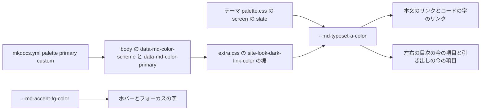
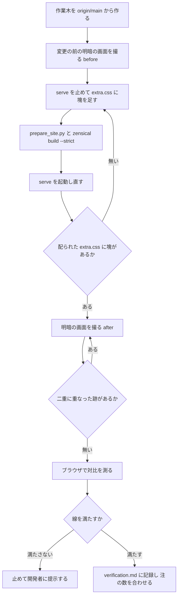

# Design Document: site-look-dark-link-color

## Overview
**Purpose**: UKADOC の公開サイトを暗い表示で読むゴースト制作者に、本文のリンク・左の目次の今の頁・右の欄の目次の今の節が暗い地の上で読める色を届ける。
**Users**: 暗い表示（ダークモード）で UKADOC を読むゴースト制作者。明るい表示で読む人と、紙に印刷する人の見え方は変えない。
**Impact**: ukadoc-spec の `assets/extra.css` の末尾に、画面だけに当たる暗い表示のリンクの色の上書きを 1 つ足す。いまは暗い表示でもリンクの色が紺 `#1f4e8c` のまま（暗い地 `#1e2129` に 1.94:1）で、これを明るい紺 `#8fb4e8`（見込み 7.55:1）にする。

変える値はテーマの変数 `--md-typeset-a-color` の 1 つだけである。本文のリンク・コードの字のリンク・左右の目次の今の項目・狭い画面の引き出しの今の項目は、どれもこの変数で描かれるので、一緒に変わる（`research.md` の「`--md-typeset-a-color` を使う所」）。ホバー・フォーカスの色（`--md-accent-fg-color`）と、明るい表示・印刷・ヘッダの紺には触らない。

### Goals
- 暗い表示の画面で、リンクの色で描かれる所をすべて明るい紺 `#8fb4e8` にし、暗い地に 7:1 以上、暗いコードの地に 4.5:1 以上にする
- 明るい表示・印刷・ヘッダの見え方を今のまま保つ
- ブラウザで測った対比の数と、明・暗の画面の見比べを、spec の記録に残す

### Non-Goals
- ホバー・フォーカスの色の変更（見込み 3.78:1 で、線の 3:1 を越えるので足さない）
- テーマの色（紺 `#1f4e8c`）・ヘッダの地・`mkdocs.yml` の `palette` の変更
- ほかの見た目の候補（`site-look-list-items` ほかの後続 spec が行う）
- 測りの道具の新設（`shot.mjs` は読むだけで使い、手を入れない）

## Boundary Commitments

### This Spec Owns
- ukadoc-spec の `assets/extra.css` の、見出しのコメント `site-look-dark-link-color:` で始まる塊 1 つ（暗い表示・画面だけ・紺のテーマのときの `--md-typeset-a-color` の値）
- その塊の注に書く、明るい紺と紺の対の関係と、暗い地との対比の数
- この spec の記録（`.kiro/specs/site-look-dark-link-color/verification.md` と `screenshots/`）: 測った対比の数・画面の見比べ・失わないものの確かめ

### Out of Boundary
- `extra.css` のほかの塊（`[data-md-color-primary="custom"]` のテーマの紺、目次の詰め、記述例の折り返し、後続 spec が足す塊）
- ホバー・フォーカスの色 `--md-accent-fg-color`、検索の強調の色 `--md-typeset-mark-color`、見出しの `¶` の色など、リンクの色以外の変数
- 明るい表示（`[data-md-color-scheme="default"]`）と印刷のときの色
- 原稿（`.md`）・`.nav.yml`・`INDEX.md`・各 `index.md` の `## 一覧`・`mkdocs.yml`・`requirements.txt`・`scripts/prepare_site.py`・Zensical の版
- `site-look-plan` の成果物（目標の画面・試作・`tools/shot.mjs`）の書き換え

### Allowed Dependencies
- テーマ（Zensical 0.0.67 の classic の見た目の指定）の変数 `--md-typeset-a-color` と、`<body>` に付く属性 `data-md-color-scheme`・`data-md-color-primary`
- テーマが暗い表示の色を `@media screen` の中だけで定める作り（印刷では明るい表示の色になる）
- `mkdocs.yml` の `palette` の今の値（明・暗とも `primary: custom`・`accent: indigo`）。読むだけで変えない
- 確かめの道具: `zensical serve`、`.kiro/specs/completed/site-look-plan/tools/shot.mjs`（読むだけ）、ブラウザ（Claude の内蔵ブラウザの枠。下の「ContrastProbe」）

### Revalidation Triggers
- テーマの紺 `#1f4e8c`（`extra.css` の `--md-primary-fg-color`）を変えたとき: 明るい紺も測り直して選び直す（注に書く）
- `mkdocs.yml` の `palette` の `primary` を `custom` 以外にしたとき: この塊は効かなくなり、テーマの暗い表示のリンクの色に戻る（そうなるように条件に `custom` を入れた）。そのときの暗い表示の対比を測り直す
- Zensical の版を上げたとき: 変数の名前・暗い表示の印の付く要素・`@media screen` の作りが変わっていないか、暗い表示の対比を測り直す
- ほかの spec が `--md-typeset-a-color` か `--md-accent-fg-color`、または暗い表示の地 `--md-default-bg-color`・コードの地 `--md-code-bg-color` を上書きしたとき: 対比を測り直す

## Architecture

### Existing Architecture Analysis
- 頁は テーマの `main.*.css` → `palette.*.css` → `assets/extra.css` の順に見た目の指定を読む。`extra.css` は最後なので、同じ詳細度でも上書きが勝つ
- テーマの `palette.*.css` は、暗い表示の色を `@media screen { [data-md-color-scheme=slate] { … --md-typeset-a-color: var(--md-primary-fg-color); … } }` で定める。決まった名前のテーマの色には、同じ `@media screen` の中で `[data-md-color-scheme=slate][data-md-color-primary=indigo] { --md-typeset-a-color: #5488e8 }` のような替えがある。`custom` には替えが無いので、暗い表示でも紺のままになる（1.94:1 の原因）
- `extra.css` の今の型: 塊ごとに、日本語の「何のための指定か」と「何と対か」の注を前に置く。`workflow.md` は、spec の単位ごとに見出しのコメント（`/* <単位名>: … */`）で区切った塊を末尾に足すことを求める

### Architecture Pattern & Boundary Map
選んだ形は「テーマ自身の暗い表示の替えと同じ形で、`custom` の分を足す」（`research.md` の案 B に案 C の条件を足したもの）。



- `Override` が触るのは `Var` だけで、`Accent`（ホバー・フォーカス）には触らない
- `Override` は `@media screen` の中にあるので、印刷では効かず、テーマの明るい表示の紺が残る
- `Override` の条件は `slate` と `custom` の両方なので、明るい表示と、テーマの色を名前の色に替えたときには効かない

### Technology Stack

| Layer | Choice / Version | Role in Feature | Notes |
|-------|------------------|-----------------|-------|
| 見た目の指定 | CSS（`assets/extra.css`） | 暗い表示のリンクの色の上書き | 新しい道具・依存は足さない |
| サイト生成 | Zensical 0.0.67（`requirements.txt` のまま） | 頁と `extra.css` の配り | 版は変えない |
| 確かめ | `zensical serve`、`shot.mjs`（Edge ヘッドレス）、内蔵ブラウザの枠の JavaScript | 画面と対比の測り | `shot.mjs` は読むだけ |

## File Structure Plan

### Directory Structure
```
ukadoc-spec（作業木 .worktrees/site-look-dark-link-color/）
└── assets/
    └── extra.css                # 末尾に site-look-dark-link-color の塊を足す（変更はこの 1 ファイルだけ）

.kiro/specs/site-look-dark-link-color/（doc_edit）
├── verification.md              # 新規。測った対比の数・画面の見比べ・失わないものの確かめの記録
└── screenshots/                 # 新規。list/sakura-script の #bang-lock-repaint の画面
    ├── before-sakura-script-light.png   # 変更の前の明るい表示（2.3 の見比べ）
    ├── before-sakura-script-dark.png    # 変更の前の暗い表示（PR で直す前の読めなさを見せる）
    ├── after-sakura-script-light.png    # 変更の後の明るい表示
    └── after-sakura-script-dark.png     # 変更の後の暗い表示
```

### Modified Files
- `assets/extra.css`（ukadoc-spec の作業木）— 末尾に次の塊を足す。ほかの塊は変えない

```css
/* site-look-dark-link-color: 暗い表示のリンクの色。
   紺 #1f4e8c のリンクは暗い地 #1e2129 に 1.94:1 しかないので、紺と対の明るい紺 #8fb4e8（暗い地に 7.55:1）にする。
   上のテーマの紺を変えたら、この色も測り直す。テーマの暗い表示と同じく画面だけに当て、印刷は明るい表示の紺のままにする */
@media screen {
  [data-md-color-scheme="slate"][data-md-color-primary="custom"] {
    --md-typeset-a-color: #8fb4e8;
  }
}
```

- 注の対比の数（1.94・7.55）は、実装でブラウザで測った数に置き換える（`research.md` の手元の計算と試作の記録は 0.01 違う。ブラウザの数を正とする）
- 詳細度は属性 2 つ（テーマの `[data-md-color-scheme=slate]` は 1 つ）で、読む順も後なので、確実に勝つ

### 部品とファイルの対応
| 部品 | ファイル | 扱い |
|---|---|---|
| DarkLinkOverride | `assets/extra.css`（ukadoc-spec の作業木） | 変える |
| ContrastProbe | なし（内蔵ブラウザの枠の JavaScript で流す使い捨ての手順。式と結果は `verification.md` に書く） | 作らない |
| ShotTool | `.kiro/specs/completed/site-look-plan/tools/shot.mjs` | 読むだけで使う |
| VerificationRecord | `.kiro/specs/site-look-dark-link-color/verification.md`・`screenshots/` | 新規 |

## System Flows

確かめの順（`serve` の写しの取り違えと、ブラウザの古い写しを避ける）。



- 「変更の前」は、作業木を作った直後（`origin/main` と同じ）の `serve` で撮る。`ukadoc-spec/` のメインのチェックアウトは使わない
- 線: 暗い地 7:1 以上（1.2）、暗いコードの地 4.5:1 以上（1.5）、ホバー・フォーカス 3:1 以上（3.3）。どれも見込みでは満たす。満たさないときは色を勝手に選ばず、測った数を添えて開発者に提示する

## Requirements Traceability

| Requirement | Summary | Components | Interfaces | Flows |
|-------------|---------|------------|------------|-------|
| 1.1 | 暗い表示の本文のリンクを `#8fb4e8` に | DarkLinkOverride, ContrastProbe | `--md-typeset-a-color` | I |
| 1.2 | 暗い地に 7:1 以上 | ContrastProbe, VerificationRecord | 測りの手順 | I, J |
| 1.3 | 左の目次の今の頁（広い画面と狭い画面の引き出し） | DarkLinkOverride, ContrastProbe | `.md-nav--primary` の今の項目 | I |
| 1.4 | 右の欄の目次の今の節・コードの字のリンクも同じ色 | DarkLinkOverride, ContrastProbe | `.md-nav--secondary` の今の項目、`.md-typeset a code` | I |
| 1.5 | コードの地の上のリンク 4.5:1 以上 | ContrastProbe, VerificationRecord | 測りの手順 | I, J |
| 1.6 | 切り替えで読み込み直さずに変わる | DarkLinkOverride, ContrastProbe | `body` の属性で選ぶ条件 | I |
| 2.1 | 明るい表示は紺 `#1f4e8c` のまま | DarkLinkOverride（`slate` だけの条件）, ContrastProbe | 測りの手順 | I |
| 2.2 | ヘッダの紺のまま | DarkLinkOverride（`--md-primary-fg-color` に触らない）, ContrastProbe | 測りの手順 | I |
| 2.3 | 明るい表示の前後の見比べ | ShotTool, VerificationRecord | `before-`・`after-…-light.png` | B, G |
| 2.4 | 暗い表示のまま印刷しても紺 | DarkLinkOverride（`@media screen`）, ContrastProbe | 見た目の指定の木（CSSOM）の確かめ | I |
| 3.1 | ホバーの字の対比を測る | ContrastProbe, VerificationRecord | 測りの手順 | I |
| 3.2 | フォーカスの字の対比を測る | ContrastProbe, VerificationRecord | 測りの手順 | I |
| 3.3 | 3:1 未満なら読める色にする | ContrastProbe（判定）, DarkLinkOverride（足すときの置き場） | 線の判定 | J, K |
| 3.4 | 3:1 以上なら足さない | DarkLinkOverride（ホバーに触らない） | — | J |
| 4.1 | 検索の欄と結果の語の強調（D15） | ContrastProbe, VerificationRecord | `?h=` の頁の `mark` | I |
| 4.2 | 見出しの id・¶・右の欄の目次（D17） | DarkLinkOverride（原稿・設定に触らない）, VerificationRecord | 差分の範囲、画面 | G |
| 4.3 | 幅 375 で横にはみ出さない（D18） | ShotTool, VerificationRecord | `scrollWidth`・`innerWidth` | G |
| 4.4 | コードのコピーのボタン（D19） | ShotTool, VerificationRecord | 画面 | G |
| 4.5 | 記述例の `\` のまま（D20） | ShotTool, VerificationRecord | 画面 | G |
| 5.1 | 配られた `extra.css` に指定があるか | ContrastProbe | `/ukadoc-spec/assets/extra.css` | F |
| 5.2 | 明暗の画面と目標の画面の見比べ | ShotTool, VerificationRecord | `after-*.png`、`mock-sakura-script-C24-*.png` | G |
| 5.3 | 3 つの対比の記録 | ContrastProbe, VerificationRecord | 測りの手順 | I, L |
| 5.4 | 注に紺との対と対比を書く | DarkLinkOverride | 塊の注 | L |
| 5.5 | 二重に重なった画面の撮り直し | ShotTool | 画面の目視 | H |
| 5.6 | 見せる前に Ctrl+F5 を頼む | VerificationRecord（開発者に見せる段） | — | — |
| 6.1 | 変えるのは `assets/extra.css` だけ | DarkLinkOverride | `git diff --stat` | — |
| 6.2 | 作業木で書く | DarkLinkOverride | `.worktrees/site-look-dark-link-color/` | A |
| 6.3 | Build Gate と規約 Gate | DarkLinkOverride | `prepare_site.py`・`build --strict` | D |
| 6.4 | `/kiro-complete` で PR、マージしない | （`workflow.md` の手順） | — | — |
| 6.5 | `origin/main` とぶつかったら追いつき、両方の塊を残す | DarkLinkOverride（独立した塊） | 見出しのコメントの区切り | — |
| 6.6 | 試作を写さず書き直す | DarkLinkOverride | 塊の書き方（`html[data-slp~=…]` を使わない） | — |
| 6.7 | PR の説明に一連の PR と続きを書く | （`/kiro-complete` の PR の説明） | `roadmap.md` の PR の単位 | — |

## Components and Interfaces

| Component | Domain/Layer | Intent | Req Coverage | Key Dependencies | Contracts |
|-----------|--------------|--------|--------------|------------------|-----------|
| DarkLinkOverride | 見た目の指定（`assets/extra.css`） | 暗い表示・画面だけ・紺のテーマのときのリンクの色 | 1.1, 1.3, 1.4, 1.6, 2.1, 2.2, 2.4, 3.3, 3.4, 4.2, 5.4, 6.1, 6.2, 6.3, 6.5, 6.6 | テーマの変数と `body` の属性（P0） | State |
| ContrastProbe | 確かめ（内蔵ブラウザの枠で流す手順。ファイルは作らない） | 配られた指定と、色と対比を測る | 1.1〜1.6, 2.1, 2.2, 2.4, 3.1〜3.3, 4.1, 5.1, 5.3 | `zensical serve`（P0）、内蔵ブラウザの枠（P0） | Service |
| ShotTool | 確かめ（`.kiro/specs/completed/site-look-plan/tools/shot.mjs`。読むだけ） | 明・暗・幅 375 の画面と横幅 | 2.3, 4.3, 4.4, 4.5, 5.2, 5.5 | Edge（P0） | 既存のまま |
| VerificationRecord | 記録（`verification.md`・`screenshots/`） | 測った数と見比べの結果を残す | 1.2, 1.5, 2.3, 3.1, 3.2, 4.1〜4.5, 5.2, 5.3, 5.6 | ContrastProbe・ShotTool の結果（P0） | State |

### 見た目の指定

#### DarkLinkOverride

| Field | Detail |
|-------|--------|
| Intent | 暗い表示の画面で、紺のテーマのときだけ `--md-typeset-a-color` を明るい紺にする |
| Requirements | 1.1, 1.3, 1.4, 1.6, 2.1, 2.2, 2.4, 3.3, 3.4, 4.2, 5.4, 6.1, 6.2, 6.3, 6.5, 6.6 |

**Responsibilities & Constraints**
- 値を 1 つ（`--md-typeset-a-color: #8fb4e8`）だけ持つ。ほかの変数・要素の指定を持たない
- 条件は `@media screen` かつ `[data-md-color-scheme="slate"][data-md-color-primary="custom"]`（同じ `body` の要素に付く 2 つの属性）
- 塊は `extra.css` の末尾に置き、見出しのコメント `site-look-dark-link-color:` で区切る。後続 spec の塊とは別の行なので、ぶつかったら両方を並べて残す（6.5）
- 注に、明るい紺が紺 `#1f4e8c` と対であること、暗い地との対比（ブラウザで測った数）、紺を変えたら測り直すこと、画面だけに当てるわけを書く（5.4）
- 3.3 のときだけ（見込みでは起きない）、同じ塊の中にホバー・フォーカスの字の指定を足す。色は開発者に提示して決める

**Contracts**: State [x]

##### State Management
- 状態は `body` の属性だけで決まる。テーマが明・暗の切り替えで属性を書き換えると、読み込み直さずに効き・外れが切り替わる（1.6）
- 効く組: 画面 × `slate` × `custom` → `#8fb4e8`。それ以外（明るい表示、印刷、名前の色のテーマ）→ テーマの値のまま

### 確かめ

#### ContrastProbe

| Field | Detail |
|-------|--------|
| Intent | `serve` の頁で、配られた指定と、計算された色と対比を測る |
| Requirements | 1.1〜1.6, 2.1, 2.2, 2.4, 3.1, 3.2, 3.3, 4.1, 5.1, 5.3 |

**Responsibilities & Constraints**
- 頁: `http://127.0.0.1:8000/ukadoc-spec/list/sakura-script/`（作業木の `serve`）。幅 1000 で測り、引き出しの項目だけ幅 375 で測る
- 色は `getComputedStyle` の `color`・`backgroundColor` から取り、WCAG 2.x の相対輝度の式で対比を出す（小数 2 桁）。地は `body` の `backgroundColor`、コードの地は `a code` の `backgroundColor`
- 手順はファイルにしない（内蔵ブラウザの枠の JavaScript で流す、使い捨ての手順）。流した式と結果は `verification.md` に書く

##### Service Interface
```typescript
type Scheme = "default" | "slate";
interface ContrastSample {
  target: string;      // 測った所（例: "本文のリンク"）
  selector: string;    // 使ったセレクタ
  scheme: Scheme;
  state: "normal" | "hover" | "focus";
  fg: string;          // getComputedStyle の color（rgb(...)）
  bg: string;          // 地の backgroundColor（rgb(...)）
  ratio: number;       // WCAG 2.x の対比（小数 2 桁）
}
interface ContrastProbe {
  served(): boolean;                    // /ukadoc-spec/assets/extra.css に site-look-dark-link-color の塊がある（5.1）
  sample(target: string): ContrastSample;
  screenOnly(): boolean;                // 塊が CSSMediaRule（media が screen）の中にある（2.4）
}
```

測る所と線:

| 測る所 | セレクタ（最初に当たる要素） | 表示 | 状態 | 見込み | 線 |
|---|---|---|---|---|---|
| 本文のリンク | `.md-content a:not(.headerlink):not(:has(code))` | 暗 | ふだん | 7.55 | 7:1 以上（1.2） |
| コードの字のリンク | `.md-content a code`（地はその `code`） | 暗 | ふだん | 6.69 | 4.5:1 以上（1.5） |
| 左の目次の今の頁 | `.md-nav--primary .md-nav__link--active` | 暗 | ふだん | 7.55 | 本文のリンクと同じ色（1.3） |
| 右の欄の目次の今の節 | `.md-nav--secondary .md-nav__link--active`（`#bang-lock-repaint` まで送った後） | 暗 | ふだん | 7.55 | 同じ色（1.4） |
| 引き出しの今の項目 | 幅 375 で `#__drawer` を開いた `.md-nav--primary .md-nav__item--active > .md-nav__link` | 暗 | ふだん | 7.55 | 同じ色（1.3） |
| 本文のリンク | 同上 | 暗 | ホバー（枠のポインタを載せる） | 3.78 | 3:1 以上（3.1・3.3） |
| 左の目次の項目 | `.md-nav--primary .md-nav__link[href]` | 暗 | ホバー | 3.78 | 3:1 以上（3.1・3.3） |
| 本文のリンク | 同上 | 暗 | フォーカス（`focus()`） | 3.78 | 3:1 以上（3.2・3.3） |
| 本文のリンク・左の目次の今の頁 | 同上 | 明 | ふだん | 8.31（`rgb(31, 78, 140)`） | 変更の前と同じ（2.1） |
| ヘッダの地 | `.md-header` の `backgroundColor` | 明・暗 | — | `rgb(31, 78, 140)` | 変更の前と同じ（2.2） |

- 1.6: 頁を読み込み直さずに、ヘッダの明・暗の切り替え（`label[for="__palette_1"]` / `[for="__palette_0"]`）を押し、本文のリンクの `color` が `#8fb4e8` ↔ `#1f4e8c` に変わることを見る
- 2.4: `screenOnly()` で塊が `@media screen` の中にあることを確かめる。テーマの暗い表示も同じく画面だけなので、印刷は明るい表示の紺になる（**前提**: 印刷の画面そのものは撮らない。「前提と OPEN QUESTION」の 3）
- 4.1: `?h=repaint` を付けた頁を暗い表示で開き、結果の語の強調（`mark`）と頭の帯の検索の欄が見えることを目で見る

### 記録

#### VerificationRecord

| Field | Detail |
|-------|--------|
| Intent | 測りと見比べの結果を、PR とテーマの色の変わったときの手がかりとして残す |
| Requirements | 1.2, 1.5, 2.3, 3.1, 3.2, 4.1〜4.5, 5.2, 5.3, 5.6 |

**Contracts**: State [x]

##### State Management
- `verification.md` の中身（日本語、`requirements.md` の文体）:
  - 測った版（作業木のコミット、`origin/main` の版）と日付
  - 測りに流した式（`getComputedStyle` の取り方と WCAG の対比の式）をそのまま。テーマの色が変わったときに同じ手順で測り直せるようにする
  - 上の「測る所と線」の表に、測った `fg`・`bg`・対比を埋めたもの
  - 配られた `extra.css` の確かめ（5.1）、`screenOnly()` の結果（2.4）、切り替えの確かめ（1.6）
  - 画面の見比べ: `after-sakura-script-dark.png` と `mock-sakura-script-C24-dark.png` のリンクと目次の今の頁の色、`before-` と `after-sakura-script-light.png` の違いの無さ（2.3・5.2）。目標の画面にはほかの候補（C01〜C21）が入っているので、比べるのは色だけ
  - 失わないもの（4.1〜4.5）: 検索の強調、`git diff --stat` が `assets/extra.css` だけ（見出しの id・¶・右の欄の目次・コピーのボタン・`\` を生む原稿と設定に触れていない）、画面の中のコピーのボタンと `\`、幅 375 の `scrollWidth` と `innerWidth`（明・暗）
  - 撮り直した画面があれば、その枚数とわけ（5.5）
- 画面は `shot.mjs` の既定の大きさ（1000×700）でセレクタ `#bang-lock-repaint`。幅 375 の画面は残さない
- 開発者に画面や `serve` を見せるときは、Ctrl+F5 を頼む（5.6）

## Error Handling

| 起きること | 見分け方 | 対し方 |
|---|---|---|
| `serve` が書きかけの `_site_src/` を拾い、`extra.css` が 404 か古い | 5.1 の `served()` が偽 | `serve` を止め、`prepare_site.py` → `build --strict` → 起動し直す |
| 撮る途中の描き直しで画面が二重に重なる | 上の端以外の左右の端にヘッダの紺の行がある | 撮り直す（5.5） |
| 開発者のブラウザに古い `extra.css` が残る | 開発者の画面だけ紺のまま | Ctrl+F5 を頼む（5.6） |
| 対比が線に届かない | ContrastProbe の表 | 色を勝手に選ばず、そこで作業を止め、測った数を添えて開発者に提示して判断を待つ（タスクにも、止めて判断を待つ所として書く） |
| `origin/main` が `extra.css` を変えて進み、ぶつかる | merge のぶつかり | 両方の塊を並べて残し、Build Gate をやり直す（`workflow.md` の「開いている PR に追いつく」） |

## Testing Strategy

自動のテストは無い（ukadoc-spec に CSS のテストの仕組みは無く、足さない）。次の確かめを `verification.md` に記録する。

- **Build Gate**: 作業木で `python scripts/prepare_site.py` と `zensical build --strict` がどちらも exit 0（6.3）。`git -C .worktrees/site-look-dark-link-color diff --stat origin/main` が `assets/extra.css` だけ（6.1）
- **配りの確かめ**: `serve` の `/ukadoc-spec/assets/extra.css` に `site-look-dark-link-color:` の塊がある（5.1）
- **暗い表示の対比**: 本文のリンク 7:1 以上、コードの字のリンク 4.5:1 以上、左右の目次・引き出しの今の項目が本文のリンクと同じ色（1.1〜1.5）。切り替えで読み込み直さずに変わる（1.6）
- **変わらないこと**: 明るい表示のリンク・目次の今の頁・ヘッダの地が変更の前と同じ `rgb(31, 78, 140)`、`before-`・`after-…-light.png` に違いが無い（2.1〜2.3）。塊が `@media screen` の中（2.4）
- **ホバー・フォーカス**: 暗い表示で 3:1 以上を測って記録（3.1〜3.4）
- **失わないもの**: 検索の強調、画面の中のコピーのボタンと `\`、幅 375 で `scrollWidth` = `innerWidth`（明・暗とも 375）（4.1〜4.5）
- **目標の画面との見比べ**: `after-sakura-script-dark.png` のリンクと左の目次の今の頁が、`mock-sakura-script-C24-dark.png` と同じ明るい紺（5.2）

## 設計の話し合いで決めたこと（2026-10-25）
開発者の「承認」により、5 件とも推奨案で確定した。ただし 2 は、変更の前の暗い表示の画面も撮る（PR で直す前の読めなさを見せるため。画面は 4 枚）。

1. **`[data-md-color-primary="custom"]` を条件に足すか（案 C）**: 足す。字数は案 B と同じで、テーマ自身の替え（`[slate][primary=indigo]`）と同じ形になり、テーマの色を名前の色に戻したときに自動で外れる。足さない案 B でも、今の要件の効き目は同じ
2. **測りの記録の置き場**: spec の中の新しい `verification.md` と `screenshots/`（4 枚。変更の前と後の明・暗）。`research.md` は設計の調査の記録なので分けた
3. **印刷の確かめ方**: 塊が `@media screen` の中にあることを見た目の指定の木（CSSOM）で確かめるだけにする（テーマの暗い表示も同じ作りなので、印刷は明るい表示の紺になる）。印刷のプレビュー（Ctrl+P）を開発者に見てもらう段は置かない
4. **塊の置き場**: `extra.css` の末尾（`workflow.md` の見出しのコメントの塊）。紺のテーマの塊の直後に置くと対が近くに見えるが、後続 spec の塊とぶつかる所が増える
5. **測りの道具**: `/kiro-impl` のセッションで Claude の内蔵ブラウザの枠（JavaScript とポインタの載せ）が使えること。使えないときは Claude in Chrome で同じ手順を流す。`shot.mjs` には手を入れない
