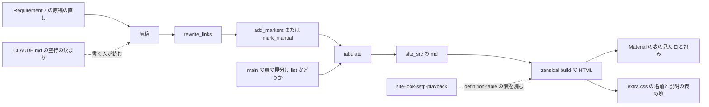
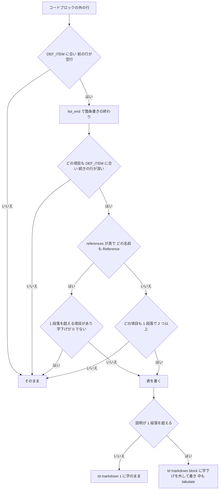

# Design Document: site-look-definition-tables

## Overview
**Purpose**: UKADOC の公開サイトで、プロパティシステムのキー・SHIORI Event の `Reference0` など・さくらスクリプトのオプションの一覧を読むゴースト制作者に、「名前」「説明」の 2 列の表を届け、名前を縦に追えるようにする。`site-look-plan` で「採る」と決まった C23 を、開発者の方針「Markdownはいじらず、対応するパターンが出てきたら表htmlにする」に従い、組み立ての処理で入れる。
**Users**: 表のある 20 頁を、明・暗の表示、幅 375 の狭い画面、印刷、検索から開く頁で読むゴースト制作者と、原稿を書く人（ukadoc-spec の `CLAUDE.md` の空行の決まりを読む）。
**Impact**: ukadoc-spec の `scripts/prepare_site.py` に、書き出す直前の Markdown の中の「`- **名前**: 説明`」の箇条書きを HTML の表に書き換える関数 `tabulate()` を足し、`main()` の書き出しの 3 か所から呼ぶ。`assets/extra.css` の末尾に 1 つの塊を足す。Requirement 7 の 7 つの原稿の空行と字下げを直し、ukadoc-spec の `CLAUDE.md` の「書式」に空行の決まりを 1 項目足す。`mkdocs.yml`・`requirements.txt`・`.nav.yml`・`INDEX.md`・各 `index.md` の「## 一覧」・Zensical の版は変えない。

使い捨ての写し（ukadoc-spec `f54423d`。Claude のスクラッチ）で、この設計の差分そのものを build し、表の数・字・見出し・ほかの spec の目印・幅 375・画面を確かめた（`research.md` の「設計の調査（2026-10-26）」）。数は実装で、作業木の build の HTML で数え直し、それを正とする。

### Goals
- 「`- **名前**: 説明`」だけが 2 つ以上並ぶ箇条書き（477 個・2105 行）を、どの頁でも形だけで見分けて名前と説明の表にする
- `list/` の頁の Reference の箇条書きを、1 項目でも、入れ子の箇条書きを持っていても表にする（入れ子は説明の欄の中に入れ、中の名前と説明の箇条書きは表の中の表にする）
- 表の名前と説明の字・並び・リンクの飛び先を、箇条書きのときと同じにする
- 表を Material の表の見た目のまま、行の上下を詰め、字を `.75rem` にし、広い画面では 24em までの名前を折り返さず（それより長い名前だけ 24em で折り返す）、狭い画面では収める
- `list/` の頁の意味の無い空行を原稿で直し（6 ファイルと `rateofusegraph`）、空行の決まりを `CLAUDE.md` に書く

### Non-Goals
- 原稿を Markdown の表に書き換えること、定義の並び（`def_list`）の拡張を足すこと
- C16（`spec/shiori3` のヘッダの値の列）。この spec は 7 個の表を見た記録だけを残す
- 表の形をしていないほかの箇条書き・原稿に Markdown で書かれた表・`manual/` のファイルの箇条書きの見え方
- `spec/shiori3`・`spec/sstp` のヘッダの一覧の中の `Reference0` など、`list/` の外の Reference の箇条書き、`list/sakura-script` の `notes_selectfile` のような、ほかの名前の一覧の空行
- 表と表の間・表の後ろの空きを詰めること（Material の包みのまま）

## Boundary Commitments

### This Spec Owns
- `scripts/prepare_site.py` の表への書き換え: 定数 `DEF_ITEM`・`REFERENCE`・`LIST_ITEM`、関数 `indent()`・`list_end()`・`definition_rows()`・`tabulate()`、`main()` の書き出しの 3 か所の呼び出し、モジュールの docstring の 1 項目
- 名前と説明の箇条書き・Reference の箇条書きを見分ける規則（原稿の行の上の規則。下の「見分けの規則」）
- 名前と説明の表の HTML の形（`div.definition-table > table > thead + tbody`）と、表の印 `definition-table`
- `assets/extra.css` の、見出しのコメント `/* site-look-definition-tables: 名前と説明の表 */` で始まる 1 つの塊
- Requirement 7 の 7 つの原稿の空行・字下げの直しと、ukadoc-spec の `CLAUDE.md` の「書式」の 1 項目
- この spec の記録（`.kiro/specs/site-look-definition-tables/verification.md` と `screenshots/`。完了で `completed/` へ移る）

### Out of Boundary
- `prepare_site.py` のほかの処理（一覧の検査・まとめ頁の流れ・id の振り方・見出しの数の検査・`rewrite_links()`・`add_markers()`・`mark_manual()`・`_raw/`・`.nav.yml` の書き換え）。この spec はそれらの出力を受けて書き換えるだけで、中身を変えない
- `extra.css` のほかの塊、Material の表の色・枠・包み（`md-typeset__scrollwrap`・`md-typeset__table`）、テーマの色の変数
- 注記の箱（admonition）・注意書きの箱（`div.bundle-notes`）・manual の頁の帯の見え方
- 7 つのほかの原稿・`.nav.yml`・`INDEX.md`・`index.md` の「## 一覧」・`mkdocs.yml`・`requirements.txt`・`.github/workflows/pages.yml`・Zensical の版
- `site-look-plan` の成果物（目標の画面・試作・`tools/shot.mjs`）。読むだけ
- 後続の `site-look-sstp-playback` がキーの表から名前を組み立てる処理

### Allowed Dependencies
- `prepare_site.py` の既にある部品: `FENCE`、`main()` の 3 つの書き出しの流れ（まとめ頁の `write(dst, …)`・読み物の頁の `write(rel, …)`・`write('index.md', …)`）、`rewrite_links()`・`add_markers()`・`mark_manual()` の出力（表はリンクの書き換えと目印の後に書く）
- Python-Markdown の `md_in_html`（`markdown="1"`・`"block"`）と `mdx_truly_sane_lists`（空行で箇条書きが分かれる）。`mkdocs.yml` と `EXTENSIONS` の今の設定のまま
- Material（Zensical 0.0.67 の classic）の `table:not([class])` の見た目と、テーマのスクリプトが付ける包み、`--md-typeset-table-color` などの変数
- 確かめの道具: `zensical serve`、`python -m http.server`（変更の前の控えを配る）、`.kiro/specs/completed/site-look-plan/tools/shot.mjs`（読むだけ）、使い捨ての Python の数えるスクリプト（`html.parser`）

### Revalidation Triggers
- 表の印 `definition-table` の名前か、表の HTML の形（包みの `div`・`thead` の「名前」「説明」・1 項目 1 行・名前の欄の `strong`）を変えたとき: `site-look-sstp-playback` がキーの表の見分けと名前の取り出しを確かめ直す
- `mark_manual()` の目印か「`: `」の外し方、`add_markers()` の `div.bundle-notes` の包み方、`site-look-top-page` の `mark_top()` を変えたとき: manual の頁・トップの表 0 と、注意書きの箱の中の表 6 を数え直す
- 原稿に新しい書き方が入ったとき（親の行の直後に空行なしで始まる名前と説明の箇条書き、字下げの無い続きの行、名前の中の `*`、名前の後ろの区切りの揺れ、項目の中か注記の箱の中の Reference の入れ子、`list/` の新しい頁）: HTML の木の判定で「表になるはずで残った箇条書き」を数え、0 であることを確かめ直す
- Reference の箇条書きを見分ける頁の決まり（`main()` の `page_dir.startswith('list/')`）を変えたとき: Reference の表の数と `spec/shiori3` の外した 3 個を数え直す
- Zensical・Python-Markdown・Material の版を上げたとき: 字下げ 4 以上の表（`dev/nar`）が段落の中の HTML として崩れずに出ること、`markdown=` が HTML に残らないこと、表の見た目・包み・幅 375 を確かめ直す
- `extra.css` に `.md-typeset table`・`td`・`th` に当たる指定を足す spec が入ったとき: 表の詰め・字の大きさ・名前の折り返しを確かめ直す
- C16 を起票するとき: この spec の `verification.md` の `spec/shiori3` の 7 個の表の記録を材料にする

## Architecture

### Existing Architecture Analysis
- `main()` は、まとめ頁の単位を `shift_headings()` → `rewrite_links()` → `add_markers()` に通してつなぎ、`write(dst, text + '\n')` で 1 頁を書く。読み物の頁は `write(rel, mark_manual(text) if d == 'manual' else text)`、トップは `write('index.md', rewrite_links(read('INDEX.md'), …))` で書く。表のある 20 頁のうち 17 頁はまとめ頁、`dev/nar`・`spec/headline`・`spec/plugin` は読み物の頁
- 原稿の「`- **名前**: 説明`」の項目は、どれも段落に包まれない詰まった箇条書きで、`mdx_truly_sane_lists` により空行で別の箇条書きに分かれる。項目の中の名前と説明の箇条書き 12 個は、どれも親の項目との間に空行があり 2 字下げ
- Material の表の見た目と包みは `table:not([class])` にだけ付き、`td > :first-child`・`:last-child` の上下の余白を 0 にする。縞の地は無く、指したときの地だけ `--md-typeset-table-color--light`
- Python-Markdown は 4 字以上字下げした HTML をブロックとして読まない（注記の箱の中）。`td` は行の中の書式だけを読む要素で、箇条書きを読ませるには `markdown="block"` が要り、それも字下げ 0 の所でだけ働く（`research.md`）

### Architecture Pattern & Boundary Map
選んだ形は、ギャップ分析の推す Option A の A2（`prepare_site.py` が HTML の表を `markdown="1"` 付きで書き、Markdown の読みは Python-Markdown に任せる）。目印を付ける後処理を `prepare_site.py` に置く `site-look-list-markers`・`site-look-manual-files` の型にそろえ、頁の種類（`list/` かどうか）は `main()` で見分けて引数で渡す。



- **見分けの置き場**: 表にする形は `tabulate()` の中の規則だけが持つ。頁の種類は `main()` の 3 か所が `references`（`list/` のまとめ頁なら真）として渡す。頁や項目を名指ししない
- **順**: 表はリンクの書き換えと目印の後に書く。表の中のリンクは書き換えた後の飛び先のまま（2.6）。manual の頁は `mark_manual()` が「`: `」を外した後なので形が合わず表にならない（1.6）
- **印**: `div.definition-table` だけを足す。表そのものには何も付けず、Material の見た目と包みをそのまま受ける（2.5・3.1）
- **色**: 色の指定を足さない。枠・地・字・リンクは Material の表とテーマの変数のまま（3.7〜3.10）

### Technology Stack

| Layer | Choice / Version | Role in Feature | Notes |
|-------|------------------|-----------------|-------|
| 組み立ての処理 | Python 3.12・`scripts/prepare_site.py` | 箇条書きを HTML の表に書き換える | 依存は足さない（`re` だけ） |
| Markdown | Python-Markdown 3.11 の `md_in_html`・`mdx_truly_sane_lists`（`mkdocs.yml` のまま） | 表の中の名前と説明を Markdown として読む | 設定は変えない |
| 見た目の指定 | CSS（`assets/extra.css`） | 字の大きさ・行の詰め・折り返し | 色は足さない |
| サイト生成 | Zensical 0.0.67・Material classic（`requirements.txt` のまま） | 表の見た目と横に流せる包み | 版は変えない |
| 確かめ | `zensical serve`、`python -m http.server`、`shot.mjs`（Edge ヘッドレス + CDP）、使い捨ての Python | 数・字・画面・幅・対比 | `shot.mjs` は読むだけ |

## File Structure Plan

### Directory Structure
```
ukadoc-spec（作業木 .worktrees/site-look-definition-tables/、ブランチ site-look-definition-tables、origin/main から）
├── CLAUDE.md                     # 「書式」に空行の決まりを 1 項目足す
├── scripts/
│   └── prepare_site.py           # DEF_ITEM・REFERENCE・LIST_ITEM と tabulate() などを足し、main() の 3 か所から呼ぶ
├── assets/
│   └── extra.css                 # 末尾に「名前と説明の表」の塊を 1 つ足す
└── list/
    ├── shiori-event/
    │   ├── dialogbox/OnConfigurationDialogHelp.md         # 空行 4 つを除く
    │   ├── file-drop/OnOtherObjectDropping.md             # 空行 3 つを除く
    │   └── notify/rateofusegraph.md                       # 1番目〜13番目を Reference* の入れ子にする
    └── shiori-event-ex/
        ├── plugin-weather-station/OnWeatherStation.Astro.md           # 空行 12 を除く
        ├── plugin-weather-station/OnWeatherStation.Forecast.Hourly.md # 空行 2 つを除く
        ├── plugin-spectre/OnSpectrePlugin.Possession.md               # 空行 2 つを除く
        └── app-music-player/OnMusicPlayer.SongInfo.md                 # 空行 10 を除く

.kiro/specs/site-look-definition-tables/（doc_edit。完了で completed/ へ移る）
├── verification.md               # 新規。数・字・見出し・目印・画面・幅・対比・C16 の材料の記録
└── screenshots/                  # 設計の写しの画面（design-*.png、済み）と、実装の後の画面（after-*.png）
```

ukadoc-spec で変えるのは上の 10 ファイルだけである（6.1）。ファイルの追加・改名・移動は無いので、各 `index.md` の「## 一覧」・`.nav.yml`・`INDEX.md` は変えない。作業木の原稿は `core.autocrlf=true` で CRLF に出ているが、索引は LF のままにする（ほかの字を変えない。7.5）。

### Modified Files

#### `scripts/prepare_site.py`（ukadoc-spec の作業木）
変える所は 4 か所で、ほかの関数は変えない。差分（`f54423d` に対して。写しで build を通したもの）:

```diff
@@ -12,6 +12,8 @@
 - manual/ の頁のファイルの箇条書きの頭の名前に目印（manual-item）を付け、名前の後ろの「: 」を外す（見た目は assets/extra.css）
+- 「- **名前**: 説明」だけが 2 つ以上並ぶ箇条書きと、list/ の頁の Reference の箇条書きを、
+  「名前」「説明」の 2 列の表（definition-table）にする（見た目は assets/extra.css）
 原稿そのものは書き換えない。
@@ -42,6 +44,9 @@
 NOTE_FILE = re.compile(r'note-\d+\.md')   # 補足の項目の原稿のファイル名
+DEF_ITEM = re.compile(r'^( *)- (\*\*(?:\\.|[^\\*])+\*\*)(?:: |:$)(.*)$')   # 頭が太字の名前で、後ろが「: 」の項目
+REFERENCE = re.compile(r'\*\*Reference(?:\d+|\\\*)(?:～\d*)?\*\*')   # list/ の頁の Reference の名前
+LIST_ITEM = re.compile(r'^ *(?:[-*+]|\d+\.) ')
 MANUAL_ITEM = re.compile(r'^(- \*\*(?:\\.|[^\\*])+\*\*)(: |:$|$)')
@@ -294,6 +299,88 @@ def mark_manual(text):
+def indent(line):
+    return len(line) - len(line.lstrip(' '))
+
+
+def list_end(lines, s, ind):
+    """s 行目から始まる箇条書きの終わり（その次の行の番号）。空行の後ろが ind より深い行なら、項目の続き"""
+    j = s + 1
+    while j < len(lines):
+        if lines[j].strip():
+            if indent(lines[j]) > ind or (indent(lines[j]) == ind and LIST_ITEM.match(lines[j])):
+                j += 1
+                continue
+            return j
+        k = j
+        while k < len(lines) and not lines[k].strip():
+            k += 1
+        if k < len(lines) and indent(lines[k]) > ind:
+            j = k
+            continue
+        return j
+    return j
+
+
+def definition_rows(lines, s, e, ind, references):
+    """箇条書き lines[s:e] を表の行 [(名前, 説明の行, 説明が 1 段落を超えるか)] にする。表にしないなら None"""
+    starts = [i for i in range(s, e) if indent(lines[i]) == ind and LIST_ITEM.match(lines[i])]
+    rows = []
+    for a, b in zip(starts, starts[1:] + [e]):
+        m = DEF_ITEM.match(lines[a])
+        if not m or any(indent(x) <= ind for x in lines[a + 1:b] if x.strip()):
+            return None
+        rest = lines[a + 1:b]
+        block = any(not x.strip() or LIST_ITEM.match(x) or FENCE.match(x) for x in rest)
+        rows.append((m.group(2), [m.group(3)] + rest, block))
+    is_ref = references and all(REFERENCE.fullmatch(r[0]) for r in rows)
+    if any(r[2] for r in rows) and not (is_ref and ind == 0):
+        return None
+    return rows if len(rows) >= 2 or is_ref else None
+
+
+def tabulate(text, references):
+    """「- **名前**: 説明」だけが 2 つ以上並ぶ箇条書き（references なら Reference の箇条書きも）を、名前と説明の表にする"""
+    lines = text.split('\n')
+    out = []
+    in_fence = False
+    i = 0
+    while i < len(lines):
+        line = lines[i]
+        if FENCE.match(line):
+            in_fence = not in_fence
+        rows = None
+        if not in_fence and DEF_ITEM.match(line) and (i == 0 or not lines[i - 1].strip()):
+            ind = indent(line)
+            e = list_end(lines, i, ind)
+            rows = definition_rows(lines, i, e, ind, references)
+        if not rows:
+            out.append(line)
+            i += 1
+            continue
+        pad = ' ' * ind
+        # 4 字以上の字下げ（注記の箱の中）では HTML が段落の中の字として読まれるので、印を付けない
+        md = ' markdown="1"' if ind < 4 else ''
+        out += [f'{pad}<div class="definition-table"{md}>', f'{pad}<table{md}>',
+                f'{pad}<thead><tr><th>名前</th><th>説明</th></tr></thead>', f'{pad}<tbody{md}>']
+        for name, desc, block in rows:
+            head = f'{pad}<tr{md}><td{md}>{name}</td>'
+            if not block:
+                out.append(f'{head}<td{md}>{desc[0]}')
+                out += desc[1:]
+                out[-1] += '</td></tr>'
+                continue
+            # 1 段落を超える説明: 字下げを外し、最初の段落の後ろに空行を置き、中の箇条書きも表にする
+            body = [desc[0]] + [x[ind + 2:] for x in desc[1:]]
+            n = next(k for k, x in enumerate(body) if k and (not x.strip() or LIST_ITEM.match(x) or FENCE.match(x)))
+            if body[n].strip():
+                body.insert(n, '')
+            out += [f'{head}<td markdown="block">'] + tabulate('\n'.join(body), references).split('\n') + ['</td></tr>']
+        out += [f'{pad}</tbody>', f'{pad}</table>', f'{pad}</div>']
+        i = e
+    return '\n'.join(out)
+
+
 # ---------------------------------------------------------------- 本体
@@ -353,7 +440,7 @@
-        write(dst, text + '\n')
+        write(dst, tabulate(text, page_dir.startswith('list/')) + '\n')
@@ -361,8 +448,8 @@
-                    write(rel, mark_manual(text) if d == 'manual' else text)
-    write('index.md', rewrite_links(read('INDEX.md'), 'INDEX.md', 'index.md'))
+                    write(rel, tabulate(mark_manual(text) if d == 'manual' else text, False))
+    write('index.md', tabulate(rewrite_links(read('INDEX.md'), 'INDEX.md', 'index.md'), False))
```

- **見分けの規則**（1.1・1.3〜1.5・1.9・1.10）:
  - 箇条書きの始まり: コードブロックの外で、`DEF_ITEM` に合い、前の行が空行（か文書の頭）の行。前の行が空行でない箇条書き（親の行に詰めて続く入れ子）は始まりにしない（表の HTML の手前に空行が要るため。今は 0 個）
  - 箇条書きの終わり（`list_end()`）: 空行の後ろが始まりの字下げ以下の行。空行の後ろがより深い行なら、その項目の続き（2 つ目の段落か入れ子）。空行の後ろが同じ字下げの `- ` なら別の箇条書き（`mdx_truly_sane_lists` と同じ。1.9）
  - 項目（`definition_rows()`）: 始まりと同じ字下げの `- ` の行ごと。どの項目の頭も `DEF_ITEM`（`- **名前**: ` か行の終わりの `:`。名前の中の `\*`・`\\` は名前の字）に合い、続きの行がどれも項目より深いこと。合わない項目が 1 つでもあれば、箇条書き全体を残す（警告は出さない。1.5）
  - 1 段落を超える項目: 続きの行に空行・箇条書きの行・コードブロックの行があるもの（1.4）
  - 表にするもの: (a) どの項目も 1 段落の中に収まり、項目が 2 つ以上、(b) `references` が真で、どの項目の名前も `REFERENCE`（`Reference` に数字か `\*`、後ろに `～` か `～数字`）に合う。(b) の 1 段落を超える項目は、字下げ 0 の箇条書きでだけ表にする
- **表の HTML の形**（2.1〜2.5）: `div.definition-table > table > thead（名前・説明の 1 行）+ tbody（1 項目 1 行）`。名前の欄は原稿の `**…**` をそのまま書く（`strong` になり太字。リンク・`code` もそのまま）。説明の欄は「`: `」の後ろの字と続きの行をそのまま書く（`<br />` と字下げした続きの行を含む）。行の順は項目の順
- **字下げの扱い**: 字下げ 1〜3（項目の中）は各段に `markdown="1"`、字下げ 4 以上（注記の箱の中）は印を付けずに書き、段落の中の字として読ませる（Python-Markdown が 4 字以上字下げした HTML をブロックとして読まないため。ブラウザは `p` を表の手前で閉じる。当て先は今 `dev/nar` の 1 個）
- **1 段落を超える説明**（1.10）: 項目の字下げ（2 字）を外して `td markdown="block"` の中に書き、最初の段落の後ろに空行を置き、中を `tabulate()` に通す（中の名前と説明の箇条書きは表の中の表になる。1.8）
- **呼び出しの 3 か所**: まとめ頁は頁ごとにつないだ後（`add_markers()` の後）、読み物の頁は `mark_manual()` の後、トップは `rewrite_links()` の後。`references` は `list/` のまとめ頁だけ真
- 写しで確かめた結果: 下の TableCheck の数。`prepare_site.py` と `zensical build --strict` は exit 0

#### `assets/extra.css`（ukadoc-spec の作業木）
末尾に 1 つの塊を足す。注は 1 行（6.3）。ほかの塊は変えない。

```css
/* site-look-definition-tables: 名前と説明の表 */
.md-typeset .definition-table table:not([class]) {
  font-size: .75rem;
}
.md-typeset .definition-table table:not([class]) :is(th, td) {
  padding: .45em .9em;
  overflow-wrap: anywhere;
}
@media screen and (min-width: 45em) {
  .md-typeset .definition-table td:first-child > strong:only-child {
    display: inline-block;
    width: max-content;
    max-width: 24em;
  }
}
```

- 詳細度: Material の `.md-typeset table:not([class]) td`（0,2,2）に勝つよう、`:is(th, td)` の指定を `table:not([class])` の下に置く（0,3,2）。字の大きさの指定（0,2,1 + `:not` で 0,3,1）も Material の `.64rem`（0,2,1）に勝つ
- 名前の太字は原稿の `strong` が出すので、CSS で付けない。幅は指定せず、Material の包み（`display: inline-block`、中の表は `width: 100%`）に任せる（3.3）
- 名前を折り返さない指定は `@media screen` の中だけ（印刷では折り返す。3.9）。名前の欄の `strong`（名前の欄の唯一の子）を `inline-block` にし、幅を名前の字の幅（`max-content`）に、上限を `24em` にする。24em までの名前は 1 行のまま、それより長い名前（幅 1000 で 5 頁の約 13 個）だけが 24em で折り返し、説明の欄が潰れない（実装のタスク 3.4 で、`white-space: nowrap` のままでは長い名前の表 2 つで説明の欄が約 100px に潰れたため。開発者の判断、2026-10-26）
- 色は足さない（3.7・3.10）

#### 原稿（ukadoc-spec の作業木。Requirement 7）
直すのは空行と字下げだけで、ほかの字は 1 字も変えない（7.5）。

| ファイル | 直し | 直した後 |
|---|---|---|
| `list/shiori-event/dialogbox/OnConfigurationDialogHelp.md` | `- **Reference0**` の行から `- **Reference3**` の行までの空行 4 つを除く（入れ子の `  - setup …… 一般` などの字下げは変えない） | 1 つの箇条書き。表は 1 個 4 行（`Reference0` の欄の中に入れ子の箇条書き） |
| `list/shiori-event/file-drop/OnOtherObjectDropping.md` | `Reference0`〜`Reference2` の間と、`Reference2` の続きの行と入れ子の間の空行 3 つを除く | 1 個 3 行 |
| `list/shiori-event-ex/plugin-weather-station/OnWeatherStation.Astro.md` | `Reference0`〜`Reference11` の間と、`Reference10` と入れ子の間の空行 12 を除く | 1 個 12 行 |
| `list/shiori-event-ex/plugin-weather-station/OnWeatherStation.Forecast.Hourly.md` | `Reference0～23` と入れ子の間、入れ子と `Reference24` の間の空行 2 つを除く | 1 個 2 行 |
| `list/shiori-event-ex/plugin-spectre/OnSpectrePlugin.Possession.md` | `Reference0` と入れ子の間、入れ子と `Reference1` の間の空行 2 つを除く | 1 個 2 行 |
| `list/shiori-event-ex/app-music-player/OnMusicPlayer.SongInfo.md` | `Reference0`〜`Reference9` の間と、`Reference7` と入れ子の間の空行 10 を除く | 1 個 10 行 |
| `list/shiori-event/notify/rateofusegraph.md` | `- **1番目**`〜`- **13番目**` の 13 行と、`7番目` の続きの 4 行に 2 字の字下げを足し（続きの行は 2 字から 4 字に）、`- **Reference\***` の行との間の空行 1 つを除く | 1 個 1 行で、`Reference*` の説明の欄の中に `1番目`〜 の 13 行の表 |

- 意味のある空行（`OnPoker`・`OnPokerNotify`・`OnMahjong`・`OnMahjongResponse` の 27 か所）は触らない（7.3）
- 7 つで、表は 33 個から 6 個にまとまり（6 ファイル）、`rateofusegraph` は 2 個のまま（外の Reference の表と中の表）

#### `CLAUDE.md`（ukadoc-spec の作業木）
「書式」の「リストは `- ` で書き、入れ子は 2 スペース（番号付きは 3 スペース）で字下げする（`mdx_truly_sane_lists` による）」の項目の直後に、次の 1 項目を足す（7.4）。ほかの行は変えない。

```markdown
- `- **名前**: 説明` の箇条書きは、サイトでは「名前」「説明」の 2 列の表になる（項目が 2 つ以上のとき。`list/` の頁の `Reference0` などは 1 項目でも表になる）。空行を挟むと別の表に分かれるので、入れ子の箇条書きがあっても項目の間に空行を入れない。空行で分けるのは、`Reference0` などの値によって後に続く `Reference` の出方が変わるときの、値ごとのまとまりの間だけにする
```

### 部品とファイルの対応

| 部品 | ファイル | 変えるか |
|---|---|---|
| DefinitionTabulator | `scripts/prepare_site.py`（作業木） | 変える |
| TableStyle | `assets/extra.css`（作業木） | 変える |
| ManuscriptJoin | Requirement 7 の 7 つの原稿（作業木） | 変える |
| BlankLineRule | `CLAUDE.md`（作業木） | 変える |
| TableCheck・ShotCheck | Claude のスクラッチの使い捨てのスクリプト、`.kiro/specs/completed/site-look-plan/tools/shot.mjs`（読むだけ） | ukadoc-spec には足さない |
| VerificationRecord | `.kiro/specs/site-look-definition-tables/verification.md`・`screenshots/` | 新規 |

## System Flows

### 見分けの流れ（`tabulate()`）



- 表にしなかった箇条書きは、始まりの行だけを書いて次の行から見分けを続ける（中の箇条書き、たとえば `spec/shiori3` の `メソッド` の値の一覧は、それだけで表になる。1.8）
- 警告もエラーも出さない（形の近いものは見出しのような書き方で誤りではない。1.5）。原稿の誤りを build で救済しない（空行をまたいでつながない。1.9）

### 作業の流れ


- B: 変更の前の控えは、作業木の HEAD（作った直後は `origin/main` と同じ）を `git archive HEAD` で Claude のスクラッチの下の新しいフォルダに書き出し、`prepare_site.py` と `zensical build --strict` を流して、`_site/` を `python -m http.server` で 8000 以外の口で配る。`ukadoc-spec/` のメインのチェックアウトでは `prepare_site.py` を流さない。終わったら止める
- D: `serve` は `_site_src/` を見るので、動かしたまま `prepare_site.py` を流さない（書きかけを拾って `extra.css` が 404 になる）

## Requirements Traceability
Flows の記号: S = 見分けの流れ、W = 作業の流れ。

| Requirement | Summary | Components | Interfaces | Flows |
|-------------|---------|------------|------------|-------|
| 1.1 | 形だけで見分けて表に（20 頁 477 個） | DefinitionTabulator（`DEF_ITEM`・`definition_rows()`）, TableCheck | 頁ごとの表の数 | S, W |
| 1.2 | 原稿・`.nav.yml` を変えずに組み立ての処理で | DefinitionTabulator（`_site_src/` に書くだけ） | `git diff` の範囲 | W |
| 1.3 | Reference でない 1 項目は今のまま | DefinitionTabulator（2 つ以上の決まり）, TableCheck | 外した 1 項目 42 | S |
| 1.4 | 入れ子・コードブロック・2 段落は今のまま | DefinitionTabulator（`block` の見分け）, TableCheck | 外した数と例 | S |
| 1.5 | 形の合わない項目があれば今のまま、警告なし | DefinitionTabulator（`DEF_ITEM` に合わなければ残す） | `spec/saori-ex` の 1 個 | S |
| 1.6 | manual の頁は表にしない | DefinitionTabulator（`mark_manual()` の後に通す）, TableCheck | manual の表 0・`manual-item` 73 | S |
| 1.7 | 箱の中でも表に、箱は変えない | DefinitionTabulator（`div.bundle-notes` の中は字下げ 0、注記の箱の中は印なし）, ShotCheck | 箱の中の表 6・1 | S |
| 1.8 | 項目の中の内側だけを表に | DefinitionTabulator（残した箇条書きの中を見分け続ける）, ShotCheck | 項目の中 11・表の中 1 | S |
| 1.9 | 空行で分かれたら別の表、またいでまとめない | DefinitionTabulator（`list_end()`） | `OnMahjong` の 14 の表 | S |
| 1.10 | Reference は 1 項目でも、入れ子は欄の中に | DefinitionTabulator（`REFERENCE`・`td markdown="block"`）, TableCheck | Reference の表 155 | S |
| 2.1 | 見出しの行を「名前」「説明」 | DefinitionTabulator（`thead`） | 表の HTML の形 | — |
| 2.2 | 1 項目 1 行、項目の順 | DefinitionTabulator | 行の数 2105 + 182 | — |
| 2.3 | 名前の字を今と同じに | DefinitionTabulator（`**…**` のまま）, TableCheck | 字の照合 | W |
| 2.4 | 説明の字を今と同じに（「`: `」を除く） | DefinitionTabulator（続きの行をそのまま）, TableCheck | 字の照合 | W |
| 2.5 | ほかの表と見分けられる形、ほかの表を変えない | DefinitionTabulator（`div.definition-table`）, TableStyle（印の下だけ） | `.definition-table table` | — |
| 2.6 | リンクの飛び先を同じに | DefinitionTabulator（`rewrite_links()` の後） | `href` の照合 | W |
| 3.1 | Material の表の見た目 | TableStyle（表に class を付けない） | `table:not([class])` | — |
| 3.2 | 行の上下を詰める | TableStyle（`.45em .9em`） | 画面 | W |
| 3.3 | 幅・字の大きさ・名前の太字を目標の画面と同じに | TableStyle（`.75rem`、幅は包み）, DefinitionTabulator（`strong`）, ShotCheck | 画面 | W |
| 3.4 | 45em 以上で名前を折り返さない（24em を超える名前だけ折り返す） | TableStyle（`@media screen and (min-width: 45em)` の `max-width: 24em`） | 画面 | W |
| 3.5 | 45em 未満で収める | TableStyle, ShotCheck | `scrollWidth` 375 | W |
| 3.6 | 長い字を途中で折り返す | TableStyle（`overflow-wrap: anywhere`） | 375 の測り | W |
| 3.7 | 明・暗でほかの表と同じ色、4.5:1 以上 | TableStyle（色を足さない）, ShotCheck（対比） | 対比の測り | W |
| 3.8 | 明暗の切り替えで読み込み直さずに変わる | TableStyle（色はテーマの変数のまま） | 画面 | W |
| 3.9 | 暗い表示のまま印刷しても明るい色 | TableStyle（暗い表示だけの色が無い、名前の幅の指定は screen だけ） | 印刷の確かめ | W |
| 3.10 | 色を直書きしない | TableStyle | `extra.css` の差分 | — |
| 4.1 | 表の中の字を検索で引ける | DefinitionTabulator（字を変えない）, TableCheck | `search.json` の字 | W |
| 4.2 | 検索の強調を表の中でも | ShotCheck | `?h=` の画面 | W |
| 4.3 | 見出しの id・¶・目次を保つ | DefinitionTabulator（見出しに触れない）, TableCheck | 全頁の比べ | W |
| 4.4 | 375 で 20 頁と `manual/ghost` が収まる | TableStyle, ShotCheck | `scrollWidth` | W |
| 4.5 | コピーのボタンと字を保つ | DefinitionTabulator（コードブロックを表にしない）, TableCheck | `pre` の数と字 | W |
| 4.6 | `\` を今と同じ字で | DefinitionTabulator（字のまま書く）, TableCheck | 字の照合 | W |
| 4.7 | `site-look-list-markers` の目印の数 | DefinitionTabulator（`add_markers()` の後）, TableCheck | 1640・423・16・2719・漏れ 0 | W |
| 4.8 | `site-look-manual-files` の目印と木の色 | DefinitionTabulator（`mark_manual()` の後）, TableCheck, ShotCheck | 73・72・木の色 | W |
| 4.9 | 項目名の帯・詰め・注釈の絵・記述例の色 | TableStyle（印の下だけ）, ShotCheck | 画面 | W |
| 4.10 | `_raw/`・`llms.txt`・検査を保つ | DefinitionTabulator（`build_raw()` と検査の後ろで触れない）, TableCheck | `_raw/` の差は直した 7 原稿だけ | W |
| 5.1 | 配られた `extra.css` を開いて確かめる | TableCheck | 200 と見出しのコメント | W |
| 5.2 | 表の数を頁ごとに分けて数える | TableCheck | 下の期待の数 | W |
| 5.3 | 外す形を数えて例とともに | TableCheck | 外した数と例 | W |
| 5.4 | 見出し・¶・目次と字の照合 | TableCheck | 差 0 | W |
| 5.5 | 目標の画面と同じ所を明・暗で撮る | ShotCheck | 6 枚 | W |
| 5.6 | 写っていない置き場所を明・暗で撮る | ShotCheck | 箱・項目の中・表の中・名前のリンク・長い名前 | W |
| 5.7 | 対比を明・暗で測る | ShotCheck（対比） | 対比の数 | W |
| 5.8 | 375 の測り | ShotCheck | 21 頁 | W |
| 5.9 | C16 の材料の記録 | VerificationRecord | `spec/shiori3` の 7 個 | W |
| 5.10 | 二重の跡の画面を撮り直す | ShotCheck | 画面の左右の端 | W |
| 5.11 | 見せるときに Ctrl+F5 を頼む | VerificationRecord（手順） | — | W |
| 6.1 | 変えるファイルの範囲 | File Structure Plan | `git diff --stat` の 10 ファイル | W |
| 6.2 | `requirements.txt` を変えない | File Structure Plan | 差分に無い | — |
| 6.3 | 塊を末尾に、注は 1 行 | TableStyle | 塊 1・注 1 行 | — |
| 6.4 | 作業木と土台 | 作業の流れ | `.worktrees/site-look-definition-tables/` | W |
| 6.5 | Build Gate と規約 Gate | 作業の流れ | exit 0 | W |
| 6.6 | この spec だけの PR、数え上げと例 | VerificationRecord（PR の本文の材料） | 頁ごとの数・外した例 | W |
| 6.7 | `origin/main` に追いつき両方を残す | Integration & Migration Notes | `tabulate(mark_top(…), False)` | W |
| 6.8 | 旧サイト・試作を写さない | DefinitionTabulator, TableStyle（`data-slp` を使わない） | 差分 | — |
| 7.1 | 意味の無い空行を直して 1 つの箇条書きに | ManuscriptJoin | 6 ファイル | W |
| 7.2 | `rateofusegraph` を入れ子に | ManuscriptJoin, DefinitionTabulator（表の中の表） | 表の中の表 | S, W |
| 7.3 | 意味のある空行 27 を残す | ManuscriptJoin（触らない）, TableCheck | 振り直す所 27 | W |
| 7.4 | `CLAUDE.md` に空行の決まり | BlankLineRule | 1 項目 | — |
| 7.5 | 直した字と見出し・目次を保つ | ManuscriptJoin, TableCheck | 字の照合・見出しの比べ | W |
| 7.6 | 意味の無い空行 0 を数える | TableCheck | 番号の続く所 0 | W |

## Components and Interfaces

| Component | Domain/Layer | Intent | Req Coverage | Key Dependencies (P0/P1) | Contracts |
|-----------|--------------|--------|--------------|--------------------------|-----------|
| DefinitionTabulator | 組み立ての処理 | 箇条書きを見分けて HTML の表に書き換える | 1.1〜1.10, 2.1〜2.6, 4.1, 4.3, 4.5〜4.8, 4.10, 6.8 | `main()` の書き出し (P0), `md_in_html` (P0) | Service, Batch |
| TableStyle | 見た目の指定 | 表の字・詰め・折り返し | 3.1〜3.10, 4.4, 4.9, 6.3, 6.8 | Material の表の見た目と包み (P0) | State |
| ManuscriptJoin | 原稿 | 意味の無い空行を除き、`rateofusegraph` を入れ子にする | 7.1〜7.3, 7.5 | DefinitionTabulator (P1) | — |
| BlankLineRule | 原稿の規約 | 空行の決まりを書く人に示す | 7.4 | — | — |
| TableCheck | 確かめ | 数・字・見出し・目印を数えて比べる | 1.1, 1.3〜1.10, 2.2〜2.4, 2.6, 4.1, 4.3, 4.5〜4.8, 4.10, 5.1〜5.4, 7.3, 7.5, 7.6 | 変更の前の控え (P0) | Service |
| ShotCheck | 確かめ | 画面・375・対比・印刷・検索の強調 | 1.7, 1.8, 3.2〜3.9, 4.2, 4.4, 4.8, 4.9, 5.5〜5.8, 5.10 | `shot.mjs` (P1) | Service |
| VerificationRecord | 記録 | 数・画面・C16 の材料・PR の本文の材料を残す | 5.9, 5.11, 6.6 | TableCheck, ShotCheck (P1) | State |

### 組み立ての処理

#### DefinitionTabulator

| Field | Detail |
|-------|--------|
| Intent | 書き出す直前の Markdown の中の、名前と説明の箇条書きと Reference の箇条書きを、名前と説明の表の HTML に書き換える |
| Requirements | 1.1〜1.10, 2.1〜2.6, 4.1, 4.3, 4.5〜4.8, 4.10, 6.8 |

**Responsibilities & Constraints**
- 表にする形の見分けと、表の HTML の組み立てだけを持つ。原稿のファイル・`_raw/`・見出しの行・コードブロックの中・一覧の検査には触れない
- 頁の種類（`list/` かどうか）は自分で見分けず、`main()` から `references` で受け取る
- 表にした行の名前と説明の字は、原稿の字（リンクの書き換えと目印の後の字）のまま。「`: `」だけを除く
- 見分けに合わないものは、行を 1 字も変えずに残す。警告・エラーは出さない

**Dependencies**
- Inbound: `main()` のまとめ頁・読み物の頁・トップの書き出し — 頁の Markdown と `references` (P0)
- Outbound: `write()` — `_site_src/` に書く (P0)
- External: Python-Markdown の `md_in_html`（`markdown="1"`・`"block"`） — 表の中の Markdown を読む (P0)、`mdx_truly_sane_lists` — 空行で箇条書きが分かれる読み方（見分けがこれに合わせる） (P1)

**Contracts**: Service [x] / Batch [x]

##### Service Interface
```python
DEF_ITEM: re.Pattern[str]    # group(1) 字下げ, group(2) "**名前**", group(3) 「: 」の後ろの説明
REFERENCE: re.Pattern[str]   # fullmatch で "**Reference0**" "**Reference\\***" "**Reference0～23**" に合う
LIST_ITEM: re.Pattern[str]   # 箇条書きの行（- * + か 数字.）

Row = tuple[str, list[str], bool]   # (名前の原稿の字 "**…**", 説明の行（1 行目は「: 」の後ろ）, 1 段落を超えるか)

def indent(line: str) -> int: ...
def list_end(lines: list[str], s: int, ind: int) -> int: ...
def definition_rows(lines: list[str], s: int, e: int, ind: int, references: bool) -> list[Row] | None: ...
def tabulate(text: str, references: bool) -> str: ...
```
- Preconditions: `text` は `rewrite_links()` の後（まとめ頁は `add_markers()`、manual の頁は `mark_manual()` の後）の 1 頁の Markdown で、改行は LF
- Postconditions: 表にした箇条書きの行は、下の表の HTML の形に置き換わる。ほかの行は同じ。`tabulate()` は副作用を持たない
- Invariants: 見出しの行・コードブロックの中・空行の数（表の外）を変えない。同じ入力に同じ出力

##### Batch / Job Contract
- Trigger: `python scripts/prepare_site.py`（手元と CI の `pages.yml` の今の手順のまま）
- Input / validation: 頁ごとの Markdown。見分けに合わないものはそのまま通す（止めない）
- Output / destination: `_site_src/**/*.md` と `_site_src/index.md`。表の HTML の形:

```html
<div class="definition-table" markdown="1">
<table markdown="1">
<thead><tr><th>名前</th><th>説明</th></tr></thead>
<tbody markdown="1">
<tr markdown="1"><td markdown="1">**名前**</td><td markdown="1">説明（続きの行もそのまま）</td></tr>
<tr markdown="1"><td markdown="1">**Reference0**</td><td markdown="block">
最初の段落

（字下げを外した入れ子の箇条書き・表）
</td></tr>
</tbody>
</table>
</div>
```

  - 項目の中の表は、各行の頭に項目の字下げを付ける。字下げ 4 以上では `markdown="1"` を付けない
- Idempotency & recovery: 毎回 `_site_src/` を作り直すので、やり直しは流し直すだけ

**Implementation Notes**
- Integration: `site-look-top-page` が同じ `write('index.md', …)` の行を `mark_top(…)` で包む。後に入る方が `tabulate(mark_top(…), False)` にする（「Integration & Migration Notes」）
- Validation: TableCheck の数・字・見出し・目印。HTML に `markdown=` が残らないこと
- Risks: 原稿の行の上の見分けは Markdown の読み方の真似で、新しい書き方でずれうる。HTML の木の判定で「表になるはずで残った箇条書き 0」を数えて守る（Revalidation Triggers）

### 見た目の指定

#### TableStyle
`assets/extra.css` の末尾の 1 つの塊（「Modified Files」）。新しい境目を作らないので、要約だけを書く。

| Field | Detail |
|-------|--------|
| Intent | 名前と説明の表の字を `.75rem` にし、行の上下を `.45em .9em` に詰め、45em 以上で 24em までの名前を折り返さず、長い字を折り返す |
| Requirements | 3.1〜3.10, 4.4, 4.9, 6.3, 6.8 |

##### State Management
- State model: 当て先は `div.definition-table` の下の Material の表だけ。ほかの表・箱・帯には当たらない
- Persistence & consistency: 色を持たない。明・暗・印刷の色は Material の表の指定とテーマの変数のまま
- Concurrency strategy: ほかの spec の塊と同じセレクタを持たない

**Implementation Notes**
- Validation: 目標の画面との見比べ、375 の測り、対比の測り（ShotCheck）
- Risks: Material の版で表の指定の詳細度か値が変わると、詰めが効かなくなる（設計の写しで、初めの指定が詳細度で負けたことを確かめた）

### 原稿

#### ManuscriptJoin・BlankLineRule
7 つの原稿の直しと `CLAUDE.md` の 1 項目（「Modified Files」）。新しい境目を作らないので、要約だけを書く。直した後の箇条書きは空行の無い 1 つの箇条書きで、DefinitionTabulator はそれを 1 つの表にする。`rateofusegraph` の `1番目`〜 は `Reference*` の項目の入れ子になり、説明の欄の中の表になる。

### 確かめ

#### TableCheck

| Field | Detail |
|-------|--------|
| Intent | 変更の前の控えと変更の後の build の HTML を比べ、表の数・外した形・字・見出し・目印を数える |
| Requirements | 1.1, 1.3〜1.10, 2.2〜2.4, 2.6, 4.1, 4.3, 4.5〜4.8, 4.10, 5.1〜5.4, 7.3, 7.5, 7.6 |

**Responsibilities & Constraints**
- 配り（5.1）: 作業木の `serve` の `/ukadoc-spec/assets/extra.css` が 200 で、`site-look-definition-tables:` の見出しのコメントが 1 つある
- 数（1.1・1.10・5.2）: 全頁の `article` の中の `div.definition-table` を頁ごとに数え、「名前と説明の箇条書きの表」（2 行以上で、どの欄も段落・箇条書き・表を持たない）と「Reference の箇条書きの表」（それ以外）に分ける。置き場所（一番外・`div.bundle-notes`・注記の箱・項目の中・表の中）も数える
- 残り（1.3〜1.6・5.3）: 変更の後の HTML に、HTML の木の判定（`mockup.js` の C23 と同じ判定と、`list/` の頁の Reference の判定）で表になるはずの箇条書きが 0。外した形の数と例
- 字（2.2〜2.4・2.6・4.6・5.4）: 変更の前の箇条書きの項目の（名前・説明）と、変更の後の表の行の（名前の欄・説明の欄）を、頁ごとに順に比べる（空白を詰め、説明の頭の「`: `」を除く。中に表を持つ欄は、中の表の見出しの行と「`:`」を除いて比べる）。`href` も同じ
- 変わらないこと（4.3・4.5・4.10・7.5）: 全頁で見出しの id の並び・`a.headerlink` の数・右の欄の目次の項目の数・`pre` の数が同じ。`llms.txt` が同じで、`_raw/` の差は直した 7 原稿だけ。HTML に `markdown=` が 0
- 目印（4.7・4.8）: `bundle-support` 1640・`bundle-default` 423・`bundle-notes` 16・`bundle-baseware` 2719・本文の `{:` 0・`manual-item` 73
- 空行（7.3・7.6）: `list/` の頁で、並んだ Reference の表の番号が続く所 0・振り直す所 27

##### Service Interface
```typescript
interface TableCount {
  page: string;                 // 例: "list/shiori-event/"
  defTables: number; defRows: number;   // 名前と説明の箇条書きの表
  refTables: number; refRows: number;   // Reference の箇条書きの表
}
interface TableCheck {
  served(): boolean;                         // 5.1
  count(page: string): TableCount;           // 5.2
  leftover(page: string): number;            // 5.3（0 であること）
  textDiffs(page: string): string[];         // 5.4（空であること）
  unchanged(page: string): boolean;          // 4.3・4.5・7.5
  markers(): Record<string, number>;         // 4.7・4.8
  blankSplits(): { continuing: number; restarting: number };   // 7.6（0）・7.3（27）
}
```

期待の数（`f54423d` の写しに設計の差分を当てて数えた。実装で数え直し、それを正とする）:

| 頁 | 名前と説明の箇条書きの表 / 行 | Reference の箇条書きの表 / 行 |
|---|---|---|
| `list/shiori-event` | 217 / 892 | 83 / 88 |
| `list/shiori-event-ex` | 124 / 552 | 62 / 84 |
| `spec/saori-ex` | 45 / 177 | 0 |
| `list/sakura-script` | 22 / 151 | 0 |
| `spec/sstp` | 10 / 71 | 0 |
| `list/propertysystem` | 9 / 56 | 0 |
| `list/plugin-event` | 8 / 34 | 9 / 9 |
| `descript/shell` | 7 / 23 | 0 |
| `spec/shiori3` | 7 / 36 | 0 |
| `spec/headline` | 5 / 15 | 0 |
| `descript/shell-surfaces` | 4 / 20 | 0 |
| `list/shiori-resource` | 4 / 18 | 1 / 1 |
| `spec/update-file` | 4 / 9 | 0 |
| `descript/install` | 3 / 17 | 0 |
| `descript/ghost` | 2 / 6 | 0 |
| `spec/fmo-mutex` | 2 / 15 | 0 |
| `descript/plugin` | 1 / 6 | 0 |
| `dev/nar` | 1 / 2 | 0 |
| `spec/plugin` | 1 / 2 | 0 |
| `spec/web` | 1 / 3 | 0 |
| 計 | 477 / 2105 | 155 / 182 |

- 計 632 個（Requirement 5.2 の見込みの 631 は、Reference の 1 項目の箇条書きを 181 と数えていた。名前 `Reference0～23` を含めると 182 で、477 + 182 − 33 + 6 = 632。`research.md`）。直した 6 ファイルの表は Reference の箇条書きの表に入る（どれも入れ子を持つ）
- 置き場所: 一番外 612・`div.bundle-notes` の中 6・注記の箱の中 1・項目の中 11・表の中 2
- 外した形: Reference でない 1 項目 42、`spec/shiori3` のヘッダの一覧の中の `Reference` 3、2 つ以上の段落 8、コードブロック 4、名前の後ろが「`: `」でない 1 項目 84 と `spec/saori-ex` の 5 項目の 1 個、manual の頁 0、表になるはずで残ったもの 0

#### ShotCheck

| Field | Detail |
|-------|--------|
| Intent | 明・暗の画面、375 の幅、対比、印刷、検索の強調を確かめる |
| Requirements | 1.7, 1.8, 3.2〜3.9, 4.2, 4.4, 4.8, 4.9, 5.5〜5.8, 5.10 |

**Responsibilities & Constraints**
- 目標と同じ所（5.5）: `node .kiro/specs/completed/site-look-plan/tools/shot.mjs <url> <selector> <out> light|dark`（既定 1000×700）で、`list/propertysystem` の `[id="system.cpu"]`、`list/sakura-script` の `#bang-set-wallpaper`、`list/shiori-event` の `#OnBoot` を明・暗で撮り、`mock-*-C23-*.png` の表の部分と見比べる
- 写っていない所（5.6）: `list/sakura-script` の注意書きの箱（`#notes_selectfile` など）、`dev/nar` の `.admonition.tip`、`spec/shiori3` の `#request`、名前にリンクや `code` のある表、長い名前の表（`--content-type=…`）、表の中の表（`#rateofusegraph`）、縦に並ぶ表（`#OnMahjong`）を明・暗で撮る
- 375（4.4・5.8）: `shot.mjs <url> body - light 375` で表のある 20 頁と `manual/ghost` の `scrollWidth` と `innerWidth` が同じ 375
- 対比（3.7・5.7）: 表の字・リンク・名前の字と、行の地（`--md-default-bg-color`）・指したときの地（`--md-typeset-table-color--light`）の対比を明・暗で測り、4.5:1 以上
- 印刷（3.9）: 暗い表示を選んだまま、印刷の媒体で表の地・字の色が明るい表示と同じで、名前が折り返されること
- 検索の強調（4.2）: `?h=<表の中の語>` で開き、表の中の `mark` が明・暗で見えること
- 二重の跡（5.10）: 左右の端の上の端以外にヘッダの色の行が出た画面は撮り直す

##### Service Interface
```typescript
interface ShotResult { file: string | null; scrollWidth: number; innerWidth: number }   // shot.mjs の標準出力
interface Contrast { scheme: 'light' | 'dark'; fg: string; bg: string; ratio: number }    // ratio >= 4.5
```

### 記録

#### VerificationRecord
`.kiro/specs/site-look-definition-tables/verification.md` と `screenshots/after-*.png`。要約だけを書く。

##### State Management
- State model: TableCheck・ShotCheck の数と結果、外した形の例、目標の画面との見比べ、`spec/shiori3` の 7 個の表で C16 が足りそうかの見立てと理由（5.9）、PR の本文に写す頁ごとの数と外した例（6.6）、開発者に見せるときの Ctrl+F5 の頼み（5.11）
- Persistence & consistency: 完了で `completed/` へ移る。画面は撮った日と土台のコミットを添える

## Error Handling
- `tabulate()` はエラーも警告も出さない。見分けに合わないものは今のまま残し、確かめ（TableCheck の「残り」）で見つける。原稿の書き方の揺れを build で救済しない（空行をまたいでつながない、形の近いものを直さない）
- `prepare_site.py` の今のエラー（一覧の食い違い・見出しの数・リンク先の見出しの無いもの）は変わらない。表の HTML は見出しの数の検査（`old_ids()`、原稿の単位で見る）の後に作るので、検査に入らない
- Build Gate: `prepare_site.py` と `zensical build --strict` のどちらかが失敗したら PR にしない。`build --strict` は存在しない `extra_css` を見ないので、配りは TableCheck の `served()` で見る

## Testing Strategy
- 単体（使い捨てのスクリプトで `tabulate()` を直に呼ぶ）:
  - 2 項目の名前と説明の箇条書き → 表 1 個 2 行、名前の欄に `**…**`、説明の欄に「`: `」の後ろの字と `<br />` の続きの行
  - 1 項目で `Reference` でない名前 → 字が 1 字も変わらない。`references` が偽の `Reference0` 1 項目 → 変わらない
  - `references` が真の `- **Reference0**: …` と 2 字下げの入れ子 → `td markdown="block"` の中に、空行・字下げを外した入れ子
  - `- **必ず守ること（MUST）：**` を含む 5 項目 → 変わらない。コードブロックの中の `- **a**: b` → 変わらない
  - 字下げ 4 の 2 項目 → `markdown=` の無い表、字下げ 2 → 各段に `markdown="1"`
- 結び（build の HTML。TableCheck）:
  - 頁ごとの表の数と行の数が期待の数と合い、表になるはずで残った箇条書きが 0
  - 全行の名前と説明の字と `href` が変更の前の箇条書きと同じ
  - 見出しの id・¶・目次・`pre`・目印の数が同じ、`markdown=` が 0、`_raw/` の差が直した 7 原稿だけ
  - `list/` の頁の番号が続く空行 0・振り直す空行 27
- 画面（ShotCheck）:
  - 目標の 3 か所を明・暗で撮り、表の部分（詰め・字の大きさ・名前の太字・幅の出方）が目標の画面と同じ
  - 箱の中・項目の中・表の中・縦に並ぶ表・長い名前を明・暗で撮り、崩れが無い
  - 375 で 21 頁が `scrollWidth` 375、対比が明・暗で 4.5:1 以上、印刷と検索の強調
- 量: 表 632 個・行 2287 の HTML が変わる。PR の本文に頁ごとの数と外した例を書き、レビューの人が見比べられるようにする（6.6）

## Integration & Migration Notes
- 作業木は `.worktrees/site-look-definition-tables/`（ブランチ `site-look-definition-tables`、ukadoc-spec の `origin/main` から）。土台は今 `f54423d`
- `site-look-top-page` が先に入ったとき: `prepare_site.py` の `write('index.md', …)` の行と `mark_manual()` の引数がぶつかる。`origin/main` に追いつき、`write('index.md', tabulate(mark_top(rewrite_links(…)), False))`・`write(rel, tabulate(mark_manual(text) if d == 'manual' else text, False))`（`mark_manual()` の新しい引数はその spec のまま）にして、両方の目印の数を確かめ直す（6.7）。この spec が先に入ったときは、その spec が同じ形に追いつく
- `extra.css` は末尾に足すので、ほかの spec が末尾に塊を足していたら、その後ろに置く
- PR: この spec の完了（`/kiro-complete`）で、この spec だけの PR を作ってスクワッシュマージする。本文に頁ごとの表の数・外した形の例・直した 7 原稿を書き、一連の PR の並びは PR を出すときの roadmap による（6.6）

## 設計の話し合いで決まったこと（2026-10-26、開発者の「承認」で 4 議題とも推奨案）
1. **表の印の名前**（2.5）: `definition-table`（`div` の class）のまま入れる。`structure.md` の目印の名前の決まり `<頁の種類>-<役>` は、この表がどの頁の種類にも出るので当てはまらない。この spec の完了のとき、`.kiro/steering/structure.md` の目印の決まりに「どの頁の種類にも出る役は `<役>` だけの名前にする」を 1 文足す
2. **字下げ 4 以上の表の出し方**（1.7）: 印を付けずに書き、段落の中の HTML として読ませる（`dev/nar` の 1 個。ブラウザが `p` を表の手前で閉じ、前後に空の `p` が残る）。`verification.md` に HTML の形と画面を記録し、版を上げたときは Revalidation Triggers で確かめ直す。注記の箱の書き換え（ほかの spec の物）はしない
3. **表にできない置き場所**（1.10）: 項目の中か注記の箱の中で入れ子を持つ Reference の箇条書きと、親の行に空行なしで続く名前と説明の箇条書きは、箇条書きのまま残す（どちらも今は 0 個）。`prepare_site.py` はエラーで止めず、TableCheck の「表になるはずで残った箇条書き 0」で見張る
4. **`CLAUDE.md` の空行の決まりの文案**（7.4）: 「Modified Files」の `CLAUDE.md` の文案のまま、「書式」の「リストは `- ` で書き…」の項目の直後に足す（`OnMahjong` などの頁は名指ししない）

## 実装で決まったこと（2026-10-26、開発者の判断）
1. **長い名前の表の名前の欄**（3.4・3.6）: 実装のタスク 3.4 の画面で、`white-space: nowrap` のままでは `list/sakura-script` の `#notes_executehttp` の箱の表（83 字の `--content-type=…`）と `#bang-anim-add-overlay-ID` の表（69 字の `\![anim,add,overlay,…]`）の説明の欄が約 100px に潰れ、表の中を横に流さないと読めなかった。名前の欄の `strong` に上限 `24em` を付ける試作（幅 1000 で、はみ出す表 0、2 つの表の説明の欄 322px・286px、短い名前の表は変わらない）を開発者が採った。3.4 は「24em までの名前を折り返さない」と読む
