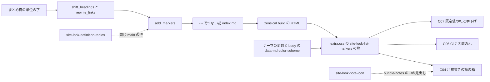
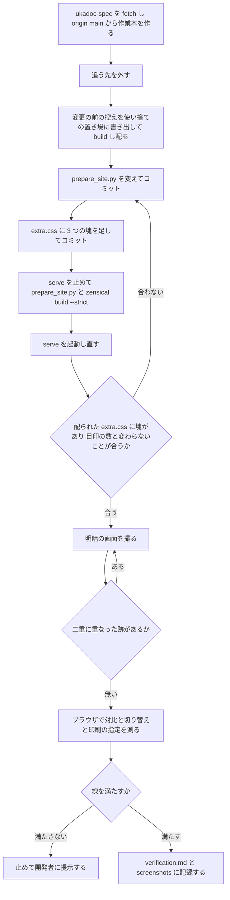

# Design Document: site-look-list-markers

## Overview
**Purpose**: UKADOC のまとめ頁（`descript/`・`list/`・`spec/` の 20 頁）で仕様を引くゴースト制作者に、注意書きの節・対応ベースウェア・既定値を、ほかの文とひと目で見分けられる見え方を届ける。`site-look-plan` で「採る」と決まった C04（注意書きの節の箱）・C06（対応のベースウェアの名前ごとの札）・C07（既定値の札と字下げ）・C17（明るい表示の札の字を白地に 7:1 以上）を、本番の書き方で ukadoc-spec に入れる。
**Users**: まとめ頁で仕様を引くゴースト制作者（明・暗の表示、幅 375 の狭い画面、印刷を含む）。読み物の頁（`manual/`・`dev/`・`memo/`・`spec/` の 1 ファイルの頁・トップ）の見え方は変えない。
**Impact**: ukadoc-spec の `scripts/prepare_site.py` に、まとめ頁の単位の字に目印を足す関数 `add_markers()`（と名前を札で包む `baseware()`）を足し、`main()` の 1 か所から呼ぶ。`assets/extra.css` の末尾に、その目印に当てる見た目の指定の塊を 3 つ足す。原稿・設定は変えない。

目印は試作の `slp_mark()` と同じ形（段落の末尾の `{: .cls }`・名前の `<span>`・単位の `<div markdown="1">`）で、名前を `site-look-list-items` の決まり `bundle-<役>` にそろえる。使い捨ての写し（`d3154d8`）で、目印の数が要件の数と合い、見出しの id・¶・右の欄の目次・区切りの線・本文の字・`_raw/` が変わらないことを確かめた（`research.md` の「設計の調査」）。

### Goals
- まとめ頁の注意書きの節 16 個（段が `h2` 2・`h3` 12・`h4` 2）を、段に依らず同じ点線の箱に入れ、見出しを中央寄せにして点線で区切る
- 対応の段落 1640 個の「形に合う部分」の名前 2719 個を名前ごとの色の札にし、札の後ろの字と ` / ` を今のまま残す
- 既定値の段落 423 個を字下げし、頭の「既定値:」だけを小さな枠の札にして、値の字は本文と同じ色・大きさにする
- 明るい表示の札を白地に 7:1 以上、暗い表示の札を暗い地に 4.5:1 以上にし、暗い表示だけの色は画面だけに当てる
- 箱の中のリンクを明・暗とも 7:1 以上、ホバー・フォーカスを 3:1 以上にする

### Non-Goals
- さくらスクリプトのタグ・環境変数の色（`site-look-sakura-script-highlight`）、`manual/` の木のファイル名の色（`site-look-manual-files`）、注意書きの見出しのアイコン（`site-look-note-icon`）
- C05（対応の段落の帯）・C11（バルーン風）、ベースウェアの画像の印
- 原稿の `**対応:**` 行の書き方を直すこと、札にするベースウェアの名前を足すこと（areka など）
- テーマの色・リンクの色の変数、`mkdocs.yml`・`.nav.yml`・`requirements.txt`・Zensical の版
- 測りの道具の新設（`shot.mjs` は読むだけで使う）

## Boundary Commitments

### This Spec Owns
- `scripts/prepare_site.py` の、まとめ頁の単位の字に目印を足す処理: 定数 `SUPPORT_LINE`・`DEFAULT_LINE`・`BASEWARE`・`BASEWARE_PART`・`NEGATION`、関数 `baseware()`・`add_markers()`、`main()` の呼び出しの 1 か所、モジュールの docstring の 1 項目
- 目印の名前 `bundle-notes`（注意書きの節の包み）・`bundle-support`（対応の段落）・`bundle-default`（既定値の段落）・`bundle-baseware` と `bundle-baseware-<名前の小文字>`（名前の札）
- 「形に合う部分」の決まり（名前で始まり、名前の後ろが部分の終わりか空白。後ろの字が打ち消しの語を含むなら札にしない）と、札にする名前の並び（`Materia`・`SSP`・`CROW`・`Ninix`）
- `assets/extra.css` の、見出しのコメント `/* site-look-list-markers: … */` で始まる 3 つの塊（注意書きの節の箱・対応のベースウェアの札・既定値の札と字下げ）と、その中の札の明・暗の色 8 つ
- この spec の記録（`.kiro/specs/site-look-list-markers/verification.md` と `screenshots/`。完了で `completed/` へ移る）: 目印の数・札にならない部分・対比・画面の見比べ・失わないものの確かめ

### Out of Boundary
- `extra.css` のほかの塊（紺のテーマ・PR #10 の `site-look-dark-link-color:`・目次の詰め・記述例の折り返し・`site-look-list-items:` の 6 つ・後続 spec の塊）。C02 の詰め（`.md-typeset:has(.bundle-item) p`・`hr`）は箱の中にも効くが、値は変えない
- `prepare_site.py` のほかの処理（一覧の検査・id の振り方・見出しの数の検査 `old_ids()`・`shift_headings()` の役の class・リンクの書き換え・`hr` の入れ方・`_raw/`・`.nav.yml` の書き換え）
- テーマの色の変数の値、リンク・ホバーの色の変数（`--md-typeset-a-color`・`--md-accent-fg-color`）、ヘッダの地の色
- ほかの spec が作る字の色（タグ・環境変数・木のファイル名）と、注意書きの見出しのアイコン
- 原稿（`.md`）・`.nav.yml`・`mkdocs.yml`・`requirements.txt`・Zensical の版、`index.md` の「## 一覧」・`INDEX.md`（UKADOC の構成は変えない）、`site-look-plan` の成果物（目標の画面・試作・`tools/shot.mjs`）

### Allowed Dependencies
- `prepare_site.py` の既にある部品: `FENCE`（コードブロックの行の見分け）、`main()` の単位の流れ（`register_bundle()` の単位 → `shift_headings()` → `rewrite_links()` → `---` でつなぐ）、`posixpath`・`re`（標準ライブラリ）
- Python-Markdown の `attr_list`（段落の末尾の `{: .cls }`）・`md_in_html`（`<div markdown="1">`）・生の HTML の `<span>`。どれも `mkdocs.yml` と `EXTENSIONS` の今の設定のまま
- `site-look-list-items` の `bundle-<役>` の決まりと、注意書きの節の見出しに役の class が付かないこと（C01・C03 の帯が当たらない）
- テーマ（Zensical 0.0.67 の classic）の変数 `--md-default-fg-color--light`・`--md-code-bg-color`、`<body>` に付く `data-md-color-scheme`、テーマが暗い表示の色を `@media screen` の中だけで定める作り
- 確かめの道具: `zensical serve`、`python -m http.server`（変更の前の控えを配る）、Edge ヘッドレス + CDP の使い捨てのスクリプト、`.kiro/specs/completed/site-look-plan/tools/shot.mjs`（読むだけ）

### Revalidation Triggers
- 目印の名前（`bundle-notes` など）か、包む単位（ファイル名が `notes_` で始まる単位）を変えたとき: `site-look-note-icon`（箱の中の `notes_` の見出しにアイコンを付ける）と、C11 に入れ替える後の spec が確かめ直す
- 包みの形（`<div class="bundle-notes" markdown="1">` と前後の空行）を変えたとき: 見出しの id・¶・右の欄の目次・`hr` の数を確かめ直す
- `BASEWARE` に名前を足したとき: `extra.css` に明・暗の札の色を足し、対比を測って記録する（2.9）
- 原稿に `**対応:**`・`**既定値:**` の行が増えた・書き方が変わったとき（名前の直後に空白の無い字、打ち消しの語、2 行以上の対応の段落、コードブロックや箇条書きの中の行）: 目印の数と札にならない部分を数え直す
- `site-look-definition-tables` など、`main()` の `parts.append(…)` の行に後処理を足す spec が入ったとき: 両方の関数を通す順と、目印の数・漏れを確かめ直す
- C02 の詰め（`.md-typeset:has(.bundle-item) p`）の詳細度か値を変えたとき: 既定値の字下げ（`.md-typeset p.bundle-default`、同じ詳細度で後に書いて勝つ）を確かめ直す
- リンクの色の変数（PR #10 の `#8fb4e8`・テーマの紺）・`--md-default-fg-color--light`・`--md-code-bg-color`・`--md-typeset-mark-color` を変えたとき、Zensical の版を上げたとき: 箱・札の対比を測り直す

## Architecture

### Existing Architecture Analysis
- `main()` は、まとめる頁ごとに `register_bundle()` の単位 `(rel, depth, is_index, text)` を順に `shift_headings()`（見出しをずらし id と役の class を付ける）→ `rewrite_links()` に通し、`strip('\n')` して `parts` に積む。`parts` を `\n\n---\n\n`（見出しだけの単位の後ろは `\n\n`）でつないで `_site_src/<頁>/index.md` に書く。読み物の頁はこの流れを通らない
- `shift_headings()`・`rewrite_links()` は `FENCE` でコードブロックの行を飛ばす。同じ飛ばし方を使う
- 見出しの数の検査 `old_ids()` は、`register_bundle()` で原稿のまま数えるので、後で足す目印には響かない。`_raw/` は原稿をそのまま写す
- 注意書きの節は、ファイル名が `notes_` で始まる単位で、1 行目が H1（ずらして `h2`〜`h4`）。`shift_headings()` は `notes_` の見出しに役の class を付けない（`site-look-list-items`）ので、C01・C03 の帯は当たらない
- テーマの見た目の指定は `main.*.css` → `palette.*.css` → `assets/extra.css` の順に読む。`extra.css` の末尾は `site-look-list-items: コピーのボタンの手前で折り返す` の塊
- C02 の `.md-typeset:has(.bundle-item) p { margin: .4em 0 }` は、まとめ頁のすべての段落（箱の中・既定値の段落を含む）に当たる。詳細度は 0,2,1（`:has()` は中の `.bundle-item` の詳細度を持つ）

### Architecture Pattern & Boundary Map
選んだ形は「組み立ての処理が段落・単位・名前に目印を付け、見た目の指定はその目印だけに当てる」（ギャップ分析の Option A）。



- 目印は見え方でなく役の名前（`notes`・`support`・`default`・`baseware`）にする。C11（バルーン風）への入れ替えは `extra.css` の C04 の塊を差し替えるだけで済む（1.8）
- `add_markers()` は `rewrite_links()` の後、`---` でつなぐ前に単位ごとに通す。単位の外（項目の間の `hr`）を包まないので、箱に区切りの線が入らない（1.3）
- 暗い表示だけの色は `@media screen` の中に書き、印刷は明るい表示の色にする（PR #10・`site-look-list-items` と同じ）

### Technology Stack

| Layer | Choice / Version | Role in Feature | Notes |
|-------|------------------|-----------------|-------|
| 組み立ての処理 | Python 3.12・`scripts/prepare_site.py` | 段落の印・名前の札・注意書きの包みを足す | 依存は足さない（`re`・`posixpath`） |
| Markdown | Python-Markdown の `attr_list`・`md_in_html`・生の HTML（`mkdocs.yml` のまま） | `{: .cls }` を `<p class>`、`<div markdown="1">` を中の Markdown ごと `<div>` にする | 設定は変えない |
| 見た目の指定 | CSS（`assets/extra.css`） | 箱・札・字下げ | 新しい道具は足さない |
| サイト生成 | Zensical 0.0.67（`requirements.txt` のまま） | 頁と `extra.css` の配り | 版は変えない |
| 確かめ | `zensical serve`、`python -m http.server`、Edge ヘッドレス + CDP、`shot.mjs` | 目印の数・対比・画面 | `shot.mjs` は読むだけ |

## File Structure Plan

### Directory Structure
```
ukadoc-spec（作業木 .worktrees/site-look-list-markers/、ブランチ site-look-list-markers、origin/main d3154d8 から）
├── scripts/
│   └── prepare_site.py          # 目印の定数・baseware()・add_markers() を足し、main() の 1 か所から呼ぶ
└── assets/
    └── extra.css                # 末尾に site-look-list-markers の塊を 3 つ足す

.kiro/specs/site-look-list-markers/（doc_edit）
├── verification.md              # 新規。目印の数・札にならない部分・対比・画面の見比べ・失わないものの記録
└── screenshots/                 # 新規。下の「VerificationRecord」の画面
```

ukadoc-spec で変えるのは上の 2 ファイルだけである（9.1）。原稿・`index.md` の「## 一覧」・`.nav.yml`・`INDEX.md`・`mkdocs.yml` には触れない。

### Modified Files

#### `scripts/prepare_site.py`（ukadoc-spec の作業木）
変える所は 4 か所で、ほかの関数は変えない。差分（`d3154d8` に対して。写しで build を通したもの）:

```diff
@@ -8,6 +8,8 @@
 - INDEX.md を index.md（トップページ）にし、INDEX.md へのリンクも書き換える。llms.txt をサイトのルートに置く
 - 生の Markdown 原稿を _raw/ に写す（ビルド後に _site へ重ねる。llms.txt から INDEX.md などを辿れるようにする）
 - まとめた頁の分類と項目の頭の見出しに、役の class（bundle-category・bundle-item）を付ける（見た目は assets/extra.css）
+- まとめた頁の対応・既定値の段落と注意書きの節に目印（bundle-support・bundle-default・bundle-notes）を付け、
+  対応のベースウェアの名前を札（bundle-baseware）で包む（見た目は assets/extra.css）
 原稿そのものは書き換えない。
 """
 import os
@@ -32,6 +34,11 @@
 INDEX_SECTION = '\n## 一覧\n'
 LINK = re.compile(r'\]\(([^)#\s]*)(#[^)\s]*)?\)')
 CATEGORY_LINE = re.compile(r'^\*\*カテゴリ:\*\*.*\n\n?', re.M)
+SUPPORT_LINE = re.compile(r'^\*\*対応:\*\* ?(.*)$')
+DEFAULT_LINE = re.compile(r'^\*\*既定値:\*\*')
+BASEWARE = ['Materia', 'SSP', 'CROW', 'Ninix']   # 札にする名前。足すときは assets/extra.css に明・暗の札の色も足す
+BASEWARE_PART = re.compile(rf'^({"|".join(BASEWARE)})(?=\s|$)(.*)$')
+NEGATION = re.compile(r'非対応|未対応|廃止')
 
 ERRORS = []
 UNIT = {}      # 元ページ（ROOT からの相対パス）→ (まとめたページ, ページ内の id, {元の見出しの id: まとめたページでの id})
@@ -229,6 +236,44 @@
     return '\n'.join(out)
 
 
+# ---------------------------------------------------------------- 目印
+
+def baseware(part):
+    """対応の部分が名前で始まり、名前の後ろが終わりか空白なら、名前を札で包む（後ろの字はそのまま）"""
+    m = BASEWARE_PART.match(part)
+    if not m or NEGATION.search(m.group(2)):
+        return part
+    return f'<span class="bundle-baseware bundle-baseware-{m.group(1).lower()}">{m.group(1)}</span>{m.group(2)}'
+
+
+def add_markers(rel, text):
+    """対応・既定値の段落の末尾に {: .bundle-support }・{: .bundle-default } を足し、対応の名前を札で包む。
+    注意書き（notes_）の単位は div.bundle-notes で包む"""
+    lines = text.split('\n')
+    in_fence = False
+    mark = None
+    for i, line in enumerate(lines):
+        if FENCE.match(line):
+            in_fence = not in_fence
+            continue
+        if in_fence:
+            continue
+        m = SUPPORT_LINE.match(line)
+        if m:
+            lines[i] = line[:m.start(1)] + ' / '.join(baseware(p) for p in m.group(1).split(' / '))
+            mark = 'bundle-support'
+        elif DEFAULT_LINE.match(line):
+            mark = 'bundle-default'
+        # 1 行目の直後に足すと <br /> で続く段落で字が漏れるので、段落の末尾に足す
+        if mark and (i + 1 == len(lines) or lines[i + 1].strip() == ''):
+            lines[i] += f'\n{{: .{mark} }}'
+            mark = None
+    text = '\n'.join(lines)
+    if posixpath.basename(rel).startswith('notes_'):
+        text = f'<div class="bundle-notes" markdown="1">\n\n{text}\n\n</div>'
+    return text
+
+
 # ---------------------------------------------------------------- 本体
 
 def page_dirs():
@@ -282,7 +327,7 @@
         parts = []
         for rel, depth, is_index, text in units:
             bundled.add(rel)
-            parts.append(rewrite_links(shift_headings(text, rel, depth, is_index), rel, dst).strip('\n'))
+            parts.append(add_markers(rel, rewrite_links(shift_headings(text, rel, depth, is_index), rel, dst).strip('\n')))
         # 項目の切れ目がわかるよう、つないだ項目の間に水平線を入れる（見出しだけの項目の後ろには入れない）
         text = parts[0]
         for prev, part in zip(parts, parts[1:]):
```

- 対応の行は `line[:m.start(1)]`（頭の `**対応:** `）を残して後ろだけを組み直すので、札にならない部分と ` / ` は 1 字も変わらない（2.3・2.4）
- 段落の印は段落の最後の行の後ろに足す（`<br />` で続く既定値の 6 段落でも漏れない。3.5・5.5）。コードブロックの中は飛ばす（5.3）
- 呼ばれるのはまとめ頁の単位だけなので、読み物の頁（`dev/nar.md` の 1 個の `**対応:**` を含む）には目印が付かない（1.5・2.8・3.7・5.4）
- 写しで確かめた結果: 「設計の調査」の数（下の MarkerCheck の表）。`prepare_site.py` と `zensical build --strict` は exit 0

#### `assets/extra.css`（ukadoc-spec の作業木）
今の末尾（`site-look-list-items: コピーのボタンの手前で折り返す` の塊）の後ろに、次の 3 つの塊を足す。ほかの塊は変えない。

```css
/* site-look-list-markers: 注意書きの節の箱 */
.md-typeset .bundle-notes {
  margin: 1em 0;
  padding: 0 .8rem .4rem;
  border: .1rem dashed var(--md-default-fg-color--light);
  border-radius: .2rem;
  background: var(--md-code-bg-color);
}
.md-typeset .bundle-notes > :first-child {
  margin: 0 -.8rem .6em;
  padding: .3em .8rem;
  border-bottom: .05rem dashed var(--md-default-fg-color--light);
  text-align: center;
}
@media screen {
  [data-md-color-scheme="slate"] .md-typeset .bundle-notes {
    background: transparent;
  }
}

/* site-look-list-markers: 対応のベースウェアの札 */
.md-typeset .bundle-baseware {
  display: inline-block;
  padding: 0 .5em;
  border: .05rem solid currentColor;
  border-radius: .2em;
  font-size: .85em;
  font-weight: 700;
  line-height: 1.5;
}
.md-typeset .bundle-baseware-materia { color: #6b4500; }
.md-typeset .bundle-baseware-ssp { color: #185a1c; }
.md-typeset .bundle-baseware-crow { color: #5a1a85; }
.md-typeset .bundle-baseware-ninix { color: #0d47a1; }
@media screen {
  [data-md-color-scheme="slate"] .md-typeset .bundle-baseware-materia { color: #ffc260; }
  [data-md-color-scheme="slate"] .md-typeset .bundle-baseware-ssp { color: #81c784; }
  [data-md-color-scheme="slate"] .md-typeset .bundle-baseware-crow { color: #ce93d8; }
  [data-md-color-scheme="slate"] .md-typeset .bundle-baseware-ninix { color: #90caf9; }
}

/* site-look-list-markers: 既定値の札と字下げ */
.md-typeset p.bundle-default {
  margin-left: 1.2em;
}
.md-typeset p.bundle-default > strong:first-child {
  display: inline-block;
  margin-right: .5em;
  padding: 0 .5em;
  border: .05rem solid currentColor;
  border-radius: .2em;
  color: var(--md-default-fg-color--light);
  font-size: .75em;
  line-height: 1.5;
}
```

指定のわけ（注に書かず、ここに残す）:
- **C04 の見出し**: 試作の `> :is(h2, h3):first-child` は `list/propertysystem` の段が `h4` の 2 個に当たらなかった。包みの最初の子はいつも節の見出し（単位の 1 行目が H1）なので、段を名指しせず `> :first-child` に当てた（1.2。写しで 16 個すべての最初の子が見出しだった）。詳細度 0,3,0 で、テーマの `.md-typeset h2` など（0,1,1）の余白に勝つ
- **C04 の箱の地**: 明るい表示はテーマのコードの地（`#f5f5f5`。リンク 7.62:1・ホバー 3.90:1）。暗い表示は、7:1 に届く地が頁の地と 1.08 以下しか違わず見分けられないので、地を敷かない（頁の地 `#1e2129` のまま。リンク 7.55:1・ホバー 3.78:1）。箱は点線の枠（2px）と中央寄せの見出しで見せる（1.1・1.7。「前提と OPEN QUESTION」の 1）。暗い表示のまま印刷すると、明るい表示の地で出る（6.2）
- **C04 の枠**: 試作の `2px`・`1px` を `.1rem`・`.05rem`（テーマの 1rem = 20px）で書いた。色は控えめの字の色で、頁の地と箱の地に明 4.61・4.52、暗 4.91・4.91（3:1 以上。1.6）
- **C04 の箱の中の余白**: 段落は C02 の `.4em` の詰めのまま。箱の上下の外の余白 `1em` は試作のまま（「前提と OPEN QUESTION」の 5）
- **C04 の箱の中のコード**: 明るい表示では箱の地とコードの地が同じ色になり、コードは字の形と色で分かる（目標の画面と同じ）。暗い表示はコードの地が残る
- **C06・C17 の札**: 札の形は試作の C06 の値。明るい表示の色は試作の C17 の色（白地に 8.34〜10.93:1）を表示の条件なしに置き、暗い表示の色は試作の C06 の色（暗い地に 6.73〜10.06:1）を `@media screen` の中の `[data-md-color-scheme="slate"]` に置いた。試作の 2 段（C06 の明るい色を C17 で上書き）を 1 段にした。暗い表示の指定の詳細度（0,3,0）が明るい表示の指定（0,2,0）に勝つ。枠は `currentColor` で字と同じ対比（2.2・2.6・4.1・6.2）
- **C06 の名前の札の class**: `bundle-baseware bundle-baseware-<名前の小文字>`。名前を足すときは `prepare_site.py` の `BASEWARE` と、この塊の明・暗の色の 2 行を足す（2.9）
- **C07 の字下げ**: `.md-typeset .bundle-default`（0,2,0）では C02 の `.md-typeset:has(.bundle-item) p`（0,2,1）に負けて字下げが消えた（写しで確かめた）。`p.bundle-default` で同じ 0,2,1 にし、末尾に書いて勝たせた。`margin-left` だけを書くので、C02 の上下の `.4em` は残る（3.1）
- **C07 の値の字**: 段落の色と大きさには触れない（本文の色: 明 16.10:1・暗 8.89:1。3.2）。斜めの字の指定は無く、既定値の 423 段落に強調の `*…*` も無い（3.3）
- **C07 の札**: 「既定値:」（段落の最初の `strong`）だけを控えめの色（明 4.61:1・暗 4.91:1）・`.75em`（試作の `.85em × .9em` ≒ `.765em` に近い）・`currentColor` の枠にした（3.4。差が小さいので実装で測る。「前提と OPEN QUESTION」の 2）

### 部品とファイルの対応
| 部品 | ファイル | 扱い |
|---|---|---|
| MarkerAdder | `scripts/prepare_site.py`（作業木） | 変える |
| NotesBox | `assets/extra.css`「注意書きの節の箱」 | 足す |
| BasewareBadge | `assets/extra.css`「対応のベースウェアの札」 | 足す |
| DefaultMark | `assets/extra.css`「既定値の札と字下げ」 | 足す |
| MarkerCheck | なし（配られた HTML を数える使い捨てのスクリプト。置き場は Claude のスクラッチ。手順と結果は `verification.md`） | 作らない |
| ContrastProbe | なし（Edge ヘッドレス + CDP の使い捨てのスクリプト。式と結果は `verification.md`） | 作らない |
| ShotTool | `.kiro/specs/completed/site-look-plan/tools/shot.mjs` | 読むだけで使う |
| VerificationRecord | `.kiro/specs/site-look-list-markers/verification.md`・`screenshots/` | 新規 |

## System Flows



- A・B（`workflow.md` の「ukadoc-spec の作業木」）: `git -C ukadoc-spec fetch origin` → `git -C ukadoc-spec worktree add ../.worktrees/site-look-list-markers -b site-look-list-markers origin/main` → `git -C .worktrees/site-look-list-markers branch --unset-upstream`。起点は `site-look-list-items` の PR #11 を含む `origin/main`（今は `d3154d8`。9.3）
- D・E のコミットは `git -C .worktrees/site-look-list-markers -c user.name=ekicyou -c user.email=dot.station@gmail.com commit …` で名前を渡す（設定は書き換えない）。push と PR は `/kiro-complete` で行う
- C: 変更の前の控えは、作業木の HEAD（作った直後は `origin/main` と同じ）を `git -C .worktrees/site-look-list-markers archive HEAD` で Claude のスクラッチの下の新しいフォルダに書き出し、`prepare_site.py` と `zensical build --strict` を流して、`_site/` を `python -m http.server` で 8000 以外の口（例: 8010）に配る。`ukadoc-spec/` のメインのチェックアウトは使わない。終わったら止めて消す
- F: `serve` は `_site_src/` を見るので、動かしたまま `prepare_site.py` を流さない（書きかけを拾って `extra.css` が 404 になる）
- M: 線に届かないときは、色や値を勝手に選び直さず、測った数を添えて開発者に提示して判断を待つ（タスクにも止まる所として書く）

## Requirements Traceability

| Requirement | Summary | Components | Interfaces | Flows |
|-------------|---------|------------|------------|-------|
| 1.1 | 点線の箱・中央寄せの見出し・点線の区切り | MarkerAdder, NotesBox, ShotTool | `div.bundle-notes`・`> :first-child` | I |
| 1.2 | 段・置かれた所に依らず 16 個すべて | MarkerAdder, NotesBox, MarkerCheck | `notes_` の単位を包む、`> :first-child` | H |
| 1.3 | 見出しと本文を 1 つの箱に、区切りの線を入れない | MarkerAdder（単位ごとに包み、`---` の前） | 包みの中身 | H |
| 1.4 | 注意書きでない見出しを箱に入れない | MarkerAdder, MarkerCheck | `notes_` の単位だけ | H |
| 1.5 | 読み物の頁は今のまま | MarkerAdder（まとめ頁だけ） | `main()` のまとめ頁の流れ | H |
| 1.6 | 箱の字 4.5:1、枠 3:1 | NotesBox, ContrastProbe | 測る所と線 | K |
| 1.7 | 箱の中のリンク 7:1、ホバー・フォーカス 3:1 | NotesBox（暗い表示は地なし）, ContrastProbe | 測る所と線 | K |
| 1.8 | 見た目の指定の差し替えで C11 に替えられる | MarkerAdder（役の名前 `bundle-notes`）, NotesBox（独立した塊） | `div.bundle-notes` | — |
| 2.1 | 形に合う部分の名前を色の枠の札に | MarkerAdder（`baseware()`）, BasewareBadge, ShotTool | `span.bundle-baseware` | I |
| 2.2 | 4 つの名前を明・暗で違う色に | BasewareBadge, ContrastProbe | 8 つの色 | K |
| 2.3 | 後ろの字・` / `・「対応:」を今のまま | MarkerAdder（後ろの字と頭を残す）, MarkerCheck | 本文の字が前と同じ | H |
| 2.4 | 形に合わない部分は今のまま、ほかの部分は札に | MarkerAdder（`BASEWARE_PART`）, MarkerCheck | 札にならない部分の一覧 | H |
| 2.5 | 札の字を名前の字のまま | MarkerAdder（名前の字を包むだけ） | `span` の中の字 | H |
| 2.6 | 暗い表示の札の字と枠 4.5:1 | BasewareBadge, ContrastProbe | 測る所と線 | K |
| 2.7 | 対応の段落の外の名前を札にしない | MarkerAdder（対応の行だけ）, MarkerCheck | 札で `p.bundle-support` の外のもの 0 | H |
| 2.8 | 読み物の頁の `**対応:**` を札にしない | MarkerAdder（まとめ頁だけ）, MarkerCheck | `dev/nar` の目印 0 | H |
| 2.9 | 名前と色を足すだけで札になる | MarkerAdder（`BASEWARE`）, BasewareBadge（名前ごとの 2 行） | `BASEWARE`・`bundle-baseware-<名前>` | — |
| 2.10 | 打ち消しの字を持つ部分を札にしない | MarkerAdder（`NEGATION`）, MarkerCheck | 今は 0 個 | H |
| 3.1 | 既定値の段落を字下げし「既定値:」を枠の札に | MarkerAdder, DefaultMark, ShotTool | `p.bundle-default` | I |
| 3.2 | 値の字を本文と同じ色・大きさに | DefaultMark（段落の色・大きさに触れない）, ContrastProbe | 測る所と線 | K |
| 3.3 | 斜めの字にしない | DefaultMark | `font-style` の指定なし | I |
| 3.4 | 札の字と枠 4.5:1 | DefaultMark, ContrastProbe | 測る所と線 | K |
| 3.5 | 2 行以上の段落の全部を字下げ、漏れなし | MarkerAdder（段落の末尾に印）, DefaultMark, MarkerCheck | 漏れ 0、6 段落 | H |
| 3.6 | 既定値でない段落は字下げしない | MarkerAdder（`DEFAULT_LINE` だけ）, DefaultMark（`p.bundle-default` だけ） | 目印の数 423 | H |
| 3.7 | 読み物の頁は今のまま | MarkerAdder（まとめ頁だけ） | 目印 0 | H |
| 4.1 | 明るい表示の札 7:1 | BasewareBadge, ContrastProbe | 測る所と線 | K |
| 4.2 | リンク・暗い表示の札・ヘッダの色を C17 で変えない | BasewareBadge（札の class だけ） | 変数に触れない差分 | — |
| 4.3 | ほかの spec の字の色を指定しない | BasewareBadge（`.bundle-baseware-*` だけ） | 塊の中のセレクタ | — |
| 5.1 | 段落・節に 1 つずつ目印、数が合う | MarkerAdder, MarkerCheck | 1640・423・16 | H |
| 5.2 | 形に合う部分の名前にだけ名前ごとの目印 | MarkerAdder, MarkerCheck | 2719（`SSP` 1606・`Materia` 446・`CROW` 433・`Ninix` 234） | H |
| 5.3 | コードブロックの中は触らない | MarkerAdder（`FENCE`） | コードブロックの中の行 | H |
| 5.4 | 読み物の頁に目印を付けない | MarkerAdder, MarkerCheck | 読み物の頁の目印 0 | H |
| 5.5 | 全頁で書きかけの字を漏らさない | MarkerAdder（段落の末尾）, MarkerCheck | 漏れ 0 | H |
| 5.6 | 目印の名前を `bundle-<役>` に | MarkerAdder, 3 つの塊 | `bundle-notes` など | — |
| 5.7 | id・数の検査・リンク・線・`_raw/` を保ち、一覧の検査を通す | MarkerAdder（`rewrite_links()` の後に足すだけ）, MarkerCheck | 変わらないことの確かめ | F, H |
| 6.1 | 切り替えで読み込み直さずに変わる | NotesBox, BasewareBadge, DefaultMark, ContrastProbe | `body` の属性の条件・変数 | K |
| 6.2 | 暗い表示のまま印刷しても明るい色 | NotesBox, BasewareBadge（暗い表示だけの指定は `@media screen`）, ContrastProbe | 見た目の指定の木（CSSOM） | K |
| 7.1 | 同じ字で検索で引け、強調が見える | MarkerAdder（字を変えない）, ContrastProbe | `?h=` の頁の `mark` | K |
| 7.2 | 箱の中の見出しの id・¶・目次 | MarkerAdder（`md_in_html`）, MarkerCheck | id の並び・`headerlink`・`md-nav__link` | H |
| 7.3 | 幅 375 で横にはみ出さない | BasewareBadge（`inline-block` で折り返す）, ShotTool | `scrollWidth`・`innerWidth` | I |
| 7.4 | コピーのボタンとコピーされる字 | MarkerAdder（コードブロックに触れない）, ShotTool | 本文の字が前と同じ・画面 | H, I |
| 7.5 | 箱の中の `\` を今と同じ字で | MarkerAdder, MarkerCheck, ShotTool | 本文の字が前と同じ・`#notes_escape` の画面 | H, I |
| 8.1 | 配られた `extra.css` に指定があるか | MarkerCheck | `/ukadoc-spec/assets/extra.css` | H |
| 8.2 | 目印の数（頁ごと）・漏れ・既定値の目印の無い段落 0 | MarkerCheck | 下の MarkerCheck の表 | H |
| 8.3 | 包む前後で id・¶・目次の数が同じ | MarkerCheck | `list/sakura-script`・`list/propertysystem` | C, H |
| 8.4 | 目標の画面と同じ位置・大きさで明・暗を見比べる | ShotTool, VerificationRecord | 画面の一覧 | I |
| 8.5 | `CROW` の札と `h4` の箱を明・暗で撮る | ShotTool, VerificationRecord | `descript/ghost` の `#charset`・`list/propertysystem` の `#notes_sound_meta` | I |
| 8.6 | 対比を明・暗で測り、変数で出せない色を記録 | ContrastProbe, VerificationRecord | 測る所と線、8 つの札の色 | K, N |
| 8.7 | 札にならない部分の種類と行の数 | MarkerCheck, VerificationRecord | 5 通り・7 行 | H, N |
| 8.8 | 二重に重なった画面の撮り直し | ShotTool | 画面の目視 | J |
| 8.9 | 見せる前に Ctrl+F5 を頼む | VerificationRecord | — | — |
| 9.1 | 変えるのは `prepare_site.py` と `extra.css` だけ | MarkerAdder, 3 つの塊 | `git diff --stat origin/main` | — |
| 9.2 | 末尾に塊、注は 1 行 | 3 つの塊 | `/* site-look-list-markers: <何> */` | — |
| 9.3 | 自分の作業木で、PR #11 の後の `origin/main` の上に書く | （作業木） | `.worktrees/site-look-list-markers/` | A, B |
| 9.4 | Build Gate と規約 Gate | MarkerAdder, 3 つの塊 | `prepare_site.py`・`build --strict` | F |
| 9.5 | 完了でこの spec だけの PR を作りスクワッシュマージ | （`/kiro-complete`） | PR の説明の決まり | — |
| 9.6 | `origin/main` とぶつかったら追いつき両方残す | MarkerAdder（関数を分けた）, 3 つの塊（独立した塊） | 見出しのコメントの区切り | — |
| 9.7 | 旧サイト・試作を写さず書き直す | MarkerAdder, 3 つの塊 | `html[data-slp~=…]`・`slp-` を使わない | — |

## Components and Interfaces

| Component | Domain/Layer | Intent | Req Coverage | Key Dependencies | Contracts |
|-----------|--------------|--------|--------------|------------------|-----------|
| MarkerAdder | 組み立ての処理（`prepare_site.py`） | まとめ頁の単位の字に段落の印・名前の札・注意書きの包みを足す | 1.2〜1.5, 1.8, 2.1, 2.3〜2.5, 2.7〜2.10, 3.1, 3.5〜3.7, 5.1〜5.7, 7.1, 7.2, 7.4, 7.5, 9.1, 9.4, 9.6, 9.7 | `attr_list`・`md_in_html`（P0）、`FENCE`・`main()` の流れ（P0） | Batch |
| NotesBox | 見た目の指定 | 注意書きの節の点線の箱と中央寄せの見出し | 1.1, 1.2, 1.6, 1.7, 1.8, 6.1, 6.2 | MarkerAdder（P0）、テーマの変数（P0） | State |
| BasewareBadge | 見た目の指定 | 名前ごとの色の枠の札（明るい表示は 7:1 以上） | 2.1, 2.2, 2.6, 2.9, 4.1〜4.3, 6.1, 6.2, 7.3 | MarkerAdder（P0） | State |
| DefaultMark | 見た目の指定 | 既定値の段落の字下げと「既定値:」の札 | 3.1〜3.4, 3.6, 6.1 | MarkerAdder（P0）、C02 の詳細度（P1） | State |
| MarkerCheck | 確かめ（使い捨て） | 目印の数・漏れ・変わらないこと・配り | 1.2〜1.5, 2.3, 2.4, 2.7, 2.8, 2.10, 3.5, 5.1〜5.5, 5.7, 7.2, 7.5, 8.1〜8.3, 8.7 | `serve` と控えの配り（P0） | Service |
| ContrastProbe | 確かめ（使い捨て） | 対比・切り替え・印刷の指定・検索の強調 | 1.6, 1.7, 2.2, 2.6, 3.2, 3.4, 4.1, 6.1, 6.2, 7.1, 8.6 | Edge ヘッドレス + CDP（P0） | Service |
| ShotTool | 確かめ（`shot.mjs`。読むだけ） | 明・暗・幅 375 の画面と横幅 | 1.1, 2.1, 3.1, 3.3, 7.3〜7.5, 8.4, 8.5, 8.8 | Edge（P0） | 既存のまま |
| VerificationRecord | 記録 | 数と見比べの結果を残す | 8.4〜8.7, 8.9 | 上の確かめの結果（P0） | State |

### 組み立ての処理

#### MarkerAdder

| Field | Detail |
|-------|--------|
| Intent | まとめ頁の各単位の字に、対応の段落・既定値の段落の印と、対応の名前の札と、注意書きの節の包みを足す |
| Requirements | 1.2〜1.5, 1.8, 2.1, 2.3〜2.5, 2.7〜2.10, 3.1, 3.5〜3.7, 5.1〜5.7, 7.1, 7.2, 7.4, 7.5, 9.1, 9.4, 9.6, 9.7 |

**Responsibilities & Constraints**
- 対応の段落: コードブロックの外で行の頭が `**対応:**` の行。「対応:」の後ろを ` / ` で区切り、各部分を `baseware()` に通す。段落の最後の行の後ろに `{: .bundle-support }` を足す
- 形に合う部分: `BASEWARE` の名前で始まり、名前の後ろが部分の終わりか空白（`(?=\s|$)`）。名前の字だけを `<span class="bundle-baseware bundle-baseware-<小文字>">` で包み、後ろの字はそのまま残す。後ろの字に `非対応`・`未対応`・`廃止` を含むなら包まない（2.10。今は 0 個）
- 既定値の段落: コードブロックの外で行の頭が `**既定値:**` の行。段落の最後の行（`<br />` で続くときは続きの最後の行）の後ろに `{: .bundle-default }` を足す
- 注意書きの節: ファイル名が `notes_` で始まる単位の字を、前後に空行を置いた `<div class="bundle-notes" markdown="1">` と `</div>` で包む
- 見出しの行・リンク・コードブロックの中の行・原稿は変えない。呼ばれるのは `main()` のまとめ頁の流れの中だけ

**Contracts**: Batch [x]

##### Batch / Job Contract
- Trigger: `python scripts/prepare_site.py`（Build Gate と GitHub Actions の build）
- Interface:
  ```python
  def baseware(part: str) -> str: ...            # 形に合えば名前を札で包んだ字、合わなければ part のまま
  def add_markers(rel: str, text: str) -> str: ...  # rel は ROOT からの相対パス（notes_ の見分けに使う）、text は rewrite_links() の後の単位の字
  ```
- Input / validation: `register_bundle()` の単位（`shift_headings()`・`rewrite_links()` を通し、前後の改行を落としたもの）。形に合わない行はそのまま通す（エラーにしない。build は止めない）
- Output / destination: `_site_src/<群>/<名前>/index.md` の対応・既定値の段落の後ろに `{: .bundle-support }`・`{: .bundle-default }` の行、名前が `<span …>SSP</span>`、注意書きの単位が `<div class="bundle-notes" markdown="1">` の中。HTML は `<p class="bundle-support">`・`<p class="bundle-default">`・`<span class="bundle-baseware bundle-baseware-ssp">`・`<div class="bundle-notes">`
- Idempotency & recovery: 毎回 `_site_src/` を作り直すので、何度流しても同じ。原稿は書き換えない

**Implementation Notes**
- Integration: `add_markers()` は `rewrite_links()` の後に通す（対応・既定値の行の中のリンクの書き換えは先に済む）。`site-look-definition-tables` が同じ行に後処理を足すときは、両方を入れ子にして残す（どちらが外でもよいが、目印の数と漏れを確かめ直す）
- Validation: MarkerCheck（下）
- Risks: `md_in_html` の `div` の中の見出しの `{#id}` が読まれないと id・¶ が変わる（写しで変わらないことを確かめた。実装で確かめ直す）。原稿の行の頭の `**対応:**` が箇条書きや注記の中に入ると、段落でなくその要素に印が付く（今は 0 個。Revalidation Triggers）

### 見た目の指定

NotesBox・BasewareBadge・DefaultMark は、どれも新しい境目を持たない見た目の指定で、中身は上の「Modified Files」の塊そのものである。共通の決まり:

**Contracts**: State [x]

##### State Management
- 状態は HTML の class と、`<body>` の `data-md-color-scheme` だけで決まる。テーマが明・暗の切り替えで属性と変数を書き換えると、読み込み直さずに効き・外れが切り替わる（6.1）
- 暗い表示だけの指定（箱の地を敷かないこと、札の暗い表示の 4 色）は `@media screen` の中にあり、印刷では効かない。テーマの暗い表示の変数も画面だけなので、暗い表示のまま印刷すると明るい表示の色で出る（6.2）
- 色はテーマの変数から取る。変数で出せない色は札の 8 色（明 `#6b4500`・`#185a1c`・`#5a1a85`・`#0d47a1`、暗 `#ffc260`・`#81c784`・`#ce93d8`・`#90caf9`）だけで、対比を下に残す（8.6）

### 確かめ

#### MarkerCheck

| Field | Detail |
|-------|--------|
| Intent | 配られた HTML で、目印の数・漏れ・変わらないこと・配りを数える |
| Requirements | 1.2〜1.5, 2.3, 2.4, 2.7, 2.8, 2.10, 3.5, 5.1〜5.5, 5.7, 7.2, 7.5, 8.1〜8.3, 8.7 |

**Responsibilities & Constraints**
- 配り（8.1）: 作業木の `serve` の `/ukadoc-spec/assets/extra.css` が 200 で、`site-look-list-markers:` の見出しのコメントが 3 つある
- 目印の数（5.1・5.2・8.2）: 40 頁の HTML を `serve`（`http://127.0.0.1:8000/ukadoc-spec/…`）から取り、`p.bundle-support`・`p.bundle-default`・`div.bundle-notes`・`span.bundle-baseware`（名前ごと）を頁ごとに数える。包みの最初の子の段と id を並べる（1.2）
- 付けないもの: 札で `p.bundle-support` の外にあるもの 0（2.7）、読み物の頁の目印 0（`dev/nar` の `<strong>対応:</strong>` は目印なし。1.5・2.8・3.7・5.4）、`<strong>既定値:</strong>` で始まる段落で目印の無いもの 0（8.2）
- 漏れ（5.5）: 全頁の `article` の中の、`pre`・`code` の外の字に `{: `・`{#` が 0
- 変わらないこと（2.3・5.7・7.2・7.5・8.3）: 変更の前の控え（8010 などで配る）と、全 40 頁で `article` の中の見出しの id の並び・`class="headerlink"` の数・`class="md-nav__link"` の数・`article` の中の `hr` の数・本文の字（`article` の中の字。空白を詰めて比べる）が同じ。`_raw/` が控えの `_raw/` と同じ
- 札にならない部分（2.4・2.10・8.7）: 作業木の `_site_src/` の対応の行で、札にならない部分の種類と行の数、打ち消しの語で札にしなかった部分の数を数える
- 頁の HTML を取るときは、`serve` を起動し直した後で取る（8.1 の配りを先に確かめる）

##### Service Interface
```typescript
type Baseware = "materia" | "ssp" | "crow" | "ninix";
interface MarkerCount {
  page: string;                                    // 例: "list/sakura-script/"
  support: number;                                 // p.bundle-support
  defaults: number;                                // p.bundle-default
  notes: { level: "h2" | "h3" | "h4"; id: string }[]; // div.bundle-notes の最初の子
  badges: Record<Baseware, number>;                // span.bundle-baseware-<名前>
  badgesOutsideSupport: number;                    // 0 であること
  unmarkedDefault: number;                         // <strong>既定値:</strong> の段落で目印なし（0 であること）
  leaks: number;                                   // pre・code の外の "{: " と "{#"（0 であること）
}
interface Unchanged {
  page: string;
  ids: boolean; headerlink: boolean; navLink: boolean; hr: boolean; text: boolean;   // どれも true であること
}
interface MarkerCheck {
  served(): boolean;                               // 配られた extra.css に 3 つの塊がある（8.1）
  count(page: string): MarkerCount;                // 5.1・5.2・8.2
  unchanged(page: string): Unchanged;              // 5.7・7.2・8.3
  rawSame(): boolean;                              // _raw/ が控えと同じ（5.7）
  unmatchedParts(): { line: string; lines: number }[];  // 8.7
}
```

期待の数（`d3154d8` の写しで数えた。実装で数え直し、それを正とする）:

| 頁 | 対応の段落 | 札（`SSP` / `Materia` / `CROW` / `Ninix`） | 既定値の段落 | 注意書きの包み |
|---|---|---|---|---|
| `descript/balloon` | 169 | 299（169 / 65 / 65 / 0） | 168 | |
| `descript/ghost` | 74 | 108（74 / 18 / 16 / 0） | 74 | |
| `descript/headline` | 9 | 18（9 / 4 / 5 / 0） | 9 | |
| `descript/install` | 17 | 32（17 / 7 / 8 / 0） | 14 | |
| `descript/plugin` | 13 | 30（13 / 8 / 9 / 0） | 13 | |
| `descript/shell` | 102 | 176（102 / 40 / 34 / 0） | 102 | |
| `descript/shell-surfaces` | 137 | 202（137 / 35 / 30 / 0） | 37 | |
| `descript/shell-surfacetable` | 6 | 6（6 / 0 / 0 / 0） | 6 | |
| `list/plugin-event` | 19 | 19（19 / 0 / 0 / 0） | | |
| `list/propertysystem` | 193 | 215（190 / 0 / 25 / 0） | | 2（`h4` 2） |
| `list/sakura-script` | 357 | 675（347 / 104 / 99 / 125） | | 14（`h2` 2・`h3` 12） |
| `list/shiori-event` | 310 | 538（309 / 72 / 71 / 86） | | |
| `list/shiori-event-ex` | 42 | 74（42 / 16 / 16 / 0） | | |
| `list/shiori-resource` | 160 | 295（140 / 77 / 55 / 23） | | |
| `spec/saori-ex` | 32 | 32（32 / 0 / 0 / 0） | | |
| 計 | 1640 | 2719（1606 / 446 / 433 / 234） | 423 | 16 |

- ほかの 25 頁（`spec/` の残りの 5 頁と読み物の頁）は 4 つとも 0。`dev/nar` は目印の無い `<strong>対応:</strong>` が 1 個
- 変わらないことの数: `list/sakura-script` は見出しの id 649（`notes_` 14）・¶ 649・`md-nav__link` 832・`href="#notes_` 89、`list/propertysystem` は 206（`notes_` 2）・206・382・12。全 40 頁の `article` の中の `hr` は 1921
- 箱の中のリンク: 42 個（`list/sakura-script` 36・`list/propertysystem` 6。¶ を除く）。箱の中の `code` 20 個
- 札にならない部分を含む行: 5 通り・7 行（`research.md` の「札にならない部分」）。打ち消しの語で札にしなかった部分 0

#### ContrastProbe

| Field | Detail |
|-------|--------|
| Intent | 作業木の `serve` の頁で、色と対比・切り替え・印刷の指定・検索の強調を測る |
| Requirements | 1.6, 1.7, 2.2, 2.6, 3.2, 3.4, 4.1, 6.1, 6.2, 7.1, 8.6 |

**Responsibilities & Constraints**
- 測り方は `site-look-list-items` の `verification.md` の「流した式」と「対比」の節に従う: Edge ヘッドレス + CDP の使い捨てのスクリプトで `getComputedStyle` の `color` と、要素から `html` までの `backgroundColor` を重ねた地から WCAG 2.x の対比（小数 2 桁）を出す。半透明の字は地に重ねてから測る
- ホバーは CDP の `Input.dispatchMouseEvent` でポインタを本当に載せて測る。フォーカスは `Emulation.setFocusEmulationEnabled` を入れて `focus()` する。読む前に `getAnimations()` が 0 になるのを待つ
- 明（`default`）で開き、暗はヘッダの切り替えを押して移る（読み込み直さない。6.1）
- 枠の対比（1.6）は `border-top-color` を、箱の外（頁の地）と箱の中（箱の地）のそれぞれに対して測る
- 印刷（6.2）: 頁の `document.styleSheets` の `assets/extra.css` で、`data-md-color-scheme` を含む規則がすべて `media` が `screen` の `CSSMediaRule` の中にあることを見る。印刷の画面は撮らない
- 検索の強調（7.1）: `?h=SSP`・`?h=CROW`（札の中）、`?h=エスケープ`（箱の見出しと本文）、`?h=省略不可`（既定値の段落）を明・暗で開き、`mark` が見えることを目で見て、字と重ねた地の対比を記録する

##### Service Interface
```typescript
type Scheme = "default" | "slate";
interface ContrastSample {
  target: string;                       // 測る所（例: "C04 箱の中のリンク"）
  selector: string;
  scheme: Scheme;
  state: "normal" | "hover" | "focus";
  fg: string;                           // getComputedStyle の color（枠は border-top-color）
  bg: string;                           // 重ねた地（rgb(...)）
  ratio: number;                        // WCAG 2.x の対比（小数 2 桁）
}
interface ContrastProbe {
  sample(target: string, scheme: Scheme, state: ContrastSample["state"]): ContrastSample;
  toggled(): boolean;                   // 読み込み直さずに切り替えたとき色が変わる（6.1）
  screenOnly(): boolean;                // data-md-color-scheme を含む規則がすべて @media screen の中（6.2）
}
```

測る所と線（「見込み」は `contrast.py` の手元の計算。実装で作業木の `serve` で測り、それを正とする）:

| 測る所 | セレクタ（最初に当たる要素） | 表示 | 状態 | 見込みの fg / bg | 見込みの対比 | 線 |
|---|---|---|---|---|---|---|
| C04 箱の中の本文の字 | `.bundle-notes li` | 明 / 暗 | ふだん | 本文の色 / `#f5f5f5`・`#1e2129` | 15.00 / 8.89 | 4.5（1.6） |
| C04 箱の見出しの字 | `#notes_escape` | 明 / 暗 | ふだん | 本文の色 / 同上 | 15.00 / 8.89 | 4.5（1.6） |
| C04 箱の中のコードの字 | `.bundle-notes code` | 明 / 暗 | ふだん | コードの字 / コードの地 | 実装で測る（テーマのコードの字のまま） | 4.5（1.6） |
| C04 箱の枠（箱の外の地） | `.bundle-notes` の `border-top-color` | 明 / 暗 | — | 控えめの色 / 頁の地 | 4.61 / 4.91 | 3（1.6） |
| C04 箱の枠（箱の中の地） | 同上 | 明 / 暗 | — | 控えめの色 / 箱の地 | 4.52 / 4.91 | 3（1.6） |
| C04 箱の見出しの下の点線 | `.bundle-notes > :first-child` の `border-bottom-color` | 明 / 暗 | — | 同上 | 4.52 / 4.91 | 3（1.6） |
| C04 箱の中のリンク | `#notes_executehttp ~ * a:not(.headerlink)` の最初 | 明 | ふだん / ホバー・フォーカス | `#1f4e8c` / `#526cfe`、地 `#f5f5f5` | 7.62 / 3.90 | 7・3（1.7） |
| 同上 | 同上 | 暗 | ふだん / ホバー・フォーカス | `#8fb4e8` / `#526cfe`、地 `#1e2129` | 7.55 / 3.78 | 7・3（1.7） |
| 参考: 試作の暗い表示の箱の地（コードの地）の上のリンク | — | 暗 | ふだん | `#8fb4e8` / `#272a35` | 6.69（計算だけ） | 地を敷かない判断の根拠 |
| C06・C17 札（4 つ） | `.bundle-baseware-materia` など | 明 | — | 札の明るい色 / `#ffffff` | 8.48・8.34・10.93・8.63 | 7（4.1） |
| 同上 | 同上 | 暗 | — | 札の暗い色 / `#1e2129` | 10.06・7.99・6.73・9.19 | 4.5（2.6） |
| C06 札の枠 | 同上の `border-top-color` | 明 / 暗 | — | `currentColor` | 字と同じ | 7 / 4.5（4.1・2.6） |
| C07 既定値の値の字 | `p.bundle-default` | 明 / 暗 | ふだん | 本文の色 / 頁の地 | 16.10 / 8.89 | 本文と同じ色（3.2） |
| C07 「既定値:」の札の字と枠 | `p.bundle-default > strong:first-child` | 明 / 暗 | — | 控えめの色 / 頁の地 | 4.61 / 4.91 | 4.5（3.4） |
| 札の中の検索の強調 | `?h=SSP` などの `.bundle-baseware mark` | 明 / 暗 | — | 札の色 / 強調を重ねた地 | 7.89〜10.34 / 4.34〜6.49 | 見える（7.1） |

- `CROW`（`descript/ghost` の `#charset` の `SSP / CROW`）の札も明・暗で測る（8.5）
- 2.2: 4 つの札の色が明・暗それぞれで互いに違うことを、測った `color` の値で記録する

### 記録

#### VerificationRecord

| Field | Detail |
|-------|--------|
| Intent | 数と見比べの結果を、PR と後続 spec（`site-look-note-icon` など）の手がかりとして残す |
| Requirements | 8.4〜8.7, 8.9 |

**Contracts**: State [x]

##### State Management
- `verification.md` の中身（日本語、`site-look-list-items` の `verification.md` の型）:
  - 測った版（作業木のコミット、`origin/main` の版）と日付、流した式（Build Gate・測りのスクリプト・重ねの計算）
  - MarkerCheck の数（頁ごとの表）と、変わらないことの確かめ、札にならない部分の種類と行の数
  - 上の「測る所と線」の表に、作業木で測った値を埋めたもの。変数で出せない 8 つの札の色とその明・暗の対比
  - 切り替え（6.1）と画面だけの指定（6.2）、検索の強調（7.1）、幅 375（7.3）、コピーのボタンと `\`（7.4・7.5）
  - 画面の見比べ（8.4・8.5）と、撮り直した画面の枚数とわけ（8.8）
  - Build Gate と規約 Gate（9.4）、`git diff --stat origin/main`（9.1）
- 画面（`screenshots/`。`shot.mjs` の既定の 1000×700）:

| 画面 | 頁 | 位置 | 見比べる目標の画面 |
|---|---|---|---|
| `after-sakura-script-notes-{light,dark}.png` | `list/sakura-script/` | `#notes_escape` | `mock-sakura-script-C04-*`（箱の部分） |
| `after-sakura-script-{light,dark}.png` | `list/sakura-script/` | `#bang-lock-repaint` | `mock-sakura-script-C06-*`・`mock-sakura-script-C17-light`（札の部分） |
| `after-descript-ghost-{light,dark}.png` | `descript/ghost/` | `#charset` | `mock-descript-ghost-C07-*`（既定値の部分）。`CROW` の札もここに写る（8.5） |
| `after-propertysystem-notes-{light,dark}.png` | `list/propertysystem/` | `#notes_sound_meta` | 目標の画面なし（段が `h4` の箱。8.5） |

- 幅 375 は `list/sakura-script`・`descript/ghost`・`list/propertysystem` で明・暗の `scrollWidth` = `innerWidth` = 375 を記録し、画面は残さない
- 目標の画面にはほかの候補（C01・C10・C20 など）も入っているので、比べるのはこの spec の 4 つの候補の部分だけ。目標の画面の既定値の値の字（控えめの色・小さい字）と、暗い表示の箱の地は、要件の決定と下の 1 のとおり変わる
- 開発者に画面や `serve` を見せるときは、Ctrl+F5 を頼む（8.9）

## Error Handling

| 起きること | 見分け方 | 対し方 |
|---|---|---|
| `serve` が書きかけの `_site_src/` を拾い、`extra.css` が 404 か古い | MarkerCheck の `served()` が偽 | `serve` を止め、`prepare_site.py` → `build --strict` → 起動し直す |
| 目印の数が合わない、本文に `{: `・`{#` が漏れる、id・¶・目次・`hr`・本文の字が変わる | MarkerCheck | `add_markers()` を見直す。直せないときは止めて開発者に提示する |
| 原稿の新しい書き方で札にならない部分が増えた | MarkerCheck の `unmatchedParts()` が 5 通り・7 行と違う | 原稿は直さず、数と種類を `verification.md` に記録する（2.4・8.7）。打ち消しの語の部分が現れたら札にならないことを確かめる |
| 撮る途中の描き直しで画面が二重に重なる | 上の端以外の左右の端にヘッダの紺の行がある | 撮り直す（8.8）。`#notes_escape` のヘッダの題の重なりは本文に響かないので撮り直さない |
| 対比が線に届かない（とくに既定値の札 4.61・4.91 の見込み） | ContrastProbe | 色や値を勝手に選び直さず、そこで作業を止め、測った数と代わりの案を添えて開発者に提示して判断を待つ |
| `origin/main` が `extra.css` か `prepare_site.py` を変えて進み、ぶつかる | merge のぶつかり | `extra.css` は両方の塊を並べて残す。`prepare_site.py` は両方の変更（`main()` の行は両方の関数を入れ子に）を残し、Build Gate と MarkerCheck をやり直す（`workflow.md` の「開いている PR に追いつく」） |
| 開発者のブラウザに古い `extra.css` が残る | 開発者の画面だけ箱・札が出ない | Ctrl+F5 を頼む（8.9） |

## Testing Strategy

自動のテストは無い（ukadoc-spec に CSS と `prepare_site.py` のテストの仕組みは無く、足さない）。`prepare_site.py` の変更の確かめは、MarkerCheck の数え方と、`baseware()` に字を直に渡す一語ずつの確かめがそれに当たる。次の確かめを `verification.md` に記録する。

- **Build Gate**: 作業木で `python scripts/prepare_site.py`（一覧の検査を含む）と `zensical build --strict` がどちらも exit 0（5.7・9.4）。`git diff --stat origin/main` が `assets/extra.css` と `scripts/prepare_site.py` だけ（9.1）
- **目印**: 頁ごとの数が MarkerCheck の表と合う（計 1640・423・16・2719、名前ごとの内訳）、包みの最初の子が `h2` 2・`h3` 12・`h4` 2、札で対応の段落の外のもの 0、読み物の頁の目印 0、`<strong>既定値:</strong>` の段落で目印なし 0、漏れ 0（1.2〜1.5・2.7・2.8・3.5〜3.7・5.1〜5.5・8.2）
- **一語ずつの確かめ**: `baseware()` に `SSP`・`SSP 2.8.40`・`SSP (2.3.83)`・`SSP 2.7 RC1`（名前だけ札）、`Materia廃止仕様`・`SSP 非対応`・`*※推奨　SSP2.5.05以上*`・`SSPX`（札にしない）を渡し、`add_markers()` にコードブロックの中の `**対応:**` と `<br />` で続く既定値の段落を渡して、結果を記録する（2.1・2.4・2.10・3.5・5.3）
- **変わらないこと**: 変更の前の控えと、全 40 頁の id の並び・¶・目次・`hr`・本文の字が同じ、`_raw/` が同じ（2.3・5.7・7.2・7.5・8.3）
- **札にならない部分**: 5 通り・7 行（2.4・8.7）
- **対比**: 「測る所と線」のすべての行が線を満たす（1.6・1.7・2.6・3.2・3.4・4.1）。4 つの札の色が明・暗で互いに違う（2.2）。切り替えで読み込み直さずに変わる（6.1）。暗い表示だけの指定が `@media screen` の中（6.2）
- **失わないもの**: 検索の強調が札・箱・既定値の段落の中で明・暗とも見える（7.1）、幅 375 で `scrollWidth` = `innerWidth` = 375（7.3）、画面の中のコピーのボタンと `#notes_escape` の `\`（7.4・7.5）
- **目標の画面との見比べ**: VerificationRecord の画面（8.4・8.5）

## Integration & Migration Notes
- 作業木: `.worktrees/site-look-list-markers/`（ブランチ `site-look-list-markers`）を `origin/main`（PR #11 の後。今は `d3154d8`）から作り、作った直後に追う先を外す。コミットは `-c user.name=ekicyou -c user.email=dot.station@gmail.com` で名前を渡す（System Flows の A・B・D・E）
- PR（9.5）: `/kiro-complete` で、この spec だけの PR を作ってスクワッシュマージする。説明は brief の「続きの PR の説明」に従い、PR を出すときの roadmap の並び（出し済みの PR の番号・この PR・この後の PR）を短く並べ、この PR だけで完結してマージしてよいこと、中身で依る先が `site-look-list-items` の PR #11（`notes_` の見出しに帯を付けない・`bundle-<役>` の決まり・C02 の詰め）であることを書く。この PR だけでサイトは壊れない（目印と見た目の指定がそろって入る）
- 後続: `site-look-note-icon` は `div.bundle-notes > :first-child`（`notes_` の見出し）にアイコンを付ける。C04 の見出しの中央寄せと点線の区切りは、その spec がアイコンを足しても保つこと（その spec の確かめ）

## 前提と OPEN QUESTION
設計で、確かめた事実か要件の決定に基づいて決めた。開発者の判断で変わりうるものを挙げる（詳しいわけは `research.md` の「設計の調査」）。

1. **暗い表示の箱の地**（［仮定］1.7 の「届く箱の地を設計で選ぶ」の答え）: 暗い表示は箱の地を敷かない（頁の地のまま。リンク 7.55:1）とした。7:1 に届く地は頁の地との違いが 1.08 以下（明るい側 `#22252d` で 7.23:1・1.04、暗い側 `#1a1c23` で 7.97:1・1.06）で、地の違いが見えず、変数で出せない色が増えるだけのため。目標の画面（暗い表示の箱にコードの地）とは地の有無が違う。代わりの案: (a) 頁より暗い `#1a1c23` を敷く、(b) 頁より少し明るい `#22252d` を敷く、(c) 試作の地のまま箱の中のリンクだけ色を替える（要件 1.7 の決定「届く箱の地を選ぶ」から外れる）
2. **「既定値:」の札の色**（［仮定］）: 試作と同じ控えめの色（明 4.61:1・暗 4.91:1 の見込み）にした。値の字が本文の色になったので、札が控えめなほど値が目立つ。4.5 の線との差が小さく、測って届かなければ止めて提示する。代わりの案: 本文の色（明 16.10・暗 8.89）にし、枠と小ささだけで札に見せる
3. **打ち消しの語**（［仮定］2.10）: `非対応`・`未対応`・`廃止` の 3 語を名前の後ろに持つ部分を札にしない確かめを、`prepare_site.py` に 1 行の正規表現で入れた（今は当たる部分が 0）。語の選び方と、確かめをコードに置くか（今の案）、記録と Revalidation Triggers だけにするか
4. **C17 の塊の分け方**（［仮定］9.2）: 明るい表示の札の濃い色（C17）を、C06 の札の塊の中の明るい表示の色として 1 つの塊にした（試作の 2 段の上書きを 1 段にした）。C17 を別の塊（例: `/* site-look-list-markers: 明るい表示の札の濃い色 */`）にすると、PR の差分で C17 が分かりやすくなる代わりに、同じ色を 2 か所で決める
5. **箱のまわりの余白**（［仮定］）: 箱の上下の外の余白は試作の `1em`、箱の中の段落は C02 の `.4em` のままにした。目標の画面（C02 の詰めの前）より、箱の中の段落の間がやや詰まり、箱と区切りの線の間は `1em` + 線の `.5em` になる
