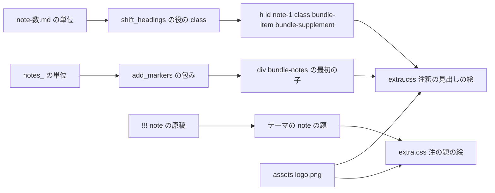
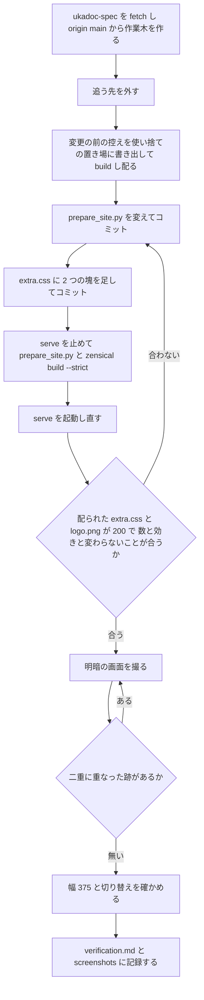

# Design Document: site-look-note-icon

## Overview
**Purpose**: UKADOC のサイトで仕様を引くゴースト制作者に、注釈で書かれた所（注釈の節 16・補足の項目 16・注の題 2 の計 34 か所）の見出しの頭に、開発者が添付した色付きの絵（筆とリボン）を置き、注釈だとひと目で分かる見え方と、伺からしい小さな遊びを届ける。`site-look-plan` で「採る」と決まった C26 を、本番の書き方で ukadoc-spec に入れる。
**Users**: まとめ頁で仕様を引くゴースト制作者と、`dev/shell` などの読み物の頁を読むゴースト制作者（明・暗の表示、幅 375 の狭い画面、印刷を含む）。
**Impact**: ukadoc-spec の `scripts/prepare_site.py` の `shift_headings()` で、ファイル名が `note-<数>.md` の単位の頭の見出しに目印 `bundle-supplement` を足す（1 行の判断と定数 1 つ、docstring の 1 項目）。`assets/extra.css` の末尾に、注釈の見出しの頭に絵を置く塊と、注の題の Material の鉛筆を絵に替える塊の 2 つを足す。絵は、ukadoc-spec に今ある `assets/logo.png` をそのまま使う（［仮定］A。下の「前提と OPEN QUESTION」の 1）。原稿・設定は変えない。

設計の調べで、注釈の絵（試作の写し `slp-notes-icon.png`、88×88、3284 バイト）が、ukadoc-spec の `assets/logo.png`（`mkdocs.yml` の `theme.logo`・`theme.favicon`）とバイトまで同じ（SHA-256 `32983af3…1335d`）と分かった。同じ絵をもう 1 つ置かず、`extra.css` から `url("logo.png")` で読む。要件 5.1・8.1 の「1 ファイルを `assets/` に足す」は、置き場とファイル名を設計に任せた所なので、「`assets/` の下の ASCII の名前のファイル `logo.png` を使い、足すファイルは 0」と読む。足す案（`assets/note-icon.png`）も下に残す。

### Goals
- 注釈の節の見出し 16 個（段が `h2` 2・`h3` 12・`h4` 2）と補足の項目の頭の見出し 16 個の頭に、見出しの字の 1.5 倍の絵を置く。C04 の中央寄せと点線の区切り、C01 の項目名の帯を保つ
- `note` の注意書きの題（今は `dev/shell` の 2 個）の Material の鉛筆を外し、同じ絵を置く。`tip`・`warning` の印は今のまま
- 補足の項目は原稿のファイル名 `note-<数>.md` で見分け、名指しの一覧を持たない（増えた原稿にも自動で付く）
- 絵は飾りとして背景の絵で出し、見出しの字・id・¶・目次・検索の字・本文の字を変えない

### Non-Goals
- C27（白黒の線の絵）、絵の描き直し・白黒・色を変えること、明・暗で絵を替えること
- `!!! tip`・`!!! warning` の印、本文の「※」の行、注意書きの節の箱そのもの（C04）、キャラクターを頁に出すこと（C12）
- 原稿（`.md`）・`.nav.yml`・`mkdocs.yml`・`requirements.txt`・Zensical の版、`index.md` の「## 一覧」・`INDEX.md`（UKADOC の構成は変えない）
- 測りの道具の新設（`shot.mjs` は読むだけで使う）

## Boundary Commitments

### This Spec Owns
- `scripts/prepare_site.py` の、補足の項目の頭の見出しに目印を足す判断: 定数 `NOTE_FILE`、`shift_headings()` の役の class を決める所の 2 行、モジュールの docstring の 1 項目の書き足し
- 目印の名前 `bundle-supplement`（補足の項目の頭の見出し）と、その付け方の決まり（ファイル名が `note-<数>.md` の単位の頭の見出しに、`bundle-item` に加えて付ける）
- `assets/extra.css` の、見出しのコメント `/* site-look-note-icon: … */` で始まる 2 つの塊（注釈の見出しの絵・注の題の絵）
- 絵の置き場の決め（`assets/logo.png` を使う。［仮定］A）
- この spec の記録（`.kiro/specs/site-look-note-icon/verification.md` と `screenshots/`。完了で `completed/` へ移る）: 目印と絵の数・当たらないこと・変わらないこと・画面の見比べ

### Out of Boundary
- `assets/logo.png` そのもの（中身・名前・`mkdocs.yml` のロゴ・ファビコンの指定）。読むだけで変えない
- `extra.css` のほかの塊（紺のテーマ・`site-look-dark-link-color:`・目次の詰め・記述例の折り返し・`site-look-list-items:` の 6 つ・`site-look-list-markers:` の 3 つ・後続 spec の塊）。C04 の `.bundle-notes > :first-child` の中央寄せ・点線、C01 の `.bundle-item` の帯の値は変えない
- `prepare_site.py` のほかの処理（一覧の検査・id の振り方・`old_ids()`・`add_markers()`・`bundle-notes` の包み・`bundle-item`・`bundle-category` の付け方・リンクの書き換え・`hr`・`_raw/`・`.nav.yml`）
- テーマの注意書きの指定（題の字・地の色 `#448aff1a`・枠・鉛筆以外の印）、テーマの色の変数
- 原稿・設定・UKADOC の構成、`site-look-plan` の成果物（目標の画面・試作・`tools/shot.mjs`）

### Allowed Dependencies
- `site-look-list-markers`（ukadoc-spec #12）: `notes_` の単位を包む `<div class="bundle-notes" markdown="1">` と、その最初の子がいつも節の見出しであること、C04 の `.md-typeset .bundle-notes > :first-child` の塊
- `site-look-list-items`（#11）: `shift_headings()` の役の class（`bundle-item`・`bundle-category`）と `bundle-<役>` の名前の決まり、`notes_` の見出しに役の class が付かないこと、C01 の帯
- `prepare_site.py` の既にある部品: `shift_headings()`・`main()` の単位の流れ、`posixpath`・`re`（標準ライブラリ）。Python-Markdown の `attr_list`（見出しの `{#id .cls .cls}`。`mkdocs.yml` の今の設定のまま）
- テーマ（Zensical 0.0.67 の classic）の `.md-typeset .note>.admonition-title:before`（`position:absolute`・`1rem` の枠・`background-color`・`mask-image`）と、`extra.css` がテーマの後に読まれること
- `assets/` を丸ごと `_site_src/assets/` に写す `main()` の今の動き
- 確かめの道具: `zensical serve`、`python -m http.server`（変更の前の控えを配る）、Edge ヘッドレス + CDP の使い捨てのスクリプト、`.kiro/specs/completed/site-look-plan/tools/shot.mjs`（読むだけ）

### Revalidation Triggers
- `assets/logo.png` を替えたとき（ロゴを変えると注釈の絵も変わる）: 注釈の絵として使えるかを見直す。分けるなら［仮定］A の代わりの案（`assets/note-icon.png` を足す）に移る
- `bundle-supplement` の名前か、付ける単位（ファイル名 `note-<数>.md`）を変えたとき、または原稿の補足の書き方（`note-<数>.md` の置き方）が変わったとき: 目印の数を数え直す
- `site-look-list-markers` の包み（`div.bundle-notes` と、最初の子が見出しであること）か C04 の見出しの指定を変えたとき: 絵が 16 個に当たり、中央寄せと点線が崩れないことを確かめ直す
- `site-look-list-items` の役の class の付け方か C01 の帯の値を変えたとき、補足の項目の頭の見出しが `h4` でコードブロックが続く形（記述例の濃い帯 `h4:has(+ .highlight)`）になったとき: 帯の中の絵の見え方を見直す（今は 0 個）
- `mkdocs.yml` に `pymdownx.details` を足して `??? note` が出るようになったとき: 折りたたみの題の絵を確かめる
- Zensical の版を上げたとき（注意書きの題の印の作りが変わりうる）: 注の題の鉛筆が消えて絵が出ることを確かめ直す

## Architecture

### Existing Architecture Analysis
- `main()` は、まとめる頁ごとに単位を `shift_headings()` → `rewrite_links()` → `add_markers()` に通して `---` でつなぐ。`shift_headings()` は、頁の頭（depth 1）と `notes_` の単位を除いて、単位の頭の見出しに ` .bundle-category`（`index.md`）か ` .bundle-item`（それ以外）を `{#<id><役>}` の形で付ける。読み物の頁はこの流れを通らない
- 補足の項目の原稿は 16 個（`list/shiori-event-ex` 9・`list/sakura-script` 3・`list/propertysystem` 1・`descript/ghost` 1・`descript/install` 1・`descript/shell` 1）で、どれもまとめ頁の中の単位（depth 2 以上、`index.md` でない）。頭の見出しには今 `bundle-item` が付く
- 注釈の節は `add_markers()` が `div.bundle-notes` で包み、最初の子は節の見出し（`notes_*.md` は見出しが 1 つだけ。中の見出しは無い）
- 見出しの数の検査 `old_ids()` は `register_bundle()` で原稿のまま数えるので、見出しの行に class を足しても響かない
- テーマの見た目の指定は `main.*.css` → `palette.*.css` → `assets/extra.css` の順に読む。テーマは見出しの `::before` を使っていない。注意書きの題の印は `.md-typeset .admonition-title:before`（`position:absolute;top:.625em;width:1rem;height:1rem`、左は `[dir=ltr]` で `.6rem`）と `.md-typeset .note>.admonition-title:before`（`background-color:#448aff` と `mask-image` の鉛筆）で描く
- `mkdocs.yml` に `pymdownx.details` は無いので、`??? note` は今は折りたたみにならない（原稿にも 0 個）

### Architecture Pattern & Boundary Map
選んだ形は「組み立ての処理は補足の項目の見出しにだけ役の目印を足し、見た目の指定は既にある目印（`bundle-notes` の最初の子・`bundle-supplement`・テーマの `.note` の題）の `::before` に背景の絵を置く」（ギャップ分析の案 A）。



- 注釈の節は既にある包みで選べるので、Python を変えない。補足の項目だけ、CSS の属性の指定で「数で終わる id」を見分けられないため、組み立ての処理でファイル名から目印を足す（2.4）
- 絵は 1 つの URL（`url("logo.png")`。`extra.css` からの相対）を 2 つの塊で使う。明・暗で絵を替えないので、表示の切り替えで何も書き換えずに済む（4.3）
- 注の題はテーマの `1rem` の枠と位置をそのまま使い、中身（色の地と鉛筆の型抜き）だけを絵に替える

### Technology Stack

| Layer | Choice / Version | Role in Feature | Notes |
|-------|------------------|-----------------|-------|
| 組み立ての処理 | Python 3.12・`scripts/prepare_site.py` | 補足の項目の頭の見出しに `bundle-supplement` を足す | 依存は足さない（`re`・`posixpath`） |
| Markdown | Python-Markdown の `attr_list`（`mkdocs.yml` のまま） | `{#note-1 .bundle-item .bundle-supplement}` を見出しの class にする | 設定は変えない |
| 見た目の指定 | CSS（`assets/extra.css`） | 見出しの `::before` と注の題の `::before` の背景の絵 | 新しい道具は足さない |
| 絵 | `assets/logo.png`（88×88 の PNG、今あるもの） | 注釈の絵 | ［仮定］A。足すファイルは 0 |
| サイト生成 | Zensical 0.0.67（`requirements.txt` のまま） | 頁・`extra.css`・絵の配り | 版は変えない |
| 確かめ | `zensical serve`、`python -m http.server`、Edge ヘッドレス + CDP、`shot.mjs` | 数・効き・画面 | `shot.mjs` は読むだけ |

## File Structure Plan

### Directory Structure
```
ukadoc-spec（作業木 .worktrees/site-look-note-icon/、ブランチ site-look-note-icon、origin/main 0eb3fb9 から）
├── scripts/
│   └── prepare_site.py          # NOTE_FILE を足し、shift_headings() で note-<数>.md の頭の見出しに bundle-supplement を足す
└── assets/
    ├── logo.png                 # 読むだけ（注釈の絵として使う。［仮定］A）
    └── extra.css                # 末尾に site-look-note-icon の塊を 2 つ足す

.kiro/specs/site-look-note-icon/（doc_edit）
├── verification.md              # 新規。数・効き・変わらないこと・画面の見比べの記録
└── screenshots/                 # 新規。下の VerificationRecord の画面
```

ukadoc-spec で変えるのは上の 2 ファイルだけで、足すファイルは無い（8.1。［仮定］A。代わりの案 B では `assets/note-icon.png` を 1 つ足し、2 つの塊の `url()` を `url("note-icon.png")` にする）。原稿・`index.md` の「## 一覧」・`.nav.yml`・`INDEX.md`・`mkdocs.yml` には触れない。

### Modified Files

#### `scripts/prepare_site.py`（ukadoc-spec の作業木）
変える所は 3 か所で、ほかの関数は変えない。差分（`0eb3fb9` に対して）:

```diff
@@ -7,7 +7,8 @@
 - 生の Markdown 原稿を _raw/ に写す（ビルド後に _site へ重ねる。llms.txt から INDEX.md などを辿れるようにする）
-- まとめた頁の分類と項目の頭の見出しに、役の class（bundle-category・bundle-item）を付ける（見た目は assets/extra.css）
+- まとめた頁の分類と項目の頭の見出しに、役の class（bundle-category・bundle-item）を付ける。
+  補足の項目（note-<数>.md）の頭の見出しには bundle-supplement も付ける（見た目は assets/extra.css）
 - まとめた頁の対応・既定値の段落と注意書きの節に目印（bundle-support・bundle-default・bundle-notes）を付け、
@@ -40,6 +41,7 @@
 NEGATION = re.compile(r'非対応|未対応|廃止')
+NOTE_FILE = re.compile(r'note-\d+\.md')   # 補足の項目の原稿のファイル名
 
@@ -186,6 +188,8 @@ def shift_headings(text, rel, depth, is_index):
     role = ''
     if depth > 1 and not posixpath.basename(rel).startswith('notes_'):
         role = ' .bundle-category' if is_index else ' .bundle-item'
+        if NOTE_FILE.fullmatch(posixpath.basename(rel)):
+            role += ' .bundle-supplement'
     lines = text.split('\n')
```

- 見出しの行は `## 補足 {#note-1 .bundle-item .bundle-supplement}` になり、HTML は `<h2 id="note-1" class="bundle-item bundle-supplement">`。id・段・字は変わらない（5.5・6.1・6.2）
- `fullmatch` なので、`notes_*.md`（`notes_` は先の条件で除く）・`note-1-foo.md` のような名前・単位の中の節の見出し（`n == 0` でない）には付かない（2.3・5.2）
- 呼ばれるのはまとめ頁の流れの中だけなので、読み物の頁には付かない（5.4）

#### `assets/extra.css`（ukadoc-spec の作業木）
今の末尾（`site-look-list-markers: 既定値の札と字下げ` の塊）の後ろに、次の 2 つの塊を足す。ほかの塊は変えない。

```css
/* site-look-note-icon: 注釈の見出しの絵 */
.md-typeset .bundle-notes > :first-child::before,
.md-typeset .bundle-supplement::before {
  content: "";
  display: inline-block;
  width: 1.5em;
  height: 1.5em;
  margin-right: .35em;
  vertical-align: -.35em;
  background: url("logo.png") center / contain no-repeat;
}

/* site-look-note-icon: 注の題の絵 */
.md-typeset .note > :is(.admonition-title, summary)::before {
  background: url("logo.png") center / contain no-repeat;
  -webkit-mask-image: none;
  mask-image: none;
}
```

指定のわけ（注に書かず、ここに残す）:
- **見出しの当て先**: 注釈の節は `.bundle-notes > :first-child`（C04 と同じ当て先。16 個すべてで最初の子が節の見出し）。`[id^="notes_"]` は単位の中の見出し（`notes_x-<元の id>`）が増えたときに当たってしまうので使わない（1.4）。補足の項目は `bundle-supplement`（2.1・2.3）
- **大きさと並び**: 試作の C26 の値（`1.5em`・右の余白 `.35em`・`vertical-align: -.35em`）をそのまま使う。どれも見出しの字の大きさに対する比なので、`h2`〜`h4` のどの段でも字の 1.5 倍になり（1.1・1.2・2.1・4.4・8.3）、中央寄せの見出しでは絵と字が一緒に中央に寄り、左寄せの帯の見出しでは帯の左の余白（`.6em`）の後ろに並ぶ。絵は `::before` なので、見出しの字の後ろの ¶ の位置と、C04 の点線・C01 の帯の枠と地には触れない（1.3・2.2）
- **粗さ**: `h2` の字（`1.5625em` × `.8rem` = 25px）の 1.5 倍は約 38px で、画素密度 2 倍でも約 75px と、88px の絵より小さい。`contain` で縦横の比を保つ（4.4）
- **暗い表示**: 絵は色を変えず、明・暗で同じ指定にする（4.1・4.2・4.3）。C01 の帯の地は暗い表示で薄い白の重ね（`--md-default-fg-color--lightest`）で、目標の画面 `mock-propertysystem-C26-dark.png` と同じ帯の上の絵になる。補足の項目の見出しは濃い帯（`bundle-category`・`h4:has(+ .highlight)`）には入らない（`note-<数>.md` は `index.md` でなく、頭の見出しの次にコードブロックが続く原稿は 0）
- **注の題**: テーマの `.md-typeset .note>.admonition-title:before`（詳細度 0,3,1）と同じ詳細度（`:is()` は中の最も高い `.admonition-title` を持つ）で、テーマより後に読まれて勝つ。`background` の一括の指定で地の色 `#448aff` を透明に戻し（一括の指定は書かない値を初めの値に戻す）、`mask-image` を `none` にして鉛筆の型抜きを外す。位置と `1rem` の枠（題の字 `.64rem` の約 1.56 倍）はテーマのまま（3.1・3.2）。`.note` の題だけに当て、`.tip`・`.warning` は触れない（3.4）。本文の中の見出し（「※1」など）は `.admonition-title` でないので当たらない（3.3）。題の字に依らない（3.5）。`summary` は `??? note`（今は `pymdownx.details` が無く 0 個）のため、テーマと同じ形にそろえた
- **飾り**: `content: ""` の背景の絵なので、読み上げ・見出しの字・検索の字・目次の字にならない（4.5・6.1・6.2）
- **印刷**: テーマは `.md-typeset` に `print-color-adjust: exact` を当てているので、多くのブラウザで絵も印刷される。背景の絵が出ないときも `1.5em` の空きが残るだけで、見出しの字は今と同じに印刷される（4.7。［仮定］F）
- **色**: 色の指定は無い。地は透明（8.3）

### 部品とファイルの対応
| 部品 | ファイル | 扱い |
|---|---|---|
| SupplementMarker | `scripts/prepare_site.py`（作業木） | 変える |
| NoteHeadIcon | `assets/extra.css`「注釈の見出しの絵」 | 足す |
| NoteTitleIcon | `assets/extra.css`「注の題の絵」 | 足す |
| NoteIconAsset | `assets/logo.png` | 読むだけ（［仮定］A） |
| IconCheck | なし（配られた HTML と見た目を調べる使い捨てのスクリプト。置き場は Claude のスクラッチ。手順と結果は `verification.md`） | 作らない |
| ShotTool | `.kiro/specs/completed/site-look-plan/tools/shot.mjs` | 読むだけで使う |
| VerificationRecord | `.kiro/specs/site-look-note-icon/verification.md`・`screenshots/` | 新規 |

## System Flows



- A・B（`workflow.md` の「ukadoc-spec の作業木」）: `git -C ukadoc-spec fetch origin` → `git -C ukadoc-spec worktree add ../.worktrees/site-look-note-icon -b site-look-note-icon origin/main` → `git -C .worktrees/site-look-note-icon branch --unset-upstream`。起点は `site-look-list-markers` の PR #12 を含む `origin/main`（今は `0eb3fb9`。8.4）
- D・E のコミットは `git -C .worktrees/site-look-note-icon -c user.name=ekicyou -c user.email=dot.station@gmail.com commit …` で名前を渡す。push と PR は `/kiro-complete` で行う
- C: 変更の前の控えは、作業木の HEAD を `git archive` で Claude のスクラッチの下の新しいフォルダに書き出し、`prepare_site.py` と `zensical build --strict` を流して、`_site/` を `python -m http.server` で 8000 以外の口（例: 8010）に配る。終わったら止めて消す
- F: `serve` は `_site_src/` を見るので、動かしたまま `prepare_site.py` を流さない（書きかけを拾って `extra.css` が 404 になる）
- H: `build --strict` は `extra.css` の中の絵の欠けに気づかないので、配られた `/ukadoc-spec/assets/logo.png` が 200 で返ることを必ず見る（7.1）

## Requirements Traceability

| Requirement | Summary | Components | Interfaces | Flows |
|-------------|---------|------------|------------|-------|
| 1.1 | 注釈の節の見出し 16 個に字の 1.5 倍の絵 | NoteHeadIcon, NoteIconAsset, IconCheck, ShotTool | `.bundle-notes > :first-child::before` | H, I |
| 1.2 | 段・置かれた所に依らず同じ絵（`h4` の 2 個も） | NoteHeadIcon（段を名指ししない） | `> :first-child`・`1.5em` | H, I |
| 1.3 | C04 の中央寄せと点線を保つ | NoteHeadIcon（`::before` だけ） | C04 の塊に触れない | I |
| 1.4 | 注釈の節の頭でない見出しに付けない | NoteHeadIcon（`[id^="notes_"]` を使わない）, IconCheck | 絵の当たる見出し 32 だけ | H |
| 2.1 | 補足の項目の見出し 16 個に字の 1.5 倍の絵 | SupplementMarker, NoteHeadIcon, IconCheck, ShotTool | `.bundle-supplement::before` | H, I |
| 2.2 | C01 の帯を保つ | SupplementMarker（`bundle-item` を残して足す）, NoteHeadIcon | `.bundle-item` の塊に触れない | I |
| 2.3 | 補足の項目の中の節の見出しに付けない | SupplementMarker（`n == 0` の見出しだけ）, IconCheck | `…-note-1-…` の見出しに目印なし | H |
| 2.4 | 増えた原稿にも一覧なしで付く | SupplementMarker（`NOTE_FILE`）, NoteHeadIcon（`bundle-notes` の包み） | `note-\d+\.md` の `fullmatch` | — |
| 3.1 | 注の題の鉛筆を出さず絵を置く | NoteTitleIcon, IconCheck, ShotTool | `.note > .admonition-title::before` | H, I |
| 3.2 | 題の字・地・枠・本文を今のまま | NoteTitleIcon（`::before` だけ） | テーマの題の指定に触れない | I |
| 3.3 | 注意書きの本文の中の見出しに付けない | NoteTitleIcon（題だけ）, IconCheck | 「※1」「※2」に絵なし | H |
| 3.4 | `tip`・`warning` は Material の印のまま | NoteTitleIcon（`.note` だけ）, IconCheck | `.tip`・`.warning` の `mask-image` が残る | H |
| 3.5 | 題の字に依らず `note` のすべて（`??? note` も） | NoteTitleIcon（`:is(.admonition-title, summary)`） | 種類の class `.note` | — |
| 4.1 | 絵を描き直さず色も変えない | NoteIconAsset（`logo.png` をそのまま）, NoteHeadIcon, NoteTitleIcon（`filter` なし） | `url("logo.png")` | — |
| 4.2 | 暗い表示で地から浮かずに読める | NoteHeadIcon, NoteTitleIcon, ShotTool | 目標の画面との見比べ | I |
| 4.3 | 切り替えで読み込み直さずに合う | NoteHeadIcon, NoteTitleIcon（明・暗で同じ指定）, IconCheck | 表示の条件を持たない | K |
| 4.4 | 試作の大きさより大きくしない | NoteHeadIcon（`1.5em`）, NoteTitleIcon（テーマの `1rem`） | 大きさの値 | I |
| 4.5 | 飾り。読み上げ・見出し・検索・目次の字にしない | NoteHeadIcon, NoteTitleIcon（`content: ""` の背景） | 本文の字が前と同じ | H |
| 4.6 | 本文の字の大きさと行間を変えない | NoteHeadIcon（見出しの `::before` だけ） | 本文に当たる指定なし | I |
| 4.7 | 印刷で見出しの字が今と同じ | NoteHeadIcon（背景の絵） | ［仮定］F | — |
| 5.1 | 絵を `assets/` の下の ASCII の名前で置き、公開の頁から読める | NoteIconAsset（`assets/logo.png`）, IconCheck | `/ukadoc-spec/assets/logo.png` が 200 | H |
| 5.2 | 補足の項目の頭の見出しにだけ目印、数が 16 | SupplementMarker, IconCheck | `bundle-supplement` の数 | H |
| 5.3 | 目印の名前を `bundle-<役>` に、`bundle-notes` と紛れない | SupplementMarker | `bundle-supplement` | — |
| 5.4 | 読み物の頁に目印を付けない | SupplementMarker（まとめ頁の流れだけ）, IconCheck | 読み物の頁の目印 0 | H |
| 5.5 | id・数の検査・リンク・線・既にある目印・`_raw/` を保つ | SupplementMarker（class を足すだけ）, IconCheck | 変わらないことの確かめ | F, H |
| 5.6 | 書きかけの字を漏らさない | SupplementMarker, IconCheck | 漏れ 0 | H |
| 6.1 | 見出しの字を変えず検索で引ける | SupplementMarker, NoteHeadIcon, IconCheck | 本文の字が前と同じ | H |
| 6.2 | id・¶・目次を保つ | SupplementMarker, IconCheck | id の並び・`headerlink`・`md-nav__link` | H |
| 6.3 | 幅 375 で横にはみ出さない | NoteHeadIcon（`inline-block` で折り返す）, ShotTool | `scrollWidth`・`innerWidth` | K |
| 6.4 | コピーのボタンとコピーされる字 | （コードブロックに触れない）, IconCheck, ShotTool | 本文の字が前と同じ・画面 | H, I |
| 6.5 | 注釈の節の中の `\` を今と同じ字で | （本文に触れない）, IconCheck, ShotTool | `#notes_escape` の画面 | H, I |
| 7.1 | 配られた `extra.css` と絵（200）を確かめる | IconCheck | `served()` | H |
| 7.2 | 16・16・2 の数（頁ごと）と漏れ 0 | IconCheck, VerificationRecord | 下の IconCheck の表 | H, L |
| 7.3 | 前後で id の並び・¶・目次の数が同じ | IconCheck | `unchanged()` | C, H |
| 7.4 | 目標の画面と同じ位置・大きさで明・暗を見比べる | ShotTool, VerificationRecord | 画面の一覧 | I |
| 7.5 | `dev/shell` の注の題と `h4` の注釈の節を撮る | ShotTool, VerificationRecord | 画面の一覧 | I |
| 7.6 | 二重に重なった画面の撮り直し | ShotTool | 画面の目視 | J |
| 7.7 | 見せる前に Ctrl+F5 を頼む | VerificationRecord | — | — |
| 8.1 | 変えるのは `extra.css` と `prepare_site.py`、絵は `assets/` に | SupplementMarker, NoteHeadIcon, NoteTitleIcon, NoteIconAsset | `git diff --stat origin/main`（［仮定］A で 2 ファイル） | — |
| 8.2 | 塊として足し、注は 1 行 | NoteHeadIcon, NoteTitleIcon | `/* site-look-note-icon: <何> */` | — |
| 8.3 | 大きさは字に対する比、色を直書きしない | NoteHeadIcon（`em`）, NoteTitleIcon（テーマの枠） | 色の指定なし | — |
| 8.4 | 自分の作業木で `origin/main` の上に書く | （作業木） | `.worktrees/site-look-note-icon/` | A, B |
| 8.5 | Build Gate と規約 Gate | SupplementMarker, 2 つの塊 | `prepare_site.py`・`build --strict`・ASCII | F |
| 8.6 | この spec だけの PR、説明に一連の中の位置、絵は使い方だけを書く | （`/kiro-complete`） | PR の説明の決まり | — |
| 8.7 | `origin/main` とぶつかったら追いつき両方残す | SupplementMarker（2 行）, 2 つの塊（独立） | 見出しのコメントの区切り | — |
| 8.8 | 旧サイト・試作を写さず書き直す | SupplementMarker, NoteHeadIcon, NoteTitleIcon | `html[data-slp~=…]`・`slp-` を使わない | — |

## Components and Interfaces

| Component | Domain/Layer | Intent | Req Coverage | Key Dependencies | Contracts |
|-----------|--------------|--------|--------------|------------------|-----------|
| SupplementMarker | 組み立ての処理（`prepare_site.py`） | `note-<数>.md` の単位の頭の見出しに `bundle-supplement` を足す | 2.1〜2.4, 5.2〜5.6, 6.1, 6.2, 8.1, 8.5, 8.7, 8.8 | `shift_headings()`・`attr_list`（P0） | Batch |
| NoteHeadIcon | 見た目の指定 | 注釈の節と補足の項目の見出しの頭に絵 | 1.1〜1.4, 2.1〜2.4, 4.1〜4.7, 6.3, 8.2, 8.3 | `bundle-notes` の包み（P0）、SupplementMarker（P0）、NoteIconAsset（P0） | State |
| NoteTitleIcon | 見た目の指定 | `note` の題の鉛筆を外して絵 | 3.1〜3.5, 4.1〜4.5, 8.2, 8.3 | テーマの題の指定（P0）、NoteIconAsset（P0） | State |
| NoteIconAsset | 絵 | 注釈の絵（`assets/logo.png`） | 4.1, 5.1, 8.1 | `main()` の `assets/` の写し（P0） | — |
| IconCheck | 確かめ（使い捨て） | 配り・数・効き・当たらないこと・変わらないこと | 1.1, 1.4, 2.1, 2.3, 3.1, 3.3, 3.4, 4.3, 4.5, 5.1, 5.2, 5.4〜5.6, 6.1, 6.2, 6.4, 6.5, 7.1〜7.3 | `serve` と控えの配り（P0）、Edge ヘッドレス + CDP（P0） | Service |
| ShotTool | 確かめ（`shot.mjs`。読むだけ） | 明・暗・幅 375 の画面と横幅 | 1.1〜1.3, 2.1, 2.2, 3.1, 3.2, 4.2, 4.4, 4.6, 6.3〜6.5, 7.4〜7.6 | Edge（P0） | 既存のまま |
| VerificationRecord | 記録 | 数と見比べの結果を残す | 7.2, 7.4, 7.5, 7.7 | 上の確かめの結果（P0） | State |

### 組み立ての処理

#### SupplementMarker

| Field | Detail |
|-------|--------|
| Intent | まとめ頁の単位のうち、ファイル名が `note-<数>.md` の単位の頭の見出しに、役の目印 `bundle-supplement` を `bundle-item` に加えて付ける |
| Requirements | 2.1〜2.4, 5.2〜5.6, 6.1, 6.2, 8.1, 8.5, 8.7, 8.8 |

**Responsibilities & Constraints**
- 見分けは原稿のファイル名だけで行う（`NOTE_FILE.fullmatch(posixpath.basename(rel))`）。見出しの字（「補足」）・頁・項目の名前は見ない（2.4）
- 付けるのは単位の頭の見出し（`n == 0`）だけ。今の `role` に ` .bundle-supplement` を足すので、`bundle-item` はそのまま残る（2.2・5.5）
- `notes_` の単位・頁の頭（depth 1）・`index.md` の単位には付かない（`role` を決める今の条件の中に入れる）
- id・段・見出しの字・原稿は変えない

**Contracts**: Batch [x]

##### Batch / Job Contract
- Trigger: `python scripts/prepare_site.py`（Build Gate と GitHub Actions の build）
- Interface:
  ```python
  NOTE_FILE: re.Pattern[str]  # r'note-\d+\.md'。fullmatch でファイル名の全体を見る
  def shift_headings(text: str, rel: str, depth: int, is_index: bool) -> str: ...  # 形は今のまま
  ```
- Input / validation: `register_bundle()` の単位。形に合わない名前はエラーにせず、目印を付けないだけ（build は止めない）
- Output / destination: `_site_src/<群>/<名前>/index.md` の見出しの行 `## 補足 {#note-1 .bundle-item .bundle-supplement}`。HTML は `<h2 id="note-1" class="bundle-item bundle-supplement">`
- Idempotency & recovery: 毎回 `_site_src/` を作り直すので、何度流しても同じ

**Implementation Notes**
- Integration: `site-look-definition-tables` も同じ `prepare_site.py` を触るが、`shift_headings()` の中のこの 2 行とぶつかる見込みは小さい。ぶつかったら両方を残す
- Validation: IconCheck（下）
- Risks: 原稿に `note-<数>.md` の名前で補足でない単位が置かれると、その見出しにも絵が付く（決定 1 のとおり、ファイル名を正とする）

### 見た目の指定

NoteHeadIcon・NoteTitleIcon は、どれも新しい境目を持たない見た目の指定で、中身は上の「Modified Files」の塊そのものである。共通の決まり:

**Contracts**: State [x]

##### State Management
- 状態は HTML の class（`bundle-notes` の最初の子・`bundle-supplement`・`note` の題）だけで決まる。明・暗の表示の条件を持たないので、切り替えで何も書き換わらず、どちらの表示でも同じ絵が出る（4.3）
- 絵の URL は `extra.css` からの相対の `logo.png`（配られた先は `/ukadoc-spec/assets/logo.png`）。`extra.css` の URL に版の印が無いので、開発者のブラウザに古い写しが残ることがある（7.7）

### 確かめ

#### IconCheck

| Field | Detail |
|-------|--------|
| Intent | 配られた HTML と見た目で、配り・目印と絵の数・当たらないこと・変わらないことを調べる |
| Requirements | 1.1, 1.4, 2.1, 2.3, 3.1, 3.3, 3.4, 4.3, 4.5, 5.1, 5.2, 5.4〜5.6, 6.1, 6.2, 6.4, 6.5, 7.1〜7.3 |

**Responsibilities & Constraints**
- 配り（5.1・7.1）: 作業木の `serve` の `/ukadoc-spec/assets/extra.css` が 200 で `site-look-note-icon:` の見出しのコメントが 2 つあり、`/ukadoc-spec/assets/logo.png` が 200 で、中身が作業木の `assets/logo.png` と同じ
- 数（5.2・7.2）: 40 頁の HTML を `serve` から取り、`article` の中の `div.bundle-notes` の最初の子（段と id）、`.bundle-supplement`（段と id）、`.admonition.note` を頁ごとに数える
- 効き（1.1・1.4・2.1・2.3・3.1・3.3・3.4）: Edge ヘッドレス + CDP で、下の表の 7 頁の `article` の中のすべての見出し（`h1`〜`h6`）について `getComputedStyle(h, '::before').backgroundImage` を読み、`logo.png` を含むのが注釈の節の見出しと補足の項目の頭の見出しの 32 個だけであること。`.note` の題の `::before` は `maskImage` が `none` で `backgroundImage` が `logo.png`、`backgroundColor` が透明。`.tip`・`.warning` の題の `::before` は `maskImage` が `none` でない
- 切り替え（4.3）: 明で開き、ヘッダの切り替えで暗に移って（読み込み直さない）、上の `backgroundImage` が同じ
- 付けないもの（5.4）: 読み物の頁の `bundle-supplement` 0。補足の項目の中の節の見出し（`descript/shell` の「サーフェスの位置情報」、`list/propertysystem` の「※SHIORI Statusヘッダ」など）に `bundle-supplement` 0（2.3）
- 漏れ（5.6）: 全頁の `article` の中の、`pre`・`code` の外の字に `{: `・`{#` が 0
- 変わらないこと（5.5・6.1・6.2・6.4・6.5・7.3）: 変更の前の控え（8010 などで配る）と、全 40 頁で `article` の中の見出しの id の並び・`class="headerlink"` の数・`class="md-nav__link"` の数・`article` の中の `hr` の数・本文の字（`article` の中の字。空白を詰めて比べる）・`bundle-item`・`bundle-category`・`bundle-notes`・`bundle-support`・`bundle-default` の数が同じ。`_raw/` が控えの `_raw/` と同じ
- 頁の HTML を取るときは、`serve` を起動し直した後で取る（配りを先に確かめる）

##### Service Interface
```typescript
type Level = "h2" | "h3" | "h4" | "h5" | "h6";
interface IconCount {
  page: string;                                 // 例: "list/sakura-script/"
  notesHeads: { level: Level; id: string }[];   // div.bundle-notes の最初の子
  supplementHeads: { level: Level; id: string }[]; // .bundle-supplement
  noteAdmonitions: number;                      // .admonition.note
  leaks: number;                                // pre・code の外の "{: " と "{#"（0 であること）
}
interface IconApplied {
  page: string;
  iconHeadings: string[];                       // ::before に logo.png を持つ見出しの id（注釈の節と補足の項目の頭だけであること）
  noteTitles: { maskNone: boolean; icon: boolean; transparentBg: boolean }[]; // どれも true
  otherTitlesKeepMask: boolean;                 // .tip・.warning の題の mask-image が残る
  sameAfterToggle: boolean;                     // 暗に切り替えても同じ（4.3）
}
interface Unchanged {
  page: string;
  ids: boolean; headerlink: boolean; navLink: boolean; hr: boolean; text: boolean; markers: boolean; // どれも true
}
interface IconCheck {
  served(): { css: boolean; blocks: number; icon: boolean };  // 7.1。blocks は 2
  count(page: string): IconCount;               // 5.2・7.2
  applied(page: string): IconApplied;           // 1.1・1.4・2.1・2.3・3.1・3.3・3.4・4.3
  unchanged(page: string): Unchanged;           // 5.5・6.1・6.2・7.3
  rawSame(): boolean;                           // _raw/ が控えと同じ（5.5）
}
```

期待の数（原稿のファイルと `site-look-list-markers` の記録から。実装で数え直し、それを正とする）:

| 頁 | 注釈の節の見出し | 補足の項目の頭の見出し | `note` の注意書き |
|---|---|---|---|
| `list/sakura-script` | 14（`h2` 2・`h3` 12） | 3 | 0 |
| `list/propertysystem` | 2（`h4` 2） | 1 | 0 |
| `list/shiori-event-ex` | 0 | 9 | 0 |
| `descript/ghost` | 0 | 1 | 0 |
| `descript/install` | 0 | 1 | 0 |
| `descript/shell` | 0 | 1 | 0 |
| `dev/shell` | 0 | 0 | 2 |
| 計 | 16 | 16 | 2 |

- ほかの 33 頁は 3 つとも 0
- 変わらないことの見込み（`site-look-list-markers` の記録）: `list/sakura-script` は見出しの id 649・¶ 649・`md-nav__link` 832、`list/propertysystem` は 206・206・382。全 40 頁の `article` の中の `hr` は 1921。どれも控えで数え直して比べる

### 記録

#### VerificationRecord

| Field | Detail |
|-------|--------|
| Intent | 数と見比べの結果を、PR と後で同じ見出しを触る spec の手がかりとして残す |
| Requirements | 7.2, 7.4, 7.5, 7.7 |

**Contracts**: State [x]

##### State Management
- `verification.md` の中身（日本語、`site-look-list-markers` の `verification.md` の型）:
  - 測った版（作業木のコミット、`origin/main` の版）と日付、流した式（Build Gate・調べのスクリプト）
  - 配り（7.1）、IconCheck の数（頁ごとの表。段と id を含む）と効き・当たらないこと・漏れ（7.2）、変わらないこと（7.3）、切り替え（4.3）
  - 幅 375（6.3）、コピーのボタンと `\`（6.4・6.5）
  - 画面の見比べ（7.4・7.5）と、撮り直した画面の枚数とわけ（7.6）
  - Build Gate と規約 Gate（8.5）、`git diff --stat origin/main`（8.1）
  - 絵については、使った置き場と当て先だけを書く（8.6）
- 画面（`screenshots/`。`shot.mjs` の既定の 1000×700）:

| 画面 | 頁 | 位置 | 見比べる目標の画面 |
|---|---|---|---|
| `after-sakura-script-notes-{light,dark}.png` | `list/sakura-script/` | `#notes_escape` | `mock-sakura-script-C26-*`（見出しの頭の絵） |
| `after-propertysystem-note-{light,dark}.png` | `list/propertysystem/` | `#note-1` | `mock-propertysystem-C26-*`（「補足」の頭の絵） |
| `after-propertysystem-notes-{light,dark}.png` | `list/propertysystem/` | `#notes_sound_meta` | 目標の画面なし（段が `h4` の注釈の節。7.5） |
| `after-dev-shell-note-{light,dark}.png` | `dev/shell/` | `.admonition.note` | 目標の画面なし（注の題。7.5） |

- 幅 375 は `list/sakura-script`・`list/propertysystem`・`list/shiori-event-ex`・`dev/shell` で明・暗の `scrollWidth` = `innerWidth` = 375 を記録し、画面は残さない（6.3）
- 目標の画面にはほかの候補（C04 の箱など）も入っているので、比べるのは見出しの頭の絵（大きさ・縦の位置・字との間・暗い表示での見え方）だけ
- 開発者に画面や `serve` を見せるときは、Ctrl+F5 を頼む（7.7）

## Error Handling

| 起きること | 見分け方 | 対し方 |
|---|---|---|
| `serve` が書きかけの `_site_src/` を拾い、`extra.css` が 404 か古い | IconCheck の `served()` が偽 | `serve` を止め、`prepare_site.py` → `build --strict` → 起動し直す |
| 絵が配られない（`url()` の道の誤り。`build --strict` は気づかない） | `/ukadoc-spec/assets/logo.png` が 200 でない、`backgroundImage` が `none` | `url()` の相対の道を `extra.css` の置き場から直す |
| 目印・絵の数が合わない、当たってはいけない見出しに当たる、`{: `・`{#` が漏れる、id・¶・目次・`hr`・本文の字・既にある目印の数が変わる | IconCheck | `NOTE_FILE` と当て先を見直す。直せないときは止めて開発者に提示する |
| 注の題に鉛筆と絵が重なる、地の青の四角が出る | `.note` の題の `maskImage`・`backgroundColor` | 詳細度と読む順（テーマの後）を見直す |
| 撮る途中の描き直しで画面が二重に重なる | 上の端以外の左右の端にヘッダの紺の行がある | 撮り直す（7.6）。`#notes_escape` のヘッダの題の重なりは本文に響かないので撮り直さない |
| 目標の画面と絵の大きさ・位置が目に見えて違う | 画面の見比べ | 値を勝手に選び直さず、画面を添えて開発者に提示する |
| `origin/main` が `extra.css` か `prepare_site.py` を変えて進み、ぶつかる（`site-look-sakura-script-highlight` など） | merge のぶつかり | `extra.css` は両方の塊を並べて残す。`prepare_site.py` は両方の変更を残し、Build Gate と IconCheck をやり直す（8.7） |
| 開発者のブラウザに古い `extra.css` が残る | 開発者の画面だけ絵が出ない | Ctrl+F5 を頼む（7.7） |

## Testing Strategy

自動のテストは無い（ukadoc-spec に CSS と `prepare_site.py` のテストの仕組みは無く、足さない）。次の確かめを `verification.md` に記録する。

- **Build Gate**: 作業木で `python scripts/prepare_site.py`（一覧の検査を含む）と `zensical build --strict` がどちらも exit 0。`git diff --stat origin/main` が `assets/extra.css` と `scripts/prepare_site.py` だけ（8.1・8.5）
- **配り**: `/ukadoc-spec/assets/extra.css` に 2 つの塊、`/ukadoc-spec/assets/logo.png` が 200（5.1・7.1）
- **一語ずつの確かめ**: `NOTE_FILE.fullmatch` に `note-1.md`・`note-12.md`（付く）、`notes_escape.md`・`note-1-a.md`・`note.md`・`footnote-1.md`（付かない）を渡し、結果を記録する（2.4・5.2）
- **目印と絵**: 頁ごとの数が IconCheck の表と合う（16・16・2）。`::before` に絵を持つ見出しが 32 個だけ、補足の中の節の見出し・項目名・分類の見出しに無い。`.note` の題は鉛筆なしで絵、`.tip`・`.warning` は印のまま。読み物の頁の目印 0、漏れ 0（1.1・1.4・2.1・2.3・3.1・3.3・3.4・5.2・5.4・5.6・7.2）
- **変わらないこと**: 控えと、全 40 頁の id の並び・¶・目次・`hr`・本文の字・既にある目印の数が同じ、`_raw/` が同じ（5.5・6.1・6.2・6.4・6.5・7.3）
- **見え方**: 明・暗の画面を目標の画面と見比べる（1.2・1.3・2.2・3.2・4.2・4.4・4.6・7.4・7.5）。切り替えで絵が同じ（4.3）。幅 375 で `scrollWidth` = `innerWidth` = 375（6.3）

## Integration & Migration Notes
- 作業木: `.worktrees/site-look-note-icon/`（ブランチ `site-look-note-icon`）を `origin/main`（PR #12 の後。今は `0eb3fb9`）から作り、作った直後に追う先を外す（8.4）
- PR（8.6）: `/kiro-complete` で、この spec だけの PR を作ってスクワッシュマージする。説明には、PR を出すときの roadmap の並び（出し済みの PR の番号・この PR・この後の PR）を短く並べ、この PR だけで完結してマージしてよいこと、中身で依る先が `site-look-list-markers` の PR #12（`bundle-notes` の包み）と `site-look-list-items` の PR #11（`bundle-item` と `bundle-<役>` の決まり）であることを書く。絵については「サイトのロゴの絵 `assets/logo.png` を注釈の見出しにも使う」ことだけを書き、README などほかのファイルにも何も書き足さない（8.6）。この PR だけでサイトは壊れない（目印と見た目の指定がそろって入る）
- 並行: `site-look-sakura-script-highlight` の作業木も `extra.css` の末尾に塊を足す。どちらが先に入っても、後の方が `origin/main` に追いついて両方の塊を並べる

## 前提と OPEN QUESTION
設計で、確かめた事実か要件の決定に基づいて決めた。開発者の判断で変わりうるものを挙げる（詳しいわけは `research.md` の「設計の調査」）。

1. **絵の置き場と名前**（［仮定］A。5.1・8.1）: 注釈の絵が `assets/logo.png`（サイトのロゴとファビコン）とバイトまで同じなので、新しいファイルを足さず `url("logo.png")` で読む。足すファイルが 0 になり、要件 8.1・Boundary Context の「画像を足す」「1 ファイルを `assets/` に足す」と字面が違う（要件の決定で置き場と名前は設計に任された）。良い点: 同じ絵が 2 つにならず、PR が小さく、ファビコンで既に読まれた絵を使い回せる。気を付ける点: ロゴを替えると注釈の絵も変わる（Revalidation Triggers）。代わりの案 B: `assets/note-icon.png`（`assets/image/` は原稿の図の置き場なので、`extra.css` と同じ `assets/` の直下）に同じ絵を足し、`url("note-icon.png")` で読む。A を採るなら、要件 5.1・8.1 と Boundary Context の字面を「`assets/logo.png` を使う（足すファイルは無い）」に直す
2. **補足の目印の名前**（［仮定］B。5.3）: `bundle-supplement`（「補足」の役の名前。`bundle-notes` と語が違い、取り違えない）。代わりの案: `bundle-aside`、`bundle-note-item`（`bundle-notes` と 1 語目が同じで紛れやすい）
3. **目印を付ける所**（［仮定］C）: 役の class を決める `shift_headings()` に 2 行を足す（`bundle-item`・`bundle-category` と同じ所。見出しの行を 1 回で書く）。代わりの案: `add_markers()` で見出しの行の `}` の前に足す（目印の処理は 1 か所に集まるが、見出しの行を書き直す 2 回目の処理になる）
4. **大きさと並び**（［仮定］D。1.1・2.1・4.4）: 試作の C26 の値（`1.5em`・`.35em`・`-.35em`）を、中央寄せの注釈の節の見出しと左寄せの帯の見出しの両方に同じに使う。目標の画面と合うかは実装の画面で見比べる
5. **注の題の絵の大きさ**（［仮定］E。3.1・4.4）: テーマの `1rem` の枠（題の字の約 1.56 倍）と位置をそのまま使い、中身だけを替える。代わりの案: 枠を `1.5em`（題の字の 1.5 倍）に替える（テーマの位置の指定 `top:.625em` との合わせ直しが要る）
6. **印刷**（［仮定］F。4.7）: 見出しの絵の指定を `@media screen` で包まず、印刷でも同じ指定にする。テーマが `.md-typeset` に `print-color-adjust: exact` を当てているので、多くのブラウザで絵も印刷される。背景の絵が出ない環境では見出しの字の前に `1.5em` の空きが残る（字は今と同じ）。印刷の画面は撮らない。代わりの案: 見出しの絵の塊を `@media screen` の中に書き、印刷は今とまったく同じにする（注の題は、印刷でもテーマの鉛筆より絵の方がそろうので包まない）
