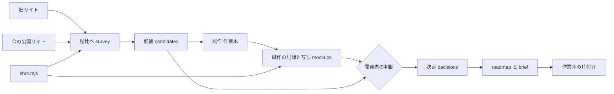
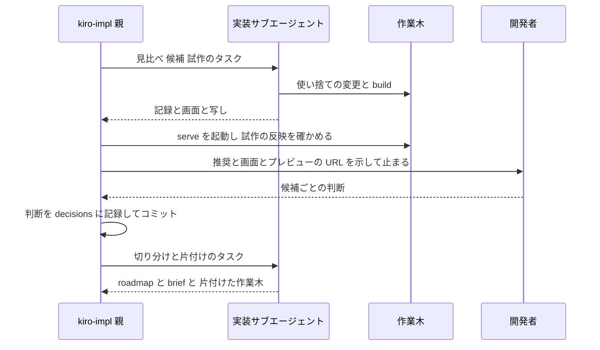
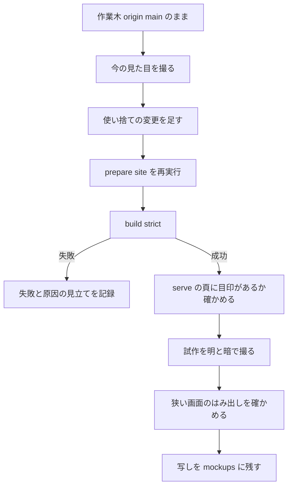

# Design Document: site-look-plan

## Overview
**Purpose**: UKADOC の公開サイトの見た目を直すために、旧サイトとの見比べ・使い捨ての試作・開発者の方向の決定・後続 spec への切り分けを行い、後続の改造 spec をそのまま `/kiro-start` できる状態にする。
**Users**: doc_edit の開発者が、試作の画面を見て方向を決め、後続 spec を始めるのに使う。後続 spec の要件・設計を書く AI も、この spec の記録（決定・画面・brief）を前提として読む。
**Impact**: doc_edit に、調査の記録・画面の記録・試作の写し・決定の記録・`.kiro/steering/roadmap.md`・後続 spec の `brief.md` が増える。ukadoc-spec と公開サイトは変わらない。

この spec は**原稿を変えない spec**である（下の Boundary Commitments）。成果物はすべて文書と画像で、コードとして残るのは画面の記録の道具 `tools/shot.mjs` だけである。試作は ukadoc-spec の作業木の中の、コミットしない使い捨ての変更として作り、写しを doc_edit に残してから捨てる。

### Goals
- 4 組の頁（`list/sakura-script`・`descript/ghost`・`spec/shiori3`・`manual/ghost`）の見比べの記録があり、差のそれぞれに画面か位置の参照が付いている
- 差から作った候補の一覧があり、候補ごとに変更の種類・波及・素材の許可・遊びの条件が書かれている
- 3 頁（`list/sakura-script`・`descript/ghost`・`manual/ghost`）に当てた試作の、今と試作の画面（明・暗）と、試作の写しが残っている
- 開発者が画面を見て決めた、候補ごとの「採る／採らない／保留」が記録されている
- `roadmap.md` と後続 spec の `brief.md` があり、次に `/kiro-start` する spec が 1 つ名指しされている

### Non-Goals
- 改造の実装と、ukadoc-spec への PR（後続の spec が行う）
- 後続 spec の要件・設計（方向と境界だけを渡す）
- 旧サイトの管理者への素材の問い合わせ（その素材を採る後続 spec で行う）
- 記述例の再生（jsstp）の試作（Requirement 2.7 により必須にしない）
- `/kiro-complete`・`workflow.md`・`/kiro-impl` の手直し（Requirement 7.4 により、この spec のタスクにしない。中身は「手順の直接の手直し」の節で定める）

## Boundary Commitments

**この spec は原稿を変えない spec である。** ukadoc-spec の作業木 `.worktrees/site-look-plan/` は試作の置き場としてだけ使い、そこでコミットも push もしない。この一文は、`/kiro-complete`・`/kiro-spec-tasks`・`/kiro-impl` が「原稿を変えない spec」かどうかを判断する目印にもなる（「手順の直接の手直し」の節）。

### This Spec Owns
- 見比べの記録 `survey.md` と、その画面 `screenshots/survey-*.png`
- 候補の一覧 `candidates.md`（候補の ID・区別・変更の種類・波及・条件）
- 試作の記録 `mockups/README.md`、試作の写し `mockups/*`、試作の画面 `screenshots/mock-*.png`
- 決定の記録 `decisions.md`（推奨と開発者の判断）
- 画面の記録の道具 `tools/shot.mjs`
- `.kiro/steering/roadmap.md` の新規作成（先頭の行は `site-look-plan`）
- 後続 spec の `.kiro/specs/<spec 名>/brief.md` の新規作成
- 作業木 `.worktrees/site-look-plan/` の中の使い捨ての変更と、その片付け（作業木を `origin/main` と同じ状態に戻すまで）

### Out of Boundary
- ukadoc-spec の原稿（Markdown）・`.nav.yml`・`requirements.txt`・Zensical の版。作業木の中でも原稿と `.nav.yml` は書き換えない
- ukadoc-spec のコミット・push・PR、サブモジュール `ukadoc-spec/` の参照コミットの更新
- 作業木とローカルブランチの削除（`/kiro-complete` の「原稿を変えない spec」の分岐が行う）
- 後続 spec の `requirements.md` 以降、後続 spec の `spec.json`（`/kiro-start` が作る）
- `.claude/skills/` と `.kiro/steering/workflow.md` の変更（設計の後・タスク生成の前に、直接直す）
- `pasta/` `areka/` `shiori4/`（読むだけ。この spec では使わない）

### Allowed Dependencies
- 読む: 旧サイト `https://ssp.shillest.net/ukadoc-legacy/manual/`、今の公開サイト `https://ukatech.github.io/ukadoc-spec/`（いまは `https://ukatech.shillest.net/ukadoc-spec/` へ転送される）、ukadoc-spec の `origin/main`（`0e028a4`）
- 使う道具: doc_edit の `.venv`（Zensical 0.0.67・pymdown-extensions 12.1・Pygments 2.21.0）、Microsoft Edge（`C:\Program Files (x86)\Microsoft\Edge\Application\msedge.exe`）、Node.js（v26。標準の `fetch` と `WebSocket` だけを使う）
- 新しいパッケージは入れない（`.venv` にも、doc_edit にも）
- 記録どうしの参照は、調査 → 候補 → 試作 → 決定 → 切り分けの向きだけにする（後の記録が前の記録の ID を指す。前の記録は後の記録を前提にしない）

### Revalidation Triggers
- ukadoc-spec の `origin/main` で `mkdocs.yml`・`assets/extra.css`・`scripts/prepare_site.py`・`requirements.txt` が変わった（brief の Current State と、試作で分かった事実が古くなる。`/kiro-next` の再測定の対象）
- Zensical の版が変わった（minijinja のテンプレート・`custom_dir`・`pymdownx.highlight` の挙動の前提が変わる）
- `decisions.md` の判断が変わった（roadmap と brief を直す）
- 旧サイトの構成や URL が変わった（`survey.md` の参照が切れる）

## Architecture

### Existing Architecture Analysis
- サイトは `prepare_site.py` が原稿を `_site_src/` に写し、`zensical build` が `_site/` を作る。`zensical serve` は `_site_src/` を見るので、直下のファイル（`assets/extra.css` など）を直したら `prepare_site.py` を再実行する。`prepare_site.py` は毎回 `_site_src/` を消して作り直す
- `mkdocs.yml` の明暗の切り替えは `prefers-color-scheme` の media 指定なので、表示の模擬だけで明・暗を撮れる
- `/kiro-impl` は前準備で作業木 `.worktrees/<feature>/` を作り、`prepare_site.py` と `zensical build --strict` を検証のコマンドにする。この spec でも、試作が作れるかの確かめにそのまま使う

### Architecture Pattern & Boundary Map
段階ごとに 1 つの記録を作り、後の段は前の段の ID だけを参照する一方向のパイプラインにする。決定の段だけは開発者の判断を待つ関門である。



**Architecture Integration**:
- Selected pattern: 一方向の記録のパイプライン（ID でつなぐ）。候補 → spec の割り当てまでが ID でたどれるので、Requirement 5.1 の「どの候補もどこかに行き着く」を機械的に確かめられる
- Domain/feature boundaries: doc_edit の spec フォルダ（記録）と、作業木（使い捨て）を分ける。作業木の変更は写しになって初めて記録になる
- Existing patterns preserved: `workflow.md` の作業木の作り方、`/kiro-discovery` の brief の形、`/kiro-next` の roadmap の形
- New components rationale: 画面の記録の道具だけを新しく作る（Edge の `--screenshot` は位置を指定できず、頁の途中を撮れないため。research.md）
- Steering compliance: 原稿の書式を崩さない（product.md）、ukadoc-spec の `main` に push しない（tech.md）

### Technology Stack

| Layer | Choice / Version | Role in Feature | Notes |
|-------|------------------|-----------------|-------|
| サイト生成 | Zensical 0.0.67（`.venv`） | 今の見た目と試作の頁を作り、`serve` で見せる | 版は変えない |
| 試作の目印 | `prepare_site.py` の試し書き + `attr_list` | `**対応:**` `**既定値:**` の段落に class を付ける | 作業木の中だけ。段落の末尾に付ける |
| 試作の着色 | `pymdownx.highlight`（`use_pygments: false`）+ ブラウザの JS | さくらスクリプトのブロックに `language-sakurascript` を残し、JS で色を付ける | 着色の試作に限る |
| テンプレート | `theme.custom_dir` のブロックの上書き（minijinja） | キャラクターなど、頁の組み立てを変える試作 | `extrahead` `content` と `super()` が通ることを確かめた |
| 画面の記録 | Microsoft Edge（ヘッドレス）+ Node.js v26 の `fetch`/`WebSocket`（CDP） | 要素の位置で切り出した画面を、明・暗で撮る | 新しいパッケージは入れない |
| 記録 | Markdown（日本語）と PNG | doc_edit の spec フォルダに置く | 公開リポジトリなので枚数を抑える |

## File Structure Plan

### Directory Structure
```
.kiro/specs/site-look-plan/
├── survey.md            # 見比べの記録（4 組の URL、観点ごとの比べ、差 D01…）
├── candidates.md        # 候補の一覧（C01…。区別・解く差・変更の種類・波及・条件・試作の当て先）
├── decisions.md         # 推奨と、開発者の判断（採る／採らない／保留）、目標の画面、両立しない組
├── screenshots/         # 画面の記録（PNG。名前の付け方は Data Models）
│   ├── survey-*.png     # 見比べの画面（旧・今）
│   └── mock-*.png       # 試作の画面（今・試作 × 明・暗）
├── mockups/             # 試作の写し（参考。後続 spec は書き直してよい）
│   ├── README.md        # 試作ごとの当て先の頁・確かめる候補・作り方・反映の確かめ・狭い画面の結果・失敗
│   ├── extra.css        # 作業木の assets/extra.css の試作後の全文
│   ├── mockup.js        # 作業木の assets/mockup.js（作ったときだけ）
│   ├── overrides/       # 作業木の overrides/ の写し（作ったときだけ）
│   └── worktree.diff    # 作業木の差分の全体（git -C .worktrees/site-look-plan diff と、未追跡ファイルの一覧）
└── tools/
    └── shot.mjs         # 画面の記録の道具（Components の ShotTool）

.kiro/steering/roadmap.md          # 新規。/kiro-next の形。先頭の行は site-look-plan
.kiro/specs/<後続 spec 名>/brief.md  # 新規。後続 spec ごとに 1 つ（spec 名は決定の後に決める）
```

### 作業木の中の使い捨てのファイル（`.worktrees/site-look-plan/`。コミットも push もしない）
- `assets/extra.css` — 試作の見た目の指定を末尾に足す。候補ごとの指定は `html[data-slp~="C01"]` のように候補の ID の下に書く
- `scripts/prepare_site.py` — 目印の試し書き（`**対応:**` `**既定値:**` の段落の末尾に `{: .slp-support }` などを足す）。目印の要る候補を試作するときだけ
- `mkdocs.yml` — 要るときだけ: `extra_javascript`（`assets/mockup.js`）、`theme.custom_dir: overrides`、`pymdownx.highlight`（`use_pygments: false`）
- `assets/mockup.js` — URL の `?slp=C01,C03` を読んで `<html data-slp="C01 C03">` を付ける。着色や動く遊びの試し書きもここに置く
- `overrides/main.html` — `` とブロックの上書き。頁の組み立てを変える候補を試作するときだけ
- `assets/image/slp-*` — 画像を足す候補の、自作の仮の画像（旧サイトの素材は使わない）
- `_site_src/` `_site/` — 生成物（gitignore 済み）

原稿（`descript/` `list/` `spec/` `manual/` `dev/` `memo/` の `.md`、`INDEX.md`）と `.nav.yml`・`requirements.txt` は、作業木の中でも書き換えない。

### 部品とファイルの対応（ファイルを持たない部品）
- DecisionGate — `tasks.md` の `_Gate: developer_` の付いたタスク 1 つ（`/kiro-spec-tasks` が作る）と、その結果を書く `decisions.md`
- WorktreeCleanup — `tasks.md` の最後のタスク。触るのは作業木 `.worktrees/site-look-plan/` だけ（上の使い捨てのファイルを戻す）
- ProcessEdits — この spec の外で直接直すファイル: `.claude/skills/kiro-complete/SKILL.md`、`.kiro/steering/workflow.md`、`.claude/skills/kiro-impl/SKILL.md`（中身は「手順の直接の手直し」）

### Modified Files
- なし（doc_edit の既存のファイルは、この spec のタスクでは変えない。`spec.json` と `tasks.md` の更新は kiro の手順による）

## System Flows

### 全体の流れと、決定の段の止まり方



- 決定の段は、`/kiro-impl` の自律実行（タスク番号を指定しない）の中の**開発者の関門のタスク**として置く。親はそのタスクで実装サブエージェントを出さず、自分で材料を示して止まる（「手順の直接の手直し」の 3）
- 開発者が同じセッションで答えれば、親はそのまま判断を記録して残りのタスクへ進む。セッションが切れたら、開発者が `/kiro-impl site-look-plan` を再実行すると、関門のタスクがまだ `[ ]` なので、そこから材料を示し直す
- 試作が表示できない候補（Requirement 3.7）も、「試作で確かめられなかった」として関門に出す

### 試作の作り方（1 回の試作の内側）



- 今の見た目は、使い捨ての変更を足す**前**の作業木（`origin/main` のまま）で撮る。試作の変更（`prepare_site.py` の目印・`highlight` の設定）は HTML そのものを変えるので、変更後の頁で候補を外しても「今の見た目」にはならないため
- 反映の確かめ（Requirement 3.3）は、`serve` の頁を取ってきて、試作の目印（`slp-` の class か `mockup.js` の読み込み）が HTML にあることを見る。無ければ `prepare_site.py` の再実行と `serve` の起動し直しをしてから確かめ直す

## Requirements Traceability

| Requirement | Summary | Components | Interfaces | Flows |
|-------------|---------|------------|------------|-------|
| 1.1 | 4 組と両方の URL | SurveyRecord | survey.md の「組」表 | 全体 |
| 1.2 | 6 つの観点で比べる | SurveyRecord | 「観点」表 | 全体 |
| 1.3 | 視認性で負けているところ | SurveyRecord | 差（種類: 視認性） | 全体 |
| 1.4 | 旧サイトだけの機能・飾り | SurveyRecord | 差（種類: 旧サイトだけ） | 全体 |
| 1.5 | 今のサイトの方が優れている点 | SurveyRecord | 差（種類: 失わないもの） | 全体 |
| 1.6 | 画面か位置の参照 | SurveyRecord, ShotTool | 差の「根拠」欄 | 全体 |
| 1.7 | 開けない組を飛ばす | SurveyRecord | 「組」表の「状態」 | 全体 |
| 2.1 | 区別と解く差 | CandidateList | 候補の「区別」「解く差」 | 全体 |
| 2.2 | 変更の種類の見込み | CandidateList | 「変更の種類」（5 値） | 全体 |
| 2.3 | 原稿の変更が要るもの | CandidateList | 「原稿」欄と代案 | 全体 |
| 2.4 | 旧サイトの素材 | CandidateList | 「素材」欄 | 全体 |
| 2.5 | 波及の範囲 | CandidateList | 「波及」欄 | 全体 |
| 2.6 | 遊びの条件 | CandidateList | 「条件」欄 | 全体 |
| 2.7 | 送信・外部読み込みの論点 | CandidateList | 「論点」欄、試作の当て先「試作しない」可 | 全体 |
| 3.1 | 3 頁に当てる | MockupWorkbench | mockups/README.md の頁ごとの節 | 試作 |
| 3.2 | 作業木の中だけ・push しない | MockupWorkbench | 作業木の規則 | 試作 |
| 3.3 | プレビューと反映の確かめ | MockupWorkbench, DecisionGate | 目印の確かめ | 試作, 全体 |
| 3.4 | 同じ位置の今と試作 | MockupWorkbench, ShotTool | 同じ URL と同じセレクタで撮る | 試作 |
| 3.5 | 画面を spec に置き名前を付ける | ShotTool | 画面の名前の付け方 | 試作 |
| 3.6 | 明・暗。狭い画面は結果だけ | ShotTool, MockupWorkbench | `scheme` 引数、はみ出しの出力 | 試作 |
| 3.7 | 表示できない試作 | MockupWorkbench | README の「失敗」、候補の状態 | 試作 |
| 3.8 | 写しを mockups に残す | MockupWorkbench | mockups/ の構成 | 試作 |
| 3.9 | 切り出し・数枚まで | ShotTool | 大きさと枚数の上限 | 試作 |
| 4.1 | 採る・採らない・保留と理由 | DecisionRecord | decisions.md の表 | 全体 |
| 4.2 | 画面を見た後だけ記録 | DecisionGate, DecisionRecord | 「判断」欄は関門のタスクだけが書く | 全体 |
| 4.3 | 採る候補の目標の画面 | DecisionRecord | 「目標」欄 | 全体 |
| 4.4 | 保留の理由と要るもの | DecisionRecord | 「保留」欄 | 全体 |
| 4.5 | 両立しない候補 | CandidateList, DecisionRecord | 「両立しない組」表 | 全体 |
| 4.6 | 自律実行の中で止まって待つ | DecisionGate | `_Gate: developer_` のタスク | 全体 |
| 5.1 | どの候補も行き先がある | FollowupSplit | decisions.md の「行き先」欄 | 全体 |
| 5.2 | roadmap.md を作る | FollowupSplit | roadmap.md の形 | 全体 |
| 5.3 | brief の形 | FollowupSplit | brief.md の節 | 全体 |
| 5.4 | 方向と目標の画面を書く | FollowupSplit | brief の Desired Outcome | 全体 |
| 5.5 | 小さく切る。依存・拡張は別 spec | FollowupSplit | 切り分けの規則 | 全体 |
| 5.6 | 画像・キャラクター・動く仕掛けは別 spec | FollowupSplit | 切り分けの規則 | 全体 |
| 5.7 | Constraints に書き写す | FollowupSplit | brief の Constraints の必須項目 | 全体 |
| 5.8 | kebab-case の英語の名前 | FollowupSplit | 名前の規則 | 全体 |
| 5.9 | 次の spec を名指し | FollowupSplit | roadmap の 棚卸 の節 | 全体 |
| 6.1 | PR も push もしない | MockupWorkbench, WorktreeCleanup | 作業木の規則 | 試作 |
| 6.2 | 原稿・nav・版を変えない | MockupWorkbench | 作業木で触ってよいファイル | 試作 |
| 6.3 | 成果物は doc_edit の中だけ | 全体 | File Structure Plan | 全体 |
| 6.4 | 作業木を捨てる。参照コミットは進めない | WorktreeCleanup, ProcessEdits | 片付けと `/kiro-complete` の分岐 | 全体 |
| 7.1 | PR・マージ・参照コミットを飛ばす | ProcessEdits | `/kiro-complete` の分岐 | — |
| 7.2 | 原稿の関門は当てはまらないと記録 | ProcessEdits | DoD と `/kiro-complete` の分岐 | — |
| 7.3 | 想定外のコミット・変更で止まる | ProcessEdits, WorktreeCleanup | 作業木の確かめ | — |
| 7.4 | 設計の後・タスク生成の前に直接直す | ProcessEdits | 「手順の直接の手直し」 | — |

## Components and Interfaces

| Component | Domain | Intent | Req Coverage | Key Dependencies | Contracts |
|-----------|--------|--------|--------------|------------------|-----------|
| SurveyRecord | 調査 | 4 組の見比べと差を記録する | 1.1–1.7 | ShotTool (P1)、旧サイト・公開サイト (P0) | State |
| CandidateList | 調査 | 差から候補を作り、見込みと条件を書く | 2.1–2.7, 4.5 | SurveyRecord (P0) | State |
| MockupWorkbench | 試作 | 作業木で使い捨ての試作を作り、写しと記録を残す | 3.1–3.4, 3.6–3.8, 6.1, 6.2 | CandidateList (P0)、`.venv` (P0)、ShotTool (P0) | Batch, State |
| ShotTool | 道具 | 要素の位置で切り出した画面を、明・暗で撮る | 1.6, 3.4–3.6, 3.9 | Edge (P0)、Node.js (P0) | Service |
| DecisionGate | 決定 | 自律実行を止め、材料を示し、判断を受け取る | 3.3, 4.2, 4.6 | `/kiro-impl` の手直し (P0) | State |
| DecisionRecord | 決定 | 候補ごとの推奨と判断と行き先を記録する | 4.1–4.5, 5.1 | CandidateList (P0)、DecisionGate (P0) | State |
| FollowupSplit | 切り分け | roadmap と brief を書き、次の spec を名指す | 5.1–5.9 | DecisionRecord (P0) | State |
| WorktreeCleanup | 後始末 | 写しを確かめ、作業木を origin/main と同じ状態に戻す | 6.1, 6.4, 7.3 | MockupWorkbench (P0) | Batch |
| ProcessEdits | 手順（この spec の外） | 原稿を変えない spec を通す手順の直接の手直し | 6.4, 7.1–7.4 | — | — |

### 調査

#### SurveyRecord（`survey.md`）

| Field | Detail |
|-------|--------|
| Intent | 旧サイトと今の公開サイトの同じ頁を見比べ、差を事実として記録する |
| Requirements | 1.1, 1.2, 1.3, 1.4, 1.5, 1.6, 1.7 |

**Responsibilities & Constraints**
- 4 組を固定する: `list/sakura-script` ↔ `list_sakura_script.html`、`descript/ghost` ↔ `descript_ghost.html`、`spec/shiori3` ↔ `spec_shiori3.html`、`manual/ghost` ↔ `manual_ghost.html`（旧サイトはどれも開けることを確かめた）
- 今のサイトの URL は `site_url` の `https://ukatech.github.io/ukadoc-spec/...` を書き、転送先（いまは `https://ukatech.shillest.net/ukadoc-spec/...`）を併記する
- 6 つの観点（項目の切れ目・パラメータ・既定値・対応ベースウェア・記述例・注記）を、組ごとに表で比べる。当てはまらない観点（例: `manual/ghost` の対応ベースウェア）は「該当なし」と書く
- 差は 3 種類に分ける: 「視認性」（旧サイトの方がひと目で見分けやすい）、「旧サイトだけ」（機能・飾り。例: 対応の印の画像、`sakura_player.js`）、「失わないもの」（今のサイトの優位。例: 検索、ダークモード、見出しへのリンク、狭い画面）
- 差ごとに根拠を付ける: 画面（`screenshots/survey-*.png`）か、頁の URL とセレクタ・見出しの組。画面は差 1 つにつき旧・今の 2 枚まで、明るい表示だけ（旧サイトにダークモードは無い。ダークモードそのものは「失わないもの」の差として書く）
- 開けない組・対応の無い組は「状態」を「飛ばした」にして理由を書き、残りの組を続ける

**Contracts**: State [x]

##### State Management
- 記録の形は Data Models の `SurveyPair` と `Difference`
- 差の ID は `D01` からの通し番号。後で候補から参照されるので、付けた後で番号を振り直さない

#### CandidateList（`candidates.md`）

| Field | Detail |
|-------|--------|
| Intent | 差から、視認性の候補と遊びの候補を作り、実現の見込みと条件を書く |
| Requirements | 2.1, 2.2, 2.3, 2.4, 2.5, 2.6, 2.7, 4.5 |

**Responsibilities & Constraints**
- 候補ごとに、区別（視認性／遊び）と、解く差の ID（`D..`。遊びの候補で対応する差が無いときは「差なし（遊び）」と書く）を記録する
- 変更の種類を、次の 5 つから 1 つ以上選ぶ: `見た目の指定だけ`・`頁の組み立て`・`サイトを作る処理`・`画像を足す`・`ブラウザの仕掛け`
- 調べて分かった事実を見込みに使う（research.md）: `**対応:**` `**既定値:**` に class が無いので、見分けて飾るには `サイトを作る処理`（`prepare_site.py` の目印）が要る。さくらスクリプトに色を付けるには、`pymdownx.highlight` で言語の印を残す（`サイトを作る処理`）か、レキサーを入れる（新しい依存）必要がある
- 原稿の変更が要る候補は「原稿: 要る」と明示し、採用候補から外すか、原稿を変えない代案を併記する
- 旧サイトの画像・CSS を使う案には「素材: 許可が明記されていない。画像は管理者への確認が要る。見た目の指定は流用せず書き直す」と添える
- 波及を書く。例: `highlight` を有効にすると、コードブロック 449 個すべての HTML が変わる（`div.highlight` の中の `pre` から `pre.highlight` へ）。うち言語指定の無い 162 個は言語の印が付かない
- 遊びの候補には、読みやすさの条件（本文の読み取りを妨げない、明・暗の両方で読める、など）を書く
- 手元のベースウェアへ送る仕掛け・外部のスクリプトを読む仕掛けには、「利用者の操作を起点にする」「外部の読み込みの扱い」を論点として添える。試作の当て先は「試作しない」でよい
- 同じ部分に別の見せ方を当てる候補どうしは「両立しない組」の表に書く（決定の段で片方を選ぶ）
- 候補ごとに試作の当て先（3 頁のどれか、または「試作しない」とその理由）を書く

**Contracts**: State [x]

##### State Management
- 記録の形は Data Models の `Candidate`。ID は `C01` からの通し番号で、振り直さない

### 試作

#### MockupWorkbench（作業木の使い捨ての変更 + `mockups/`）

| Field | Detail |
|-------|--------|
| Intent | 3 頁に試作を当て、今と試作の画面、写し、試作の記録を残す |
| Requirements | 3.1, 3.2, 3.3, 3.4, 3.6, 3.7, 3.8, 6.1, 6.2 |

**Responsibilities & Constraints**
- 作業木は `/kiro-impl` の前準備が `workflow.md` どおりに作る（`.worktrees/site-look-plan/`、ブランチ `site-look-plan`、起点 `origin/main`）
- **作業木ではコミットしない。push もしない。** 変更は未コミットのまま置き、最後に WorktreeCleanup が片付ける
- 作業木で触ってよいのは、File Structure Plan の「作業木の中の使い捨てのファイル」に挙げたものだけ
- 候補の指定は `html[data-slp~="Cxx"]` の下に書き、`?slp=` で候補ごとに入れたり外したりできるようにする（両立しない候補を同じ build で見比べるため）
- 試作の順: (1) 変更を足す前に今の見た目を撮る → (2) 変更を足す → (3) `prepare_site.py` を再実行 → (4) `zensical build --strict` → (5) `zensical serve` の頁に目印があることを確かめる → (6) 試作を撮る → (7) 狭い画面のはみ出しを確かめる → (8) 写しを残す
- 試作の作成・表示が失敗したら、失敗した候補・失敗したコマンドと出力の要点・原因の見立てを `mockups/README.md` に書き、その候補を「試作で確かめられなかった」として決定の段へ渡す。ほかの候補の試作は続ける
- 写しは、作業木で作った・変えたファイルの全文（`mockups/extra.css` など）と、作業木全体の差分 `mockups/worktree.diff` にする

**Dependencies**
- Inbound: CandidateList — 試作の当て先と候補の ID（P0）
- Outbound: ShotTool — 画面（P0）
- External: `.venv` の `python` と `zensical`（P0）

**Contracts**: Batch [x] / State [x]

##### Batch / Job Contract
- Trigger: 試作のタスク（`/kiro-impl` の自律実行）
- Input / validation: 候補の ID と当て先の頁。作業木が `origin/main` から始まっていること（`git -C .worktrees/site-look-plan log --oneline origin/main..HEAD` が空）
- Output / destination: `screenshots/mock-*.png`、`mockups/*`、`mockups/README.md`
- Idempotency & recovery: `prepare_site.py` は `_site_src/` を毎回作り直すので、何度流してもよい。`serve` は再実行の後に頁を取り直して確かめる

##### State Management
- `mockups/README.md` の形は Data Models の `MockupRecord`

#### ShotTool（`tools/shot.mjs`）

| Field | Detail |
|-------|--------|
| Intent | 頁の指定の位置を切り出した画面を、明・暗で撮る。狭い画面のはみ出しを測る |
| Requirements | 1.6, 3.4, 3.5, 3.6, 3.9 |

**Responsibilities & Constraints**
- Edge をヘッドレスで、使い捨てのプロファイル（一時フォルダ）と CDP のポートを付けて起動し、Node.js の標準の `fetch` と `WebSocket` だけで操作する。新しいパッケージは入れない
- 明・暗は CDP の `Emulation.setEmulatedMedia`（`prefers-color-scheme`）で切り替える
- 位置は CSS セレクタで指定し、要素を画面の上端近く（ヘッダの高さの分を空ける）に来るようにして、幅 × 高さの範囲を切り出す
- 毎回、`scrollWidth` と `innerWidth` を出力する（狭い画面の確かめに使う）
- 終わったら Edge を止める

**Contracts**: Service [x]

##### Service Interface
```typescript
// node .kiro/specs/site-look-plan/tools/shot.mjs <url> <selector> <out> [scheme] [width] [height]
interface ShotArgs {
  url: string;                    // 撮る頁。?slp=C01 のような試作の切り替えも含めてよい
  selector: string;               // 切り出しの起点にする要素の CSS セレクタ（例: "#bang-lock-repaint"）
  out: string;                    // 書き出す PNG のパス。"-" なら画像を書かずに測るだけ
  scheme?: "light" | "dark";      // 既定は "light"
  width?: number;                 // 既定は 1000（狭い画面の確かめは 375）
  height?: number;                // 既定は 700
}
interface ShotResult {            // 標準出力に 1 行ずつ書く
  wrote: string | null;           // 書いた PNG のパス
  scrollWidth: number;            // 頁の横幅
  innerWidth: number;             // 表示の横幅。scrollWidth <= innerWidth なら横にはみ出していない
}
// 失敗: セレクタが見つからない・頁が開けない・Edge が起動しない → 終了コード 1 と、理由の 1 行
```
- Preconditions: Edge と Node.js がある。撮る頁が開ける（ローカルなら `zensical serve` が動いている）
- Postconditions: `out` に `width × height` の PNG がある。Edge のプロセスが残っていない
- Invariants: 同じ `url`・`selector`・`width`・`height` なら同じ範囲を撮る（今と試作を同じ位置で撮れる）

**Implementation Notes**
- Integration: Edge の `--screenshot` は使わない。位置を指定できず、`#見出し` 付きの URL では白紙になった（research.md）。既定のプロファイルは使わない（起動中の Edge とぶつかる）
- Validation: 作った画面は Read で目で見て、白紙でないこと・狙った要素が写っていることを確かめる
- Risks: 頁の読み込みを待つ時間を固定（数秒）にしている。重い頁で写りが欠けたら待ち時間を延ばす

### 決定

#### DecisionGate（`/kiro-impl` の開発者の関門のタスク）

| Field | Detail |
|-------|--------|
| Intent | 自律実行を決定の段で止め、推奨と画面とプレビューを示して、開発者の判断を受け取る |
| Requirements | 3.3, 4.2, 4.6 |

**Responsibilities & Constraints**
- 関門は tasks.md の 1 つのタスクで、`_Gate: developer_` を付ける（`/kiro-impl` の手直しで、この印を扱えるようにする）
- 関門の前のタスクで、`decisions.md` に候補ごとの「推奨」と理由までを書いておく。「判断」欄は空のままにする
- 関門のタスクでは、`/kiro-impl` の親が次を行う:
  1. 作業木で `zensical serve` を起動し、3 頁それぞれで試作の目印が HTML にあることを確かめる
  2. 開発者に、候補ごとの推奨（1 行）、画面のパス、プレビューの URL（`?slp=` の付け方を含む）、両立しない組、「試作で確かめられなかった」候補を示す
  3. 止まって判断を待つ
  4. 開発者の答えを `decisions.md` の「判断」「理由」「目標」「保留」欄に、開発者の言葉に沿って書く。答えに無い候補は「判断」を空のまま残し、開発者に確かめ直す（推奨を判断に写さない）
  5. 全候補の「判断」が埋まったら、タスクを完了にして、残りのタスクへ進む
- 開発者が「推奨どおり」と答えたときは、その旨と日付を「判断の記録」に書いて、推奨を判断として写してよい（開発者の明示の答えだから）

**Contracts**: State [x]

##### State Management
- 状態: `未判断`（「判断」が空）→ `判断済み`（全候補の「判断」が埋まった）。`判断済み` になるのは関門のタスクの中だけ
- セッションが切れたときは、`/kiro-impl site-look-plan` の再実行で関門のタスクから再開する（タスクが `[ ]` のまま残るため）

#### DecisionRecord（`decisions.md`）

| Field | Detail |
|-------|--------|
| Intent | 候補ごとの推奨・判断・理由・目標の画面・保留の条件・行き先を 1 か所に記録する |
| Requirements | 4.1, 4.3, 4.4, 4.5, 5.1 |

**Responsibilities & Constraints**
- 全候補を 1 行ずつ載せる（候補の一覧と同じ ID）
- 「採る」には、目標の画面のファイル名と、どこの見え方を目指すかを書く
- 「保留」には、保留の理由と、決めるのに要るもの（例: 管理者の確認、別の試作）を書く
- 「両立しない組」の表に、採った方と採らなかった方を書く
- 「行き先」に、割り当てた後続 spec の名前か、「外した」と理由を書く（FollowupSplit が埋める）

**Contracts**: State [x]

##### State Management
- 記録の形は Data Models の `Decision`
- 「判断の記録」の節に、開発者が判断した日付と、見たもの（プレビューか画面か）を書く

### 切り分け

#### FollowupSplit（`roadmap.md` と後続 spec の `brief.md`）

| Field | Detail |
|-------|--------|
| Intent | 「採る」候補を後続 spec に割り当て、roadmap と brief を書き、次の spec を名指す |
| Requirements | 5.1, 5.2, 5.3, 5.4, 5.5, 5.6, 5.7, 5.8, 5.9 |

**Responsibilities & Constraints**
- 切り分けの規則:
  - 他者も使う公開リポジトリへの PR として、小さくレビューしやすい単位にする
  - 新しい依存（`requirements.txt`）や Markdown 拡張を足す改造（例: さくらスクリプトの着色）は、見た目の改造と別の spec にする
  - 目印（class など）を付ける程度の後処理（`prepare_site.py`）やテンプレートの上書きは、その目印を使う見た目の改造と同じ spec に入れてよい
  - 画像・キャラクター・ブラウザで動く仕掛けを要する遊びは、視認性の改造と別の spec にする
  - 「保留」の候補は spec にせず、roadmap の `## バックログ` に、保留の理由と決めるのに要るものを書く
- 名前は変更の中身が分かる kebab-case の英語にする（例の形: `site-look-<中身>`。具体の名前は決定の後に決める）
- `roadmap.md` は `/kiro-next` の形にする:
  ```markdown
  # Roadmap

  ## 概要
  （サイトの見た目の改造の流れ。site-look-plan の決定に基づくこと）

  ## Specs (dependency order)
  - [ ] site-look-plan -- 旧サイトとの見比べと試作で見た目の方向を決め、改造 spec に切り分ける. Dependencies: none
  - [ ] <後続 spec 名> -- <1 行の要約>. Dependencies: <site-look-plan などの spec 名>

  ## バックログ
  - <保留の候補と、決めるのに要るもの>

  ## 棚卸（YYYY-MM-DD・ukadoc-spec 0e028a4）
  - 次に /kiro-start する spec: <名前>（理由）
  - 見込み: <続く spec を 3 つまで>
  - 開発者の判断が要るもの: <あれば>
  ```
  `棚卸` の見出しの ukadoc-spec の SHA は、書く時点の `origin/main` の短い SHA にする（`/kiro-next` が次の棚卸の起点に使う）
- 依存の順: 目印を作る spec は、その目印を使う spec より先。同じファイル（`assets/extra.css`・`mkdocs.yml`・`prepare_site.py`）を触る spec どうしは、どちらかを先にして依存に書く
- `brief.md` は discovery の形（Problem / Current State / Desired Outcome / Approach / Scope / Boundary Candidates / Out of Boundary / Upstream / Downstream / Existing Spec Touchpoints / Constraints）。最初の行に起票元（`site-look-plan` の決定から）を書く
- 各 brief の Desired Outcome に、決めた方向（`decisions.md` の候補の ID と判断）と、目標の画面（`.kiro/specs/site-look-plan/screenshots/...`。完了後は `completed/` の下に移ることを添える）を書く
- 各 brief の Constraints に、当てはまるものを書き写す:
  - 旧サイトの素材の許可（画像は管理者の確認、見た目の指定は書き直す）
  - Zensical 0.0.67 の制限（minijinja、partial を丸ごと写さない、`build --strict` は存在しない `extra_css` を検出しない）と、試作で確かめた事実（`custom_dir` のブロックの上書きと `super()`・`extra_javascript` が通る、`highlight` の挙動、目印は段落の末尾に付ける）
  - 表示の確かめ方（直下を直したら `prepare_site.py` を再実行、`serve` の頁で目印を確かめる、`tools/shot.mjs` で明・暗を撮る、375 px の幅ではみ出しを測る）
  - 失わないもの（`survey.md` の「失わないもの」の差の一覧）
- 終わったら、次に `/kiro-start` する spec を 1 つ、roadmap の棚卸の節と、実装の報告で名指す

**Contracts**: State [x]

### 後始末

#### WorktreeCleanup（最後のタスク）

| Field | Detail |
|-------|--------|
| Intent | 写しが残っていることを確かめ、作業木を `origin/main` と同じ状態に戻す |
| Requirements | 6.1, 6.4, 7.3 |

**Responsibilities & Constraints**
- 先に、`mockups/` に作業木で作った・変えたファイルの写しと `worktree.diff` がそろっていることを確かめる（`git -C .worktrees/site-look-plan status --short` の各行が写しか diff に載っている）
- `serve` を止めてから、変更したファイルを `git -C .worktrees/site-look-plan checkout -- <file>` で 1 つずつ戻し、未追跡のファイルを 1 つずつ消す（`git clean -fd` は使わない。`workflow.md` の禁止事項）
- 終わりの条件: `git -C .worktrees/site-look-plan log --oneline origin/main..HEAD` が空、`git -C .worktrees/site-look-plan status --porcelain` が空（gitignore 済みの `_site_src/` `_site/` は残ってよい）
- 作業木とローカルブランチそのものは消さない（`/kiro-complete` の分岐が、この条件を確かめてから消す）

**Contracts**: Batch [x]

##### Batch / Job Contract
- Trigger: 最後のタスク（切り分けの後）
- Input / validation: `mockups/` の写し。作業木にコミットが無いこと（あれば止めて開発者に報告する）
- Output / destination: `origin/main` と同じ状態の作業木
- Idempotency & recovery: 戻す前に写しを確かめるので、やり直してもよい。写しが欠けていたら、戻す前に写しを足す

### 手順の直接の手直し（ProcessEdits。この spec のタスクではない）

Requirement 7.4 により、次の手直しは、この設計の後・`/kiro-spec-tasks` の前に、doc_edit のスキルと steering を直接直して済ませる。ここでは、手直しが含むべき中身だけを定める。

**目印**: 「原稿を変えない spec」は、`design.md` の Boundary Commitments に「この spec は原稿を変えない spec である」と書いた spec とする。3 つの手直しは、どれもこの一文で判断する。

1. **`/kiro-complete`（`.claude/skills/kiro-complete/SKILL.md`）に「原稿を変えない spec」の分岐を足す**（7.1, 7.2, 7.3, 6.4）
   - 発動条件の注: 原稿を変えない spec では、承認は PR とマージを含まない
   - ステップ0: 作業木 `.worktrees/{feature}` が無くても止めない。あれば、`git -C .worktrees/{feature} log --oneline origin/main..HEAD` が空で、`git -C .worktrees/{feature} status --porcelain` が空であることを確かめる。どちらかが空でなければ、作業木を消さずに止めて開発者に報告する
   - ステップ1: Spec・Doc・Steering の各 Gate は確かめる。Build Gate と規約 Gate は「当てはまらない（原稿を変えない spec）」として、完了の記録に書く
   - ステップ2（原稿のコミット）とステップ7（push・PR・squash マージ）は飛ばす
   - ステップ3〜6 はふつうどおり（アーカイブ・spec.json・参照パス・roadmap）。spec.json には `"ukadoc_spec": { "pr": "none", "reason": "原稿を変えない spec。Build Gate・規約 Gate は当てはまらない" }` を足す
   - ステップ8: `git -C ukadoc-spec worktree remove ../.worktrees/{feature}`（未追跡が gitignore 済みの生成物だけなら `--force`）と `git -C ukadoc-spec branch -D {feature}`。`ukadoc-spec/` の checkout・pull はせず、サブモジュールの参照コミットは進めない。doc_edit へのコミットのメッセージは `chore({feature}): spec を完了してアーカイブする（原稿の変更なし・ukadoc-spec の PR なし）`
   - 完了チェックリストに、この分岐の 1 行を足す
2. **`workflow.md`（`.kiro/steering/workflow.md`）に計画の spec の扱いを書く**（7.2, 7.4）
   - 「ukadoc-spec の作業木」の節: 原稿を変えない spec の作業木は試作の置き場で、コミットも push もしない。spec の最後のタスクで `origin/main` と同じ状態に戻し、`/kiro-complete` が消す
   - 「完了基準（DoD）」: Build Gate と規約 Gate は、原稿を変えない spec では当てはまらない。そのことを完了の記録に書く
   - 「実装完了時アクション」: 原稿を変えない spec では 1（原稿のコミット）と 3（PR → squash マージ）を飛ばし、4 は作業木の確かめと削除だけを行う（参照コミットは進めない）
   - 「タスク生成ルール」: 原稿を変えない spec では、最終タスク「整合性の確認と更新」の代わりに次を必ず加える
     ```markdown
     - [ ] N. 計画の成果物の整合と作業木の片付け
       - roadmap と brief: どの候補にも行き先がある、spec 名が kebab-case の英語、次の spec が名指しされている
       - 試作の写し（`mockups/`）がそろっている
       - 作業木を `origin/main` と同じ状態に戻す（コミット 0・未コミットの変更 0）
       - doc_edit: 初めて決めた方針を steering に書き足す
     ```
     開発者の判断を待つタスクには `_Gate: developer_` を付けてよい（下の 3）
3. **`/kiro-impl`（`.claude/skills/kiro-impl/SKILL.md`）に開発者の関門と、原稿を変えない spec のコミットの扱いを足す**（4.6。**前提**: OPEN QUESTION 1）
   - Step 2 のタスクの列: `_Gate: developer_` の付いたタスクは開発者の関門である。`_Blocked:_` と違って飛ばさない
   - Step 3 の自律モード: 関門のタスクでは実装サブエージェントを出さない。親がタスクに書かれた材料を示して止まり、開発者の答えを待つ。答えを受けたら、親がタスクのとおりに記録し、`kiro-verify-completion` を当ててから `[x]` にしてコミットし、残りのタスクを続ける。関門のタスクのレビューは「記録が開発者の答えと一致しているか」だけを親が確かめる
   - セッションが切れたら、`/kiro-impl {feature}` の再実行で関門のタスクから再開する（タスクが `[ ]` のまま残るため）
   - Step 3 e) のコミット: 原稿を変えない spec では、作業木でコミットしない（(1) を飛ばし、(2) の doc_edit のコミットだけを行う）
   - 自律実行のまま全タスクを流す（タスク番号を指定した手動モードにしない）

## Data Models

### Domain Model
- 1 つの差（`Difference`）は 1 つの組（`SurveyPair`）に属する
- 1 つの候補（`Candidate`）は 0 個以上の差を解く（遊びの候補は 0 個でもよい）
- 1 つの候補に、ちょうど 1 つの決定（`Decision`）がある
- 「採る」の決定は、ちょうど 1 つの後続 spec に行き着く。「採らない」「保留」は spec に行き着かない（保留はバックログへ）
- 不変条件: 後の記録は前の記録の ID だけを指す。ID は振り直さない

### Logical Data Model

```typescript
type PageSlug = "sakura-script" | "descript-ghost" | "shiori3" | "manual-ghost";
type Aspect = "項目の切れ目" | "パラメータ" | "既定値" | "対応ベースウェア" | "記述例" | "注記";

interface SurveyPair {                 // survey.md「組」表の 1 行
  page: PageSlug;
  oldUrl: string;                      // 例: https://ssp.shillest.net/ukadoc-legacy/manual/list_sakura_script.html
  nowUrl: string;                      // site_url の URL。転送先を併記する
  status: "比べた" | "飛ばした";
  skipReason?: string;                 // status が 飛ばした のとき必須
  aspects: Record<Aspect, { old: string; now: string } | "該当なし">;
}

interface Difference {                 // survey.md「差」の 1 項目
  id: `D${number}`;                    // D01 から
  page: PageSlug;
  kind: "視認性" | "旧サイトだけ" | "失わないもの";
  where: string;                       // どの頁のどの部分か
  oldShows?: string;                   // 旧サイトでどう見せているか（kind が 視認性 のとき必須）
  evidence: { screenshots: string[] } | { url: string; selector: string };
}

type ChangeKind = "見た目の指定だけ" | "頁の組み立て" | "サイトを作る処理" | "画像を足す" | "ブラウザの仕掛け";

interface Candidate {                  // candidates.md の 1 項目
  id: `C${number}`;                    // C01 から
  title: string;
  category: "視認性" | "遊び";
  solves: Difference["id"][] | "差なし（遊び）";
  changeKinds: ChangeKind[];           // 1 つ以上
  manuscript: "要らない" | { required: true; alternative?: string };
  legacyAssets?: string;               // 旧サイトの素材を使う案のときの注記
  spread?: string;                     // サイト全体に波及するときの範囲
  playConditions?: string[];           // category が 遊び のとき必須
  sendOrExternal?: string;             // 送信・外部の読み込みの論点
  mockupTarget: PageSlug | { none: string };  // 試作の当て先か、試作しない理由
}

interface MockupRecord {               // mockups/README.md の頁ごとの節
  page: Exclude<PageSlug, "shiori3">;
  candidates: Candidate["id"][];
  howBuilt: string[];                  // 触った作業木のファイルと写しのファイル名
  reflected: string;                   // 反映を確かめた方法と結果（例: serve の頁に slp-support が 350 個）
  narrow375: "はみ出しなし" | string;   // scrollWidth と innerWidth
  failures: { candidate: Candidate["id"]; command: string; cause: string }[];
}

interface Decision {                   // decisions.md の 1 行
  candidate: Candidate["id"];
  recommendation: "採る" | "採らない" | "保留";
  recommendationReason: string;
  judgment?: "採る" | "採らない" | "保留";   // 関門のタスクだけが書く
  reason?: string;                     // judgment があるとき必須
  target?: { screenshot: string; aim: string };       // 採る のとき必須
  hold?: { why: string; needed: string };             // 保留 のとき必須
  destination?: string | { excluded: string };       // 後続 spec 名か、外した理由（採らない・保留は excluded）
}
```

### 画面の名前の付け方と上限
- 見比べ: `screenshots/survey-<page>-<D番号>-<old|now>.png`（例: `survey-sakura-script-D03-old.png`）
- 試作: `screenshots/mock-<page>-<C番号|base>-<light|dark>.png`（`base` は変更を足す前の今の見た目。例: `mock-descript-ghost-C05-dark.png`）
- 大きさ: 1 枚 1000 × 700 の切り出し（ShotTool の既定）。PNG
- 枚数: 試作は候補ごとに試作の明・暗の 2 枚まで。今の見た目（`base`）は頁と位置ごとに明・暗の 2 枚まで。見比べは差ごとに旧・今の 2 枚まで（**前提**: OPEN QUESTION 4）

## Error Handling

### Error Strategy
- 旧サイトの頁が開けない・対応する頁が無い → その組を「飛ばした」にして理由を書き、残りの組で続ける（1.7）
- 試作の `prepare_site.py` か `build --strict` が失敗する、`serve` で目印が見えない → 失敗と原因の見立てを `mockups/README.md` に書き、その候補を「試作で確かめられなかった」として決定の段へ渡す。ほかの候補は続ける（3.7）
- ShotTool がセレクタを見つけられない・白紙になる → セレクタを見直すか待ち時間を延ばす。撮れなければ、差の根拠を「URL とセレクタ」に切り替える（1.6 はどちらでも満たす）
- 作業木に `origin/main` からのコミットがある（誤ってコミットした） → WorktreeCleanup は作業木を戻さずに止めて開発者に報告する（7.3 と同じ扱い）
- 開発者の答えが一部の候補にしか無い → 「判断」を空のまま残し、開発者に確かめ直す。推奨を判断に写さない（4.2）

### Monitoring
- 進み具合は tasks.md のチェックと、各記録の ID の数で見る。ログの仕組みは作らない

## Testing Strategy

原稿の spec の Build Gate に当たる確かめを、記録ごとの機械的な確かめにする。各タスクの完了条件と `/kiro-validate-impl` は、これを根拠にする。

### 記録の確かめ（各タスク）
1. `survey.md`: 「組」表に 4 組があり、各組に `https://ssp.shillest.net/` と `https://ukatech.github.io/` の URL がある。各組に 6 つの観点の行がある。各差に `kind` と根拠（画面のファイル名か URL とセレクタ）がある。参照した画面のファイルが `screenshots/` にある
2. `candidates.md`: 各候補に区別・解く差・変更の種類（5 値のどれか）・試作の当て先がある。解く差の ID がすべて `survey.md` にある。遊びの候補に条件がある。送信・外部読み込みの候補に論点がある
3. `mockups/README.md`: 3 頁の節があり、各節に確かめた候補・反映の確かめの結果・375 px の結果がある。参照した `mock-*.png` がすべてあり、各候補の明・暗の両方がある。`worktree.diff` がある
4. `decisions.md`: 全候補の行がある。関門の後は全行の「判断」が埋まり、「採る」に目標の画面、「保留」に要るもの、全行に行き先がある。「判断の記録」に日付がある
5. `roadmap.md` と `brief.md`: roadmap に 4 つの節があり、`## Specs (dependency order)` の先頭の行が `site-look-plan`。「採る」の候補の行き先の spec ごとに `brief.md` があり、11 の節がそろい、Desired Outcome に候補の ID と画面のパスがある。spec 名が kebab-case の英語。棚卸の節に次の spec が 1 つある

### 試作の確かめ（試作のタスク）
1. 作業木で `prepare_site.py` と `zensical build --strict` が exit 0（`/kiro-impl` の検証のコマンド）
2. `serve` の 3 頁の HTML に、試作の目印（`slp-` の class か `mockup.js`）がある
3. ShotTool の画面を目で見て、白紙でなく、狙った位置が写っている
4. 375 px の幅で `scrollWidth <= innerWidth`

### 境界の確かめ（最後のタスクと `/kiro-validate-impl`）
1. `git -C .worktrees/site-look-plan log --oneline origin/main..HEAD` が空、`status --porcelain` が空
2. `git -C .worktrees/site-look-plan diff --name-only origin/main` が空（原稿・`.nav.yml`・`requirements.txt` を変えていない）
3. ukadoc-spec の origin に `site-look-plan` ブランチが無い（`git -C ukadoc-spec ls-remote --heads origin site-look-plan` が空）
4. doc_edit の変更が `.kiro/specs/site-look-plan/`・`.kiro/specs/<後続 spec>/brief.md`・`.kiro/steering/roadmap.md` と、最後のタスクで初めて決めた方針を書き足した `.kiro/steering/*.md` だけ
5. `screenshots/` の合計の大きさを記録する（**前提**: 10 MB 以内を目安にする。OPEN QUESTION 4）

## Security Considerations
- 記述例の再生（`sakura_player.js` の方式）は、公開サイトから手元のベースウェアへ SSTP を送り、外部の CDN からスクリプトを読む。この spec では試作しない（2.7）。候補として残すときは、「利用者の操作（ボタン）を起点にする」「外部の読み込みを自前で置くか、読み込みを利用者の操作の後にする」を論点として brief に渡す
- 画面の記録は公開リポジトリに入る。頁の一部の切り出しに限り、ローカルのパスや個人の情報が写らないようにする（ヘッドレスの使い捨てのプロファイルで撮るので、ブックマークや拡張は写らない）
- 旧サイトの装飾画像と CSS は doc_edit にも作業木にも写さない（画面に写るのは見比べの記録として扱う）

## Supporting References
- 試作で確かめた事実（Zensical 0.0.67 の `custom_dir`・`extra_javascript`・`highlight`・目印の付け方）と、画面の記録の道具の試験の記録は `research.md` の「設計フェーズの調査」にある
