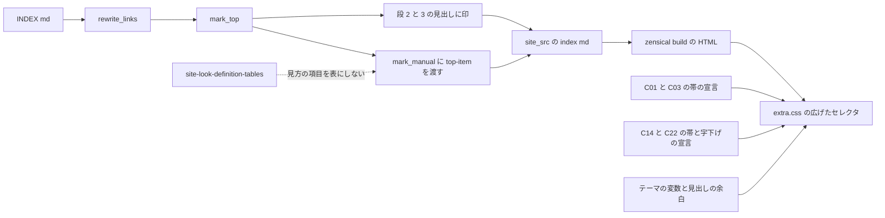
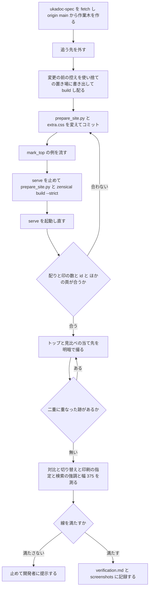

# Design Document: site-look-top-page

## Overview
**Purpose**: UKADOC のトップページ（原稿 `INDEX.md`）から読みたい頁を探すゴースト制作者に、節・目次の分類・「ukadocの見方」の分類名がひと目で見分けられる見え方を届ける。新しい見せ方は作らず、まとめ頁の分類の帯（C03）・項目名の帯（C01）と、`manual/` の頁のファイル名の帯と説明の字下げ（C22・C14）を、トップにも当てる（開発者の指示「基本の方向は、ほかの頁と同じ」）。
**Users**: トップを開くゴースト制作者（明・暗の表示、幅 375 の狭い画面、印刷、検索から開く頁を含む）。ほかの頁の見え方は変えない。
**Impact**: ukadoc-spec の `scripts/prepare_site.py` に、トップの見出しと見方の箇条書きに印を付ける関数 `mark_top()` を足し、`main()` の `write('index.md', …)` の 1 か所から呼ぶ。`mark_manual()` は付ける class を引数で受ける。`assets/extra.css` は、既にある 4 つの塊の 8 つのセレクタにトップの印を足すだけで、宣言・色・塊・注を足さない。原稿・`.nav.yml`・`mkdocs.yml` は変えない。

印は、要件の話し合いの議題 1 の決定（ギャップ分析の案 B）のとおりトップだけの印 `top-section`・`top-category`・`top-item` にし、まとめ頁と `manual/` の頁の印（`bundle-*`・`manual-item`）は使い回さない。使い捨ての写し（ukadoc-spec `f54423d`。Claude のスクラッチ）で、この設計の差分そのものを build し、数・id・対比・余白・幅 375 を確かめた（`research.md` の「8. 設計の調査」）。

### Goals
- トップかどうかを `prepare_site.py` の 1 か所（原稿が `INDEX.md`）で見分け、トップの中だけに印を付ける。頁の種類だけを示す印は足さない
- 節の見出し 5 個を C03 の分類の帯、目次の分類 7 個を C01 の項目名の帯、見方の箇条書き 7 個の分類名を C22 の帯と C14 の字下げで見せる。見方の分類名の後ろの「`: `」7 個を見せない
- 帯の字・¶ の対比を、まとめ頁と同じ線（7:1・3:1・4.5:1）で、明・暗とも満たす
- トップを除く 40 頁の HTML を 1 バイトも変えない

### Non-Goals
- 原稿（`INDEX.md`）の書き換え（節の並べ替え・文の直し・見出しの段の直し）
- 頁の題（`h1`）・「対象version」と「外部リンク」のリンクの箇条書き・「ukadocについて」の段落と引用・目次のリンクの無いまとめの項目 8 個の見え方（要件の話し合いの議題 3）
- 旧サイトの頭の飾り、目次のカードや段組みなどほかの頁に無い見せ方
- 頭が太字の箇条書きを表にすること（`site-look-definition-tables` の C23）
- 暗い表示のまま印刷したときのリンクの色（roadmap のバックログ。トップの帯の中にリンクは無い）

## Boundary Commitments

### This Spec Owns
- `scripts/prepare_site.py` の、トップに印を付ける処理: 定数 `TOP_HEADING`、関数 `mark_top()`、`mark_manual()` の引数 `cls`（既定値 `manual-item`）、`main()` の `write('index.md', …)` の 1 行、モジュールの docstring の 1 項目
- 印の名前と当て先: `top-section`（トップの段 2 の見出し）・`top-category`（トップの段 3 の見出し）・`top-item`（トップの一番外の箇条書きの頭の太字の名前の `strong`）
- `assets/extra.css` の 8 つのセレクタに足すトップの印（宣言の値は変えない）:
  - `site-look-list-items: 項目名の帯` の帯のセレクタ（30 行）に `.top-category`・`.top-item`
  - `site-look-list-items: 分類の見出しの帯` の帯のセレクタ（59 行）に `.top-section`
  - `site-look-list-items: 濃い帯の中の ¶ と検索の強調` の 2 つのセレクタ（105・108 行）に `.top-section`
  - `site-look-manual-files: ファイル名の帯と説明の字下げ` の 4 つのセレクタ（209・212・216・219 行）に `.top-item`
- この spec の記録（`.kiro/specs/site-look-top-page/verification.md` と `screenshots/`。完了で `completed/` へ移る）

### Out of Boundary
- `extra.css` の上の 8 つの外のセレクタと、すべての宣言の値: C01 の帯の中のコード（36 行）・暗い表示の帯の中のリンク（41 行）、C02 の詰め（48〜56 行）、C03 の帯の中のコード（66 行）、記述例の箱・list-markers・sakura-script-highlight・note-icon・木のファイル名の塊
- `prepare_site.py` のほかの処理（一覧の検査・まとめ頁の流れ・`add_markers()`・id の振り方・見出しの数の検査・`rewrite_links()`・`_raw/`・`.nav.yml` の書き換え）と、manual の頁の `mark_manual(text)` の呼び出し
- テーマの色の変数とリンクの色の変数、ヘッダの地の色
- 原稿・`.nav.yml`・`mkdocs.yml`・`requirements.txt`・Zensical の版・`overrides/`、完了した `site-look-list-items`・`site-look-manual-files` の文書

### Allowed Dependencies
- `prepare_site.py` の既にある部品: `fence_free_headings()`（コードブロックの外の見出し行）、`MANUAL_ITEM` と `mark_manual()`、`rewrite_links()` の後に書き出す流れ
- Python-Markdown の `attr_list`（見出しの末尾の `{: .cls }` と、行の中の `**…**{: .cls }`）と toc（id を題の字から作る）。`mkdocs.yml` の今の設定のまま
- `site-look-list-items` の C01・C03 の帯の宣言と、濃い帯の ¶ と検索の強調の宣言。`site-look-manual-files` の帯と字下げの宣言
- テーマ（Zensical 0.0.67 の classic）の見出しの余白、`<body>` の `data-md-color-scheme`、暗い表示の変数を `@media screen` の中だけで定める作り
- 確かめの道具: `zensical serve`、`python -m http.server`（変更の前の控えを配る）、Edge ヘッドレス + CDP の使い捨てのスクリプト、`.kiro/specs/completed/site-look-plan/tools/shot.mjs`（読むだけ）

### Revalidation Triggers
- `INDEX.md` に、末尾に `{…}` の付いた見出し・閉じの `#` の付いた見出し・段 2・3 の新しい見出し・頭が太字の一番外の箇条書きが入ったとき: 印の数と漏れを数え直す（今は 5・7・7、漏れ 0）
- トップの帯の中にリンクかコードが入ったとき（今は 0 個）: 要件 6.3 の線で測り、C01 の暗い表示のリンク（41 行）・帯の中のコード（36・66 行）のセレクタにトップの印を足すかを決める
- `mark_manual()` の規則（`MANUAL_ITEM`）か「`: `」の外し方を変えたとき: manual の頁とトップの両方の数を数え直す
- `site-look-definition-tables` など、読み物の頁かトップの写しに処理を足す spec が入ったとき: 見方の 7 個が表にならないこと（要件 4.7）と、印の数を確かめ直す
- C01・C03・C14・C22 の宣言、テーマの見出しの余白、色の変数を変えたとき、Zensical の版を上げたとき: 対比・余白・字下げを測り直す

## Architecture

### Existing Architecture Analysis
- `main()` は、`INDEX.md` を `write('index.md', rewrite_links(read('INDEX.md'), 'INDEX.md', 'index.md'))` で写すだけで、トップに目印は付かない（`prepare_site.py` 365 行）
- まとめ頁の見出しには `shift_headings()` が `{#id .bundle-category}` の形で id と class を書く。トップの見出しの id は toc が作るので、class だけを `{: .x }` で足す。写しで、id が今と同じに作られることを確かめた
- `mark_manual()` は、コードブロックの外で `MANUAL_ITEM` に合う行（行の頭の `- **名前**`）の名前に `{: .manual-item }` を足し、「`: `」を外す。`INDEX.md` で合う行は見方の箇条書きの 7 行だけ
- C02 の詰め（`.md-typeset:has(.bundle-item) p` など）は `.bundle-item` のある頁だけに効く。トップに `.bundle-item` を付けないので、トップの段落は詰まらない
- C01・C03 の帯の塊は margin を持たない。トップの見出しの帯は、テーマの見出しの余白のままになる

### Architecture Pattern & Boundary Map
選んだ形は、ギャップ分析の案 B（組み立ての処理がトップだけの印を付け、見た目の指定は既にある塊のセレクタにその印を足す）。



- **印の役**: `top-section`・`top-category`・`top-item` は「トップの中の役」の印で、見え方の名前にしない。見た目を替えるときは `extra.css` だけを替えればよい
- **見分け**: トップかどうかは `main()` の `write('index.md', …)` の 1 か所が持つ（1.1）。節・目次の分類は見出しの段、見方の箇条書きは `MANUAL_ITEM` の形で見分け、題・id を名指ししない（1.2）
- **見た目の共有**: 帯と字下げの宣言は 1 か所のまま、セレクタだけをトップの印に広げる。C01・C03・C14・C22 が変われば、トップもそろって変わる（6.4・9.2）
- **詰めを及ぼさない**: `bundle-*`・`manual-item` をトップに付けないので、C02 の詰めと後の spec の `bundle-*`・`manual-item` の指定はトップに及ばない（1.5・5.3）

### Technology Stack

| Layer | Choice / Version | Role in Feature | Notes |
|-------|------------------|-----------------|-------|
| 組み立ての処理 | Python 3.12・`scripts/prepare_site.py` | トップの見出しと見方の名前に印を足し「`: `」を外す | 依存は足さない |
| Markdown | Python-Markdown の `attr_list`・toc（`mkdocs.yml` のまま） | `{: .cls }` を class にし、id は題から作る | 設定は変えない |
| 見た目の指定 | CSS（`assets/extra.css`） | 帯・字下げ・¶・検索の強調 | `:is()`・`:has()` は既にある塊も使っている |
| サイト生成 | Zensical 0.0.67（`requirements.txt` のまま） | build・serve | 版は変えない |
| 確かめ | `zensical serve`、`python -m http.server`、Edge ヘッドレス + CDP、`shot.mjs` | 数・id・対比・余白・画面・幅 | `shot.mjs` は読むだけ |

## File Structure Plan

### Directory Structure
```
ukadoc-spec（作業木 .worktrees/site-look-top-page/、ブランチ site-look-top-page、origin/main から）
├── scripts/
│   └── prepare_site.py          # TOP_HEADING・mark_top() を足し、mark_manual() に cls を足し、index.md を書く 1 行から呼ぶ
└── assets/
    └── extra.css                # 4 つの塊の 8 つのセレクタにトップの印を足す（宣言は変えない）

.kiro/specs/site-look-top-page/（doc_edit。完了で completed/ へ移る）
├── verification.md              # 新規。数・変わらないこと・対比・余白・画面の見比べの記録
└── screenshots/                 # 設計の写しの画面（design-*.png、済み）と、実装の後の画面（after-*.png）
```

ukadoc-spec で変えるのは上の 2 ファイルだけである（9.1）。原稿・`.nav.yml`・`mkdocs.yml`・`requirements.txt`・`overrides/` には触れない。

### Modified Files

#### `scripts/prepare_site.py`（ukadoc-spec の作業木）
変える所は 5 か所で、ほかの関数は変えない。差分（`f54423d` に対して。写しで build を通したもの）:

```diff
@@ -14,3 +14,4 @@
 - manual/ の頁のファイルの箇条書きの頭の名前に目印（manual-item）を付け、名前の後ろの「: 」を外す（見た目は assets/extra.css）
+- トップページの節と目次の分類の見出しに目印（top-section・top-category）を、頭が太字の箇条書きの名前に目印（top-item）を付ける
 原稿そのものは書き換えない。
 """
@@ -44,3 +45,4 @@
 NOTE_FILE = re.compile(r'note-\d+\.md')   # 補足の項目の原稿のファイル名
+TOP_HEADING = {2: 'top-section', 3: 'top-category'}   # トップの見出しの段 → 目印
 MANUAL_ITEM = re.compile(r'^(- \*\*(?:\\.|[^\\*])+\*\*)(: |:$|$)')   # 一番外の箇条書きの頭の太字の名前（\* と \\ は名前の字）
@@ -283,8 +285,8 @@
-def mark_manual(text):
-    """manual/ の頁のファイルの箇条書きの頭の名前に {: .manual-item } を足し、名前の後ろの「: 」を外す"""
+def mark_manual(text, cls='manual-item'):
+    """一番外の箇条書きの頭の太字の名前に {: .<cls> } を足し、名前の後ろの「: 」を外す"""
     lines = text.split('\n')
@@ -293,3 +295,3 @@
         if m:
-            lines[i] = m.group(1) + '{: .manual-item }' + (' ' if m.group(2) == ': ' else '') + line[m.end():]
+            lines[i] = m.group(1) + f'{{: .{cls} }}' + (' ' if m.group(2) == ': ' else '') + line[m.end():]
     return '\n'.join(lines)
@@ -296,4 +298,13 @@
 
 
+def mark_top(text):
+    """トップの節（##）と目次の分類（###）の見出しに目印を足し、頭が太字の箇条書きの名前に top-item を付ける"""
+    lines = text.split('\n')
+    for i, level, title in fence_free_headings(text):
+        if level in TOP_HEADING:
+            lines[i] = f'{"#" * level} {title} {{: .{TOP_HEADING[level]} }}'
+    return mark_manual('\n'.join(lines), 'top-item')
+
+
 # ---------------------------------------------------------------- 本体
@@ -365 +376 @@
-    write('index.md', rewrite_links(read('INDEX.md'), 'INDEX.md', 'index.md'))
+    write('index.md', mark_top(rewrite_links(read('INDEX.md'), 'INDEX.md', 'index.md')))
```

- **トップを見分ける所**: `main()` の `write('index.md', …)`（原稿が `INDEX.md` であること。1.1）。頁の種類だけを示す印は HTML に足さない（1.4）
- **見出しの印**: `fence_free_headings()` が返すコードブロックの外の見出しのうち、段 2 の行を `## 題 {: .top-section }`、段 3 の行を `### 題 {: .top-category }` に書き直す。題の字は変えず、id は toc が今と同じに作る（7.3）。段 1（頁の題）・段 4 以下には付けない（2.4・3.3）
- **見方の印**: `mark_manual()` に `'top-item'` を渡す。行の頭の `- **名前**: 説明` が `- **名前**{: .top-item } 説明` になり、「`:`」が外れて空白 1 つが残る（4.4。空白は帯の後ろの行の頭の空白として見えず、検索の字の語の切れ目になる。`site-look-manual-files` の決定 4 と同じ）。字下げした行・コードブロックの中・目次のリンクの並び（頭が太字でない）には付かない（4.6）
- **`mark_manual()` の引数**: 既定値 `manual-item` のまま、manual の頁の呼び出し（`mark_manual(text) if d == 'manual' else text`）は変えない。名前は変えない（OPEN QUESTION 3）
- **`TOP_HEADING` の置き場**: 定数の並び（`MANUAL_ITEM` の前）。段を足すときは辞書に 1 つ足す
- 写しで確かめた結果: 下の TopCheck の数。`prepare_site.py` と `zensical build --strict` は exit 0、`_raw/` と `llms.txt` は変わらない

#### `assets/extra.css`（ukadoc-spec の作業木）
既にある 4 つの塊の 8 つのセレクタにトップの印を足す。宣言・塊の注・ほかのセレクタは変えない。新しい塊は足さないので、`/* site-look-top-page: … */` の注は要らない（9.2）。

```diff
 /* site-look-list-items: 項目名の帯 */
-.md-typeset :is(.bundle-item, .manual-item) {
+.md-typeset :is(.bundle-item, .manual-item, .top-category, .top-item) {
@@
 /* site-look-list-items: 分類の見出しの帯 */
-.md-typeset .bundle-category {
+.md-typeset :is(.bundle-category, .top-section) {
@@
 /* site-look-list-items: 濃い帯の中の ¶ と検索の強調 */
-.md-typeset :is(.bundle-category, h4:has(+ .highlight)) .headerlink {
+.md-typeset :is(.bundle-category, .top-section, h4:has(+ .highlight)) .headerlink {
   color: var(--md-primary-bg-color--light);
 }
-.md-typeset :is(.bundle-category, h4:has(+ .highlight)) mark {
+.md-typeset :is(.bundle-category, .top-section, h4:has(+ .highlight)) mark {
@@
 /* site-look-manual-files: ファイル名の帯と説明の字下げ */
-.md-typeset > ul:has(> li > .manual-item, > li > p:first-child > .manual-item) {
+.md-typeset > ul:has(> li > :is(.manual-item, .top-item), > li > p:first-child > :is(.manual-item, .top-item)) {
   margin-left: 0;
 }
-.md-typeset > ul > li:has(> .manual-item, > p:first-child > .manual-item) {
+.md-typeset > ul > li:has(> :is(.manual-item, .top-item), > p:first-child > :is(.manual-item, .top-item)) {
@@
-.md-typeset li > p:first-child:has(> .manual-item) {
+.md-typeset li > p:first-child:has(> :is(.manual-item, .top-item)) {
@@
-.md-typeset .manual-item {
+.md-typeset :is(.manual-item, .top-item) {
```

指定のわけ（注に書かず、ここに残す）:
- **節の見出しの帯**（2.1・2.2）: トップの `h2.top-section` は、まとめ頁の `h2.bundle-category` と同じ要素・同じ宣言なので、同じ見え方になる（紺の地に白の太字、`padding: .3em .6em`）
- **¶ と検索の強調**（2.3・7.2）: 濃い帯の中の ¶ を白の 70%、強調を白の地に紺の字にする指定を広げた。テーマのホバーの藍（紺の地に約 1.95）にならず、ふだん・ホバー・フォーカスとも 4.99
- **目次の分類の帯**（3.1・3.2）: トップの `h3.top-category` は、まとめ頁の `h3.bundle-item` と同じ要素・同じ帯の宣言。C02 の `margin` は当てない（余白は下の「余白」）
- **見方の分類名の帯と字下げ**（4.1〜4.3）: `strong.top-item` は `strong.manual-item` と同じ帯・字の大きさ（`1.25em`、`h3` と同じ）・太さ `400`・余白 `.5em 0 .3em -1.2rem`、項目は `1.2rem` の字下げで点なし。`li > p:first-child > strong`（6 個）と `li > strong`（「その他」1 個）のどちらの形にも当たる
- **`:has()` の中の `:is()`**: `:is()` の中は class だけなので、セレクタの重さは前と同じで、manual の頁の見え方は変わらない（写しで manual の頁の HTML と帯・字下げの測りが同じ）
- **広げないセレクタ**（6.3）: C01 の帯の中のコード（36 行）・暗い表示の帯の中のリンク（41 行）・C03 の帯の中のコード（66 行）は、トップの帯の中にリンクもコードも 0 個なので広げない（OPEN QUESTION 2）
- **余白**（5.2〜5.4）: 余白の宣言は足さず、テーマの見出しの余白のままにする。節の見出しの帯は上 40px・下 16px、目次の分類の帯は上 32px（「目次」の帯の直後だけ 16px）・下 16px、見方の分類名の帯は manual と同じ上 10px・下 6px（幅 1000）。リンクの並びの最後の行と次の分類の帯の間が約 32px 空き、帯が前の並びにつながって見えない。段落・リンクの並び・入れ子の箇条書きの余白は変わらない（設計の写しの画面 `screenshots/design-top-*.png`。OPEN QUESTION 1）
- **色**（6.1・6.2・6.4）: 色はどれも C01・C03 の宣言とテーマの変数から来る。トップだけの色・`@media screen` の指定・直書きの色を足さない。暗い表示だけの値はテーマと `site-look-dark-link-color` の `@media screen` の中にあるので、暗い表示のまま印刷しても帯は明るい表示の色で出る
- **幅 375**（7.4）: 帯の名前・節の題は短く、1 行に収まる。`overflow-wrap` などの指定は要らない

### 部品とファイルの対応
| 部品 | ファイル | 扱い |
|---|---|---|
| TopMarker | `scripts/prepare_site.py`（作業木） | 変える |
| TopBandStyle | `assets/extra.css` の 8 つのセレクタ（作業木） | 変える |
| TopCheck | なし（配られた HTML を数え、控えと比べる使い捨てのスクリプト。置き場は Claude のスクラッチ。手順と結果は `verification.md`） | 作らない |
| ContrastProbe | なし（Edge ヘッドレス + CDP の使い捨てのスクリプト。式と結果は `verification.md`） | 作らない |
| ShotTool | `.kiro/specs/completed/site-look-plan/tools/shot.mjs` | 読むだけで使う |
| VerificationRecord | `.kiro/specs/site-look-top-page/verification.md`・`screenshots/` | 新規 |

## System Flows

### 作業の流れ

- A・B（`workflow.md` の「ukadoc-spec の作業木」）: `git -C ukadoc-spec fetch origin` → `git -C ukadoc-spec worktree add ../.worktrees/site-look-top-page -b site-look-top-page origin/main` → `git -C .worktrees/site-look-top-page branch --unset-upstream`。起点は `site-look-manual-files` の PR #15 を含む `origin/main`（今は `f54423d`。9.3）
- C: 変更の前の控えは、作業木の HEAD（作った直後は `origin/main` と同じ）を `git archive HEAD` で Claude のスクラッチの下の新しいフォルダに書き出し、`prepare_site.py` と `zensical build --strict` を流して、`_site/` を `python -m http.server` で 8000 以外の口（例: 8010）に `/ukadoc-spec/` の下で配る。`ukadoc-spec/` のメインのチェックアウトは使わない。終わったら止めて消す
- D のコミットは 1 つにする（印と見た目の指定は互いに依り、片方だけでは見え方が変わらないか、印の書きかけが残る）。`-c user.name=ekicyou -c user.email=dot.station@gmail.com` で名前を渡す。push と PR は `/kiro-complete` で行う
- F: `serve` は `_site_src/` を見るので、動かしたまま `prepare_site.py` を流さない（書きかけを拾って `extra.css` が 404 になる）
- M: 線に届かないとき・余白を開発者が変えたいと見たときは、値を勝手に選び直さず、測った数と画面を添えて開発者に提示して判断を待つ

## Requirements Traceability

| Requirement | Summary | Components | Interfaces | Flows |
|-------------|---------|------------|------------|-------|
| 1.1 | 1 か所で `INDEX.md` から見分け、印をトップの中だけに | TopMarker（`write('index.md', mark_top(…))`）, TopCheck | 頁ごとの `top-*` の数 | H |
| 1.2 | 段と箇条書きの形で見分け、題・id を名指ししない | TopMarker（`TOP_HEADING` の段、`MANUAL_ITEM`）, TopBandStyle（class だけ） | — | — |
| 1.3 | トップでない頁の HTML と見え方を保つ | TopMarker（`index.md` だけ）, TopBandStyle（`top-*` だけを足す）, TopCheck | 40 頁の HTML のバイト比べ | H |
| 1.4 | 使わない頁の種類の印を足さない | TopMarker（印は見た目が使う 3 つだけ） | `git diff` | — |
| 1.5 | `bundle-*`・`manual-item` でなくトップだけの印 | TopMarker（`top-section`・`top-category`・`top-item`） | `class="top-…"` | H |
| 2.1 | 節の見出しを C03 の帯で | TopBandStyle（59 行）, ShotTool | `h2.top-section` | I |
| 2.2 | 節の見出しの白い字 7:1 | TopBandStyle, ContrastProbe | 8.31（明・暗） | K |
| 2.3 | 節の見出しの ¶ 3:1（ふだん・ホバー・フォーカス） | TopBandStyle（105 行）, ContrastProbe | 4.99（明・暗） | K |
| 2.4 | `h1`・`h3` に分類の帯を付けない | TopMarker（段 2 だけ `top-section`）, TopCheck | `h1` の class 無し | H |
| 3.1 | 目次の分類を C01 の帯で | TopBandStyle（30 行）, ShotTool | `h3.top-category` | I |
| 3.2 | 目次の分類の帯の字 4.5:1 | TopBandStyle, ContrastProbe | 明 14.13・暗 6.76 | K |
| 3.3 | `h1`・`h2` に項目名の帯を付けない | TopMarker（段 3 だけ `top-category`）, TopCheck | — | H |
| 3.4 | リンクの無いまとめの項目 8 個は今のまま | TopMarker（頭が太字でない行に付けない）, ContrastProbe | 一番外の項目の点 `disc`・左の端 46px | K |
| 4.1 | 見方の分類名を C22 の帯で 1 行に | TopMarker（`mark_manual(…, 'top-item')`）, TopBandStyle（30・219 行）, ShotTool | `strong.top-item` | I |
| 4.2 | 説明のすべての段落を同じ字下げ、点を見せない | TopBandStyle（209・212・216 行）, ContrastProbe | 説明の左の端 40px、点 `none` | K |
| 4.3 | 「その他」も次の行から同じ字下げ | TopBandStyle（`li > strong` の形も同じ）, ShotTool | `design-top-howto-other-*.png` | I |
| 4.4 | 「`: `」7 個を見せず、ほかの字を変えない | TopMarker（「`:`」だけを外す）, TopCheck | 本文の字の違いが「`:`」7 字だけ | H |
| 4.5 | 帯を見出しにせず、目次・id・¶ を増やさない | TopMarker（`strong` に class だけ）, TopCheck | id 13・¶ 13・`md-nav__link` 82 | H |
| 4.6 | 目次のリンクの並び・リンクの箇条書きは今のまま | TopMarker（`MANUAL_ITEM` に合わない）, TopBandStyle（`:has()` で印のある項目だけ）, ContrastProbe | 点 `disc`・左の端 46px | K |
| 4.7 | 見方の箇条書きを表にしない | TopMarker（「`: `」が外れる）, TopCheck | `table` 0（トップ） | H |
| 5.1 | 分類の帯と項目名の帯を違う見え方で、リンクの並びと見分ける | TopBandStyle（C03 と C01）, ShotTool | 画面 | I |
| 5.2 | リンクの並びの余白・入れ子の字下げを今のまま、変えるのは帯の上下だけ | TopBandStyle（余白の宣言を足さない）, ContrastProbe | 控えとリンクの行の位置が同じ | K |
| 5.3 | 段落を C02 のように詰めない | TopMarker（`bundle-item` を付けない）, ContrastProbe | 段落の `margin` `16px 0` | K |
| 5.4 | 帯の上に前の並びとつながらない余白 | TopBandStyle（テーマの `h2`・`h3` の余白）, ContrastProbe, ShotTool | 上 40px・32px | I, K |
| 6.1 | 切り替えで読み込み直さずに変わる | TopBandStyle（属性と変数）, ContrastProbe | `body` の属性 | K |
| 6.2 | 暗い表示のまま印刷しても明るい色 | TopBandStyle（`@media screen` の外に暗い表示の指定を足さない）, ContrastProbe | CSSOM | K |
| 6.3 | 帯の中のリンクの数を記録し、あれば測る | TopCheck, VerificationRecord | 今は 0 | H, N |
| 6.4 | 帯の色を同じ指定から取り、トップだけの色を足さない | TopBandStyle（セレクタだけ） | `git diff` の宣言 0 | — |
| 7.1 | 同じ字で検索で引ける（外すのは「`: `」だけ） | TopMarker, TopCheck | 本文の字・`search.json` | H |
| 7.2 | 帯の中で検索の強調が見える | TopBandStyle（108 行）, ContrastProbe | `?h=目次`・`?h=ファイル構成` | K |
| 7.3 | id・¶・目次を保ち、トップの見出しへのリンクを通す | TopMarker（id は toc のまま）, TopCheck | id の並び 13 | H |
| 7.4 | 幅 375 に収まる | TopBandStyle, ContrastProbe | `scrollWidth` = `innerWidth` = 375 | K |
| 7.5 | `_raw/INDEX.md`・`llms.txt`・検査・リンクの書き換えを今のまま | TopMarker（`rewrite_links()` の後に足すだけ）, TopCheck | 控えと同じ、Build Gate | F, H |
| 8.1 | 配られた `extra.css` が 200 でこの spec の中身がある | TopCheck | `/ukadoc-spec/assets/extra.css` | H |
| 8.2 | 帯の数・外した「`: `」・漏れ 0 を数える | TopCheck | 5・7・7・7・0 | H |
| 8.3 | 前後で id・¶・目次の数が同じ | TopCheck | 控えとの比べ | C, H |
| 8.4 | トップを除くすべての頁の本文が同じ | TopCheck | 40 頁 | C, H |
| 8.5 | 明・暗で当て先と並べて撮る | ShotTool, VerificationRecord | 画面の一覧 | I |
| 8.6 | 帯の字と ¶ の対比を明・暗で測る | ContrastProbe, VerificationRecord | 測る所と線 | K, N |
| 8.7 | 幅 375 の `scrollWidth`・`innerWidth` を記録 | ContrastProbe, VerificationRecord | 明・暗 | K |
| 8.8 | 二重に重なった画面の撮り直し | ShotTool | 画面の目視 | J |
| 8.9 | 見せる前に Ctrl+F5 を頼む | VerificationRecord | — | — |
| 9.1 | 変えるのは `extra.css` と `prepare_site.py` だけ | TopMarker, TopBandStyle | `git diff --stat origin/main` の 2 ファイル | — |
| 9.2 | 宣言を書かずセレクタを広げる、新しい塊なら注 1 行 | TopBandStyle（8 つのセレクタだけ、塊 0） | 差分 | — |
| 9.3 | 自分の作業木で、PR #15 の後の `origin/main` の上に書く | （作業木） | `.worktrees/site-look-top-page/` | A, B |
| 9.4 | Build Gate と規約 Gate | TopMarker ほか全部 | `prepare_site.py`・`build --strict` | F |
| 9.5 | 完了でこの spec だけの PR を作りスクワッシュマージ | （`/kiro-complete`） | PR の説明 | — |
| 9.6 | `origin/main` とぶつかったら追いつき両方残す | TopBandStyle（セレクタの並びに両方の印）, TopMarker | merge の直し | — |

## Components and Interfaces

| Component | Domain/Layer | Intent | Req Coverage | Key Dependencies | Contracts |
|-----------|--------------|--------|--------------|------------------|-----------|
| TopMarker | 組み立ての処理（`prepare_site.py`） | トップの見出しと見方の名前に印を付け「`: `」を外す | 1.1〜1.5, 2.4, 3.3, 3.4, 4.1, 4.4〜4.7, 5.3, 7.1, 7.3, 7.5, 9.1, 9.4, 9.6 | `attr_list`・toc（P0）、`fence_free_headings()`・`mark_manual()`・`main()` の流れ（P0） | Batch |
| TopBandStyle | 見た目の指定（`extra.css`） | 既にある帯と字下げの宣言をトップの印に当てる | 1.2, 1.3, 2.1〜2.3, 3.1, 3.2, 4.1〜4.3, 4.6, 5.1〜5.4, 6.1, 6.2, 6.4, 7.2, 7.4, 9.1, 9.2, 9.6 | TopMarker（P0）、C01・C03・C14・C22 の宣言（P0）、テーマの変数と見出しの余白（P0） | State |
| TopCheck | 確かめ（使い捨て） | 印の数・漏れ・変わらないこと・配り | 1.1, 1.3, 1.5, 2.4, 3.3, 4.4, 4.5, 4.7, 6.3, 7.1, 7.3, 7.5, 8.1〜8.4 | `serve` と控えの配り（P0） | Service |
| ContrastProbe | 確かめ（使い捨て） | 対比・位置・余白・切り替え・印刷の指定・検索の強調・幅 375 | 2.2, 2.3, 3.2, 3.4, 4.2, 4.6, 5.2〜5.4, 6.1, 6.2, 7.2, 7.4, 8.6, 8.7 | Edge ヘッドレス + CDP（P0） | Service |
| ShotTool | 確かめ（`shot.mjs`。読むだけ） | 明・暗の画面 | 2.1, 3.1, 4.1, 4.3, 5.1, 5.4, 8.5, 8.8 | Edge（P0） | 既存のまま |
| VerificationRecord | 記録 | 数・対比・見比べの結果を残す | 6.3, 8.5〜8.7, 8.9 | 上の確かめの結果（P0） | State |

### 組み立ての処理

#### TopMarker

| Field | Detail |
|-------|--------|
| Intent | トップの写しの字に、節・目次の分類の見出しの印と、見方の箇条書きの名前の印を足し、名前の後ろの「`: `」を外す |
| Requirements | 1.1〜1.5, 2.4, 3.3, 3.4, 4.1, 4.4〜4.7, 5.3, 7.1, 7.3, 7.5, 9.1, 9.4, 9.6 |

**Responsibilities & Constraints**
- 頁の見分け: `main()` で `INDEX.md` を写すときだけ `mark_top()` に通す。まとめ頁・`manual/`・`dev/`・`memo/`・`spec/` の 1 ファイルの頁は通さない
- 見出しの印: コードブロックの外の段 2・3 の見出し行の末尾に ` {: .top-section }`・` {: .top-category }` を足す。題の字・段は変えない
- 見方の印: `mark_manual(text, 'top-item')`。規則と「`: `」の外し方は `site-look-manual-files` の `mark_manual()` のまま
- 原稿・`_raw/`・`llms.txt`・リンクの書き換えは変えない

**Contracts**: Batch [x]

##### Batch / Job Contract
- Trigger: `python scripts/prepare_site.py`（Build Gate と GitHub Actions の build）
- Interface:
  ```python
  TOP_HEADING: dict[int, str]                              # {2: 'top-section', 3: 'top-category'}
  def mark_manual(text: str, cls: str = 'manual-item') -> str: ...   # 一番外の箇条書きの頭の太字の名前に {: .<cls> }
  def mark_top(text: str) -> str: ...                      # text は rewrite_links() の後の INDEX.md の字
  ```
- Input / validation: `INDEX.md` の、`rewrite_links()` を通した字。形に合わない行（末尾に `{…}` の付いた見出しなど。今は 0 個）はエラーにせず、TopCheck の漏れ・数で見つける
- Output / destination: `_site_src/index.md`。HTML は `<h2 class="top-section" id="…">`・`<h3 class="top-category" id="…">`・`<strong class="top-item">…</strong>`（後ろに空白 1 つと説明の字）
- Idempotency & recovery: 毎回 `_site_src/` を作り直すので、何度流しても同じ。原稿は書き換えない

**Implementation Notes**
- Integration: `mark_top()` は `rewrite_links()` の後に通す。`site-look-definition-tables` が同じ写しに処理を足すときは、入れ子にして両方を残し、見方の 7 個が表にならないことを確かめ直す
- Validation: TopCheck（下）と、`mark_top()` に字を直に渡す例（Testing Strategy）
- Risks: 見出しの末尾に `{…}` や閉じの `#` を書く原稿が入ると、印が二重になるか字に漏れる（今は 0 個。Revalidation Triggers）

### 見た目の指定

#### TopBandStyle
新しい境目を持たない見た目の指定で、中身は上の「Modified Files」の `assets/extra.css` の差分そのものである。

**Contracts**: State [x]

##### State Management
- 状態は HTML の class と、`<body>` の `data-md-color-scheme` と、テーマの変数だけで決まる。テーマが明・暗の切り替えで属性と変数を書き換えると、読み込み直さずに変わる（6.1）
- この spec は暗い表示だけの指定を足さない。帯の地・字はテーマの変数（`--md-primary-fg-color`・`--md-primary-bg-color`・`--md-default-fg-color--lightest` など）から来て、暗い表示の値はテーマの `@media screen` の中にある（6.2）
- 宣言・直書きの色を足さない（6.4）。広げたセレクタの重さは前と同じ（`:is()` の中は class だけ）

### 確かめ

#### TopCheck

| Field | Detail |
|-------|--------|
| Intent | 配られた HTML で、印の数・漏れ・変わらないこと・配りを数える |
| Requirements | 1.1, 1.3, 1.5, 2.4, 3.3, 4.4, 4.5, 4.7, 6.3, 7.1, 7.3, 7.5, 8.1〜8.4 |

**Responsibilities & Constraints**
- 配り（8.1）: 作業木の `serve` の `/ukadoc-spec/assets/extra.css` が 200 で、`.top-section` が 3 つ（59・105・108 行）・`.top-category` が 1 つ（30 行）・`.top-item` が 7 つ（30・209・212・216・219 行。209・212 行は 2 つずつ）ある（8 つのセレクタ）
- 数（1.1・1.5・2.4・3.3・8.2）: トップの `article` の中の `h2.top-section`・`h3.top-category`・`strong.top-item`（うち `li > strong` の形）、`h1` に class が無いこと、外した「`:`」の数、漏れ（`pre`・`code` の外の `{:`・`{#`・`{.`）、帯の中のリンクとコードの数（6.3）、`table` の数（4.7）。全頁で `top-` を含む class がトップの外に 0
- 変わらないこと（1.3・4.5・7.1・7.3・8.3・8.4）: 変更の前の控えと、トップの見出しの id の並び・`class="headerlink"` の数・`md-nav__link` の数が同じ。トップの本文の字（タグを外し空白を詰めたもの）の違いが「`:`」7 字と後ろの空白だけ。トップを除く 40 頁の HTML がバイト単位で同じ。`search.json` の違いが「ukadocの見方」の 1 件だけ
- `_raw/` と `llms.txt` が控えと同じ（7.5）。`prepare_site.py` が exit 0（一覧の検査・見出しの数の検査）

##### Service Interface
```typescript
interface TopCount {
  sections: number;        // h2.top-section（5 であること）
  categories: number;      // h3.top-category（7）
  items: number;           // strong.top-item（7）
  itemsWithoutP: number;   // li > strong.top-item（1）
  colonsRemoved: number;   // 控えとの本文の字の「:」の差（7）
  leaks: number;           // pre・code の外の "{:" "{#" "{."（0）
  linksInBands: number;    // 帯の中の a:not(.headerlink)（0。1 以上なら 6.3 の線で測る）
  codeInBands: number;     // 帯の中の code（0）
  tables: number;          // トップの table（0）
  topClassOutside: number; // トップの外の頁の top- の class（0）
}
interface TopUnchanged {
  ids: boolean; headerlink: boolean; navLink: boolean;   // トップで true であること
  otherPagesSame: boolean;                               // 40 頁の HTML のバイト比べ
  searchDiffOnlyHowto: boolean; rawSame: boolean;
}
interface TopCheck {
  served(): boolean;          // 8.1
  count(): TopCount;          // 8.2
  unchanged(): TopUnchanged;  // 1.3・8.3・8.4
}
```

期待の数（`f54423d` の写しで数えた。実装で数え直し、それを正とする）:

| もの | 数 |
|---|---|
| `h2.top-section` | 5 |
| `h3.top-category` | 7 |
| `strong.top-item`（うち `li > strong`） | 7（1） |
| 外した「`:`」 | 7 |
| 漏れ・帯の中のリンク・帯の中のコード・`table` | 0・0・0・0 |
| トップの見出しの id・¶・`md-nav__link` | 13・13・82（控えと同じ） |
| HTML が控えと違う頁 | `index.html` だけ（ほか 40 頁は同じ） |
| HTML の外で控えと違うもの | `search.json`（「ukadocの見方」の 1 件）・`assets/extra.css` |

#### ContrastProbe

| Field | Detail |
|-------|--------|
| Intent | 作業木の `serve` のトップで、色と対比・位置・余白・切り替え・印刷の指定・検索の強調・幅 375 を測る |
| Requirements | 2.2, 2.3, 3.2, 3.4, 4.2, 4.6, 5.2〜5.4, 6.1, 6.2, 7.2, 7.4, 8.6, 8.7 |

**Responsibilities & Constraints**
- 測り方は `site-look-list-items` の `verification.md` の「流した式」と「対比」の節に従う: Edge ヘッドレス + CDP で `getComputedStyle` の `color` と、要素から `html` までの `backgroundColor` を重ねた地から WCAG 2.x の対比（小数 2 桁）を出す。半透明の字は地に重ねてから測る。ホバーは `Input.dispatchMouseEvent` でポインタを載せ、フォーカスは `focus()` で測る
- 明（`default`）で開き、暗はヘッダの切り替えを押して移る（読み込み直さない。6.1）
- 位置と余白（3.4・4.2・4.6・5.2〜5.4）: 帯の左の端と幅、見方の説明の左の端、一番外の項目の点、帯の `margin`、段落の `margin`、目次のリンクの行の位置が控えと同じ
- 印刷（6.2）: 頁の `document.styleSheets` の `assets/extra.css` で、`data-md-color-scheme` を含む規則がすべて `media` が `screen` の `CSSMediaRule` の中にあること（この spec は足さない）
- 検索の強調（7.2）: `?h=目次`（節の見出しの帯）・`?h=ファイル構成`（目次の分類の帯と見方の分類名の帯）を明・暗で開き、帯の中の `mark` を数えて画面で見えることを確かめる
- 幅 375（7.4・8.7）: トップを明・暗で `scrollWidth` と `innerWidth` を測る

##### Service Interface
```typescript
type Scheme = "default" | "slate";
interface ContrastSample {
  target: string; selector: string; scheme: Scheme;
  state: "normal" | "hover" | "focus";
  fg: string; bg: string; ratio: number;   // WCAG 2.x（小数 2 桁）
}
interface TopLayout {
  bandLefts: number[]; bandWidths: number[]; descLefts: number[];
  howtoListStyle: string[]; otherListStyle: string[];
  sectionMargin: string[]; categoryMargin: string[]; itemMargin: string[]; paragraphMargin: string[];
}
interface ContrastProbe {
  sample(target: string, scheme: Scheme, state: ContrastSample["state"]): ContrastSample;
  layout(scheme: Scheme): TopLayout;
  toggled(): boolean;      // 6.1
  screenOnly(): boolean;   // 6.2
  marks(query: string): { inSection: number; inCategory: number; inItem: number };   // 7.2
  width(scheme: Scheme): { scrollWidth: number; innerWidth: number };   // 7.4・8.7
}
```

測る所と線（「写し」は設計の写しを Edge ヘッドレスで測った値。実装で作業木の `serve` で測り、それを正とする）:

| 測る所 | セレクタ | 表示 | 状態 | 写しの fg / bg | 写しの対比 | 線 |
|---|---|---|---|---|---|---|
| 節の見出しの帯の字 | `h2.top-section` | 明 / 暗 | — | `#ffffff` / `#1f4e8c` | 8.31 / 8.31 | 7（2.2） |
| 節の見出しの帯の ¶ | `h2.top-section .headerlink` | 明 / 暗 | ふだん・ホバー・フォーカス | `rgba(255,255,255,.7)` / `#1f4e8c` | 4.99（6 通りとも） | 3（2.3） |
| 目次の分類の帯の字 | `h3.top-category` | 明 / 暗 | — | `rgba(0,0,0,.87)` / `rgb(237,237,237)`、`rgba(226,228,233,.82)` / `rgb(54,56,64)` | 14.13 / 6.76 | 4.5（3.2） |
| 見方の分類名の帯の字 | `strong.top-item` | 明 / 暗 | — | 同上 | 14.13 / 6.76 | 4.5（参考。C22 と同じ） |
| 節の見出しの帯の中の強調 | `.top-section mark`（`?h=目次`） | 明 / 暗 | — | `#1f4e8c` / `#ffffff` | 8.31 / 8.31 | 見える（7.2） |
| 項目名の帯の中の強調 | `.top-category mark`（`?h=ファイル構成`） | 明 / 暗 | — | テーマの強調の色 | 14.41 / 4.88 | 見える（7.2） |

- 写しの位置（幅 1000）: 帯の左の端 16px・幅 711px（節・分類・見方の 19 個とも）、見方の説明の左の端 40px、見方の項目の点 `none`、ほかの一番外の項目は点 `disc`・左の端 46px
- 写しの余白: 節の見出しの帯 `40px 0 16px`、目次の分類の帯 `32px 0 16px`（「目次」の直後の 1 個は `16px 0`）、見方の分類名の帯 `10px 0 6px -24px`、段落 `16px 0`
- 写しの検索の強調: `?h=目次` で帯の中 1、`?h=ファイル構成` で目次の分類の帯 1・見方の分類名の帯 1（明・暗とも）
- 写しの幅 375: 明・暗とも `scrollWidth` = `innerWidth` = 375、帯の幅 328px
- 参考（線は無い）: 目次の分類の帯の ¶ はテーマの色のまま（明 2.2・暗 2.33。まとめ頁の項目名の帯と同じ）

### 記録

#### VerificationRecord

| Field | Detail |
|-------|--------|
| Intent | 数と見比べの結果を、PR と後続 spec（`site-look-definition-tables`）の手がかりとして残す |
| Requirements | 6.3, 8.5〜8.7, 8.9 |

**Contracts**: State [x]

##### State Management
- `verification.md` の中身（日本語、`site-look-manual-files` の `verification.md` の型）:
  - 測った版（作業木のコミット、`origin/main` の版）と日付、流した式（Build Gate・測りのスクリプト・重ねの計算）
  - TopCheck の数と、変わらないことの確かめ、`mark_top()` の例の結果
  - 「測る所と線」の表に作業木で測った値を埋めたもの、帯の中のリンクの数（6.3）
  - 切り替え（6.1）と画面だけの指定（6.2）、検索の強調（7.2）、幅 375（7.4・8.7）、位置と余白（5.2〜5.4）
  - 画面の見比べ（8.5）と、撮り直した画面の枚数とわけ（8.8）
  - Build Gate と規約 Gate（9.4）、`git diff --stat origin/main`（9.1）
- 画面（`screenshots/`。`shot.mjs`）:

| 画面 | 頁 | 位置・大きさ | 並べて見比べる当て先 |
|---|---|---|---|
| `after-top-head-{light,dark}.png` | トップ | `.md-content`、1000×1100 | `list/sakura-script` の分類の帯（`after-ref-sakura-script-*`） |
| `after-top-howto-{light,dark}.png` | トップ | `h2.top-section:nth-of-type(4)`、1000×1100 | `manual/ghost` のファイル名の帯と説明の字下げ（`after-ref-manual-ghost-*`） |
| `after-top-howto-other-{light,dark}.png` | トップ | `li:has(> strong.top-item)`（「その他」）、1000×500 | 段落に分かれない項目（4.3） |
| `after-top-toc-{light,dark}.png` | トップ | `h2.top-section:nth-of-type(5)`、1000×1300 | `list/shiori-event` の項目名の帯（`after-ref-shiori-event-*`） |
| `after-ref-sakura-script-{light,dark}.png` | `list/sakura-script/` | `.bundle-category`、1000×700 | 分類の帯の当て先 |
| `after-ref-shiori-event-{light,dark}.png` | `list/shiori-event/` | `.bundle-item`、1000×700 | 項目名の帯の当て先 |
| `after-ref-manual-ghost-{light,dark}.png` | `manual/ghost/` | `.md-typeset > ul`、1000×900 | ファイル名の帯と説明の字下げの当て先 |

- 幅 375 の画面は残さない（8.7）
- 開発者に画面や `serve` を見せるときは、Ctrl+F5 を頼む（8.9）
- 設計の写しで撮った画面（`screenshots/design-*.png`。ukadoc-spec `f54423d` の写しにこの設計の差分を当てたもの。`design-before-*` は変更の前）は、設計の話し合いで余白を見るためのもので、実装の確かめには使わない

## Error Handling

| 起きること | 見分け方 | 対し方 |
|---|---|---|
| `serve` が書きかけの `_site_src/` を拾い、`extra.css` が 404 か古い | TopCheck の `served()` が偽 | `serve` を止め、`prepare_site.py` → `build --strict` → 起動し直す |
| 印の数が合わない、本文に `{:` が漏れる、id・¶・目次・本文の字が変わる、ほかの頁の HTML が変わる | TopCheck | `mark_top()` を見直す。原稿の新しい書き方が理由なら、原稿は直さず数と行を記録して開発者に提示する |
| 対比が線に届かない、余白を変えたいと開発者が見た | ContrastProbe、画面 | 値を勝手に選び直さず、そこで作業を止め、測った数と代わりの案（OPEN QUESTION 1）を添えて開発者に提示して判断を待つ |
| 撮る途中の描き直しで画面が二重に重なる | 上の端以外の左右の端にヘッダの紺の行がある | 撮り直す（8.8） |
| `origin/main` が `extra.css`・`prepare_site.py` を変えて進み、ぶつかる | merge のぶつかり | セレクタの並びに両方の印を残し、`main()` の `index.md` の行は両方の処理を入れ子にして残す。Build Gate・TopCheck・測りをやり直す（`workflow.md` の「開いている PR に追いつく」。9.6） |
| 開発者のブラウザに古い `extra.css` が残る | 開発者の画面だけ帯が出ない | Ctrl+F5 を頼む（8.9） |

## Testing Strategy

自動のテストは無い（ukadoc-spec に CSS・`prepare_site.py` のテストの仕組みは無く、足さない）。次の確かめを `verification.md` に記録する。

- **Build Gate**: 作業木で `python scripts/prepare_site.py`（一覧の検査・見出しの数の検査を含む）と `zensical build --strict` がどちらも exit 0（7.5・9.4）。`git diff --stat origin/main` が `scripts/prepare_site.py`・`assets/extra.css` だけ（9.1）
- **`mark_top()` の例**: 次の字を直に渡し、結果を記録する: `# UKADOC トップページ`（変わらない。2.4・3.3）、`## 目次`（`## 目次 {: .top-section }`）、`### HowTo`（`### HowTo {: .top-category }`）、`#### x`（変わらない）、`- **ファイル構成**: 説明`（`- **ファイル構成**{: .top-item } 説明`）、`- **その他**: 説明`（同じ形）、`- [全体の構成](manual/directory.md)`・`- Ghost`・`  - [descript.txt](…)`（変わらない。3.4・4.6）、コードブロックの中の `## x`・`- **x**: y`（変わらない）。`mark_manual(text)` を引数なしで呼んだとき、今と同じ `{: .manual-item }` が付く（manual の頁を変えない）
- **印の数**: TopCheck の表と合う（5・7・7（1）・7、漏れ 0、帯の中のリンク 0・コード 0、`table` 0、トップの外の `top-` 0）（1.1・1.5・2.4・3.3・4.7・6.3・8.2）
- **変わらないこと**: 変更の前の控えと、トップの id の並び・¶・目次の数が同じ、トップの本文の字の違いが「`:`」7 字だけ、ほかの 40 頁の HTML が同じ、`search.json` の違いが「ukadocの見方」の 1 件だけ、`_raw/`・`llms.txt` が同じ（1.3・4.4・4.5・7.1・7.3・7.5・8.3・8.4）
- **位置・余白と対比**: 帯の左の端・幅・見方の説明の左の端が 1 通り、見方の点が消えほかの一番外の項目の点が残る、帯の余白と段落の余白が「写しの余白」と同じで目次のリンクの行の位置が帯の分だけずれる（3.4・4.2・4.6・5.2〜5.4）。「測る所と線」のすべての行が線を満たす（2.2・2.3・3.2・8.6）。切り替えで読み込み直さずに変わる（6.1）。暗い表示だけの指定が `@media screen` の中（6.2）
- **失わないもの**: 検索の強調が 3 種の帯の中で明・暗とも見える（7.2）、幅 375 で明・暗とも `scrollWidth` = `innerWidth` = 375（7.4・8.7）
- **見比べ**: VerificationRecord の画面を、当て先と並べて開発者が見る（5.1・8.5）

## Integration & Migration Notes
- 作業木: `.worktrees/site-look-top-page/`（ブランチ `site-look-top-page`）を `origin/main`（PR #15 の後。今は `f54423d`）から作り、作った直後に追う先を外す。コミットは `-c user.name=ekicyou -c user.email=dot.station@gmail.com` で名前を渡す（System Flows の A・B・D）
- `site-look-definition-tables`: 同じ `prepare_site.py`・`extra.css` を変える見込み。どちらが先に入っても、後から入る方が `origin/main` に追いつき、両方の処理と塊を残す（9.6）。トップの見方の 7 個は「`: `」が外れ、6 個は 2 つの段落を持ち、どれも 1 項目だけの箇条書きなので、C23 の当て先にならない。後に入る spec が、見方の 7 個が表にならず要件 4 の見え方のままであることを確かめる（4.7）
- PR（9.5）: `/kiro-complete` で、この spec だけの PR を作ってスクワッシュマージする。説明には、roadmap の並び（出し済みの PR の番号・この PR・この後の PR）を短く並べ、この PR だけで完結してマージしてよいこと、中身で依る先が `site-look-list-items`（#11。C01・C03 の帯の宣言）と `site-look-manual-files`（#15。C14・C22 の帯と字下げの宣言、`mark_manual()`）であることを書く
- 後続: トップに帯の中のリンクやコード、新しい段の見出しを足す原稿の変更は、Revalidation Triggers に従って数え直す

## 前提と OPEN QUESTION（設計の話し合いで決める）
この設計は、次の前提で書いた。どれも写しで確かめた値に基づくが、開発者の判断が要る。

1. **帯の上下の余白はテーマのまま**（5.2・5.4。前提）: 余白の宣言を足さない。目次の分類の帯は上 32px・下 16px で、まとめ頁の項目名の帯（C02 の上 10px・下 6px）より広い。設計の写しの画面（`screenshots/design-top-toc-*.png`・`design-top-howto-*.png`・`design-top-head-*.png`、変更の前 `design-before-top-*.png`、当て先 `design-ref-*.png`）で、帯とリンクの並びが分かれて見え、詰まりすぎないと判断した。代わりの案: 目次の分類の帯にだけ C02 と同じ `.5em 0 .3em` を当てる（新しい塊が 1 つ要る）
2. **帯の中のコードとリンクの指定は広げない**（6.3・9.2。前提）: C01 の帯の中のコード（36 行）・暗い表示の帯の中のリンク（41 行）・C03 の帯の中のコード（66 行）は、トップの帯の中に 0 個なので広げない。代わりの案: 同じ見え方を先にそろえるため 3 つのセレクタにも足す（宣言は増えない）
3. **`mark_manual()` の名前は変えない**（1.5。前提）: 要件の話し合いの決定（付ける class を渡して使い回す）のとおり、引数 `cls` を足すだけにした。トップでも使うので名前と中身が少しずれる。代わりの案: `mark_items()` などに改める（manual の頁の呼び出しの 1 行も変わる）
